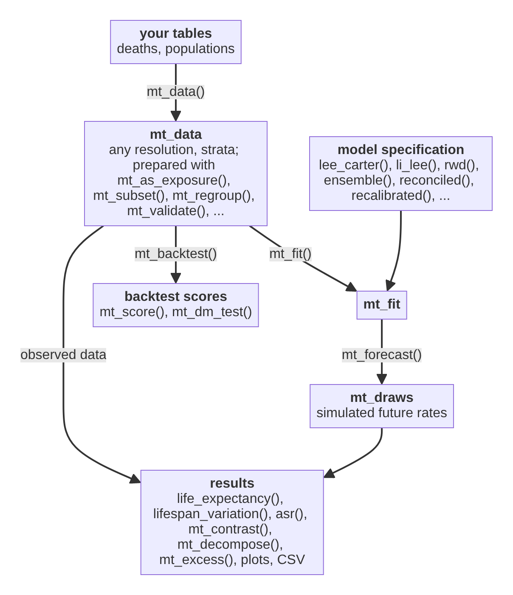

# mortensor

<!-- badges: start -->
[](https://lifecycle.r-lib.org/articles/stages.html#experimental)
[](https://github.com/kalleEF/mortensor/actions/workflows/R-CMD-check.yaml)
<!-- badges: end -->

Flexible probabilistic mortality forecasting from data observed at different
granularities: age groups and open age intervals, single or grouped periods,
population strata and causes.

mortensor has no preferred model. It implements common mortality models and
wraps others from demography, StMoMo, StanMoMo, bamp and forecast behind one interface:
every model is fitted with `mt_fit()`, forecast with `mt_forecast()` and
returns simulated paths of the same form. Models can therefore be compared in
the same backtest and combined into ensembles of any composition, and the
same steps (smoothing, jump-off, recalibration, coherent totals) apply to all
of them.

> **Caution: experimental, vibe-coded software. Use at your own risk.**
> mortensor is written largely with AI coding assistants ("vibe-coded").
> It has unit tests that check its methods against published results and
> reference implementations, but it has not been peer reviewed, its
> interfaces still change, and its results can be wrong in ways the tests
> do not catch.
> Check results independently before you use them in publications, reports
> or decisions.

**Status:** version 0.2 is a rewrite in development (see `dev/progress.md`).

## Installation

```r
# install.packages("remotes")
remotes::install_github("kalleEF/mortensor")
```

Requires R >= 4.3.0. Hard dependencies are data.table and Matrix; models and
data adapters that build on other packages (forecast, bamp, StMoMo,
StanMoMo, demography, ggplot2) use them when installed.

## What it does

| Layer | Functions |
|---|---|
| Data at any granularity | `mt_data()` (long or wide tables, symbols for suppressed cells, shared populations), `mt_add()`, `as_mt_data()` (StMoMo, demography), `mt_from_hmd()`, `mt_read_hmd()`, `mt_read_genesis()`, `mt_read_gbe()`, `mt_validate()`, `ons_data`, `de_deaths` |
| Preparation | `mt_as_exposure()`, `mt_subset()`, `mt_group_levels()` (aggregation layers: cause groups, quintiles, regions), `mt_relabel()`, `mt_fill_suppressed()` |
| Harmonisation | `mt_regroup()`, `mt_ungroup()` (penalized composite link model with exposure offset, 1D/2D; monotone interpolation; deprecated spline and GAM methods), `mt_plot_ungroup()` and `mt_ungroup_check()` (diagnostics), `mt_smooth()` (over age, over time or both; P-splines, Whittaker, GAM), `mt_smooth_check()`, `mt_plot_smooth()` |
| Preprocessing pipelines | `mt_prep()` with `step_ungroup()`, `step_smooth()`, `step_regroup()`, `step_grid()`, `step_shocks()`, `step_window()`; models fitted to smoothed rates take their observation noise from the raw rates |
| Describing the past | `mt_observed()`, `life_expectancy()`, `asr()`, `prob_dying()` on data, `mt_contrast()` (gaps, ratios), `mt_inequality()` (SII, RII), `lifespan_variation()` (e-dagger, entropy, Gini, standard deviation, IQR), `standard_population()` |
| Models | `rwd()`, `lee_carter()` (Poisson or SVD with the adjustments and period choice of demography; optional rotation of the age pattern, Li, Lee and Gerland 2013; negative binomial deaths, Delwarde, Denuit and Partrat 2007), `coda()` (compositional model of life-table deaths and its coherent version, Oeppen 2008; Bergeron-Boucher et al. 2017), `p_splines()` (two-dimensional P-splines, Currie, Durban and Eilers 2004), `cp_splines()` (constrained P-splines, Camarda 2019), `bohk_rau()` (age-specific rates of mortality improvement, Bohk-Ewald and Rau 2017), `arima_series()`, `ets_series()`, `hyndman_ullah()` (demography), `stmomo()` (APC, CBD, RH, M6, M7, M8, Plat, LC), `apci()` (age-period-cohort-improvement model, Richards et al. 2019), `stanmomo()` (LC, RH, APC, CBD and M6, Bayesian, in Stan), `li_lee()`, `cae()` (common age effect model, Kleinow 2015), `saint()` (trend of a reference population and stationary spreads, Jarner and Kryger 2011; Jarner and Jallbjørn 2022), `coherent_fdm()` (demography), `apc_bayes()` and `apc_select()` (bamp), `nordpred_apc()` (Nordpred age-period-cohort model, Møller et al. 2003); experimental: `tucker3()` (three-way Lee-Carter), `coda_multiway()` (multiway compositional model, Bergeron-Boucher et al. 2018), `coda_causes()`; deprecated: `product_ratio()`, `cause_shares()` |
| Wrappers for any model | `ensemble()` (weights from inner backtests, `top_k`), `stratified()` (different models for groups of strata), `reconciled()`, `coupled()` and `mt_couple()` (separate forecasts given the dependence of a joint model by ensemble copula coupling, Schefzik et al. 2013), `recalibrated()` (spread fitted to the errors of the last 10 years, optionally by age band or for life expectancy), `anchored()` (jump-off at the observed level), `bootstrapped()`, `tuned()` and `mt_tune()` (model and preprocessing settings chosen by forecast accuracy on the last years: hold-out or rolling origins, full or two-stage grids) |
| Coherence | `mt_hierarchy()`, `mt_aggregate_strata()`, `mt_reconcile()` and `reconciled()` (bottom-up, WLS, MinT, structural, OLS, proportional; draw by draw; non-negative; `fixed` nodes such as a trusted all-cause total; score-optimal reconciliation learnt from past forecasts, Panagiotelis et al. 2023), `mt_coherence()`, `mt_plot_coherence()`, `mt_aggregate_draws()`, `mt_order_strata()` |
| Forecasts | `mt_fit()`, `summary()`, `mt_parameters()`, `residuals()`, `mt_forecast()` (simulated paths), `mt_jump_off()`, `mt_summarise()`, `mt_deaths()`, `mt_disaggregate()` with `mt_shape_rates()` and `mt_disaggregate_check()` |
| Evaluation and comparison | `mt_backtest()` (rolling origin, no leakage; rates, life expectancy, ASR), `mt_score()` (CRPS, WIS, coverage, PIT, MAE, RMSE, MASE; also of gaps between strata), `mt_compare()` and `mt_score_table()` (several models in one backtest, by level of a hierarchy), `mt_dm_test()` (Diebold-Mariano tests of differences in accuracy), `mt_compare_forecasts()`, `mt_plot_compare()`, `mt_plot_backtest_design()`, `mt_plot_tuning()`, `mt_plot_pit()` |
| Decomposition | `mt_decompose()` (differences by age, cause and subgroup: Arriaga, Horiuchi, stepwise replacement, Kitagawa, and Arriaga meets Kitagawa for subgroup composition; on observed data, forecast draws or both), `mt_plot_decomposition()` |
| Excess mortality | `mt_excess()` (observed minus expected deaths or life expectancy, with intervals from a baseline model; by age, stratum and year, cumulative), `mt_plot_excess()` |
| Results and plots | `life_table()`, `life_expectancy()`, `prob_dying()`, `asr()`, `yll()`, `mt_contrast()`, `mt_inequality()`, `lifespan_variation()`, `mt_plot_forecast()`, `mt_plot_life_expectancy()`, `mt_plot_contrast()`, `mt_plot_scores()`, `mt_plot_shares()`, `theme_mortensor()`, `mt_export()`, `as_demogdata()`, `as_stmomodata()` |

## Function map

The objects of an analysis and the functions that connect them. The
[function map](vignettes/articles/function-map.Rmd) (on the website:
Articles, Function map) shows every function with its purpose, the
possible workflows and what the package does not cover.

<!-- Drawn from dev/diagrams/readme-function-map.mmd by dev/diagrams/render.js (an image, because
the GitHub mobile app does not draw Mermaid diagrams) -->
<p align="center">

</p>

## Example

```r
library(mortensor)

# deaths and populations by sex, age group and deprivation decile, England
# 2001-2019 (ONS; Open Government Licence)
x <- mt_data(deaths = ons_data, population = ons_data, by = c("sex", "imd_decile"),
             age = "age_group", value = c(deaths = "all_causes", population = "population"))
x <- mt_as_exposure(x, type = "midyear")
# deciles to quintiles: an aggregation layer with its own name
x <- mt_group_levels(x, "imd_decile", function(d) paste0("Q", ceiling(as.numeric(d) / 2)),
                     name = "quintile")
mt_validate(x)

fit <- mt_fit(li_lee(common_by = "sex"), x)
fc <- mt_forecast(fit, h = 15, n_draws = 500, seed = 1)
life_expectancy(fc, at = 0)

bt <- mt_backtest(li_lee(common_by = "sex"), x, origins = 2008:2014, h = 5)
mt_score(bt)
```

Vignettes:

* **Start**: *Getting started*, *Your own data, from CSV to report*.
* **Concepts, one at a time**: *Ungrouping age groups: methods and diagnostics*,
  *Smoothing death rates*, *Where a forecast starts: the jump-off*,
  *Backtesting and scores*, *Tuning and recalibration*, *Coherent forecasts:
  totals and their parts*, *Decomposing differences in life expectancy*.
* **Models**: *Choosing and combining models* (implemented and wrapped
  models side by side, ensembles of any combination), *Model reference*,
  *Bayesian age-period-cohort models with bamp*, *Comparison with
  demography, bamp and StMoMo*.
* **Applications**: *Inequality in England: life expectancy and causes of
  death by deprivation* (ONS), *Differences between the German Laender*
  (Destatis).
* **Help**: *Frequently asked questions*, *Function map*.

## Development

See `CLAUDE.md` for conventions and commands, and
`dev/implementation-plan.md` for the plan.

## Licence

GPL-3.
