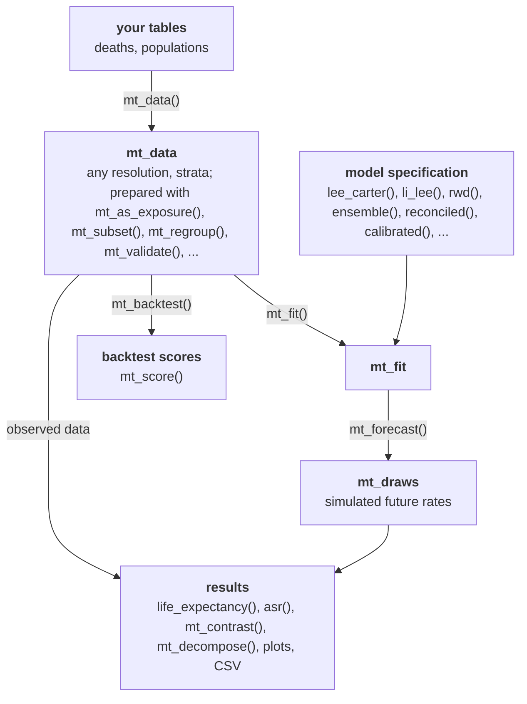

# mortensor

<!-- badges: start -->
[](https://lifecycle.r-lib.org/articles/stages.html#experimental)
[](https://github.com/kalleEF/mortensor/actions/workflows/R-CMD-check.yaml)
[](https://github.com/kalleEF/mortensor/actions/workflows/validation.yaml)
<!-- badges: end -->

Flexible probabilistic mortality forecasting from data observed at different
granularities: age groups and open age intervals, single or grouped periods,
population strata and causes.

> **Caution: experimental, vibe-coded software. Use at your own risk.**
> mortensor is written largely with AI coding assistants ("vibe-coded").
> It has unit tests and a validation pipeline with thresholds (see
> `validation/`), but it has not been peer reviewed, its interfaces still
> change, and its results can be wrong in ways the tests do not catch.
> Check results independently before you use them in publications, reports
> or decisions.

**Status:** version 0.2 is a rewrite in development (see `dev/progress.md`).

## Installation

```r
# install.packages("remotes")
remotes::install_github("kalleEF/mortensor")
```

Requires R >= 4.3.0. Hard dependencies are data.table and Matrix; models and
data adapters that build on other packages (forecast, bamp, StMoMo,
demography, ggplot2) use them when installed.

## What it does

| Layer | Functions |
|---|---|
| Data at any granularity | `mt_data()` (long or wide tables, symbols for suppressed cells, shared populations), `mt_add()`, `as_mt_data()` (StMoMo, demography), `mt_from_hmd()`, `mt_read_hmd()`, `mt_read_genesis()`, `mt_read_gbe()`, `mt_validate()`, `ons_data`, `de_deaths` |
| Preparation | `mt_as_exposure()`, `mt_subset()`, `mt_group_levels()` (aggregation layers: cause groups, quintiles, regions), `mt_relabel()`, `mt_fill_suppressed()` |
| Harmonisation | `mt_regroup()`, `mt_ungroup()` (penalized composite link model with exposure offset, 1D/2D; spline and GAM methods), `mt_smooth()` (over age, over time or both; P-splines, Whittaker, GAM), `mt_smooth_check()`, `mt_plot_smooth()` |
| Preprocessing pipelines | `mt_prep()` with `step_ungroup()`, `step_smooth()`, `step_regroup()`, `step_grid()`, `step_shocks()`, `step_window()`; models fitted to smoothed rates take their observation noise from the raw rates |
| Describing the past | `mt_observed()`, `life_expectancy()`, `asr()`, `prob_dying()` on data, `mt_contrast()` (gaps, ratios), `mt_inequality()` (SII, RII), `standard_population()` |
| Models | `rwd()`, `lee_carter()` (Poisson or SVD with the adjustments and period choice of demography), `tucker3()`, `arima_series()`, `ets_series()`, `hyndman_ullah()` (demography), `stmomo()` (APC, CBD, RH, M6, LC), `li_lee()`, `product_ratio()`, `apc_bayes()` and `apc_select()` (bamp), `cause_shares()` |
| Wrappers for any model | `ensemble()` (weights from inner backtests, `top_k`), `reconciled()`, `calibrated()` (spread fitted to the errors of the last 10 years), `anchored()` (jump-off at the observed level), `bootstrapped()`, `tuned()` and `mt_tune()` (full or two-stage grids) |
| Coherence | `mt_hierarchy()`, `mt_aggregate_strata()`, `mt_reconcile()` and `reconciled()` (bottom-up, WLS, MinT, structural, OLS, proportional; draw by draw; non-negative; `fixed` nodes such as a trusted all-cause total), `mt_coherence()`, `mt_plot_coherence()`, `mt_aggregate_draws()`, `mt_order_strata()` |
| Forecasts | `mt_fit()`, `summary()`, `mt_parameters()`, `residuals()`, `mt_forecast()` (simulated paths), `mt_jump_off()`, `mt_summarise()`, `mt_deaths()`, `mt_disaggregate()` with `mt_shape_rates()` and `mt_disaggregate_check()` |
| Evaluation | `mt_backtest()` (rolling origin, no leakage; rates, life expectancy, ASR), `mt_score()` (CRPS, WIS, coverage, PIT, MASE) |
| Decomposition | `mt_decompose()` (differences by age, cause and subgroup: Arriaga, Horiuchi, stepwise replacement, Kitagawa, and Arriaga meets Kitagawa for subgroup composition; on observed data, forecast draws or both), `mt_plot_decomposition()` |
| Results and plots | `life_table()`, `life_expectancy()`, `prob_dying()`, `asr()`, `yll()`, `mt_contrast()`, `mt_inequality()`, `mt_plot_forecast()`, `mt_plot_life_expectancy()`, `mt_plot_scores()`, `mt_plot_shares()`, `theme_mortensor()`, `mt_export()`, `as_demogdata()`, `as_stmomodata()` |

## Function map

The objects of an analysis and the functions that connect them. The
[function map](vignettes/articles/function-map.Rmd) (on the website:
Articles, Function map) shows every function with its purpose, the
possible workflows and what the package does not cover.



## Example

```r
library(mortensor)

# deaths and populations by sex, age group and deprivation decile, England
# 2001-2019 (ONS; Open Government Licence)
x <- mt_data(deaths = ons_data, population = ons_data, by = c("sex", "imd_decile"),
             age = "age_group", value = c(deaths = "all_causes", population = "population"))
x <- mt_as_exposure(x, type = "midyear")
# deciles to quintiles: an aggregation layer with its own name
x <- mt_group_levels(x, "imd_decile", function(d) paste0("Q", ceiling(as.numeric(d) / 2)),
                     name = "quintile")
mt_validate(x)

fit <- mt_fit(li_lee(common_by = "sex"), x)
fc <- mt_forecast(fit, h = 15, n_draws = 500, seed = 1)
life_expectancy(fc, at = 0)

bt <- mt_backtest(li_lee(common_by = "sex"), x, origins = 2008:2014, h = 5)
mt_score(bt)
```

Vignettes: *Getting started* (ONS deprivation data), *Your own data, from
CSV to report*, *Forecasting mortality by deprivation quintile*, *Causes of
death by deprivation*, *Coherent forecasts by sex, region and cause* (German
Laender), *Coherent forecasts: what reconciliation changes*, *Decomposing
differences in life expectancy*, *Model reference*, *Data at
different granularities* and *Forecasting and backtesting* (HMD data),
*Bayesian age-period-cohort models with bamp*, *Comparison with demography,
bamp and StMoMo*, *Frequently asked questions*.

## Development

See `CLAUDE.md` for conventions and commands, `validation/README.md` for the
validation pipeline, and `dev/implementation-plan.md` for the plan.

## Licence

GPL-3.
