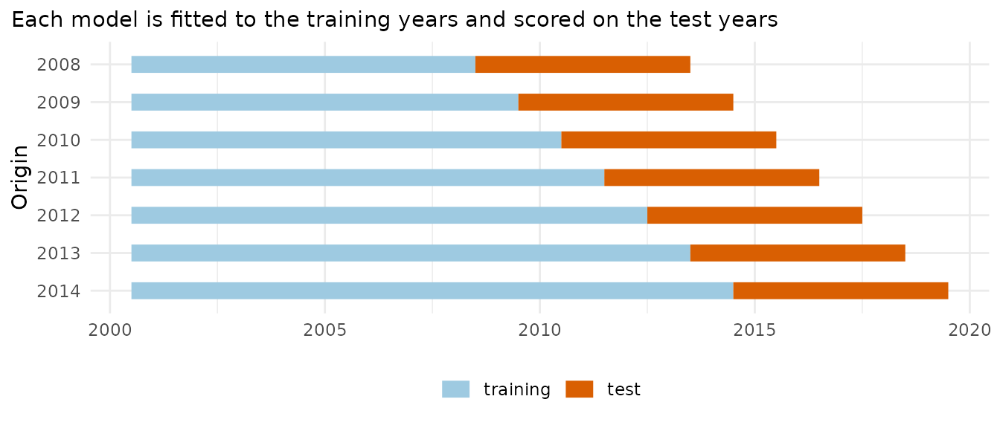
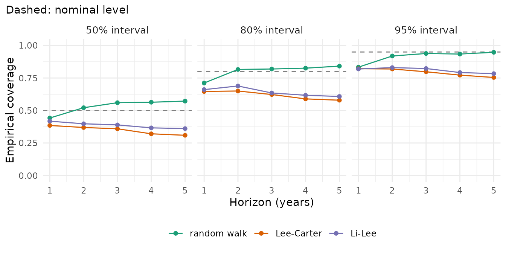
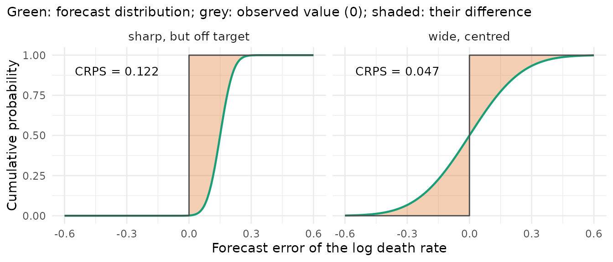
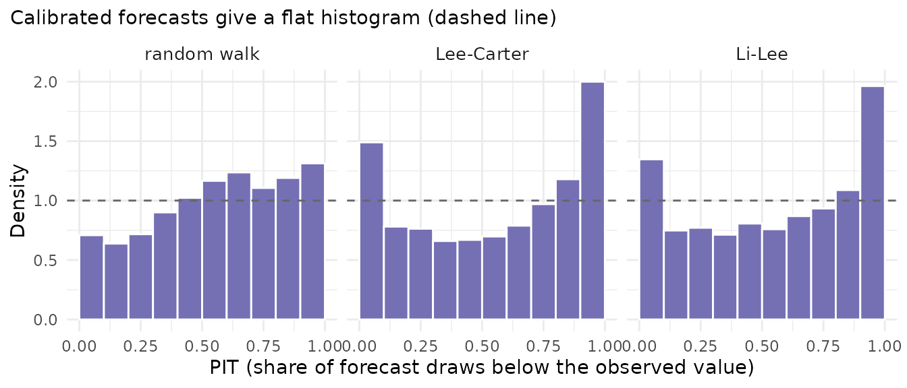
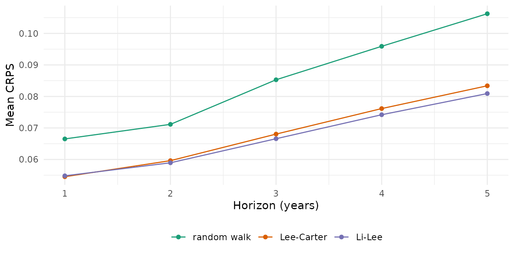

# Backtesting and scores

How good is a forecast? The future is unknown, but the past can be used
as a test: fit a model to the years up to some year in the past (the
*origin*), forecast the following years, and compare the forecast with
what was observed. Repeating this from several origins gives a
*rolling-origin backtest* (Tashman 2000). This vignette explains the
design and the scores, and compares three models on one data set.

## Data and models

Deaths and populations in England by sex and deprivation quintile,
2001-2019 (ONS). Three models, chosen as examples:

- a **random walk with drift** per age ([`rwd()`](../reference/rwd.md)):
  each log rate continues its average change of the past. It is a
  standard benchmark in forecasting: a model that does not beat it adds
  little;
- **Lee-Carter** ([`lee_carter()`](../reference/lee_carter.md)), one
  model per stratum;
- **Li-Lee** (`li_lee(common_by = "sex")`), quintiles of each sex pooled
  around a common trend.

``` r

library(mortensor)
library(data.table)
x <- mt_data(deaths = ons_data, population = ons_data, by = c("sex", "imd_decile"), age = "age_group",
             value = c(deaths = "all_causes", population = "population"))
x <- mt_as_exposure(x, type = "midyear")
x <- mt_group_levels(x, "imd_decile", function(d) paste0("Q", ceiling(as.numeric(d) / 2)), name = "quintile")
models <- list("random walk" = rwd(), "Lee-Carter" = lee_carter(), "Li-Lee" = li_lee(common_by = "sex"))
```

## The design

Seven origins, 2008 to 2014, each forecasting five years:

``` r

mt_plot_backtest_design(x, origins = 2008:2014, h = 5)
```



Every model, and every preprocessing step such as smoothing, is fitted
anew at each origin from the training years only, so no information from
the test years leaks into the forecast. Each test year is forecast
several times from different origins and horizons, which averages over
the particular events of a single period.

``` r

bt <- mt_compare(models, x, origins = 2008:2014, h = 5, n_draws = 200, quantities = "life_expectancy")
#> Warning in report_fit_problems(diagnostics, spec$label, classes): Li-Lee
#> (common by sex): Li-Lee: the AR(1) coefficient of the stratum index is bounded
#> at |phi| = 0.99 in 1 stratum/strata (female.Q4): their deviations from the
#> common trend are close to a unit root and revert very slowly; coherence may not
#> suit them. (diagnostics of 10 stratum/strata of the fit).
#> Warning in report_fit_problems(diagnostics, spec$label, classes): Li-Lee
#> (common by sex): Li-Lee: the AR(1) coefficient of the stratum index is bounded
#> at |phi| = 0.99 in 1 stratum/strata (female.Q4): their deviations from the
#> common trend are close to a unit root and revert very slowly; coherence may not
#> suit them. (diagnostics of 10 stratum/strata of the fit).
```

The forecasts are *predictive*: they describe the observed death rates
of the test years, including the Poisson noise of the counts, because
the observed rates are what they are compared with.

## Scores

### Interval coverage

A 95% interval should contain the observed value in about 95% of the
cases. The *empirical coverage* is the share of observed values inside
the interval: below the nominal level, the intervals are too narrow;
above it, too wide.

``` r

mt_plot_coverage(bt)
```



Coverage alone can be gamed: a very wide interval always covers. It is
read together with a score that also rewards narrow intervals.

### CRPS

The continuous ranked probability score (CRPS) compares the whole
forecast distribution with the observed value: it is the integral of the
squared difference between the forecast’s cumulative distribution and a
step at the observed value (Gneiting and Raftery 2007). The figure
shades the difference between the two curves; squared and summed over
the axis, it gives the CRPS:



A forecast that puts its probability close to the observed value has a
small area. The CRPS punishes both a distribution that is off target and
one that is wider than necessary. For a forecast without uncertainty it
equals the absolute error, so it is in the unit of the forecast
quantity: for log death rates, a CRPS of 0.05 means errors of roughly 5%
of the rate; for life expectancy it is in years. Lower is better.

The *weighted interval score* (WIS, Bracher et al. 2021) approximates
the CRPS from a few central intervals; it is reported as well and ranks
models in the same way.

### Point errors

`mae` and `rmse` are the mean absolute and the root mean squared error
of the forecast median: they ignore the intervals. `mase` divides the
absolute error by the mean absolute year-to-year change of the training
data (Hyndman and Koehler 2006): below 1, the forecast errs less than
the typical change of a single year.

### PIT

The probability integral transform (PIT) is the share of forecast draws
below the observed value. For calibrated forecasts it is spread evenly
between 0 and 1, so its histogram is flat. A U shape means that the
observed values often fall in the tails, outside intervals that are too
narrow; a slope means that the forecasts are systematically too high or
too low (Gneiting, Balabdaoui and Raftery 2007).

``` r

mt_plot_pit(bt)
```



All three histograms rise to the right: the observed rates were more
often above the forecast median than below it. The forecasts were too
optimistic, because the decline of mortality in England slowed after
2011. Lee-Carter and Li-Lee also pile up at both ends (a U shape): their
intervals are too narrow.

## Comparing the models

``` r

mt_score_table(bt, metrics = c("crps", "rmse", "cov80", "cov95"))
#>          model   crps  rmse cov80 cov95 crps_le rmse_le cov80_le cov95_le
#>         <fctr>  <num> <num> <num> <num>   <num>   <num>    <num>    <num>
#> 1: random walk 0.0850 0.180 0.803 0.915   0.293   0.503    0.603    0.820
#> 2:  Lee-Carter 0.0683 0.139 0.618 0.793   0.293   0.508    0.620    0.814
#> 3:      Li-Lee 0.0671 0.132 0.642 0.810   0.338   0.603    0.611    0.806
```

The columns without suffix score the log death rates of all cells; the
columns with `_le` score life expectancy at birth (in years), computed
from the same forecasts. Rates and life expectancy can rank models
differently, because life expectancy depends on how the errors of the
ages add up: for the rates Li-Lee is the most accurate (CRPS 0.067) and
the random walk the least (0.085), for life expectancy the random walk
and Lee-Carter are equal (0.29 years) and Li-Lee is the least accurate
(0.34 years). Choose the target that the analysis is about.

``` r

mt_plot_scores(bt)
```



All three models get worse with the horizon, as they should. The random
walk has wide intervals: its 95% coverage is close to nominal (0.92),
and its 50% and 80% intervals cover about as often as they should. The
95% intervals of Lee-Carter and Li-Lee cover 0.79 and 0.81 of the
observed rates, fewer at longer horizons: they describe the uncertainty
of a fixed trend and the Poisson noise of the deaths, while the trend of
English mortality changed after 2011. “Tuning and recalibration” shows
how to widen intervals to the errors of recent forecasts, and “Choosing
and combining models” how mixtures of models do.

### Life expectancy by horizon

Raftery et al. (2013) check probabilistic forecasts of life expectancy
by the coverage of their 80%, 90% and 95% intervals and by the
standardised absolute predictive error (SAPE): the absolute error of the
median, divided by the standard deviation of the forecast distribution
and multiplied by `sqrt(pi / 2)`. Its mean is 1 when the forecast
distribution is correct and normal; above 1, the intervals are too
narrow. `measures` adds both to
[`mt_score()`](../reference/mt_score.md):

``` r

s <- mt_score(bt, by = c("model", "horizon"), target = "life_expectancy", measures = c("sape", "cov90"))
s[, list(model, horizon, mae, sape, cov80, cov90, cov95)]
#>           model horizon       mae     sape     cov80     cov90     cov95
#>          <fctr>   <num>     <num>    <num>     <num>     <num>     <num>
#>  1: random walk       1 0.2253386 1.430122 0.6428571 0.7000000 0.7571429
#>  2: random walk       2 0.3047631 1.302902 0.6000000 0.7714286 0.8857143
#>  3: random walk       3 0.4087531 1.373876 0.5714286 0.7571429 0.8428571
#>  4: random walk       4 0.5226022 1.440622 0.5857143 0.7142857 0.7857143
#>  5: random walk       5 0.5906862 1.388070 0.6142857 0.7000000 0.8285714
#>  6:  Lee-Carter       1 0.2237034 1.369782 0.6428571 0.7000000 0.7857143
#>  7:  Lee-Carter       2 0.2988562 1.294863 0.6714286 0.8428571 0.9000000
#>  8:  Lee-Carter       3 0.3997773 1.383686 0.6000000 0.7571429 0.8571429
#>  9:  Lee-Carter       4 0.5270525 1.550064 0.5714286 0.7285714 0.8000000
#> 10:  Lee-Carter       5 0.6168905 1.594811 0.6142857 0.6714286 0.7285714
#> 11:      Li-Lee       1 0.2671036 1.395208 0.6285714 0.7000000 0.8285714
#> 12:      Li-Lee       2 0.3352442 1.273501 0.6571429 0.7428571 0.8428571
#> 13:      Li-Lee       3 0.4615053 1.404290 0.6285714 0.7571429 0.8000000
#> 14:      Li-Lee       4 0.5857525 1.536526 0.6000000 0.6857143 0.7857143
#> 15:      Li-Lee       5 0.6797984 1.568170 0.5428571 0.6857143 0.7714286
```

The mean SAPE is 1.3 to 1.6 for all three models at every horizon: the
errors of life expectancy are larger than the spread of the forecasts
implies, and the 90% intervals hold 67% to 84% of the observed values.
Raftery et al. report a mean SAPE of 1.04 for their model of male life
expectancy at birth, out of sample over ten years.

### Revisions between origins

A forecast also changes when a year of data is added. Stoeldraijer et
al. (2013) name robustness as a purpose of a forecast: small changes in
the observations should change the forecast only modestly. They give no
measure. `measures = "revision"` gives the mean absolute change of the
forecast median of each cell (stratum, age group, year) between
consecutive origins, a measure of this package:

``` r

mt_score(bt, measures = "revision")[, list(model, crps, revision)]
#>          model       crps   revision
#>         <fctr>      <num>      <num>
#> 1: random walk 0.08502155 0.11590834
#> 2:  Lee-Carter 0.06834583 0.03739882
#> 3:      Li-Lee 0.06709049 0.03414229
mt_score(bt, target = "life_expectancy", measures = "revision")[, list(model, crps, revision)]
#>          model      crps  revision
#>         <fctr>     <num>     <num>
#> 1: random walk 0.2934839 0.2303523
#> 2:  Lee-Carter 0.2925671 0.2187877
#> 3:      Li-Lee 0.3379676 0.2452118
```

The random walk revises its forecasts of the log rates by 0.12 per added
year, three times as much as Lee-Carter (0.037) and Li-Lee (0.034). It
starts from the observed rates of the last year, so their noise moves
the whole forecast; the two models start from fitted rates. For life
expectancy the revisions are alike (0.22 to 0.25 years), because the
noise of the single age groups averages out. Accuracy and robustness can
conflict (Stoeldraijer et al. 2013); here Li-Lee forecasts the rates
both most accurately and most robustly.

## Is the difference larger than chance?

Mean scores over seven origins depend on the particular years. The
Diebold-Mariano test (Diebold and Mariano 1995) asks whether two models
differ in accuracy by more than the origins vary.
[`mt_dm_test()`](../reference/mt_dm_test.md) computes it for each
horizon from the mean score of each origin, so the many cells of one
forecast count once. Forecasts from neighbouring origins overlap in
their test years, so the differences between origins are autocorrelated.
By default the test estimates their variance with the equal-weighted
cosine (EWC) estimator and takes critical values from a t distribution
with few degrees of freedom (Lazarus et al. 2018).
`varestimator = "daniell"` gives the fixed-smoothing test of Coroneo and
Iacone (2020) with a Daniell-kernel estimate. The older version, with
the autocovariances up to lag `h - 1` and the small-sample correction of
Harvey, Leybourne and Newbold (1997), rejects a true null hypothesis too
often with few overlapping origins: in simulations with seven origins,
in 10% to 19% of the samples at the nominal 5% level, and in 27% with
the fallback to lag 0 of
[`forecast::dm.test()`](https://pkg.robjhyndman.com/forecast/reference/dm.test.html)
(see [`?mt_dm_test`](../reference/mt_dm_test.md); `varestimator = "acf"`
gives that version without the fallback).

``` r

dm <- mt_dm_test(bt, ref = "Li-Lee")
dm[target == "rate", list(model, horizon, mean_diff, statistic, df, p_value)]
#>           model horizon     mean_diff   statistic    df     p_value
#>          <char>  <fctr>         <num>       <num> <num>       <num>
#>  1: random walk       1  0.0117078512 11.17200995     1 0.056832004
#>  2: random walk       2  0.0121981051 11.66561874     1 0.054439227
#>  3: random walk       3  0.0187062941 85.80335706     1 0.007419185
#>  4: random walk       4  0.0217150706 10.36381867     1 0.061237567
#>  5: random walk       5  0.0253279342  4.59073526     1 0.136541937
#>  6: random walk     all  0.0179310510  9.03410903     1 0.070182752
#>  7:  Lee-Carter       1 -0.0002869724 -0.09908812     1 0.937123793
#>  8:  Lee-Carter       2  0.0006775856  0.18437807     1 0.883924895
#>  9:  Lee-Carter       3  0.0014679661  0.46086351     1 0.725074982
#> 10:  Lee-Carter       4  0.0019556634  0.81081784     1 0.566269381
#> 11:  Lee-Carter       5  0.0024624184  0.80790403     1 0.567390174
#> 12:  Lee-Carter     all  0.0012553322  0.41249759     1 0.750933008
```

A positive `mean_diff` means a higher CRPS than Li-Lee, so a less
accurate forecast. Li-Lee forecast the rates more accurately than the
random walk at every horizon, with p-values from 0.007 to 0.14 (0.07
over all horizons). Li-Lee and Lee-Carter differ little, with p-values
from 0.57 to 0.94: this backtest cannot tell them apart.

``` r

dm[target == "life_expectancy", list(model, horizon, mean_diff, statistic, p_value)]
#>           model horizon   mean_diff  statistic   p_value
#>          <char>  <fctr>       <num>      <num>     <num>
#>  1: random walk       1 -0.03123928 -1.5703335 0.3609921
#>  2: random walk       2 -0.02758071 -1.0405313 0.4873564
#>  3: random walk       3 -0.03273421 -0.8868458 0.5381325
#>  4: random walk       4 -0.04788062 -1.0613540 0.4810573
#>  5: random walk       5 -0.08298369 -2.0305517 0.2913243
#>  6: random walk     all -0.04448370 -1.3138241 0.4141789
#>  7:  Lee-Carter       1 -0.03662197 -1.4811578 0.3780573
#>  8:  Lee-Carter       2 -0.03362929 -1.1732706 0.4493507
#>  9:  Lee-Carter       3 -0.04370171 -1.5140826 0.3715934
#> 10:  Lee-Carter       4 -0.04705685 -1.8454361 0.3161362
#> 11:  Lee-Carter       5 -0.06599281 -3.3113667 0.1867089
#> 12:  Lee-Carter     all -0.04540053 -1.7779056 0.3261777
```

For life expectancy, the random walk and Lee-Carter were more accurate
than Li-Lee at every horizon, but no difference is significant (p-values
from 0.19 to 0.54). With seven origins the test has one degree of
freedom (`df`) and detects only large and consistent differences. The
row `"all"` averages over the horizons.

## How far to trust a backtest

- Seven origins of one country are few, and the test years overlap; a
  difference of a few percent in the CRPS can be noise, as
  [`mt_dm_test()`](../reference/mt_dm_test.md) shows.
- A backtest scores the past. If the future differs from the test period
  (a pandemic, a policy change), so will the accuracy.
- Compare models on the same origins, horizons and cells, as
  [`mt_compare()`](../reference/mt_compare.md) does. Suppressed cells
  that were estimated are not scored.

## References

Bracher J, Ray EL, Gneiting T, Reich NG (2021). Evaluating epidemic
forecasts in an interval format. *PLoS Computational Biology* 17(2):
e1008618.

Coroneo L, Iacone F (2020). Comparing predictive accuracy in small
samples using fixed-smoothing asymptotics. *Journal of Applied
Econometrics* 35(4): 391-409.

Diebold FX, Mariano RS (1995). Comparing predictive accuracy. *Journal
of Business & Economic Statistics* 13(3): 253-263.

Gneiting T, Balabdaoui F, Raftery AE (2007). Probabilistic forecasts,
calibration and sharpness. *Journal of the Royal Statistical Society
Series B* 69(2): 243-268.

Gneiting T, Raftery AE (2007). Strictly proper scoring rules,
prediction, and estimation. *Journal of the American Statistical
Association* 102(477): 359-378.

Harvey D, Leybourne S, Newbold P (1997). Testing the equality of
prediction mean squared errors. *International Journal of Forecasting*
13(2): 281-291.

Hyndman RJ, Koehler AB (2006). Another look at measures of forecast
accuracy. *International Journal of Forecasting* 22(4): 679-688.

Lazarus E, Lewis DJ, Stock JH, Watson MW (2018). HAR inference:
recommendations for practice. *Journal of Business & Economic
Statistics* 36(4): 541-559.

Raftery AE, Chunn JL, Gerland P, Ševčíková H (2013). Bayesian
probabilistic projections of life expectancy for all countries.
*Demography* 50(3): 777-801.

Stoeldraijer L, van Duin C, van Wissen L, Janssen F (2013). Impact of
different mortality forecasting methods and explicit assumptions on
projected future life expectancy: the case of the Netherlands.
*Demographic Research* 29(13): 323-354.

Tashman LJ (2000). Out-of-sample tests of forecasting accuracy: an
analysis and review. *International Journal of Forecasting* 16(4):
437-450.
