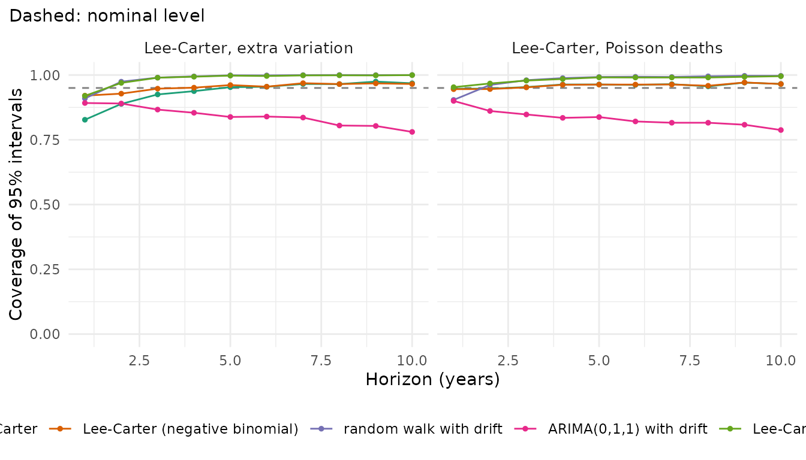
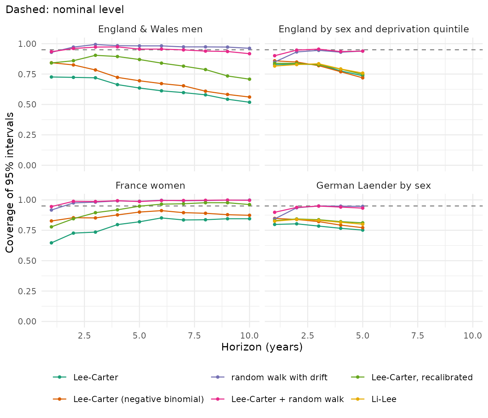

# Benchmarks: how well the pipeline works

How well does the pipeline of mortensor work? This vignette reports
three benchmarks:

1.  **Known truth**: on data simulated from the Lee-Carter model, do the
    forecast intervals contain the true future rates as often as they
    claim?
2.  **Real data**: how accurate and how well calibrated are the standard
    models on four data sets, in rolling-origin backtests?
3.  **Defective input**: what does mortensor do with tables that contain
    typical errors?

The results describe these data and years. They do not tell how a model
will do on other data; a backtest on your own data does
([`mt_backtest()`](../reference/mt_backtest.md), “Backtesting and
scores”). The computations take about a quarter of an hour and are run
by `dev/benchmarks.R` in the source repository; this vignette shows the
code and reads the stored results. Run on:

``` r

res$settings[c("date", "versions")]
#> $date
#> [1] "2026-10-26"
#> 
#> $versions
#>  mortensor     StMoMo demography   forecast 
#>    "0.3.0"    "0.4.1"    "2.0.1"   "8.21.1"
```

Other vignettes hold further benchmarks: “Comparison with demography,
bamp and StMoMo” (the same models in other packages), “Choosing and
combining models” (eleven models on England & Wales), “Ungrouping age
groups: methods and diagnostics” (errors against known single years),
“Tuning and recalibration” and “Dependence between groups” (totals and
gaps).

The scores are those of [`mt_score()`](../reference/mt_score.md): the
CRPS of the log death rates (lower is better; Gneiting and Raftery 2007)
and the coverage of the central 50%, 80% and 95% intervals, the share of
observed values inside them. Well calibrated intervals cover close to
their nominal level. All forecasts are predictive draws: rates with the
variation of the deaths that the model assumes.

## Known truth: data simulated from the model

[`simulate_lc_dgp()`](../reference/simulate_lc_dgp.md) simulates deaths
for 10 strata (two sexes, five quintiles) and 13 five-year age groups
from 30 to 94: each stratum has the age pattern of a Lee-Carter model
and its own period index, a random walk with drift, and the deaths are
Poisson with the expected counts of the model. Two versions:

- **Poisson deaths**: the model of
  [`lee_carter()`](../reference/lee_carter.md) holds exactly;
- **extra variation**: independent normal noise with standard deviation
  0.03 on the log rate of every cell, a source of variation that only
  the negative binomial Lee-Carter model describes.

Each model is fitted to 30 years and forecasts the next 10, in 20
replicates with different random data.

``` r

generators <- list("Lee-Carter, Poisson deaths" = 0, "Lee-Carter, extra variation" = 0.03)
models <- list("Lee-Carter" = lee_carter(), "Lee-Carter (negative binomial)" = lee_carter(family = "nb"),
               "random walk with drift" = rwd(),
               "ARIMA(0,1,1) with drift" = arima_series(order = c(0, 1, 1), drift = TRUE),
               "Lee-Carter + random walk" = ensemble(lc = lee_carter(), rw = rwd()))
sim <- rbindlist(lapply(names(generators), function(g) {
  rbindlist(lapply(1:20, function(r) {
    x <- mortensor:::simulate_lc_dgp(n_t = 40, seed = 1000 + r, sd_obs = generators[[g]])
    bt <- mt_compare(models, x, origins = 2030, h = 10, n_draws = 500, seed = r)
    cbind(generator = g, rep = r, as.data.table(bt))
  }))
}))
sim[, mt_score(.SD, by = "model"), by = generator]
```

``` r

knitr::kable(res$sim$overall[, .(generator, model, CRPS = fmt(crps, 4), `50%` = fmt(cov50), `80%` = fmt(cov80),
                                 `95%` = fmt(cov95))])
```

| generator | model | CRPS | 50% | 80% | 95% |
|:---|:---|:---|:---|:---|:---|
| Lee-Carter, Poisson deaths | Lee-Carter | 0.0351 | 0.498 | 0.815 | 0.959 |
| Lee-Carter, Poisson deaths | Lee-Carter (negative binomial) | 0.0351 | 0.498 | 0.814 | 0.959 |
| Lee-Carter, Poisson deaths | random walk with drift | 0.0424 | 0.634 | 0.904 | 0.980 |
| Lee-Carter, Poisson deaths | ARIMA(0,1,1) with drift | 0.0393 | 0.397 | 0.660 | 0.833 |
| Lee-Carter, Poisson deaths | Lee-Carter + random walk | 0.0370 | 0.584 | 0.888 | 0.983 |
| Lee-Carter, extra variation | Lee-Carter | 0.0407 | 0.505 | 0.794 | 0.936 |
| Lee-Carter, extra variation | Lee-Carter (negative binomial) | 0.0403 | 0.524 | 0.816 | 0.953 |
| Lee-Carter, extra variation | random walk with drift | 0.0541 | 0.729 | 0.942 | 0.987 |
| Lee-Carter, extra variation | ARIMA(0,1,1) with drift | 0.0443 | 0.387 | 0.659 | 0.841 |
| Lee-Carter, extra variation | Lee-Carter + random walk | 0.0442 | 0.636 | 0.918 | 0.986 |

``` r

cov_plot(res$sim$by_horizon, ~ generator)
```



With Poisson deaths, the intervals of
[`lee_carter()`](../reference/lee_carter.md) cover 49.8%, 81.5% and
95.9% of the true future rates, close to the nominal 50%, 80% and 95%,
at every horizon (95% coverage 0.947 at one year ahead, 0.965 at ten).
This is the check that the pipeline is correct: fitting, the forecast of
the period index with its drift uncertainty, and the Poisson variation
of the predictive draws together give intervals of the right width when
the model is true. The negative binomial version estimates no
overdispersion here and gives the same forecasts.

With extra variation, Lee-Carter is too narrow at short horizons (95%
coverage 0.83 one year ahead), where the variation of single years
matters most; the negative binomial version describes it (0.953 overall)
and has the lowest CRPS. The random walk with drift over-covers (95%
coverage 0.98 to 0.99): the Poisson noise of the observed rates enters
every year-to-year change and accumulates in its forecasts. ARIMA(0,1,1)
with drift separates that noise from the trend but under-covers (0.83 to
0.84). The mixture of Lee-Carter and the random walk is wider than
Lee-Carter and over-covers too: a mixture of well calibrated components
is too wide (Gneiting and Ranjan 2013).

## Real data: rolling-origin backtests

Four data sets, with rolling origins and the horizons used in the other
vignettes. England & Wales and France are Human Mortality Database data
from StMoMo and demography; England by deprivation and the German
Laender are the package data (`ons_data`; `de_deaths`, `de_population`
with suppressed counts estimated as in “Differences between the German
Laender”). The models are the starting points of the FAQ (“Which model
should I use?”): Lee-Carter with Poisson or negative binomial deaths,
the random walk with drift, their equal-weight mixture, Lee-Carter with
intervals recalibrated to its errors in the last ten training years,
and, where there are several groups, Li-Lee with a common trend per sex.

``` r

knitr::kable(rbindlist(lapply(res$real, function(s) {
  data.table(data = s$label, strata = s$n_strata, ages = paste0(s$ages[1], "-", s$ages[2], "+"),
             years = paste(s$periods, collapse = "-"), origins = paste(range(s$origins), collapse = "-"),
             horizon = s$h)
})))
```

| data | strata | ages | years | origins | horizon |
|:---|---:|:---|:---|:---|---:|
| England & Wales men | 1 | 0-100+ | 1961-2011 | 1996-2001 | 10 |
| France women | 1 | 0-99+ | 1950-2006 | 1991-1996 | 10 |
| England by sex and deprivation quintile | 10 | 0-90+ | 2001-2019 | 2010-2014 | 5 |
| German Laender by sex | 32 | 0-90+ | 1998-2019 | 2010-2014 | 5 |

``` r

single <- list("Lee-Carter" = lee_carter(), "Lee-Carter (negative binomial)" = lee_carter(family = "nb"),
               "random walk with drift" = rwd(), "Lee-Carter + random walk" = ensemble(lc = lee_carter(), rw = rwd()),
               "Lee-Carter, recalibrated" = recalibrated(lee_carter()))
joint <- c(single, list("Li-Lee" = li_lee(common_by = "sex")))
ew <- as_mt_data(StMoMo::EWMaleData)
bt_ew <- mt_compare(single, ew, origins = 1996:2001, h = 10, n_draws = 300, quantities = "life_expectancy")
mt_score(bt_ew)
mt_score(bt_ew, target = "life_expectancy")
```

Death rates (CRPS of log rates; coverage of the 50%, 80% and 95%
intervals):

``` r

rate <- rbindlist(lapply(res$real, function(s) cbind(data = s$label, s$rate)))
knitr::kable(rate[, .(data, model, CRPS = fmt(crps, 4), `50%` = fmt(cov50), `80%` = fmt(cov80),
                      `95%` = fmt(cov95))])
```

| data | model | CRPS | 50% | 80% | 95% |
|:---|:---|:---|:---|:---|:---|
| England & Wales men | Lee-Carter | 0.0827 | 0.235 | 0.445 | 0.632 |
| England & Wales men | Lee-Carter (negative binomial) | 0.0816 | 0.277 | 0.506 | 0.695 |
| England & Wales men | random walk with drift | 0.0756 | 0.604 | 0.861 | 0.972 |
| England & Wales men | Lee-Carter + random walk | 0.0716 | 0.435 | 0.773 | 0.949 |
| England & Wales men | Lee-Carter, recalibrated | 0.0782 | 0.338 | 0.617 | 0.825 |
| France women | Lee-Carter | 0.0860 | 0.337 | 0.586 | 0.794 |
| France women | Lee-Carter (negative binomial) | 0.0766 | 0.434 | 0.695 | 0.876 |
| France women | random walk with drift | 0.0728 | 0.729 | 0.935 | 0.984 |
| France women | Lee-Carter + random walk | 0.0692 | 0.596 | 0.914 | 0.988 |
| France women | Lee-Carter, recalibrated | 0.0841 | 0.485 | 0.769 | 0.923 |
| England by sex and deprivation quintile | Lee-Carter | 0.0671 | 0.343 | 0.615 | 0.800 |
| England by sex and deprivation quintile | Lee-Carter (negative binomial) | 0.0682 | 0.337 | 0.603 | 0.803 |
| England by sex and deprivation quintile | random walk with drift | 0.0848 | 0.518 | 0.798 | 0.919 |
| England by sex and deprivation quintile | Lee-Carter + random walk | 0.0693 | 0.448 | 0.775 | 0.935 |
| England by sex and deprivation quintile | Lee-Carter, recalibrated | 0.0668 | 0.354 | 0.630 | 0.808 |
| England by sex and deprivation quintile | Li-Lee | 0.0676 | 0.384 | 0.637 | 0.806 |
| German Laender by sex | Lee-Carter | 0.0906 | 0.383 | 0.614 | 0.781 |
| German Laender by sex | Lee-Carter (negative binomial) | 0.0895 | 0.402 | 0.648 | 0.814 |
| German Laender by sex | random walk with drift | 0.1093 | 0.565 | 0.816 | 0.925 |
| German Laender by sex | Lee-Carter + random walk | 0.0908 | 0.501 | 0.797 | 0.932 |
| German Laender by sex | Lee-Carter, recalibrated | 0.0897 | 0.417 | 0.668 | 0.828 |
| German Laender by sex | Li-Lee | 0.0883 | 0.410 | 0.659 | 0.822 |

``` r

rate_h <- rbindlist(lapply(res$real, function(s) cbind(data = s$label, s$rate_h)))
cov_plot(rate_h, ~ data)
```



Life expectancy at birth (CRPS in years; coverage of the 95% intervals):

``` r

le <- rbindlist(lapply(res$real, function(s) cbind(data = s$label, s$le)))
knitr::kable(le[, .(data, model, CRPS = fmt(crps), RMSE = fmt(rmse), `80%` = fmt(cov80), `95%` = fmt(cov95))])
```

| data | model | CRPS | RMSE | 80% | 95% |
|:---|:---|:---|:---|:---|:---|
| England & Wales men | Lee-Carter | 0.449 | 0.795 | 0.567 | 0.950 |
| England & Wales men | Lee-Carter (negative binomial) | 0.657 | 1.003 | 0.167 | 0.483 |
| England & Wales men | random walk with drift | 0.555 | 0.948 | 0.433 | 0.983 |
| England & Wales men | Lee-Carter + random walk | 0.496 | 0.871 | 0.517 | 0.983 |
| England & Wales men | Lee-Carter, recalibrated | 0.428 | 0.797 | 1.000 | 1.000 |
| France women | Lee-Carter | 0.239 | 0.389 | 0.967 | 1.000 |
| France women | Lee-Carter (negative binomial) | 0.168 | 0.192 | 0.983 | 1.000 |
| France women | random walk with drift | 0.216 | 0.205 | 1.000 | 1.000 |
| France women | Lee-Carter + random walk | 0.216 | 0.291 | 1.000 | 1.000 |
| France women | Lee-Carter, recalibrated | 0.311 | 0.390 | 1.000 | 1.000 |
| England by sex and deprivation quintile | Lee-Carter | 0.330 | 0.558 | 0.556 | 0.780 |
| England by sex and deprivation quintile | Lee-Carter (negative binomial) | 0.349 | 0.584 | 0.432 | 0.768 |
| England by sex and deprivation quintile | random walk with drift | 0.328 | 0.553 | 0.540 | 0.788 |
| England by sex and deprivation quintile | Lee-Carter + random walk | 0.328 | 0.559 | 0.548 | 0.804 |
| England by sex and deprivation quintile | Lee-Carter, recalibrated | 0.328 | 0.557 | 0.568 | 0.796 |
| England by sex and deprivation quintile | Li-Lee | 0.388 | 0.675 | 0.544 | 0.780 |
| German Laender by sex | Lee-Carter | 0.338 | 0.575 | 0.539 | 0.800 |
| German Laender by sex | Lee-Carter (negative binomial) | 0.328 | 0.562 | 0.538 | 0.806 |
| German Laender by sex | random walk with drift | 0.278 | 0.472 | 0.721 | 0.876 |
| German Laender by sex | Lee-Carter + random walk | 0.298 | 0.516 | 0.656 | 0.861 |
| German Laender by sex | Lee-Carter, recalibrated | 0.325 | 0.575 | 0.725 | 0.918 |
| German Laender by sex | Li-Lee | 0.351 | 0.604 | 0.596 | 0.802 |

On real data the model is never true, and intervals are narrower than
claimed:

- **Lee-Carter** covers 63% to 80% of the observed rates with its 95%
  intervals, and the shortfall grows with the horizon on England & Wales
  (0.73 one year ahead, 0.52 ten years ahead). Changes in the pace of
  decline add uncertainty that a constant drift does not describe.
- **Negative binomial deaths** widen the intervals of the rates (95%
  coverage 0.70 against 0.63 on England & Wales, 0.88 against 0.79 on
  France). For life expectancy on England & Wales its forecasts were
  worse (CRPS 0.66 against 0.45 years): it estimates a different trend.
- **Recalibration** widens the intervals of the rates (0.83 against 0.63
  on England & Wales) without changing the median; one factor for all
  horizons leaves the shortfall at long horizons.
- **The random walk with drift** covers 92% to 98% and is the least
  accurate model on the two data sets with five-year age groups.
- **The mixture of Lee-Carter and the random walk** covers 93% to 99% of
  the rates: where the components disagree, the mixture is wide. It has
  the lowest CRPS on England & Wales and France, and a CRPS within 4% of
  the best model for the groups of England and Germany.
- **Li-Lee** is about as accurate as Lee-Carter for these groups
  (slightly more for the Laender), with similar coverage.

For life expectancy at birth the coverage is higher than for the rates:
errors of single ages partly cancel. On England & Wales and France the
95% intervals of most models cover all or nearly all outcomes; by
deprivation and for the Laender they cover 77% to 92%, with
recalibration the closest to 95% for the Laender (0.92).

## Defective input tables

A clean data set (two regions of 200,000 and 100,000 people, two sexes,
age groups 0-4 to 85+, 2001-2020) and one typical defect at a time. Each
scenario runs the workflow of “Your own data, from CSV to report”
([`mt_data()`](../reference/mt_data.md),
[`mt_as_exposure()`](../reference/mt_as_exposure.md),
[`mt_validate()`](../reference/mt_validate.md),
[`lee_carter()`](../reference/lee_carter.md),
[`mt_forecast()`](../reference/mt_forecast.md),
[`life_expectancy()`](../reference/life_expectancy.md)) and records
whether mortensor stops with an error, warns, reports a finding of
[`mt_validate()`](../reference/mt_validate.md) or continues without a
message. A third region of 5,000 people is used for small populations.
The table shows the error and the first warning, shortened.

``` r

first <- function(m, n = 200) {
  m <- sub("^\\[[a-z_]+\\] ", "", sub(" \\| .*$", "", m))
  ifelse(nchar(m) > n, paste0(substr(m, 1, n - 3), "..."), m)
}
knitr::kable(res$defects[, .(defect, outcome, error = first(error), warning = first(warnings), result)])
```

| defect | outcome | error | warning | result |
|:---|:---|:---|:---|:---|
| clean data (reference) | no message |  |  | 4 strata; e0 in the last year 77.1-82.0 |
| rows with age ‘All ages’ (table totals) | warning |  | 80 row(s) of the deaths table with age or period labelled as a total (“All ages”) are left out. | 4 strata; e0 in the last year 77.1-82.0 |
| rows with sex ‘Persons’ next to female and male | mt_validate() finding |  |  | mt_validate(): total among levels (warning); 6 strata; e0 in the last year 77.1-82.0 |
| sex ‘female’/‘male’ in the deaths, ‘F’/‘M’ in the populations | error | Deaths and exposures must be complete on the grid. No deaths for stratum/strata North.F, North.M, South.F, South.M: check the coding of the stratum variables in the tables (see the warnings of mt_d… | Levels of `sex` differ between the tables: only in the population table: F, M; only in the other tables: female, male. Check the coding (for example “F” and “female”). |  |
| region ‘North’ (trailing space) and ‘south’ (case) in the populations | error | Deaths and exposures must be complete on the grid. No deaths for stratum/strata south.female, south.male: check the coding of the stratum variables in the tables (see the warnings of mt_data()) or … | Levels of `region` differ between the tables: only in the population table: south; only in the other tables: South. Levels that differ only in upper and lower case: south. Check the coding (for exa… |  |
| sex missing (NA) in 20 death rows | error | Deaths and exposures must be complete on the grid. 20 deaths cell(s) are missing, for example North.female, age 70-74, 2013. Suppressed deaths are estimated with mt_fill_suppressed(); single missin… | 20 row(s) of the deaths table have no value in `sex` and are left out. |  |
| year and age stored as factors | no message |  |  | 4 strata; e0 in the last year 77.1-82.0 |
| years as financial years ‘2001/02’ | no message |  |  | 4 strata; e0 in the last year 77.1-82.0 |
| single ages 0-90 where 90 means 90+, without age_open | warning |  | The highest age 90 has 14.2 times the deaths of age 89; it may be an open interval (90+). If so, read it with `age_open = 90`. | 2 strata; e0 in the last year 72.7-72.8 |
| populations as text with thousands separators (‘12,345’) | no message |  |  | 4 strata; e0 in the last year 77.1-82.0 |
| populations as text with decimal commas (‘1234,5’) | error | Deaths and exposures must be complete on the grid. No exposures in 2001, 2002, 2003, 2004, 2005 (all strata): restrict the years with mt_subset(periods = ), for example when 31 December populations… | Values of population that are neither numbers nor declared markers are treated as missing: “11111,5”, “10223,5”, “9405,5”, “8653,5”, “7961,5”. Declare them with `missing` or `zero`. Values with a d… |  |
| a block of death rows appears twice | error | 72 duplicate deaths cell(s) (same stratum, age and period), for example North.female, age 0-4, period 2010. Rows that repeat a cell come from repeated rows or from a column that distinguishes them … |  |  |
| year 2010 missing in all tables | error | Models need consecutive years; the data have gaps (periods 2001, 2002, 2003, 2004, 2005, 2006). Describe and decompose such data with life_expectancy(), mt_decompose() and the other functions for o… |  |  |
| year 2010 missing for one region in the deaths | error | Deaths and exposures must be complete on the grid. 36 deaths cell(s) are missing, for example South.female, age 0-4, 2010. Suppressed deaths are estimated with mt_fill_suppressed(); single missing … |  |  |
| populations missing for one region | error | Deaths and exposures must be complete on the grid. No exposures for stratum/strata South.female, South.male: check the coding of the stratum variables in the tables (see the warnings of mt_data()) … |  |  |
| deaths to 90+ (85-89, 90+), populations to 85+ | error | The exposures are in coarser age (or period) groups than the grid, which follows the deaths. Either model the groups, by aggregating all tables to groups they share with mt_regroup(x, age = “common… |  |  |
| deaths 85+ until 2010, 85-89 and 90+ from 2011 | error | The deaths are in coarser age (or period) groups than the grid, which follows the exposures. Either model the groups, by aggregating all tables to groups they share with mt_regroup(x, age = “common… |  |  |
| both ‘85+’ and ‘85-89’, ‘90+’ in the deaths of one year | error | Overlapping age groups in the deaths table, for example 85+ and 85-89 (North.female). The table may contain subtotals (such as 85+ next to 85-89 and 90+) or totals over all ages; remove them before… |  |  |
| only 4 years of data | error | Lee-Carter needs at least 5 periods. |  |  |
| population 0 in a cell with deaths | error | Exposures must be positive on the grid; 2 cell(s) are zero or negative, for example South.female, age 85+, 2005. At the highest ages, close the age range with an open interval, for example mt_regro… |  |  |
| deaths larger than the population in one cell | warning |  | Death rates above 1 in 2 cell(s), for example North.female, age 40-44, 2005 (11410 deaths, exposure 5705); check the data with mt_validate(). | mt_validate(): rate above 1 (warning), rate above 1 (warning); 4 strata; e0 in the last year 75.6-82.0 |
| a negative death count | error | 2 negative deaths value(s), for example -3 (South.female, age 50-54, period 2012). |  |  |
| counts below 5 published as ‘\<5’ | error | Deaths and exposures must be complete on the grid. 410 deaths cell(s) are missing, for example North.female, age 5-9, 2001. Suppressed deaths are estimated with mt_fill_suppressed(); single missing… | Values of deaths that are neither numbers nor declared markers are treated as missing: “\<5”. Declare them with `missing` or `zero`. |  |
| counts below 5 published as ‘\<5’, declared with missing = ‘\<5’ | error | Deaths and exposures must be complete on the grid. 410 deaths cell(s) are missing, for example North.female, age 5-9, 2001. Suppressed deaths are estimated with mt_fill_suppressed(); single missing… | 410 missing deaths value(s) left out; suppressed counts can be estimated with mt_fill_suppressed(). |  |
| suppressed cells (‘.’) without published totals, then mt_fill_suppressed() | error | None of the totals of the hierarchy (region = “all”) is in the data, so they cannot constrain the suppressed cells. Read the published totals as strata, or give the range of the suppressed counts w… | 280 missing deaths value(s) left out; suppressed counts can be estimated with mt_fill_suppressed(). |  |
| an age group with zero deaths in every year | warning |  | Lee-Carter: No deaths in age group(s) 5-9 in the training years: constant rate (0.5 deaths in all years), no trend. (diagnostics of 2 stratum/strata of the fit). | 4 strata; e0 in the last year 77.2-82.0 |
| a mortality shock (+20%) in the last two years | no message |  |  | 4 strata; e0 in the last year 73.6-79.0 |
| a region of 5,000 people, Lee-Carter for each region and sex | warning |  | Lee-Carter: No deaths in age group(s) 5-9, 15-19 in the training years: constant rate (0.5 deaths in all years), no trend. | 53% of its cells without deaths; draws with a rate above 1: 96% |
| the same region with rwd(), li_lee(common_by = “sex”) and tucker3() | warning |  | Random walk with drift: forecast death rates above 1 in 62.0% of the draws (strata Island.female, Island.male, South.female; ages 30-34, 35-39, 50-54, 55-59). The model is unstable here, often beca… | draws with a rate above 1 in the small region: rwd 61%, li_lee 0%, tucker3 2% |
| 400 districts x 2 sexes x 18 ages x 20 years (288,000 rows) | no message |  |  | reading 1.9 s; grouping and totals 0.6 s |

Defects that would make a forecast wrong without notice stop the
pipeline with an error that names the cells or strata: duplicated rows,
gaps in the years, inconsistent coding of the strata between the tables,
overlapping or incompatible age groups, zero or negative values and
suppressed counts, and numbers with decimal commas (the warning suggests
`decimal = ","`). Rows without a stratum value are left out with a
warning, and the missing cells then stop the fit. Defects that can be
repaired without ambiguity are repaired with a warning (rows of totals)
or without one (factors, financial years, thousands separators). A top
age that looks like an open interval gets a warning that suggests
`age_open`. [`mt_validate()`](../reference/mt_validate.md) reports a
level that equals the sum of the others (the “Persons” rows) and death
rates above 1.

Two outcomes are worth knowing. A mortality shock in the last two years
passes without a message: whether it belongs in the trend is a decision
of the analyst ([`step_shocks()`](../reference/mt_prep.md), “Excess
mortality”). In a region of 5,000 people more than half of the cells
have no deaths, and Lee-Carter for each region and sex gives rates above
1 in most draws; the warning names the strata and suggests pooling,
wider age groups or smoothing. Li-Lee with a common trend per sex gives
plausible forecasts for the same region.

## What the benchmarks show

- On data from its own model, Lee-Carter gives intervals with the
  nominal coverage: the pipeline from fit to predictive draws is
  calibrated when its assumptions hold.
- On real data, single models give intervals that are too narrow, more
  so at long horizons. Mixtures of different models, recalibration and
  overdispersed deaths widen them; the mixture of Lee-Carter and the
  random walk came closest to the nominal 95% here, at a CRPS within 4%
  of the best model.
- Rankings differ between data sets and between rates and life
  expectancy. Check the candidate models on your own data with a
  backtest, and score the quantity you will report.
- Input tables with typical defects stop the pipeline with messages that
  locate the problem, or are repaired with a warning.

## References

Gneiting T, Raftery AE (2007). Strictly proper scoring rules,
prediction, and estimation. *Journal of the American Statistical
Association* 102(477): 359-378. <doi:10.1198/016214506000001437>.

Gneiting T, Ranjan R (2013). Combining predictive distributions.
*Electronic Journal of Statistics* 7: 1747-1782.
<doi:10.1214/13-EJS823>.

Lee RD, Carter LR (1992). Modeling and forecasting U.S. mortality.
*Journal of the American Statistical Association* 87(419): 659-671.

Delwarde A, Denuit M, Partrat C (2007). Negative binomial version of the
Lee-Carter model for mortality forecasting. *Applied Stochastic Models
in Business and Industry* 23(5): 385-401. <doi:10.1002/asmb.679>.

Li N, Lee R (2005). Coherent mortality forecasts for a group of
populations: an extension of the Lee-Carter method. *Demography* 42(3):
575-594.
