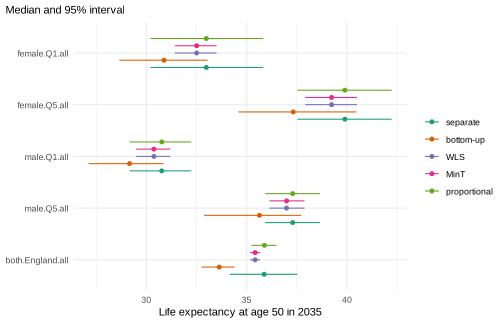
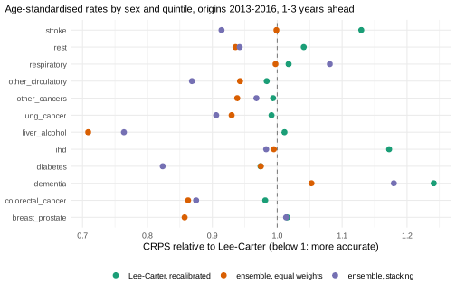

# Causes of death by deprivation: coherent and combined forecasts

*This vignette is precomputed (`dev/precompute-vignettes.R`) because its
backtests refit many models at every origin.*

Forecasts of causes of death by deprivation have to add up in three
directions: the quintiles to England, women and men to both sexes, and
the causes to all causes. They also have to suit causes whose trends
differ: a model that forecasts one cause well can forecast another
badly. This vignette forecasts twelve groups of causes by sex, age and
deprivation quintile. Part 1 makes the forecasts coherent in all three
directions and compares the ways to do so. Part 2 combines six models
for each cause, one of them with a tuned fitting window, recalibrates
the combination, and checks in a backtest whether it forecasts better
than Lee-Carter.

``` r

library(mortensor)
library(data.table)
```

## Data

Deaths and mid-year populations by sex, 5-year age group, decile of the
Index of Multiple Deprivation and cause of death, England 2001-2019
(`ons_data`; Source: Office for National Statistics, Open Government
Licence v3.0). The deciles are combined into quintiles (Q1 most
deprived, Q5 least deprived), and the 29 causes of the table into the
eleven groups of `ons_cause_groups` and a residual group (`rest`: all
causes minus the eleven groups, so it also holds the deaths of causes
the table does not list). The twelve groups add up to all causes:

``` r

causes <- names(ons_data)[-(1:7)]
x <- mt_data(deaths = ons_data, population = ons_data, by = c("sex", "imd_decile", "cause"), age = "age_group",
             value = list(deaths = c(all = "all_causes", causes), population = "population"))
x <- mt_as_exposure(x, type = "midyear")
x <- mt_group_levels(x, "imd_decile", function(d) paste0("Q", ceiling(as.numeric(d) / 2)), name = "quintile")
x <- mt_group_levels(x, "cause", ons_cause_groups, other = "rest", total = "all", additive = "rates")
```

**Ages.** Cause-specific counts per sex and quintile are small at
younger ages. The share of cells (sex, quintile, year) with fewer than
five deaths, by cause and age group:

``` r

cells <- as.data.table(x)[measure == "deaths" & cause != "all" & age_lo >= 40 & age_lo < 65]
dcast(cells, cause ~ paste0(age_lo, "-", age_hi - 1), value.var = "value",
      fun.aggregate = function(d) round(mean(d < 5), 2))
#>                 cause 40-44 45-49 50-54 55-59 60-64
#>  1:   breast_prostate  0.50  0.41  0.01  0.00  0.00
#>  2: colorectal_cancer  0.02  0.00  0.00  0.00  0.00
#>  3:          dementia  1.00  0.99  0.98  0.39  0.01
#>  4:          diabetes  0.47  0.29  0.22  0.06  0.04
#>  5:               ihd  0.04  0.00  0.00  0.00  0.00
#>  6:     liver_alcohol  0.00  0.00  0.00  0.00  0.00
#>  7:       lung_cancer  0.04  0.00  0.00  0.00  0.00
#>  8:     other_cancers  0.00  0.00  0.00  0.00  0.00
#>  9: other_circulatory  0.52  0.28  0.13  0.02  0.00
#> 10:       respiratory  0.45  0.20  0.01  0.00  0.00
#> 11:              rest  0.00  0.00  0.00  0.00  0.00
#> 12:            stroke  0.03  0.01  0.00  0.00  0.00
```

Below 50, many cells of several groups hold fewer than five deaths: at
45-49 almost all cells of dementia, and between a fifth and two fifths
of those of breast and prostate cancer, diabetes, other circulatory
diseases and respiratory diseases. From 50 on, more than a fifth of the
cells have fewer than five deaths only for dementia at 50-59 and
diabetes at 50-54. The analysis uses ages 50 and over, as “Inequality in
England” does. Dementia at 50-54 is kept, so that the causes add up to
all causes at every age.

``` r

x <- mt_subset(x, ages = c(50, Inf))
```

## The hierarchy

Three variables add up: sex to both sexes, quintile to England, and
cause to all causes. Sexes and quintiles divide the population, so their
deaths and exposures add up. Causes share the population of their
stratum, so their rates add up to the all-cause rate
(`additive = "rates"`). One crossed hierarchy describes all three, and
[`mt_aggregate_strata()`](../reference/mt_aggregate_strata.md) adds
every total to the data:

``` r

h <- mt_hierarchy(sex = "both", quintile = "England", cause = list(total = "all", additive = "rates"))
xa <- mt_aggregate_strata(x, h)
mt_validate(xa, hierarchy = h)
#> <mt_validation> 1 finding(s): 0 error, 0 warning, 1 info
#>   [info] hierarchy (deaths,exposure, 114 aggregate strata, n = 0): sums of parts agree with the totals within tolerance
mt_strata(xa, h)[, .N, by = level]
#>        level   N
#> 1:    bottom 120
#> 2: aggregate 113
#> 3:     total   1
```

The data now hold 120 bottom series (2 sexes, 5 quintiles, 12 causes),
113 aggregates and the total (both sexes, England, all causes). The
all-cause series of each sex and quintile are observed (`all_causes`),
and [`mt_validate()`](../reference/mt_validate.md) confirms that the
causes add up to them; all other aggregates are sums.

## Part 1: forecasts that add up in three directions

### Separate forecasts

One Lee-Carter model (Lee and Carter 1992) for each of the 234 strata,
forecast to 2035:

``` r

fc_base <- mt_forecast(mt_fit(lee_carter(), xa), to = 2035, n_draws = 500, seed = 1)
#> Warning in check_draws_plausible(arr, fit$age, fit$strata, spec$label):
#> Lee-Carter: forecast death rates above 1 in 4.0% of the draws (strata
#> female.Q1.dementia, female.Q3.dementia, male.Q1.dementia; ages 90+). The model
#> is unstable here, often because of sparse counts or a steep trend extrapolated
#> far ahead; consider wider age groups (mt_regroup()), pooling (li_lee(common_by
#> = )), smoothing (step_smooth()) or an ensemble.
```

The warning concerns dementia at ages 90 and over, whose recorded rates
rose steeply in 2001-2019: Lee-Carter extrapolates the rise, and some
paths reach rates above one.

[`mt_coherence()`](../reference/mt_coherence.md) gives, for every
aggregate, the ratio of the sum of its bottom strata to the aggregate’s
own forecast, path by path, on the deaths scale with the exposures of
2019. The table groups the aggregates by the variables they sum over:

``` r

coherence_table <- function(forecasts) {
  co <- rbindlist(lapply(forecasts, mt_coherence, hierarchy = h), idcol = "method")
  co[, summed := paste(c("sex", "quintile", "cause")[c(sex == "both", quintile == "England", cause == "all")],
                       collapse = " + "), by = .(sex, quintile, cause)]
  tab <- co[, .(ratio = sprintf("%.3f (%.3f-%.3f)", median(q0.5), min(q0.025), max(q0.975))), by = .(summed, method)]
  dcast(tab, summed ~ factor(method, names(forecasts)), value.var = "ratio")
}
coherence_table(list(separate = fc_base))
#>                    summed            separate
#> 1:                  cause 1.066 (0.761-2.713)
#> 2:               quintile 1.009 (0.347-3.568)
#> 3:       quintile + cause 1.087 (0.867-2.127)
#> 4:                    sex 0.999 (0.293-4.325)
#> 5:            sex + cause 1.073 (0.835-2.363)
#> 6:         sex + quintile 1.006 (0.492-3.096)
#> 7: sex + quintile + cause 1.087 (0.893-1.884)
```

Each cell gives the median ratio of a group of aggregates (over ages,
paths, years and aggregates) and, in brackets, the lowest 2.5% and the
highest 97.5% quantile of the ratios of its single aggregates and years.

The forecasts of the twelve causes add up to more than the all-cause
forecasts: by 7% in the median for the ten series of sex by quintile
(`cause`), and by 7% to 9% for the totals over sexes or quintiles. Over
long horizons, sums of cause-specific forecasts tend to be more
pessimistic than forecasts of all causes, because the sum is dominated
by the causes that fall slowest or rise (Wilmoth 1995). Over sexes and
quintiles the medians agree within 1%, but single paths do not: the 234
models draw their futures independently, so a path of England has no
matching paths of its quintiles.

### Four ways to make them add up

- **Bottom-up** (`"bottom_up"`): only the 120 bottom series (sex by
  quintile by cause) are used, and every total is their sum.
- **WLS** (`"wls"`): all 234 forecasts are adjusted, each in proportion
  to the variance of its own draws (Hyndman, Lee and Wang 2016).
- **MinT** (`"mint"`): as WLS, with the covariances between the strata
  (Wickramasuriya, Athanasopoulos and Hyndman 2019).
- **Proportional** (`"proportional"` with `fixed`): the all-cause
  forecasts of the ten series of sex by quintile are kept, and the
  causes of each are scaled, path by path, so that they add up to it
  (Athanasopoulos, Ahmed and Hyndman 2009). The totals over sexes and
  quintiles are sums.

``` r

all_cause <- mt_strata(xa)[cause == "all" & sex != "both" & quintile != "England", label]
fc <- list("separate" = fc_base,
           "bottom-up" = mt_reconcile(fc_base, h, method = "bottom_up"),
           "WLS" = mt_reconcile(fc_base, h, method = "wls"),
           "MinT" = mt_reconcile(fc_base, h, method = "mint"),
           "proportional" = mt_reconcile(fc_base, h, method = "proportional", fixed = all_cause))
#> Warning in reconcile_array(arr, hs, h$additive, method, shrink, exposure %||% :
#> In 97% of the draws some bottom forecasts were set to zero to keep the
#> aggregates; their distributions are truncated. Check the base forecasts
#> (mt_coherence()) or use method = "proportional" with fixed nodes.

#> Warning in reconcile_array(arr, hs, h$additive, method, shrink, exposure %||% :
#> In 97% of the draws some bottom forecasts were set to zero to keep the
#> aggregates; their distributions are truncated. Check the base forecasts
#> (mt_coherence()) or use method = "proportional" with fixed nodes.
coherence_table(fc[-1])
#>                    summed           bottom-up                 WLS
#> 1:                  cause 1.000 (1.000-1.000) 1.000 (1.000-1.000)
#> 2:               quintile 1.000 (1.000-1.000) 1.000 (1.000-1.000)
#> 3:       quintile + cause 1.000 (1.000-1.000) 1.000 (1.000-1.000)
#> 4:                    sex 1.000 (1.000-1.000) 1.000 (1.000-1.000)
#> 5:            sex + cause 1.000 (1.000-1.000) 1.000 (1.000-1.000)
#> 6:         sex + quintile 1.000 (1.000-1.000) 1.000 (1.000-1.000)
#> 7: sex + quintile + cause 1.000 (1.000-1.000) 1.000 (1.000-1.000)
#>                   MinT        proportional
#> 1: 1.000 (1.000-1.000) 1.000 (1.000-1.000)
#> 2: 1.000 (1.000-1.000) 1.000 (1.000-1.000)
#> 3: 1.000 (1.000-1.000) 1.000 (1.000-1.000)
#> 4: 1.000 (1.000-1.000) 1.000 (1.000-1.000)
#> 5: 1.000 (1.000-1.000) 1.000 (1.000-1.000)
#> 6: 1.000 (1.000-1.000) 1.000 (1.000-1.000)
#> 7: 1.000 (1.000-1.000) 1.000 (1.000-1.000)
```

After reconciliation every ratio is 1.000 in every path, for every kind
of aggregate: the forecasts add up over sexes, quintiles and causes at
the same time. WLS and MinT warn that in 97% of the paths the projection
made some bottom forecasts negative; the non-negative reconciliation of
Wickramasuriya, Turlach and Hyndman (2020) then holds them at zero. The
values held at zero by WLS (age, year, stratum and path), by cause, and
the first year in which they occur:

``` r

zero <- which(fc$WLS$rates < 1e-9, arr.ind = TRUE)
zeros <- data.table(cause = fc$WLS$strata$cause[zero[, 3]], year = fc$WLS$periods[zero[, 2]])
zeros[, .(values = .N, from = min(year)), by = cause][order(-values)]
#>                cause values from
#> 1:          diabetes   3846 2024
#> 2:          dementia   2049 2026
#> 3:     liver_alcohol   1353 2024
#> 4: other_circulatory    487 2025
#> 5: colorectal_cancer     46 2031
#> 6:       respiratory     16 2031
#> 7:       lung_cancer     13 2032
#> 8:   breast_prostate     12 2032
```

They are mostly diabetes, dementia and liver disease, from the mid-2020s
on: WLS moves each forecast in proportion to the variance of its own
draws, so the causes with the most uncertain trends absorb most of the
adjustment, and some of their paths reach zero.

Life expectancy at 50 from all causes in 2035:

``` r

mt_plot_compare(fc, periods = 2035, at = 50,
                strata = c("female.Q1.all", "female.Q5.all", "male.Q1.all", "male.Q5.all", "both.England.all"))
```



``` r

mt_compare_forecasts(fc, periods = 2035, at = 50, strata = c("female.Q1.all", "female.Q5.all", "both.England.all"))
#>               label period         separate        bottom-up              WLS
#> 1: both.England.all   2035 35.9 (34.2-37.5) 33.6 (32.7-34.4) 35.4 (35.2-35.7)
#> 2:    female.Q1.all   2035 33.0 (30.2-35.8) 30.9 (28.7-33.0) 32.5 (31.4-33.5)
#> 3:    female.Q5.all   2035 39.9 (37.5-42.2) 37.3 (34.6-40.5) 39.2 (37.9-40.5)
#>                MinT     proportional
#> 1: 35.4 (35.2-35.7) 35.9 (35.2-36.5)
#> 2: 32.5 (31.4-33.5) 33.0 (30.2-35.8)
#> 3: 39.2 (37.9-40.5) 39.9 (37.5-42.2)
```

The age-standardised death rates (per 100,000, ages 50 and over) of some
causes for both sexes in England:

``` r

mt_compare_forecasts(fc, quantity = "asr", periods = 2035,
                     strata = paste0("both.England.", c("lung_cancer", "ihd", "dementia", "respiratory")), digits = 0)
#>                       label period       separate      bottom-up           WLS
#> 1:    both.England.dementia   2035 727 (266-2148) 899 (624-1385) 352 (283-419)
#> 2:         both.England.ihd   2035   104 (81-133)   105 (96-115)  105 (98-112)
#> 3: both.England.lung_cancer   2035  113 (107-121)  124 (114-140) 119 (118-122)
#> 4: both.England.respiratory   2035  141 (140-148)  143 (122-170) 142 (135-153)
#>             MinT  proportional
#> 1: 352 (283-418) 558 (453-692)
#> 2:  105 (98-112)    83 (70-94)
#> 3: 119 (118-122)   99 (85-117)
#> 4: 142 (135-153)  110 (88-139)
```

The methods differ most for all-cause life expectancy and for the causes
with uncertain trends. Bottom-up gives the lowest life expectancy at 50:
33.6 years for England in 2035, against 35.9 years from the all-cause
forecast, because the sum of the causes is more pessimistic. WLS and
MinT stay close to the all-cause forecasts (35.4 years), with much
narrower intervals (35.2-35.7): they move the most uncertain forecasts
most, and these are forecasts of single causes. Dementia, whose separate
forecast is the most uncertain (age-standardised rate 727 per 100,000,
interval 266-2148), is pulled down to 352. Proportional scaling keeps
the all-cause forecasts of each sex and quintile; England, their sum,
has the median of its own forecast (35.9 years) and a narrower interval
(35.2-36.5). It scales all causes of a path by the same factor, so every
cause comes down: ischaemic heart disease from 104 to 83 per 100,000,
lung cancer from 113 to 99, respiratory diseases from 141 to 110.

### Which way forecast best

A backtest from the origins 2010-2014, five years ahead, with the
reconciliation inside each fit
([`reconciled()`](../reference/reconciled.md)), scores the log death
rates of all 234 strata, the age-standardised rates (`asr`, log scale)
and life expectancy at 50 (`life_expectancy`), and the differences
between each quintile and Q1 (`asr_gap`, `life_expectancy_gap`):

``` r

lc <- lee_carter()
cand <- list("separate" = lc,
             "bottom-up" = reconciled(lc, h, method = "bottom_up"),
             "WLS" = reconciled(lc, h, method = "wls"),
             "MinT" = reconciled(lc, h, method = "mint"),
             "proportional" = reconciled(lc, h, method = "proportional", fixed = all_cause))
bt1 <- mt_compare(cand, xa, origins = 2010:2014, h = 5, n_draws = 200, quantities = c("life_expectancy", "asr"),
                  contrast = c(var = "quintile", ref = "Q1"), cores = 4)
```

The warnings of this backtest are not shown: at every origin, WLS and
MinT set some bottom forecasts to zero, in 15% to 92% of the paths, as
in the forecasts above.

The log death rates of all strata, by level of the hierarchy (bottom:
sex by quintile by cause; aggregates; total: both sexes, England, all
causes):

``` r

mt_score_table(bt1, metrics = c("crps", "cov95"), targets = "rate", hierarchy = h)
#>            model     level   crps cov95
#>  1:     separate    bottom 0.1130 0.849
#>  2:     separate aggregate 0.0851 0.750
#>  3:     separate     total 0.0374 0.733
#>  4:    bottom-up    bottom 0.1130 0.846
#>  5:    bottom-up aggregate 0.0823 0.734
#>  6:    bottom-up     total 0.0295 0.387
#>  7:          WLS    bottom 0.1160 0.804
#>  8:          WLS aggregate 0.0881 0.607
#>  9:          WLS     total 0.0392 0.156
#> 10:         MinT    bottom 0.1160 0.805
#> 11:         MinT aggregate 0.0881 0.604
#> 12:         MinT     total 0.0393 0.160
#> 13: proportional    bottom 0.1170 0.876
#> 14: proportional aggregate 0.0873 0.731
#> 15: proportional     total 0.0401 0.293
```

The age-standardised rates of the causes, and their ratio between Q5 and
Q1:

``` r

mt_score_table(bt1[cause != "all"], metrics = c("crps", "cov95"), targets = "asr", hierarchy = h)
#>            model     level crps_asr cov95_asr
#>  1:     separate    bottom   0.0562     0.879
#>  2:     separate aggregate   0.0530     0.770
#>  3:    bottom-up    bottom   0.0562     0.876
#>  4:    bottom-up aggregate   0.0513     0.735
#>  5:          WLS    bottom   0.0595     0.797
#>  6:          WLS aggregate   0.0583     0.551
#>  7:         MinT    bottom   0.0595     0.794
#>  8:         MinT aggregate   0.0584     0.550
#>  9: proportional    bottom   0.0641     0.904
#> 10: proportional aggregate   0.0606     0.734
mt_score_table(bt1[cause != "all" & quintile == "Q5"], metrics = c("crps", "cov95"), targets = "asr_gap")
#>           model crps_asr_gap cov95_asr_gap
#> 1:     separate       0.0398         0.984
#> 2:    bottom-up       0.0387         0.987
#> 3:          WLS       0.0362         0.957
#> 4:         MinT       0.0362         0.960
#> 5: proportional       0.0405         0.992
```

Life expectancy at 50 from all causes, and its gap between Q5 and Q1:

``` r

mt_score_table(bt1[cause == "all"], metrics = c("crps", "cov95"), targets = "life_expectancy", hierarchy = h)
#>            model     level crps_le cov95_le
#>  1:     separate aggregate   0.300    0.769
#>  2:     separate     total   0.316    0.800
#>  3:    bottom-up aggregate   0.178    0.831
#>  4:    bottom-up     total   0.184    0.480
#>  5:          WLS aggregate   0.304    0.341
#>  6:          WLS     total   0.345    0.120
#>  7:         MinT aggregate   0.305    0.339
#>  8:         MinT     total   0.346    0.120
#>  9: proportional aggregate   0.307    0.675
#> 10: proportional     total   0.361    0.240
mt_score_table(bt1[cause == "all" & quintile == "Q5"], metrics = c("crps", "cov95"),
               targets = "life_expectancy_gap", by = c("model", "sex"))
#>            model    sex crps_le_gap cov95_le_gap
#>  1:     separate female       0.185         1.00
#>  2:     separate   male       0.127         1.00
#>  3:     separate   both       0.153         1.00
#>  4:    bottom-up female       0.150         1.00
#>  5:    bottom-up   male       0.122         1.00
#>  6:    bottom-up   both       0.114         1.00
#>  7:          WLS female       0.122         1.00
#>  8:          WLS   male       0.110         1.00
#>  9:          WLS   both       0.112         0.84
#> 10:         MinT female       0.121         1.00
#> 11:         MinT   male       0.110         1.00
#> 12:         MinT   both       0.112         0.88
#> 13: proportional female       0.185         1.00
#> 14: proportional   male       0.127         1.00
#> 15: proportional   both       0.128         1.00
```

Observed life expectancy at 50 in England, and the mean error of the
median forecast of life expectancy at 50 (forecast minus observed,
years) by horizon:

``` r

mt_compare_forecasts(list(observed = mt_subset(xa, cause == "all" & quintile == "England")),
                     periods = c(2001, 2011, 2019), at = 50)
#>                 label period         observed
#> 1:   both.England.all   2001 30.5 (30.5-30.5)
#> 2:   both.England.all   2011 32.9 (32.9-32.9)
#> 3:   both.England.all   2019 33.5 (33.5-33.6)
#> 4: female.England.all   2001 32.3 (32.3-32.4)
#> 5: female.England.all   2011 34.4 (34.4-34.5)
#> 6: female.England.all   2019 35.0 (34.9-35.0)
#> 7:   male.England.all   2001 28.5 (28.5-28.6)
#> 8:   male.England.all   2011 31.2 (31.2-31.3)
#> 9:   male.England.all   2019 32.0 (32.0-32.0)
```

``` r

bias <- bt1[cause == "all" & target == "life_expectancy", .(error = round(mean(median - observed), 2)),
            by = .(model, horizon)]
dcast(bias, model ~ horizon, value.var = "error")
#>           model    1    2    3    4    5
#> 1:     separate 0.11 0.26 0.40 0.55 0.68
#> 2:    bottom-up 0.07 0.15 0.21 0.26 0.29
#> 3:          WLS 0.11 0.24 0.35 0.46 0.55
#> 4:         MinT 0.11 0.24 0.34 0.45 0.56
#> 5: proportional 0.10 0.26 0.40 0.54 0.68
```

Life expectancy at 50 of both sexes in England rose by 2.4 years from
2001 to 2011 and by 0.6 years from 2011 to 2019. Every method forecast
it too high, by more the further ahead: the all-cause forecasts by 0.68
years five years ahead, the summed causes (bottom-up) by 0.29 years.
Sums of cause-specific forecasts tend to fall more slowly than forecasts
of all causes (Wilmoth 1995), and in a decade in which improvement
slowed this made them more accurate. The results by target:

- **All-cause life expectancy at 50**: bottom-up forecast it best by far
  (CRPS 0.178 years for the series by sex and quintile and their sums
  over sexes or quintiles, against 0.300-0.307), with the highest 95%
  coverage (0.83). For England as a whole its intervals were too narrow
  (0.48): the 120 bottom forecasts are drawn independently, so their
  errors partly cancel in the sum (“Dependence between groups”).
- **Gaps between Q5 and Q1**: WLS and MinT forecast the gaps of life
  expectancy and of the cause-specific rates best (CRPS of the life
  expectancy gap of women 0.122 and 0.121, against 0.150 for bottom-up
  and 0.185 for separate forecasts), but the 95% intervals of their life
  expectancy covered only 0.34 of the observed values.
- **Cause-specific rates**: WLS and MinT made them less accurate (CRPS
  of the ASR of the bottom series 0.0595 against 0.0562). Proportional
  scaling made them least accurate (0.0641) and left all-cause life
  expectancy as inaccurate as the all-cause forecasts it keeps.
- **Single rates of the bottom series**: the methods differ little (CRPS
  0.113-0.117).

Part 2 uses bottom-up reconciliation: it forecast all-cause life
expectancy best, and the cause-specific rates as well as separate
forecasts.

## Part 2: an ensemble for each cause

### The ensemble

Six models with different assumptions:

- **Lee-Carter**, fitted to all training years;
- **Lee-Carter with a tuned window**:
  [`tuned()`](../reference/mt_tune.md) chooses whether it is fitted to
  the last 6, the last 9 or all training years (`window = 19` keeps all)
  by the CRPS of a hold-out of the last two training years (“Tuning and
  recalibration”);
- the **random walk with drift** of the observed log rates
  ([`rwd()`](../reference/rwd.md));
- the **functional demographic model**
  ([`hyndman_ullah()`](../reference/hyndman_ullah.md); Hyndman and Ullah
  2007);
- **Li-Lee** (`li_lee(common_by = "sex")`; Li and Lee 2005): the five
  quintiles of each sex share a common trend, and their deviations from
  it revert;
- the **local level model with drift**
  (`arima_series(order = c(0, 1, 1), drift = TRUE)`): a random walk with
  drift observed with noise (Harvey 1989), which separates the noise of
  small counts from the trend.

Each path of the ensemble comes from one component
([`ensemble()`](../reference/ensemble.md)). The weights are stacking
weights (`weights = "crps_stack"`): those that minimise the CRPS of the
mixture in an inner backtest on the training years (stacking of
predictive distributions, Yao et al. 2018, here with the CRPS). An
ensemble with equal weights shows what the weights add.

``` r

window_lc <- function(window) list(spec = lee_carter(), prep = mt_prep(step_window(window)))
components <- list(
  "Lee-Carter" = lee_carter(),
  "Lee-Carter, window tuned" = tuned(window_lc, data.frame(window = c(6, 9, 19)), inner_origins = 1, inner_h = 2,
                                     n_draws = 50, label = "Lee-Carter, window tuned"),
  "random walk" = rwd(),
  "fdm" = hyndman_ullah(),
  "Li-Lee" = li_lee(common_by = "sex"),
  "local level" = arima_series(order = c(0, 1, 1), drift = TRUE))
```

Ensemble weights are one vector for all strata of a fit. To give each
cause its own weights, `stratified("cause", ...)` fits a separate
ensemble to each cause; the call names every cause and is built with
[`do.call()`](https://rdrr.io/r/base/do.call.html). With
`.default = ensemble(...)` instead, all causes would share one ensemble
and one weight vector. Each cause also gets its own tuned window and its
own Li-Lee trends.

Part 1 chose bottom-up reconciliation: every total is the sum of the 120
bottom series, and the totals’ own forecasts are not used.
[`reconciled()`](../reference/reconciled.md) still fits its base model
to every stratum, so `bottom_only()` fits the ensemble to the ten bottom
series of each cause (two nested
[`stratified()`](../reference/stratified.md) calls) and Lee-Carter to
the totals, whose forecasts are discarded. The stacking weights are then
estimated on the series they are used for. `recalibrated(by = "cause")`
around the reconciled model rescales the spread of the bottom series
with one factor per cause and recomputes the totals as their sums, so
the forecasts stay coherent.

``` r

cause_groups <- setdiff(unique(mt_strata(xa)$cause), "all")
bottom_only <- function(model) {
  stratified("quintile", England = lee_carter(), .default = stratified("sex", both = lee_carter(), .default = model))
}
bu <- function(spec) reconciled(spec, h, method = "bottom_up")
recal <- function(spec) recalibrated(spec, years = 3, n_origins = 2, by = "cause", n_draws = 50)
full_ensemble <- function(weights) {
  ens <- do.call(ensemble, c(components, list(weights = weights, inner_origins = 1, inner_h = 2, inner_n_draws = 50)))
  per_cause <- setNames(rep(list(bottom_only(ens)), length(cause_groups)), cause_groups)
  recal(bu(do.call(stratified, c(list("cause", all = lee_carter()), per_cause))))
}
```

### Training years for the inner backtests

Each level of this model refits what it wraps on fewer years.
Recalibration refits the reconciled ensembles at inner origins; each fit
of an ensemble runs an inner backtest for the stacking weights; and each
fit of the tuned component runs its own hold-out. mortensor fits Li-Lee,
the fdm and the local level model only to 8 or more years, and
[`tuned()`](../reference/mt_tune.md) needs `inner_origins + inner_h + 5`
years (8 here). The settings above leave every inner fit enough years
from the first origin, 2013, on:

| Level | Setting | Deepest fit at the origin 2013 |
|----|----|----|
| Backtest | origins 2013-2016, 3 years ahead | 2001-2013 (13 years) |
| Recalibration | `years = 3`, `n_origins = 2` | refits to 2001-2010 and 2001-2011, forecasts of 2011-2013 |
| Stacking weights | `inner_origins = 1`, `inner_h = 2` | within the refit to 2001-2010: fit to 2001-2008 (8 years), forecasts of 2009-2010 |
| Window tuning | `inner_origins = 1`, `inner_h = 2` | within the fit to 2001-2008: fit to 2001-2006 (6 years), forecasts of 2007-2008 |

One more inner origin or one more year of inner horizon at any level, or
an earlier outer origin, would leave the deepest fits of Li-Lee, the fdm
and the local level model 7 years. The origin 2016 is the last with
three observed years ahead. In the deepest fits all three windows keep
the same 6 years; they differ only in fits to more years. With three
calibration years, the spread factors rest on forecasts 1 to 3 years
ahead, the horizons of the backtest. The inner forecasts use 50 draws
instead of the default 100 to save time.

### Backtest against Lee-Carter

``` r

models <- list("Lee-Carter" = bu(lee_carter()),
               "Lee-Carter, recalibrated" = recal(bu(lee_carter())),
               "ensemble, equal weights" = full_ensemble("equal"),
               "ensemble, stacking" = full_ensemble("crps_stack"))
bt2 <- mt_compare(models, xa, origins = 2013:2016, h = 3, n_draws = 200, quantities = c("life_expectancy", "asr"),
                  contrast = c(var = "quintile", ref = "Q1"), cores = 4)
```

The age-standardised rates of the causes (bottom strata and aggregates),
and their ratio between Q5 and Q1:

``` r

metrics <- c("crps", "cov50", "cov80", "cov95")
mt_score_table(bt2[cause != "all"], metrics = metrics, targets = "asr", hierarchy = h)
#>                       model     level crps_asr cov50_asr cov80_asr cov95_asr
#> 1:               Lee-Carter    bottom   0.0393     0.470     0.751     0.915
#> 2:               Lee-Carter aggregate   0.0354     0.365     0.587     0.757
#> 3: Lee-Carter, recalibrated    bottom   0.0412     0.503     0.794     0.923
#> 4: Lee-Carter, recalibrated aggregate   0.0356     0.400     0.633     0.798
#> 5:  ensemble, equal weights    bottom   0.0371     0.488     0.785     0.928
#> 6:  ensemble, equal weights aggregate   0.0332     0.428     0.672     0.841
#> 7:       ensemble, stacking    bottom   0.0367     0.481     0.762     0.918
#> 8:       ensemble, stacking aggregate   0.0325     0.392     0.654     0.841
mt_score_table(bt2[cause != "all" & quintile == "Q5"], metrics = metrics, targets = "asr_gap")
#>                       model crps_asr_gap cov50_asr_gap cov80_asr_gap
#> 1:               Lee-Carter       0.0317         0.708         0.919
#> 2: Lee-Carter, recalibrated       0.0348         0.743         0.917
#> 3:  ensemble, equal weights       0.0327         0.657         0.903
#> 4:       ensemble, stacking       0.0387         0.553         0.810
#>    cov95_asr_gap
#> 1:         0.988
#> 2:         0.984
#> 3:         0.981
#> 4:         0.951
```

Life expectancy at 50 from all causes, and its gap between Q5 and Q1:

``` r

mt_score_table(bt2[cause == "all"], metrics = metrics, targets = "life_expectancy", hierarchy = h)
#>                       model     level crps_le cov50_le cov80_le cov95_le
#> 1:               Lee-Carter aggregate   0.148   0.3970    0.672    0.843
#> 2:               Lee-Carter     total   0.157   0.0833    0.167    0.583
#> 3: Lee-Carter, recalibrated aggregate   0.149   0.4710    0.716    0.843
#> 4: Lee-Carter, recalibrated     total   0.148   0.1670    0.333    0.667
#> 5:  ensemble, equal weights aggregate   0.152   0.4410    0.711    0.809
#> 6:  ensemble, equal weights     total   0.146   0.4170    0.500    0.750
#> 7:       ensemble, stacking aggregate   0.157   0.3480    0.672    0.824
#> 8:       ensemble, stacking     total   0.150   0.2500    0.583    0.667
mt_score_table(bt2[cause == "all" & quintile == "Q5"], metrics = metrics, targets = "life_expectancy_gap")
#>                       model crps_le_gap cov50_le_gap cov80_le_gap cov95_le_gap
#> 1:               Lee-Carter      0.0846        1.000        1.000        1.000
#> 2: Lee-Carter, recalibrated      0.0934        0.944        1.000        1.000
#> 3:  ensemble, equal weights      0.1110        0.639        0.972        1.000
#> 4:       ensemble, stacking      0.2110        0.167        0.556        0.944
```

The mean error of the median forecast of the gap in life expectancy at
50 between Q5 and Q1 (forecast minus observed, years):

``` r

gap <- bt2[cause == "all" & quintile == "Q5" & target == "life_expectancy_gap"]
dcast(gap[, .(error = round(mean(median - observed), 2)), by = .(model, sex)], model ~ sex, value.var = "error")
#>                       model  both female  male
#> 1:               Lee-Carter -0.06  -0.06 -0.07
#> 2: Lee-Carter, recalibrated -0.06  -0.05 -0.06
#> 3:  ensemble, equal weights -0.15  -0.16 -0.15
#> 4:       ensemble, stacking -0.33  -0.38 -0.26
```

One to three years ahead:

- **Rates of the causes**: both ensembles forecast the age-standardised
  rates of the causes more accurately than Lee-Carter, by 7% (stacking,
  CRPS 0.0367) and 6% (equal weights, 0.0371) for the bottom series, and
  by 8% and 6% for the totals over sexes or quintiles (0.0325 and 0.0332
  against 0.0354). The 95% intervals of the bottom series covered 0.92
  to 0.93 of the observed values under every model; for the totals,
  those of Lee-Carter covered 0.76, those of the ensembles 0.84.
- **Gaps of the cause-specific rates between Q5 and Q1**: Lee-Carter
  forecast them best (CRPS 0.0317), the equal-weight ensemble nearly as
  well (0.0327) and the stacking ensemble worst (0.0387, 50% coverage
  0.55).
- **All-cause life expectancy at 50**: the four models are close (CRPS
  0.148 to 0.157 years for the series by sex and quintile and their sums
  over sexes or quintiles).
- **Gap in life expectancy at 50 between Q5 and Q1**: Lee-Carter
  forecast it best (CRPS 0.085 years), the equal-weight ensemble less
  well (0.111) and the stacking ensemble worst (0.211, 50% coverage
  0.17): it forecast the gap too small, by 0.38 years for women and 0.26
  years for men on average.
- **Recalibration of Lee-Carter** made the rates of the causes slightly
  less accurate (0.0412 against 0.0393) and changed life expectancy
  little.

The warnings of this backtest are not shown. Two kinds occur at the
origins: the fdm warns at every fit that the monotonic smoothing of the
rates above age 65 could not be fitted at these ages, and smooths the
rates without that constraint; and Li-Lee warns that the deviation of
ischaemic heart disease of women in Q1 from the common trend is close to
a unit root (its AR(1) coefficient is bounded at 0.99), so it reverts
very slowly.

The CRPS of the age-standardised rates of each cause (bottom strata),
relative to Lee-Carter:

``` r

sc <- mt_score(bt2[cause != "all" & sex != "both" & quintile != "England"], by = c("model", "cause"),
               target = "asr")
sc[, relative := crps / crps[model == "Lee-Carter"], by = cause]
ggplot2::ggplot(sc[model != "Lee-Carter"], ggplot2::aes(relative, cause, colour = model)) +
  ggplot2::geom_vline(xintercept = 1, linetype = "dashed", colour = "grey50") +
  ggplot2::geom_point(size = 2.5) +
  scale_colour_mortensor(type = "categorical") +
  ggplot2::labs(x = "CRPS relative to Lee-Carter (below 1: more accurate)", y = NULL, colour = NULL,
                subtitle = "Age-standardised rates by sex and quintile, origins 2013-2016, 1-3 years ahead") +
  theme_mortensor()
```



``` r

dcast(sc[model != "Lee-Carter", .(cause, model, relative = round(relative, 2))], cause ~ model, value.var = "relative")
#>                 cause Lee-Carter, recalibrated ensemble, equal weights
#>  1:   breast_prostate                     1.02                    0.86
#>  2: colorectal_cancer                     0.98                    0.86
#>  3:          dementia                     1.24                    1.05
#>  4:          diabetes                     0.97                    0.97
#>  5:               ihd                     1.17                    0.99
#>  6:     liver_alcohol                     1.01                    0.71
#>  7:       lung_cancer                     0.99                    0.93
#>  8:     other_cancers                     0.99                    0.94
#>  9: other_circulatory                     0.98                    0.94
#> 10:       respiratory                     1.02                    1.00
#> 11:              rest                     1.04                    0.94
#> 12:            stroke                     1.13                    1.00
#>     ensemble, stacking
#>  1:               1.01
#>  2:               0.87
#>  3:               1.18
#>  4:               0.82
#>  5:               0.98
#>  6:               0.76
#>  7:               0.91
#>  8:               0.97
#>  9:               0.87
#> 10:               1.08
#> 11:               0.94
#> 12:               0.91
```

The stacking ensemble was more accurate than Lee-Carter for nine of the
twelve causes, most for liver disease (by 24%), diabetes (18%), other
circulatory diseases and colorectal cancer (13%), and less accurate for
dementia (18%), respiratory diseases (8%) and breast and prostate cancer
(1%). The equal-weight ensemble was at least as accurate as Lee-Carter
for eleven causes (ischaemic heart disease, respiratory diseases and
stroke within 1%) and less accurate for dementia (5%). Recalibrated
Lee-Carter was less accurate than Lee-Carter for dementia (24%),
ischaemic heart disease (17%) and stroke (13%).

### Is the difference larger than chance?

[`mt_dm_test()`](../reference/mt_dm_test.md) tests whether the mean CRPS
of a model over the origins differs from that of Lee-Carter by more than
the origins vary (Diebold and Mariano 1995). The variance of the mean
difference is the equal-weighted cosine estimate, with critical values
from a t distribution (Lazarus, Lewis, Stock and Watson 2018). With four
origins the test has one degree of freedom (`df`), so it finds only
large and consistent differences:

``` r

dm <- rbind(
  mt_dm_test(bt2[cause != "all" & sex != "both" & quintile != "England"], ref = "Lee-Carter", targets = "asr"),
  mt_dm_test(bt2[cause != "all" & quintile == "Q5"], ref = "Lee-Carter", targets = "asr_gap"),
  mt_dm_test(bt2[cause == "all"], ref = "Lee-Carter", targets = "life_expectancy"),
  mt_dm_test(bt2[cause == "all" & quintile == "Q5"], ref = "Lee-Carter", targets = "life_expectancy_gap"))
dm[horizon == "all", .(model, target, df, score = signif(score, 3), score_ref = signif(score_ref, 3),
                        p_value = round(p_value, 2))]
#>                        model              target df  score score_ref p_value
#>  1: Lee-Carter, recalibrated                 asr  1 0.0412    0.0393    0.41
#>  2:  ensemble, equal weights                 asr  1 0.0371    0.0393    0.44
#>  3:       ensemble, stacking                 asr  1 0.0367    0.0393    0.23
#>  4: Lee-Carter, recalibrated             asr_gap  1 0.0348    0.0317    0.37
#>  5:  ensemble, equal weights             asr_gap  1 0.0327    0.0317    0.48
#>  6:       ensemble, stacking             asr_gap  1 0.0387    0.0317    0.22
#>  7: Lee-Carter, recalibrated     life_expectancy  1 0.1490    0.1480    0.59
#>  8:  ensemble, equal weights     life_expectancy  1 0.1510    0.1480    0.45
#>  9:       ensemble, stacking     life_expectancy  1 0.1560    0.1480    0.74
#> 10: Lee-Carter, recalibrated life_expectancy_gap  1 0.0934    0.0846    0.72
#> 11:  ensemble, equal weights life_expectancy_gap  1 0.1110    0.0846    0.38
#> 12:       ensemble, stacking life_expectancy_gap  1 0.2110    0.0846    0.18
```

No difference is significant at the 5% level on average over the three
horizons (p from 0.18 to 0.74). The 7% lower CRPS of the stacking
ensemble for the rates of the causes has p = 0.23, its higher CRPS of
the gap in life expectancy p = 0.18. Four origins of three years are
few: the differences between the models are within the variation between
the origins.

### Weights and recalibration on all data

``` r

fit_ens <- mt_fit(full_ensemble("crps_stack"), xa, cores = 4)
weights <- mt_parameters(fit_ens)[parameter == "weight", .(cause = group, component = index, weight = round(value, 2))]
dcast(weights, cause ~ component, value.var = "weight")[, c("cause", names(components)), with = FALSE]
#>                 cause Lee-Carter Lee-Carter, window tuned random walk  fdm
#>  1:   breast_prostate       0.21                     0.00        0.03 0.00
#>  2: colorectal_cancer       0.26                     0.00        0.00 0.10
#>  3:          dementia       0.00                     0.00        0.00 0.54
#>  4:          diabetes       0.10                     0.00        0.32 0.41
#>  5:               ihd       0.00                     0.70        0.23 0.04
#>  6:     liver_alcohol       0.07                     0.06        0.00 0.72
#>  7:       lung_cancer       0.00                     0.64        0.26 0.10
#>  8:     other_cancers       0.33                     0.00        0.02 0.03
#>  9: other_circulatory       0.11                     0.44        0.09 0.26
#> 10:       respiratory       0.09                     0.00        0.31 0.43
#> 11:              rest       0.00                     0.00        0.17 0.41
#> 12:            stroke       0.00                     0.00        0.24 0.49
#>     Li-Lee local level
#>  1:   0.38        0.38
#>  2:   0.55        0.09
#>  3:   0.33        0.13
#>  4:   0.18        0.00
#>  5:   0.04        0.00
#>  6:   0.14        0.01
#>  7:   0.00        0.00
#>  8:   0.60        0.02
#>  9:   0.10        0.00
#> 10:   0.17        0.00
#> 11:   0.29        0.13
#> 12:   0.28        0.00
fit_ens$calibration[group != "all", .(cause = group, scale_h1, crps_before, crps_after, cov95_before, cov95_after)]
#>                 cause  scale_h1 crps_before crps_after cov95_before cov95_after
#>  1:   breast_prostate 0.7420155  0.06172032 0.06148200    0.9422222   0.9155556
#>  2: colorectal_cancer 0.2359251  0.05950908 0.05813445    0.9333333   0.8866667
#>  3:          dementia 0.6252263  0.15639359 0.15348601    0.9777778   0.9288889
#>  4:          diabetes 0.9316157  0.14713984 0.14710959    0.9044444   0.8822222
#>  5:               ihd 0.8651978  0.05689420 0.05673168    0.9022222   0.8888889
#>  6:     liver_alcohol 0.7830481  0.09594753 0.09541231    0.9444444   0.8933333
#>  7:       lung_cancer 1.2863029  0.07804079 0.07740141    0.8466667   0.9066667
#>  8:     other_cancers 0.8794309  0.02848042 0.02843622    0.9088889   0.8800000
#>  9: other_circulatory 0.6955683  0.10807185 0.10683857    0.9533333   0.8977778
#> 10:       respiratory 0.7965749  0.07461080 0.07431964    0.9222222   0.8800000
#> 11:              rest 0.6867152  0.03867120 0.03781412    0.9733333   0.9133333
#> 12:            stroke 0.8560036  0.07119017 0.07093992    0.9644444   0.9377778
```

The weights and spread factors of the stacking ensemble fitted to all
data, 2001-2019 (the warnings of the fit, of the same two kinds as in
the backtest, are not shown). The weights differ between causes. The
window-tuned Lee-Carter carries most of the weight for ischaemic heart
disease (0.70) and lung cancer (0.64); the fdm for liver disease (0.72),
dementia (0.54), stroke (0.49), respiratory diseases (0.43), diabetes
and the residual group (0.41 each); Li-Lee for other cancers (0.60) and
colorectal cancer (0.55). The random walk gets up to 0.32 (diabetes),
the local level model 0.38 for breast and prostate cancer.

Stacking weights are chosen for the accuracy of the rates of each cause;
the gaps between quintiles do not enter them. One possible reason for
the small gaps of the stacking ensemble is that it gives much weight to
models whose quintiles move together, such as Li-Lee, which pulls the
quintiles of each sex towards a common trend and forecast the gap worst
in “Inequality in England”. The weights at the backtest origins were
estimated anew at each origin and are not shown.

The spread factors (`scale_h1`) are below 1 for eleven causes, from 0.24
(colorectal cancer) to 0.93 (diabetes): in the calibration window
(forecasts of 2017-2019 from the origins 2016 and 2017) the intervals of
the ensemble were wider than the errors required, and recalibration
narrows them. Only lung cancer gets wider intervals (1.29), which raises
the 95% coverage of its calibration forecasts from 0.85 to 0.91. The
factors lower the CRPS of the calibration forecasts only slightly (for
colorectal cancer from 0.0595 to 0.0581).

## Summary

| Question | Answer here | Evidence | Functions |
|----|----|----|----|
| Which ages? | 50 and over | below 50, many cause-specific cells hold fewer than five deaths | [`mt_subset()`](../reference/mt_subset.md) |
| How do the forecasts add up? | one crossed hierarchy of sex, quintile and cause; every method gives coherent paths | ratios of 1.000 for every aggregate | [`mt_hierarchy()`](../reference/mt_hierarchy.md), [`mt_aggregate_strata()`](../reference/mt_aggregate_strata.md), [`mt_reconcile()`](../reference/mt_reconcile.md), [`mt_coherence()`](../reference/mt_coherence.md) |
| Which reconciliation? | bottom-up | the most accurate all-cause life expectancy at 50 in 2011-2019 | [`reconciled()`](../reference/reconciled.md), [`mt_compare()`](../reference/mt_compare.md), `mt_score_table(hierarchy = )` |
| Ensemble per cause or Lee-Carter? | ensemble for the rates of the causes, Lee-Carter for the gaps | backtest 2013-2016, 1-3 years ahead; no difference significant | [`stratified()`](../reference/stratified.md), [`ensemble()`](../reference/ensemble.md), [`tuned()`](../reference/mt_tune.md), `recalibrated(by = )`, [`mt_dm_test()`](../reference/mt_dm_test.md) |

In these data, an ensemble for each cause forecast the rates of most
causes more accurately than Lee-Carter one to three years ahead, and
all-cause life expectancy about as well. With stacking weights it
forecast the gaps between the most and the least deprived quintile worst
of the four models. The data allow only short inner backtests: the
stacking weights rest on one inner origin with two years ahead, and the
spread factors on two origins. Whether the gains for the rates hold over
longer horizons cannot be checked with 19 years of data.

## References

Athanasopoulos G, Ahmed RA, Hyndman RJ (2009). Hierarchical forecasts
for Australian domestic tourism. *International Journal of Forecasting*
25: 146-166.

Diebold FX, Mariano RS (1995). Comparing predictive accuracy. *Journal
of Business & Economic Statistics* 13(3): 253-263.

Harvey AC (1989). *Forecasting, Structural Time Series Models and the
Kalman Filter*. Cambridge University Press.

Hyndman RJ, Lee AJ, Wang E (2016). Fast computation of reconciled
forecasts for hierarchical and grouped time series. *Computational
Statistics & Data Analysis* 97: 16-32.

Hyndman RJ, Ullah MS (2007). Robust forecasting of mortality and
fertility rates: a functional data approach. *Computational Statistics &
Data Analysis* 51(10): 4942-4956.

Lazarus E, Lewis DJ, Stock JH, Watson MW (2018). HAR inference:
recommendations for practice. *Journal of Business & Economic
Statistics* 36(4): 541-559.

Lee RD, Carter LR (1992). Modeling and forecasting U.S. mortality.
*Journal of the American Statistical Association* 87(419): 659-671.

Li N, Lee R (2005). Coherent mortality forecasts for a group of
populations: an extension of the Lee-Carter method. *Demography* 42(3):
575-594.

Van Schaeybroeck B, Vannitsem S (2015). Ensemble post-processing using
member-by-member approaches: theoretical aspects. *Quarterly Journal of
the Royal Meteorological Society* 141(688): 807-818.

Wickramasuriya SL, Athanasopoulos G, Hyndman RJ (2019). Optimal forecast
reconciliation for hierarchical and grouped time series through trace
minimization. *Journal of the American Statistical Association*
114(526): 804-819.

Wickramasuriya SL, Turlach BA, Hyndman RJ (2020). Optimal non-negative
forecast reconciliation. *Statistics and Computing* 30: 1167-1182.

Wilmoth JR (1995). Are mortality projections always more pessimistic
when disaggregated by cause of death? *Mathematical Population Studies*
5(4): 293-319.

Yao Y, Vehtari A, Simpson D, Gelman A (2018). Using stacking to average
Bayesian predictive distributions (with discussion). *Bayesian Analysis*
13(3): 917-1007.
