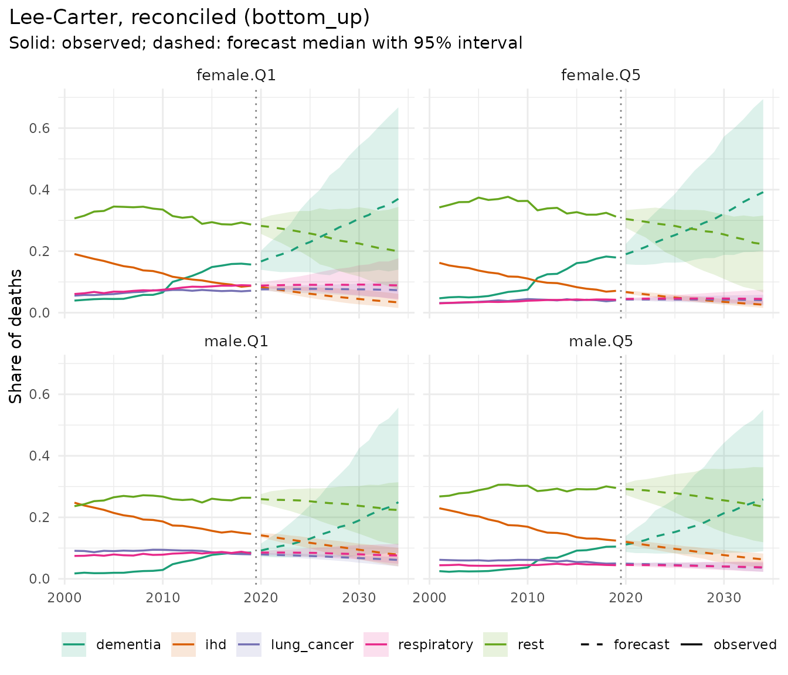

# Causes of death by deprivation

Forecasting causes of death one at a time gives cause-specific forecasts
that do not add up to the all-cause forecast. mortensor offers three
ways to coherent cause-specific forecasts:

- **bottom-up**: separate models per cause, with all causes as their sum
  (`reconciled(..., method = "bottom_up")`);
- **reconciliation**: separate models for every cause and for all
  causes, projected draw by draw so that they add up (`method = "wls"`,
  `"mint"`, …);
- **cause shares**: all-cause mortality with any model, and the shares
  of the causes with a compositional tensor model
  ([`cause_shares()`](../reference/cause_shares.md)).

This vignette compares them on deaths by cause and deprivation in
England, 2001-2019 (`ons_data`; Source: Office for National Statistics
licensed under the Open Government Licence v3.0).

``` r

library(mortensor)
library(data.table)
```

## Cause groups

The workbook has 29 causes, defined by mutually exclusive ICD-10 codes.
Several are rare, so cells by sex, quintile, 5-year age group and year
would often hold a handful of deaths. `ons_cause_groups` keeps the
common cancers and causes separate and combines small causes within
their ICD-10 chapter. The analysis starts at age 50, where the groups
have enough deaths in almost every cell (dementia and diabetes are
sparse below 50).

The deaths of `ons_data` are in wide format, one column per cause.
[`mt_data()`](../reference/mt_data.md) reads them by listing the cause
columns as the levels of the stratum variable `cause` (the all-cause
column is named `"all"`); the populations have no cause and are shared
by all causes. [`mt_subset()`](../reference/mt_subset.md) keeps ages 50
and over, and [`mt_group_levels()`](../reference/mt_group_levels.md)
combines the causes. With `total = "all"` and `other = "rest"`, the rest
is all causes minus the groups, so it also holds deaths from causes the
table does not list (including suicide).

``` r

str(ons_cause_groups)
#> List of 11
#>  $ lung_cancer      : chr "lung_cancer"
#>  $ colorectal_cancer: chr "colorectal_cancer"
#>  $ breast_prostate  : chr [1:2] "breast_cancer" "prostate_cancer"
#>  $ other_cancers    : chr "all_other_cancers"
#>  $ ihd              : chr "chronic_ischaemic_heart_disease"
#>  $ stroke           : chr "stroke_incl_transient_ischaemic_attack"
#>  $ other_circulatory: chr [1:3] "heart_failure" "hypertension" "atrial_fibrillation"
#>  $ dementia         : chr "dementia"
#>  $ respiratory      : chr [1:2] "copd" "asthma"
#>  $ diabetes         : chr [1:3] "type_1_diabetes" "type_2_diabetes" "diabetes_other"
#>  $ liver_alcohol    : chr [1:3] "alcohol_related_liver_disease" "non_alcohol_related_liver_disease" "alcohol_specific"
causes <- names(ons_data)[-(1:7)]
xc <- mt_data(deaths = ons_data, population = ons_data, by = c("sex", "imd_decile", "cause"),
              age = "age_group", value = list(deaths = c(all = "all_causes", causes), population = "population"))
xc <- mt_as_exposure(xc, type = "midyear")
xc <- mt_subset(xc, ages = c(50, Inf))
xc <- mt_group_levels(xc, "imd_decile", function(d) paste0("Q", ceiling(as.numeric(d) / 2)), name = "quintile")
xc <- mt_group_levels(xc, "cause", ons_cause_groups, other = "rest", total = "all", additive = "rates")
xc
#> <mt_data> 130 strata by sex, quintile, cause, omega = 110
#>   deaths     5-year groups 50-89, 90+; periods 2001-2019 (width 1); 22230 cells
#>   exposure   5-year groups 50-89, 90+; periods 2001-2019 (width 1); 22230 cells
#>   population 5-year groups 50-89, 90+; periods 2001-2019 (width 1); 22230 cells
#>   grid       <mt_axis: age, 9 intervals> 50-54 55-59 60-64 65-69 ... 80-84 85-89 90+
#>              <mt_axis: period, 19 intervals> 2001 2002 2003 2004 ... 2017 2018 2019
```

Breast and prostate cancer form one group, the sex-specific cancer of
each sex (for men it also contains the few male breast cancers), so that
both sexes have the same causes.

Causes share the exposure of their stratum, so their **rates** add up to
the all-cause rate. The hierarchy says so with `additive = "rates"`, and
[`mt_validate()`](../reference/mt_validate.md) checks the sums:

``` r

h <- mt_hierarchy(cause = "all", additive = "rates")
mt_validate(xc, hierarchy = h)
#> <mt_validation> 1 finding(s): 0 error, 0 warning, 1 info
#>   [info] hierarchy (deaths,exposure, 10 aggregate strata, n = 0): sums of parts agree with the totals within tolerance
```

## Inequality by cause

Age-standardised death rates at ages 50 and over (European Standard
Population 2013) per cause and quintile, and the ratio between the most
and the least deprived quintile, 2017-2019:

``` r

obs <- asr(mt_subset(xc, periods = c(2017, 2019)))[, .(asr = mean(q0.5)), by = .(sex, quintile, cause)]
ratio <- dcast(obs[quintile %in% c("Q1", "Q5")], sex + cause ~ quintile, value.var = "asr")
ratio[, `Q1 / Q5` := round(Q1 / Q5, 2)]
ratio[, c("Q1", "Q5") := lapply(.SD, round), .SDcols = c("Q1", "Q5")]
ratio[order(sex, -`Q1 / Q5`)]
#>        sex             cause    Q1    Q5 Q1 / Q5
#>     <char>            <char> <num> <num>   <num>
#>  1: female       respiratory   249    70    3.56
#>  2: female       lung_cancer   203    69    2.95
#>  3: female     liver_alcohol    59    21    2.76
#>  4: female          diabetes    36    15    2.43
#>  5: female               ihd   240   114    2.11
#>  6: female               all  2700  1613    1.67
#>  7: female other_circulatory   120    79    1.52
#>  8: female              rest   766   503    1.52
#>  9: female          dementia   403   273    1.48
#> 10: female            stroke   129    88    1.47
#> 11: female     other_cancers   354   260    1.36
#> 12: female colorectal_cancer    58    49    1.18
#> 13: female   breast_prostate    82    73    1.13
#> 14:   male     liver_alcohol   124    37    3.39
#> 15:   male       respiratory   307    96    3.19
#> 16:   male       lung_cancer   273   103    2.66
#> 17:   male          diabetes    49    21    2.32
#> 18:   male               ihd   521   269    1.94
#> 19:   male               all  3612  2135    1.69
#> 20:   male            stroke   140    90    1.56
#> 21:   male          dementia   357   230    1.55
#> 22:   male              rest   976   647    1.51
#> 23:   male other_circulatory   129    88    1.46
#> 24:   male     other_cancers   514   372    1.38
#> 25:   male colorectal_cancer    95    70    1.35
#> 26:   male   breast_prostate   126   112    1.12
#>        sex             cause    Q1    Q5 Q1 / Q5
#>     <char>            <char> <num> <num>   <num>
```

The gradient is steepest for chronic lower respiratory disease, lung
cancer, liver disease and alcohol, and diabetes, and flattest for the
sex-specific cancers and colorectal cancer.

## Three approaches in a backtest

Forecasts from the origins 2008, 2011 and 2014 are scored on the
following five years, separately for the causes and for all causes:

``` r

specs <- list(
  reconciled(lee_carter(), h, method = "bottom_up"),
  reconciled(lee_carter(), h, method = "wls"),
  reconciled(li_lee(common_by = c("sex", "cause")), h, method = "bottom_up"),
  cause_shares(total = li_lee(common_by = "sex"), ranks = c(5, 4, 6, 8)),
  lee_carter())
bt <- rbindlist(lapply(specs, function(sp) {
  b <- mt_backtest(sp, xc, origins = c(2008, 2011, 2014), h = 5, n_draws = 200)
  b[, level := ifelse(cause == "all", "all causes", "causes")]
}))
sc <- bt[, .(crps = round(mean(crps), 4), cov50 = round(mean(cov50), 2), cov95 = round(mean(cov95), 2)),
         by = .(model, level)]
dcast(sc, model ~ level, value.var = c("crps", "cov95"))
#> Key: <model>
#>                                                    model crps_all causes
#>                                                   <char>           <num>
#> 1:                 Cause shares (Li-Lee (common by sex))          0.0448
#> 2:                                            Lee-Carter          0.0409
#> 3:                    Lee-Carter, reconciled (bottom_up)          0.0353
#> 4:                          Lee-Carter, reconciled (wls)          0.0381
#> 5: Li-Lee (common by sex, cause), reconciled (bottom_up)          0.0407
#>    crps_causes cov95_all causes cov95_causes
#>          <num>            <num>        <num>
#> 1:      0.1521             0.77         0.97
#> 2:      0.1147             0.75         0.86
#> 3:      0.1148             0.78         0.86
#> 4:      0.1160             0.73         0.86
#> 5:      0.1127             0.71         0.87
```

The last row, separate Lee-Carter models without reconciliation, is not
coherent: its all-cause forecasts come from a model of their own. On
these data the bottom-up sum of separate Lee-Carter models is coherent
and forecasts all causes more accurately than a model of all-cause
mortality itself: the trends of the causes differ (ischaemic heart
disease fell much faster than the rest), and their sum follows the
changing composition. Li-Lee with one common trend per sex and cause,
also summed bottom-up, is slightly more accurate for the single causes
and less accurate for all causes. The cause-share model is clearly less
accurate here: it describes the composition through a few factors shared
by ages, years, groups and causes, which these data, with large counts
and diverse cause trends, do not need. The 95% intervals of all
approaches are too narrow for all causes (see “Frequently asked
questions” on interval calibration).

## Forecasts

Forecasts to 2034 with the bottom-up approach:

``` r

fit <- mt_fit(reconciled(lee_carter(), h, method = "bottom_up"), xc)
fc <- mt_forecast(fit, h = 15, n_draws = 500, seed = 1)
fc$reconciliation
#> $method
#> [1] "bottom_up"
#> 
#> $max_relative_gap_before
#> [1] 0.8730635
#> 
#> $share_set_to_zero
#> [1] 0
#> 
#> $mean_shrinkage
#> [1] NA
#> 
#> $max_relative_change_fixed
#> [1] NA
```

``` r

mt_plot_shares(fc, groups = c("female.Q1", "female.Q5", "male.Q1", "male.Q5"),
               causes = c("ihd", "dementia", "lung_cancer", "respiratory", "rest"))
```



Dementia deaths rose steeply between 2001 and 2019. Separate models per
stratum extrapolate that rise for 15 years, which makes dementia the
largest group by 2034 with very wide intervals. Whether such a trend
continues is a substantive question (recorded trends of single causes
can reflect changes in diagnosis, certification and coding as well as in
risk), and the forecast should be read as a conditional statement.

Age-standardised rates and the ratio Q1 / Q5, path by path, so that the
intervals of the ratio include the joint uncertainty of both quintiles:

``` r

rr <- mt_contrast(fc, var = "quintile", ref = "Q5", quantity = "asr", type = "ratio")[level == "Q1" & period == 2034]
rr <- rr[, .(sex, cause, q0.025 = round(q0.025, 2), q0.5 = round(q0.5, 2), q0.975 = round(q0.975, 2))]
merge(rr, ratio[, .(sex, cause, `2017-2019` = `Q1 / Q5`)], by = c("sex", "cause"))[order(sex, -q0.5)]
#>        sex             cause q0.025  q0.5 q0.975 2017-2019
#>     <char>            <char>  <num> <num>  <num>     <num>
#>  1: female       respiratory   2.36  4.12   6.71      3.56
#>  2: female       lung_cancer   2.73  3.50   4.99      2.95
#>  3: female          diabetes   1.81  3.35   8.55      2.43
#>  4: female     liver_alcohol   1.23  3.05   6.93      2.76
#>  5: female               ihd   1.62  2.63   3.96      2.11
#>  6: female               all   1.32  2.07   2.85      1.67
#>  7: female          dementia   0.54  2.00   5.12      1.48
#>  8: female              rest   1.21  1.93   3.22      1.52
#>  9: female            stroke   1.33  1.79   2.54      1.47
#> 10: female other_circulatory   0.90  1.71   2.96      1.52
#> 11: female     other_cancers   1.21  1.39   1.75      1.36
#> 12: female   breast_prostate   0.93  1.31   1.80      1.13
#> 13: female colorectal_cancer   0.81  1.21   2.14      1.18
#> 14:   male       respiratory   2.72  3.88   5.07      3.19
#> 15:   male       lung_cancer   2.37  3.03   3.96      2.66
#> 16:   male     liver_alcohol   1.73  2.80   5.34      3.39
#> 17:   male          diabetes   1.18  2.75   6.23      2.32
#> 18:   male               ihd   1.76  2.21   2.97      1.94
#> 19:   male          dementia   0.37  2.06   9.05      1.55
#> 20:   male               all   1.28  1.93   3.03      1.69
#> 21:   male              rest   1.28  1.73   2.37      1.51
#> 22:   male other_circulatory   0.76  1.68   4.24      1.46
#> 23:   male            stroke   0.99  1.65   3.00      1.56
#> 24:   male   breast_prostate   1.16  1.41   1.83      1.12
#> 25:   male     other_cancers   1.16  1.41   1.57      1.38
#> 26:   male colorectal_cancer   0.93  1.33   2.03      1.35
#>        sex             cause q0.025  q0.5 q0.975 2017-2019
#>     <char>            <char>  <num> <num>  <num>     <num>
```

Separate models per stratum extrapolate each quintile’s own trend, so
the ratios continue the recent changes of the gradient, with wide
intervals. Li-Lee with a common trend per sex and cause lets the
quintiles deviate from that trend only through stationary processes,
which keeps the ratios close to their average over the training years:

``` r

fc_ll <- mt_forecast(mt_fit(specs[[3]], xc), h = 15, n_draws = 500, seed = 1)
rr_ll <- mt_contrast(fc_ll, var = "quintile", ref = "Q5", quantity = "asr", type = "ratio")[level == "Q1" &
                                                                                              period == 2034]
merge(rr[, .(sex, cause, lee_carter = q0.5)], rr_ll[, .(sex, cause, li_lee = round(q0.5, 2))],
      by = c("sex", "cause"))[order(sex, -lee_carter)]
#>        sex             cause lee_carter li_lee
#>     <char>            <char>      <num>  <num>
#>  1: female       respiratory       4.12   2.93
#>  2: female       lung_cancer       3.50   2.51
#>  3: female          diabetes       3.35   1.98
#>  4: female     liver_alcohol       3.05   2.58
#>  5: female               ihd       2.63   1.95
#>  6: female               all       2.07   1.48
#>  7: female          dementia       2.00   1.28
#>  8: female              rest       1.93   1.40
#>  9: female            stroke       1.79   1.30
#> 10: female other_circulatory       1.71   1.40
#> 11: female     other_cancers       1.39   1.27
#> 12: female   breast_prostate       1.31   1.06
#> 13: female colorectal_cancer       1.21   1.12
#> 14:   male       respiratory       3.88   2.72
#> 15:   male       lung_cancer       3.03   2.38
#> 16:   male     liver_alcohol       2.80   3.52
#> 17:   male          diabetes       2.75   1.99
#> 18:   male               ihd       2.21   1.75
#> 19:   male          dementia       2.06   1.36
#> 20:   male               all       1.93   1.52
#> 21:   male              rest       1.73   1.46
#> 22:   male other_circulatory       1.68   1.39
#> 23:   male            stroke       1.65   1.48
#> 24:   male   breast_prostate       1.41   0.96
#> 25:   male     other_cancers       1.41   1.32
#> 26:   male colorectal_cancer       1.33   1.28
#>        sex             cause lee_carter li_lee
#>     <char>            <char>      <num>  <num>
```

When an all-cause forecast is trusted more than the sum of the causes
(for example one that matches an official projection), the causes can be
reconciled to it: `fixed = "total"` keeps the strata of the total level,
here all causes in every sex and quintile, and a projection method moves
only the causes. On these data the bottom-up sum forecast all causes
more accurately, so this is shown for illustration:

``` r

fc_fx <- mt_forecast(mt_fit(reconciled(lee_carter(), h, method = "wls", fixed = "total"), xc), h = 10,
                     n_draws = 100, seed = 1)
fc_fx$reconciliation$max_relative_change_fixed
#> [1] 6.502021e-09
a <- rbind(asr(fc)[, approach := "bottom-up"], asr(fc_fx)[, approach := "all causes fixed"])
dcast(a[period == 2029 & sex == "female" & cause %in% c("all", "ihd", "dementia", "lung_cancer"),
        .(approach, quintile, cause, asr = round(q0.5))], quintile + cause ~ approach, value.var = "asr")
#> Key: <quintile, cause>
#>     quintile       cause all causes fixed bottom-up
#>       <char>      <char>            <num>     <num>
#>  1:       Q1         all             2423      2954
#>  2:       Q1    dementia              465       824
#>  3:       Q1         ihd              139       141
#>  4:       Q1 lung_cancer              229       231
#>  5:       Q2         all             1894      2223
#>  6:       Q2    dementia              387       611
#>  7:       Q2         ihd               99       101
#>  8:       Q2 lung_cancer              148       151
#>  9:       Q3         all             1669      1928
#> 10:       Q3    dementia              372       561
#> 11:       Q3         ihd               83        80
#> 12:       Q3 lung_cancer              115       116
#> 13:       Q4         all             1514      1756
#> 14:       Q4    dementia              330       490
#> 15:       Q4         ihd               71        71
#> 16:       Q4 lung_cancer               98       100
#> 17:       Q5         all             1251      1506
#> 18:       Q5    dementia              257       447
#> 19:       Q5         ihd               56        57
#> 20:       Q5 lung_cancer               70        70
#>     quintile       cause all causes fixed bottom-up
#>       <char>      <char>            <num>     <num>
```

The all-cause model forecasts lower rates than the sum of the cause
models. With WLS the difference falls mostly on dementia, whose draws
vary most and so carry the largest weight; the other causes barely
change. Which cause absorbs the gap follows from the weights, not from
evidence about the causes, so a fixed total is a modelling decision that
should be reported.

Which assumption is more plausible is a judgement the backtest cannot
settle over five years. Deprivation deciles are also reclassified with
each new IMD version (2007, 2010, 2015 and 2019 in these data), and
cause coding changes over time, so trends of single causes in single
quintiles deserve a critical look before they are extrapolated.
