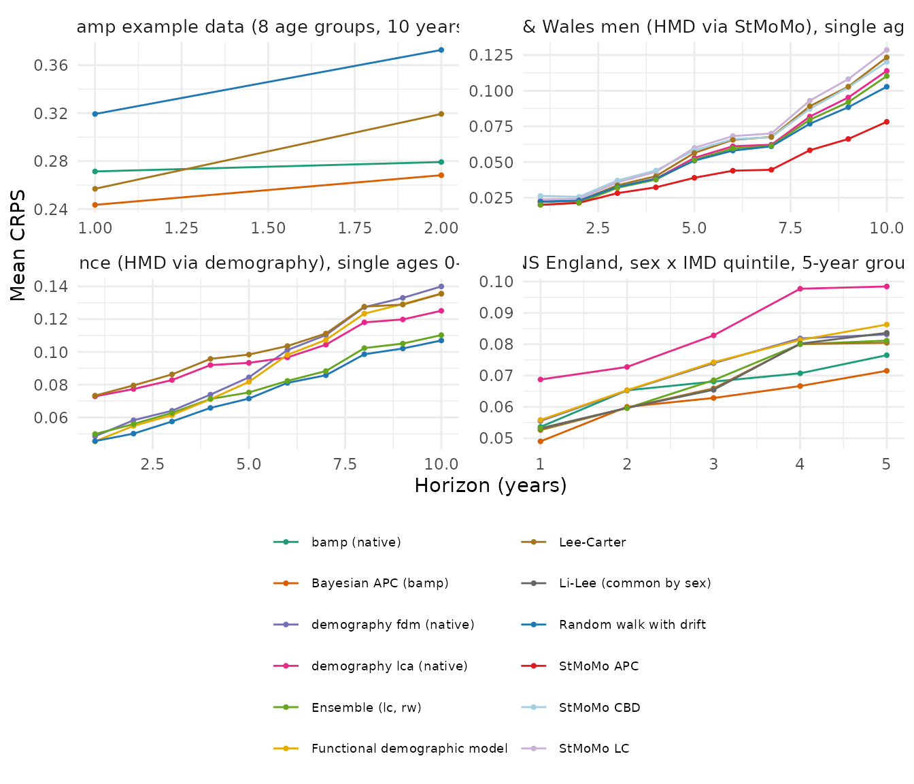

# Comparison with demography, bamp and StMoMo

mortensor wraps established implementations (Lee-Carter as in StMoMo and
demography, the functional demographic model of demography, Bayesian
age-period-cohort models of bamp) and adds its own data handling,
predictive draws, backtests and coherence. Two questions follow:

1.  **Fidelity**: given the same data and settings, do the wrappers
    reproduce the original packages?
2.  **Accuracy**: how do forecasts made with the original packages, used
    as their documentation recommends, compare with mortensor pipelines
    in rolling-origin backtests?

The computations take one to one and a half hours, mostly for MCMC
chains, and are run by `dev/compare-packages.R` in the source
repository; this vignette shows the code and reads the stored results.
Versions used:

``` r

res$settings$versions
#>  mortensor demography       bamp     StMoMo   forecast 
#>    "0.3.0"    "2.0.1"    "3.0.0"    "0.4.1"   "8.21.1"
```

## Fidelity

### Lee-Carter

[`lee_carter()`](../reference/lee_carter.md) fits the Poisson
log-bilinear model of Brouhns, Denuit and Vermunt (2002) as StMoMo does,
and `lee_carter(method = "svd")` the original least-squares version with
the adjustment of k to the observed deaths, as
[`demography::lca()`](https://pkg.robjhyndman.com/demography/reference/lca.html)
does. Maximum absolute differences of log death rates:

``` r

res$fidelity$lee_carter[, .(comparison, data, max_abs_difference = signif(max_abs_difference, 2))]
#>                                                                               comparison
#>                                                                                   <char>
#> 1:                                         lee_carter() vs StMoMo lc(): fitted log rates
#> 2:                    lee_carter() vs StMoMo lc(): central forecast, log rates, h = 1-10
#> 3:                      lee_carter(method = "svd") vs demography lca(): fitted log rates
#> 4: lee_carter(method = "svd") vs demography lca(): central forecast, log rates, h = 1-10
#>                                    data max_abs_difference
#>                                  <char>              <num>
#> 1: England & Wales men 55-89, 1961-2011            2.5e-05
#> 2: England & Wales men 55-89, 1961-2011            2.8e-05
#> 3:           France men 0-95, 1950-2006            9.1e-07
#> 4:           France men 0-95, 1950-2006            3.3e-09
```

The fitted rates agree to optimisation tolerance. Central forecasts
differ only through the drift: both packages extrapolate k with a random
walk with drift.

### Functional demographic model

[`hyndman_ullah()`](../reference/hyndman_ullah.md) calls
[`demography::fdm()`](https://pkg.robjhyndman.com/demography/reference/fdm.html)
and draws paths with
[`simulate()`](https://rdrr.io/r/stats/simulate.html) from the forecast.
With the same input (French men 0-95, 1950-2006, 6 components, ARIMA,
without the smoothing over age that
[`hyndman_ullah()`](../reference/hyndman_ullah.md) applies by default),
the median of 2,000 mortensor draws is compared with demography’s point
forecast, and the width of the central 80% interval of the draws with
demography’s 80% interval:

``` r

res$fidelity$fdm[, lapply(.SD, signif, 3)]
#>    horizon median_abs_log_diff_point max_abs_log_diff_point
#>      <num>                     <num>                  <num>
#> 1:       1                  0.000995                0.00731
#> 2:      10                  0.001400                0.01080
#> 3:      20                  0.002830                0.01660
#>    width80_ratio_median
#>                   <num>
#> 1:                0.807
#> 2:                0.935
#> 3:                0.969
```

demography computes its intervals analytically from the variance of the
coefficients, the model error and the observational variance;
[`simulate()`](https://rdrr.io/r/stats/simulate.html) draws coefficient
paths and model errors. Width ratios below one mean that the simulated
paths are narrower than demography’s analytic intervals.

### Bayesian age-period-cohort models

[`apc_bayes()`](../reference/apc_bayes.md) calls
[`bamp::bamp()`](https://volkerschmid.github.io/bamp/reference/bamp.html)
and
[`bamp::predict_apc()`](https://volkerschmid.github.io/bamp/reference/predict_apc.html).
On bamp’s own example data (8 five-year age groups, 10 years), the
forecast log rates of three future years from
[`apc_bayes()`](../reference/apc_bayes.md) are compared with a native
bamp run with the same priors and chain settings; a second native run
with another seed shows the Monte Carlo variation of bamp itself.
Differences are in units of the posterior standard deviation:

``` r

res$fidelity$bamp[, lapply(.SD, function(v) if (is.numeric(v)) signif(v, 2) else v)]
#>                        comparison max_abs_diff_median_in_sd
#>                            <char>                     <num>
#> 1:   apc_bayes() vs bamp (seed 1)                     0.055
#> 2: bamp (seed 2) vs bamp (seed 1)                     0.068
#>    max_abs_diff_90_bounds_in_sd
#>                           <num>
#> 1:                         0.15
#> 2:                         0.11
```

## Accuracy

### Design

Each original package is wrapped as a model specification that returns
its own predictive distribution, so that
[`mt_backtest()`](../reference/mt_backtest.md) scores all forecasts in
the same way: rolling origins, predictive draws compared with the
observed death rates at their observed resolution, CRPS on the log
scale, interval coverage. The adapters (abbreviated):

``` r

# demography: functional demographic model, the documented workflow
fit_model.mt_spec_native_fdm <- function(spec, D, E, ages, periods, ...) {
  dd <- demography::demogdata(pmax(D, 0.5) / E, pop = E, ages = ages$lower, years = periods,
                              type = "mortality", label = "native", name = "s")
  if (all(utils::head(ages$upper - ages$lower, -1) == 1)) dd <- demography::smooth.demogdata(dd)
  list(fit = demography::fdm(dd, series = "s", order = 6))
}
simulate_model.mt_spec_native_fdm <- function(spec, fit, h, n_draws, ...) {
  fc <- forecast::forecast(fit$fit, h = h)        # point forecast and total variance
  mu <- log(fc$rate$s)
  sd <- sqrt(fc$var$total)
  array(exp(rep(mu, n_draws) + rep(sd, n_draws) * rnorm(length(mu) * n_draws)), c(dim(mu), n_draws))
}

# bamp: random walks of first order, posterior samples of future rates
fit_model.mt_spec_native_bamp <- function(spec, D, E, ages, periods, ...) {
  list(model = bamp::bamp(round(t(D)), round(t(E)), age = "rw1", period = "rw1", cohort = "rw1",
                          periods_per_agegroup = 5, mcmc.options = mcmc_control("fast")$options))
}
simulate_model.mt_spec_native_bamp <- function(spec, fit, h, n_draws, ...) {
  pr <- bamp::predict_apc(fit$model, periods = h)$samples$pr
  ...   # future periods, n_draws samples, as [age, period, draw]
}
```

[`demography::lca()`](https://pkg.robjhyndman.com/demography/reference/lca.html)
is wrapped in the same way (random walk with drift for k, its 95%
bounds); StMoMo models are used through
[`stmomo()`](../reference/stmomo.md), which calls `fit()` and
[`simulate()`](https://rdrr.io/r/stats/simulate.html). The native
distributions of bamp and `lca()` describe the smooth death rates, and
that of `fdm()` includes an observational variance; for models of smooth
rates, mortensor’s predictive draws add Poisson variation of the deaths
given the rates (Brouhns, Denuit and Vermunt 2002).

Data sets: the ONS deprivation data (`ons_data`, sex by quintile, 5-year
age groups with 0-4 combined so that bamp has equal widths), France (HMD
via demography, single ages 0-95), England & Wales men (HMD via StMoMo,
single ages 55-89) and bamp’s example data.

``` r

acc <- res$accuracy
for (d in unique(acc$data)) {
  cat("\n", d, "\n", sep = "")
  print(acc[data == d, .(model, crps = fmt(crps, 4), cov50 = fmt(cov50, 2), cov80 = fmt(cov80, 2),
                         cov95 = fmt(cov95, 2), seconds = round(seconds))], row.names = FALSE)
}
#> 
#> England & Wales men (HMD via StMoMo), single ages 55-89
#>                    model   crps  cov50  cov80  cov95 seconds
#>                   <char> <char> <char> <char> <char>   <num>
#>               StMoMo APC 0.0432   0.33   0.75   0.98       3
#>   Random walk with drift 0.0554   0.48   0.80   0.97       0
#>        Ensemble (lc, rw) 0.0566   0.38   0.73   0.94       1
#>  demography lca (native) 0.0583   0.31   0.60   0.79       0
#>               Lee-Carter 0.0624   0.28   0.52   0.74       0
#>               StMoMo CBD 0.0635   0.33   0.57   0.76       1
#>                StMoMo LC 0.0655   0.23   0.46   0.70       1
#> 
#> France (HMD via demography), single ages 0-95
#>                         model   crps  cov50  cov80  cov95 seconds
#>                        <char> <char> <char> <char> <char>   <num>
#>        Random walk with drift 0.0765   0.65   0.91   0.98       2
#>             Ensemble (lc, rw) 0.0803   0.47   0.82   0.97       2
#>  Functional demographic model 0.0908   0.28   0.49   0.66      19
#>       demography fdm (native) 0.0941   0.24   0.43   0.59      14
#>       demography lca (native) 0.0982   0.31   0.54   0.74       2
#>                    Lee-Carter 0.1040   0.26   0.46   0.65       2
#> 
#> ONS England, sex x IMD quintile, 5-year groups
#>                         model   crps  cov50  cov80  cov95 seconds
#>                        <char> <char> <char> <char> <char>   <num>
#>           Bayesian APC (bamp) 0.0620   0.47   0.75   0.91    2933
#>                 bamp (native) 0.0668   0.37   0.62   0.79    2913
#>                    Lee-Carter 0.0677   0.33   0.58   0.77       2
#>        Li-Lee (common by sex) 0.0684   0.35   0.60   0.77       2
#>             Ensemble (lc, rw) 0.0685   0.43   0.75   0.92       3
#>       demography fdm (native) 0.0719   0.33   0.57   0.76      12
#>  Functional demographic model 0.0726   0.34   0.62   0.81      31
#>       demography lca (native) 0.0841   0.21   0.39   0.56       2
#> 
#> bamp example data (8 age groups, 10 years)
#>                   model   crps  cov50  cov80  cov95 seconds
#>                  <char> <char> <char> <char> <char>   <num>
#>     Bayesian APC (bamp) 0.2559   0.42   0.54   0.69      34
#>           bamp (native) 0.2753   0.23   0.42   0.60      32
#>              Lee-Carter 0.2881   0.31   0.58   0.71       0
#>  Random walk with drift 0.3460   0.54   0.81   0.85       0
```

``` r

library(ggplot2)
ggplot(res$by_horizon, aes(horizon, crps, colour = model)) +
  geom_line() + geom_point(size = 0.8) +
  facet_wrap(~ data, scales = "free", ncol = 2) +
  labs(x = "Horizon (years)", y = "Mean CRPS", colour = NULL) +
  scale_colour_mortensor(type = "categorical") +
  theme_mortensor() +
  theme(legend.text = element_text(size = 7)) +
  guides(colour = guide_legend(ncol = 2))
```



### Results

**Fidelity.** The Lee-Carter fits agree with StMoMo and demography to
optimisation tolerance (largest difference of log rates 3e-05). The
medians of the simulated functional-demographic-model paths agree with
demography’s point forecasts to within 0.3% (median absolute log
difference); the simulated 80% intervals are 19% narrower than
demography’s analytic intervals at horizon 1 and nearly as wide at 20
years. The Bayesian APC forecasts of
[`apc_bayes()`](../reference/apc_bayes.md) differ from native bamp by
about as much as two independent bamp runs differ from each other, so
the wrapper adds no difference beyond Monte Carlo error.

**Accuracy.** Four observations hold across the data sets:

- The same model used through mortensor scores better than the native
  package in 4 of 7 comparisons. Where the native intervals describe the
  smooth rates only, the Poisson variation of the deaths in mortensor’s
  predictive draws improves coverage: bamp on the ONS data covers 0.79
  of observed rates at 95% natively and 0.91 through
  [`apc_bayes()`](../reference/apc_bayes.md), on bamp’s example 0.60
  against 0.69; `lca()` on the ONS data 0.56 against 0.77 for
  [`lee_carter()`](../reference/lee_carter.md). The functional
  demographic model on France is more accurate through mortensor (CRPS
  0.091 against 0.094, coverage 0.66 against 0.59). The exceptions are
  the functional demographic model on the ONS data, where the native
  forecast is slightly more accurate (CRPS 0.0719 against 0.0726) with
  lower coverage (0.76 against 0.81), and
  [`demography::lca()`](https://pkg.robjhyndman.com/demography/reference/lca.html)
  on France and on England & Wales men, whose least-squares fit with k
  adjusted to the observed deaths is more accurate there than the
  Poisson Lee-Carter of [`lee_carter()`](../reference/lee_carter.md)
  (CRPS 0.098 against 0.104 and 0.058 against 0.062) and, on England &
  Wales men, of StMoMo.
- No single model is best everywhere. The Bayesian APC model is the most
  accurate on the ONS data and on bamp’s example, the StMoMo APC model
  on England & Wales men 55-89 (cohort effects), and the random walk
  with drift on France, where the age pattern of mortality decline
  changed over the period and Lee-Carter extrapolates the old pattern.
- Single structured models (Lee-Carter, `lca()`, functional demographic
  model, Li-Lee, StMoMo LC and CBD) have 95% intervals that cover 56% to
  81% of the observed rates on the three larger data sets, so they
  understate the uncertainty of real forecasts. On the three larger data
  sets the random walk and the ensemble of Lee-Carter and random walk
  cover 92% to 98% (bamp’s example has only 48 scored cells).
- The ensemble is never the most accurate (its CRPS is 10% above that of
  the best model on the ONS data, 5% on France and 31% on England &
  Wales men), but its coverage is near nominal on all three data sets,
  at the cost of seconds; the Bayesian APC models
  ([`apc_bayes()`](../reference/apc_bayes.md) and native bamp) took
  about 49 minutes each per backtest on the ONS data.

On data like these, an ensemble is a robust default, and a backtest on
the data at hand ([`mt_backtest()`](../reference/mt_backtest.md))
decides whether a structured model such as an APC model is worth its
cost.

## References

Brouhns N, Denuit M, Vermunt JK (2002). A Poisson log-bilinear
regression approach to the construction of projected lifetables.
*Insurance: Mathematics and Economics* 31(3): 373-393.

Hyndman RJ, Ullah MS (2007). Robust forecasting of mortality and
fertility rates: a functional data approach. *Computational Statistics &
Data Analysis* 51(10): 4942-4956.

Lee RD, Carter LR (1992). Modeling and forecasting U.S. mortality.
*Journal of the American Statistical Association* 87(419): 659-671.

Schmid VJ, Held L (2007). Bayesian age-period-cohort modeling and
prediction: BAMP. *Journal of Statistical Software* 21(8): 1-15.

Villegas AM, Kaishev VK, Millossovich P (2018). StMoMo: an R package for
stochastic mortality modeling. *Journal of Statistical Software* 84(3):
1-38.
