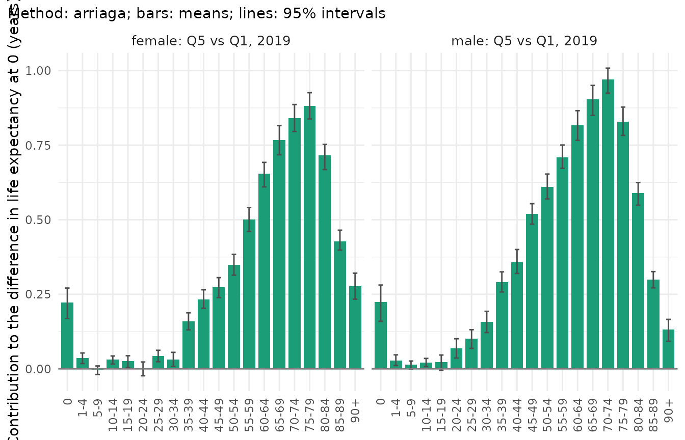
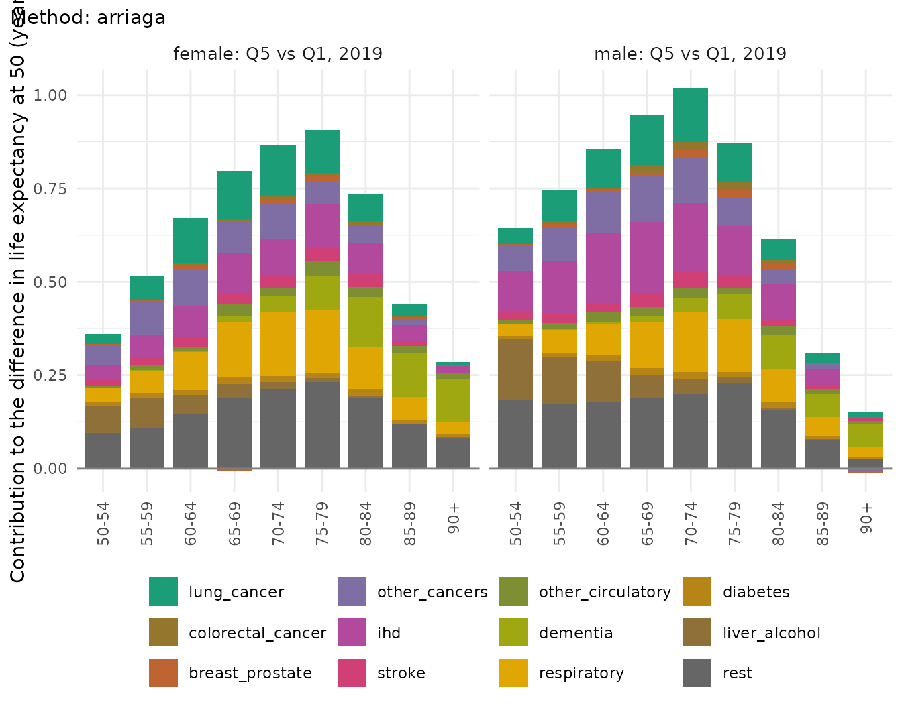
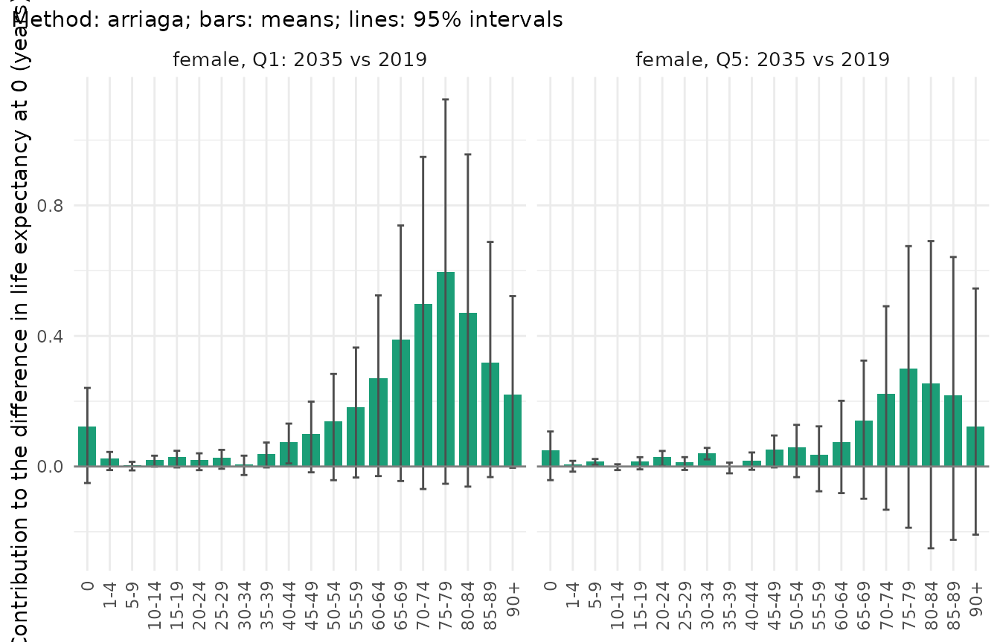
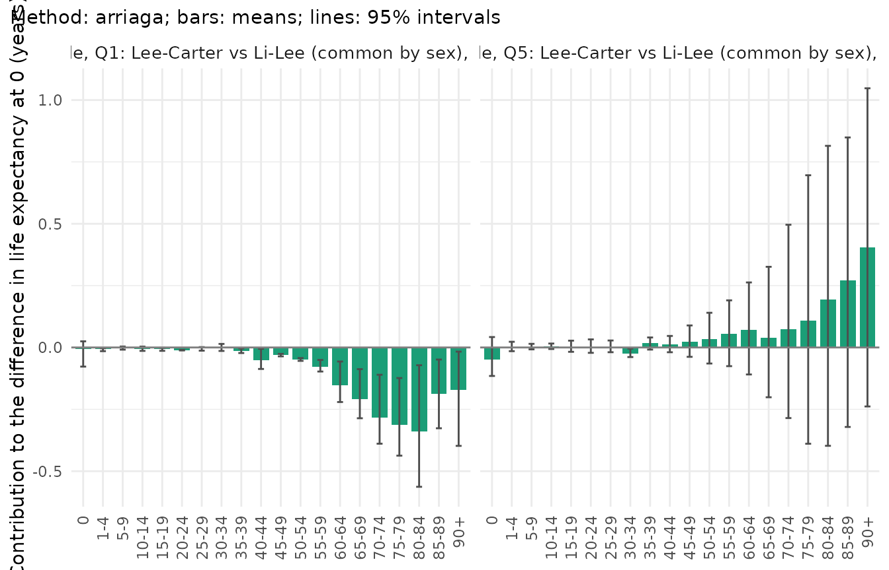

# Decomposing differences in life expectancy

A difference in life expectancy, between deprivation quintiles, between
two years or between two forecasts, is the sum of differences in death
rates at many ages and from many causes. A decomposition attributes it
to those ages and causes, and, for populations made of subgroups,
separates the effect of the subgroups’ mortality from the effect of
their composition. In mortensor this is a post-processing step,
[`mt_decompose()`](../reference/mt_decompose.md), that works on observed
data, on forecast draws, and on both together. Forecasts are decomposed
draw by draw, so every contribution has an interval.

| Method | Decomposes | Reference |
|----|----|----|
| `"arriaga"` (default for life expectancy) | life expectancy, by age (and cause) | Arriaga (1984), symmetric form as in Riffe et al. (2024) |
| `"horiuchi"` | any function of the rates | Horiuchi, Wilmoth and Pletcher (2008) |
| `"stepwise"` | any function of the rates | Andreev, Shkolnikov and Begun (2002) |
| `"kitagawa"` | crude death rate: rates and age structure | Kitagawa (1955) |
| `groups` with `composition = "radix"` | life expectancy of a population of subgroups: subgroup rates and composition | Riffe, Tursun-zade and Trias Llimós (2024), “Arriaga meets Kitagawa” |
| `groups` with `composition = "pooled"` | life expectancy of the pooled rates: subgroup rates and age-specific composition | Horiuchi et al. (2008) |

``` r

library(mortensor)
library(data.table)
x <- mt_data(deaths = ons_data, population = ons_data, by = c("sex", "imd_decile"), age = "age_group",
             value = c(deaths = "all_causes", population = "population"))
x <- mt_as_exposure(x, type = "midyear")
x <- mt_group_levels(x, "imd_decile", function(d) paste0("Q", ceiling(as.numeric(d) / 2)), name = "quintile")
```

The data are the ONS deaths and populations of England by sex, 5-year
age group and IMD quintile, 2001-2019 (`ons_data`; Source: Office for
National Statistics licensed under the Open Government Licence v3.0). Q1
is the most deprived quintile.

## The deprivation gap by age

Each quintile compared with Q1 in 2019, with 200 Poisson draws of the
deaths for the intervals:

``` r

gap <- mt_decompose(x, var = "quintile", ref = "Q1", periods = 2019, n_draws = 200)
gap
#> <mt_decomposition> life expectancy at 0, method arriaga; 8 comparison(s), 200 draw(s)
#>    comparison    sex   from     to period from_value to_value difference
#>         <int> <char> <char> <char>  <num>      <num>    <num>      <num>
#> 1:          1 female     Q1     Q2   2019     79.825   82.501      2.676
#> 2:          2 female     Q1     Q3   2019     79.825   83.930      4.105
#> 3:          3 female     Q1     Q4   2019     79.825   85.020      5.195
#> 4:          4 female     Q1     Q5   2019     79.825   86.290      6.465
#> 5:          5   male     Q1     Q2   2019     75.429   78.596      3.167
#> 6:          6   male     Q1     Q3   2019     75.429   80.604      5.174
#> 7:          7   male     Q1     Q4   2019     75.429   81.818      6.389
#> 8:          8   male     Q1     Q5   2019     75.429   83.094      7.665
#>    difference_q0.025 difference_q0.5 difference_q0.975 sum_contributions
#>                <num>           <num>             <num>             <num>
#> 1:             2.515           2.682             2.826             2.676
#> 2:             3.969           4.109             4.249             4.105
#> 3:             5.027           5.198             5.335             5.195
#> 4:             6.318           6.466             6.615             6.465
#> 5:             3.001           3.166             3.332             3.167
#> 6:             5.013           5.168             5.312             5.174
#> 7:             6.223           6.384             6.564             6.389
#> 8:             7.521           7.659             7.831             7.665
#>    max_residual
#>           <num>
#> 1:      1.3e-14
#> 2:      1.7e-14
#> 3:      1.5e-14
#> 4:      1.6e-14
#> 5:      1.6e-14
#> 6:      1.5e-14
#> 7:      1.6e-14
#> 8:      1.4e-14
```

The totals list one comparison per row: the life expectancy of the
reference (`from_value`) and of the level (`to_value`), their difference
with its interval, and the sum of the age contributions, which equals
the difference (`max_residual` is the largest discrepancy over draws).
`summary(gap, by = "age")` gives the contributions; the plot shows them
for the gap between Q5 and Q1 (comparisons 4 and 8):

``` r

mt_plot_decomposition(gap, by = "age", comparisons = c(4, 8))
```



``` r

s <- summary(gap, by = "age")[to == "Q5"]
s[, band := cut(as.numeric(sub("[-+].*", "", age)), c(-1, 39, 64, 84, Inf),
                labels = c("0-39", "40-64", "65-84", "85+"))]
dcast(s[, .(contribution = round(sum(mean), 2)), by = .(sex, band)], sex ~ band, value.var = "contribution")
#> Key: <sex>
#>       sex  0-39 40-64 65-84   85+
#>    <char> <num> <num> <num> <num>
#> 1: female  0.55  2.01  3.20  0.70
#> 2:   male  0.93  3.01  3.29  0.43
```

The gap of 6.5 years for women and 7.7 years for men comes mostly from
ages 40 to 84 (5.2 and 6.3 years): deaths at working ages and in early
old age are much more frequent in Q1. Ages below 40 add 0.6 years for
women and 0.9 years for men; infant mortality alone adds 0.2 years for
women. With Poisson draws of the observed deaths, the intervals of
single ages are narrow.

The methods agree closely. Symmetric Arriaga and symmetric stepwise
replacement are identical for life expectancy, because Arriaga’s
decomposition is stepwise replacement from the oldest to the youngest
age; the line integral assigns interactions between ages slightly
differently:

``` r

meth <- rbindlist(lapply(c("arriaga", "horiuchi", "stepwise"), function(m) {
  d <- mt_decompose(x, var = "quintile", ref = "Q1", periods = 2019, method = m)
  summary(d, by = "age")[to == "Q5" & sex == "female", .(age, method = m, mean = round(mean, 3))]
}))
meth[, age := factor(age, unique(age))]
dcast(meth, age ~ method, value.var = "mean")[age %in% c("0", "40-44", "60-64", "75-79", "90+")]
#> Key: <age>
#>       age arriaga horiuchi stepwise
#>    <fctr>   <num>    <num>    <num>
#> 1:      0   0.221    0.221    0.221
#> 2:  40-44   0.232    0.231    0.232
#> 3:  60-64   0.651    0.650    0.651
#> 4:  75-79   0.881    0.886    0.881
#> 5:    90+   0.276    0.272    0.276
```

## Causes behind the gap

Causes of death are a stratum variable whose rates add up to all causes.
`cause` names it, and the hierarchy tells
[`mt_decompose()`](../reference/mt_decompose.md) which level is the
total. At ages 50 and over (as in “Causes of death by deprivation”):

``` r

causes <- names(ons_data)[-(1:7)]
xc <- mt_data(deaths = ons_data, population = ons_data, by = c("sex", "imd_decile", "cause"),
              age = "age_group", value = list(deaths = c(all = "all_causes", causes), population = "population"))
xc <- mt_as_exposure(xc, type = "midyear")
xc <- mt_subset(xc, ages = c(50, Inf), periods = c(2019, 2019))
xc <- mt_group_levels(xc, "imd_decile", function(d) paste0("Q", ceiling(as.numeric(d) / 2)), name = "quintile")
xc <- mt_group_levels(xc, "cause", ons_cause_groups, other = "rest", total = "all", additive = "rates")
gc <- mt_decompose(xc, var = "quintile", ref = "Q1", cause = "cause",
                   hierarchy = mt_hierarchy(cause = "all", additive = "rates"))
sc <- summary(gc, by = "cause")[to == "Q5"]
dcast(sc, cause ~ sex, value.var = "mean")[order(-female), lapply(.SD, function(v) if (is.numeric(v)) round(v, 2) else v)]
#>                 cause female  male
#>                <char>  <num> <num>
#>  1:              rest   1.37  1.42
#>  2:       respiratory   0.89  0.77
#>  3:       lung_cancer   0.71  0.71
#>  4:               ihd   0.65  1.09
#>  5:     other_cancers   0.54  0.65
#>  6:          dementia   0.52  0.34
#>  7:     liver_alcohol   0.28  0.51
#>  8:            stroke   0.21  0.21
#>  9: other_circulatory   0.18  0.17
#> 10:          diabetes   0.12  0.12
#> 11: colorectal_cancer   0.04  0.09
#> 12:   breast_prostate   0.04  0.07
```

``` r

mt_plot_decomposition(gc, by = "age", fill = "cause", comparisons = c(4, 8))
```



Each age contribution is split over the causes in proportion to their
rate differences (Riffe et al. 2024, eqs. 12-13). Of the gap in life
expectancy at 50, respiratory diseases, lung cancer and ischaemic heart
disease contribute most among the named causes, for both sexes, and the
remaining causes together (`rest`) contribute a large share. Causes with
higher rates in Q5 than in Q1 would have negative contributions.

## Change over time and the composition of England

The life expectancy of England changes because the mortality of every
quintile changes and because the population shifts between quintiles.
Riffe, Tursun-zade and Trias Llimós (2024) treat the life expectancy of
a population of subgroups as the mean of the subgroups’ life
expectancies, weighted by their shares at the start of life (the radix).
A Kitagawa decomposition of that mean separates the composition from the
change within each subgroup, which is then split by age:

``` r

eng <- mt_decompose(x, periods = c(2001, 2019), groups = "quintile")
eng
#> <mt_decomposition> life expectancy at 0, method arriaga, radix composition; 2 comparison(s), 1 draw(s)
#>    comparison    sex   from     to from_value to_value difference
#>         <int> <char> <char> <char>      <num>    <num>      <num>
#> 1:          1 female   2001   2019     80.418   83.139      2.721
#> 2:          2   male   2001   2019     75.721   79.463      3.742
#>    sum_contributions max_residual
#>                <num>        <num>
#> 1:             2.721      3.1e-15
#> 2:             3.742      1.3e-15
summary(eng, by = c("component", "group"))[, .(sex, component, group, mean = round(mean, 3))]
#>        sex   component  group   mean
#>     <char>      <char> <char>  <num>
#>  1: female        rate     Q1  0.543
#>  2: female        rate     Q2  0.600
#>  3: female        rate     Q3  0.549
#>  4: female        rate     Q4  0.536
#>  5: female        rate     Q5  0.589
#>  6: female composition   <NA> -0.096
#>  7:   male        rate     Q1  0.947
#>  8:   male        rate     Q2  0.825
#>  9:   male        rate     Q3  0.737
#> 10:   male        rate     Q4  0.703
#> 11:   male        rate     Q5  0.658
#> 12:   male composition   <NA> -0.128
```

Life expectancy at birth of England, computed this way, rose by 2.7
years for women and 3.7 years for men. Every quintile contributed about
half a year or more; for men, Q1 contributed most. The composition
effect is negative: in 2019 a larger share of births was in the more
deprived quintiles than in 2001. The deciles are defined by the IMD
version of each year, so the shares partly reflect reclassification of
areas.

The radix-weighted life expectancy is not the life expectancy of the
pooled rates of England, which weight the quintiles by their population
at each age (Vaupel 2002 calls these “current conditions” and “current
rates”). `composition = "pooled"` decomposes the latter, with the shares
at every age as parameters of a line-integral decomposition:

``` r

eng_pooled <- mt_decompose(x, periods = c(2001, 2019), groups = "quintile", composition = "pooled")
summary(eng_pooled, by = NULL)[, .(sex, from_value, to_value, difference)]
#>       sex from_value to_value difference
#>    <char>      <num>    <num>      <num>
#> 1: female   80.64917 83.63128   2.982103
#> 2:   male   76.02971 79.98056   3.950856
summary(eng_pooled, by = c("component", "group"))[, .(sex, component, group, mean = round(mean, 3))]
#>        sex   component  group  mean
#>     <char>      <char> <char> <num>
#>  1: female        rate     Q1 0.462
#>  2: female        rate     Q2 0.568
#>  3: female        rate     Q3 0.601
#>  4: female        rate     Q4 0.615
#>  5: female        rate     Q5 0.635
#>  6: female composition   <NA> 0.101
#>  7:   male        rate     Q1 0.854
#>  8:   male        rate     Q2 0.799
#>  9:   male        rate     Q3 0.785
#> 10:   male        rate     Q4 0.783
#> 11:   male        rate     Q5 0.696
#> 12:   male composition   <NA> 0.033
E <- mt_array(x, "exposure")
women <- x$strata$label[x$strata$sex == "female"]
round(rbind(birth_2001 = E["0", "2001", women], birth_2019 = E["0", "2019", women],
            age75_2001 = E["75-79", "2001", women], age75_2019 = E["75-79", "2019", women]) /
        rep(c(sum(E["0", "2001", women]), sum(E["0", "2019", women]), sum(E["75-79", "2001", women]),
              sum(E["75-79", "2019", women])), 5), 3)
#>            female.Q1 female.Q2 female.Q3 female.Q4 female.Q5
#> birth_2001     0.249     0.204     0.184     0.178     0.184
#> birth_2019     0.252     0.223     0.195     0.175     0.156
#> age75_2001     0.188     0.200     0.211     0.208     0.193
#> age75_2019     0.143     0.175     0.211     0.232     0.239
```

The pooled life expectancy is 0.2 to 0.5 years higher, and its
composition effect is positive. The shares explain the difference: at
birth the share of Q5 fell (from 18% to 16% for girls), while at ages
75-79, where many deaths occur, it rose from 19% to 24% and the share of
Q1 fell from 19% to 14%. The two decompositions answer different
questions; the radix version is the one of Riffe et al. and is exact,
the pooled one matches the life expectancy published for the whole
population. The composition effect is a single number (radix) or one per
age (pooled): the separate composition terms of the subgroups are not
identified.

## Forecasts

Li-Lee forecasts to 2035, decomposed draw by draw. With draws, `periods`
can combine an observed year (held in the draws) with forecast years:

``` r

fc <- mt_forecast(mt_fit(li_lee(common_by = "sex"), x), to = 2035, n_draws = 500, seed = 1)
change <- mt_decompose(fc, periods = c(2019, 2035))
summary(change, by = NULL)[, .(sex, quintile, from_value, to_value, difference, difference_q0.025,
                               difference_q0.975)]
#>        sex quintile from_value to_value difference difference_q0.025
#>     <char>   <char>      <num>    <num>      <num>             <num>
#>  1: female       Q1   79.83321 83.38002   3.546810        -0.4746512
#>  2: female       Q2   82.49875 85.19000   2.691251        -0.9157246
#>  3: female       Q3   83.93153 86.29470   2.363171        -0.9994910
#>  4: female       Q4   85.01728 87.04342   2.026131        -1.1991626
#>  5: female       Q5   86.29508 87.95801   1.662930        -1.3416993
#>  6:   male       Q1   75.43067 79.56163   4.130958         1.9716285
#>  7:   male       Q2   78.59779 82.07083   3.473034         1.5525868
#>  8:   male       Q3   80.60501 83.66165   3.056633         1.3083920
#>  9:   male       Q4   81.82001 84.69466   2.874653         1.1883222
#> 10:   male       Q5   83.08997 85.79980   2.709830         1.1197734
#>     difference_q0.975
#>                 <num>
#>  1:          7.056338
#>  2:          5.833867
#>  3:          5.259254
#>  4:          4.759013
#>  5:          4.286227
#>  6:          6.373607
#>  7:          5.442919
#>  8:          4.848403
#>  9:          4.601860
#> 10:          4.325339
```

``` r

mt_plot_decomposition(change, by = "age", comparisons = c(1, 5))
```



The forecast gain of women in Q1 (3.5 years by 2035) comes mostly from
ages 50 to 84 (2.5 years). The bars give the mean contribution and the
lines the 95% interval of each age over the draws. The intervals are
wide and include zero at most ages: the common trend of Li-Lee is
uncertain 16 years ahead, and it moves all ages together, so the
uncertainty of the ages adds up in the total (its interval is in the
table above).

The gap between Q5 and Q1, observed in 2019 and forecast for 2035:

``` r

g <- mt_decompose(fc, var = "quintile", ref = "Q1", periods = c(2019, 2035))
sg <- summary(g, by = "age")[to == "Q5" & sex == "female"]
sg[, age := factor(age, unique(age))]
dcast(sg, age ~ period, value.var = "mean")[, lapply(.SD, function(v) if (is.numeric(v)) round(v, 3) else v)]
#> Key: <age>
#>        age   2019  2035
#>     <fctr>  <num> <num>
#>  1:      0  0.221 0.147
#>  2:    1-4  0.036 0.017
#>  3:    5-9 -0.003 0.009
#>  4:  10-14  0.030 0.010
#>  5:  15-19  0.027 0.012
#>  6:  20-24  0.002 0.010
#>  7:  25-29  0.043 0.029
#>  8:  30-34  0.031 0.067
#>  9:  35-39  0.159 0.122
#> 10:  40-44  0.232 0.181
#> 11:  45-49  0.272 0.229
#> 12:  50-54  0.350 0.278
#> 13:  55-59  0.501 0.372
#> 14:  60-64  0.651 0.475
#> 15:  65-69  0.766 0.532
#> 16:  70-74  0.843 0.568
#> 17:  75-79  0.881 0.565
#> 18:  80-84  0.716 0.492
#> 19:  85-89  0.428 0.304
#> 20:    90+  0.276 0.158
#>        age   2019  2035
#>     <fctr>  <num> <num>
```

Li-Lee narrows the female gap from 6.5 to 4.6 years mainly at ages 60 to
84, where its deviations of Q1 from the common trend return towards
their average (see “Forecasting mortality by deprivation quintile”).

Two forecasts of the same year are compared by giving the second as `y`.
Lee-Carter per quintile against Li-Lee, for 2035:

``` r

fl <- mt_forecast(mt_fit(lee_carter(), x), to = 2035, n_draws = 500, seed = 1)
mm <- mt_decompose(fc, fl, periods = 2035)
summary(mm, by = NULL)[sex == "female", .(quintile, from_value, to_value, difference)]
#>    quintile from_value to_value difference
#>      <char>      <num>    <num>      <num>
#> 1:       Q1   83.38002 81.45818 -1.9218316
#> 2:       Q2   85.19000 84.66799 -0.5220072
#> 3:       Q3   86.29470 86.20373 -0.0909772
#> 4:       Q4   87.04342 87.46871  0.4252962
#> 5:       Q5   87.95801 89.20283  1.2448255
```

``` r

mt_plot_decomposition(mm, by = "age", comparisons = c(1, 5))
```



For women in Q1, Lee-Carter forecasts 1.9 years less than Li-Lee, 1.5
years of it at ages 60 and over: Lee-Carter extrapolates the slower
improvement of Q1 at these ages in 2001-2019, while Li-Lee lets Q1
return towards the common trend of all quintiles.

## Other quantities

`quantity` selects the summary. The probability of dying between 30 and
75 and the age-standardised rate are decomposed by age with the line
integral; any function of the rates can be given as well:

``` r

pd <- mt_decompose(x, periods = c(2001, 2019), quantity = "prob_dying", at = 30, to = 75)
summary(pd, by = NULL)[sex == "male", .(quintile, from_value, to_value, difference)]
#>    quintile from_value  to_value  difference
#>      <char>      <num>     <num>       <num>
#> 1:       Q1  0.4928583 0.3893294 -0.10352894
#> 2:       Q2  0.4081154 0.2966236 -0.11149177
#> 3:       Q3  0.3401629 0.2389755 -0.10118739
#> 4:       Q4  0.3045689 0.2098098 -0.09475918
#> 5:       Q5  0.2653566 0.1775151 -0.08784144
```

The crude death rate changes with the rates and with the age structure
of the population. Kitagawa’s decomposition separates the two:

``` r

cr <- mt_decompose(x, periods = c(2001, 2019), quantity = "crude_rate")
dcast(summary(cr, by = "component"), sex + quintile ~ component, value.var = "mean")[
  , lapply(.SD, function(v) if (is.numeric(v)) round(v) else v)]
#> Key: <sex, quintile>
#>        sex quintile composition  rate
#>     <char>   <char>       <num> <num>
#>  1: female       Q1         -56  -138
#>  2: female       Q2         -23  -214
#>  3: female       Q3          69  -270
#>  4: female       Q4         155  -279
#>  5: female       Q5         262  -301
#>  6:   male       Q1          97  -287
#>  7:   male       Q2         141  -314
#>  8:   male       Q3         240  -350
#>  9:   male       Q4         319  -357
#> 10:   male       Q5         399  -340
```

Per 100,000, falling rates lowered the crude death rate of every
quintile by 140 to 360 deaths. Ageing raised it, most in the least
deprived quintiles, whose populations are oldest; only for women in Q1
and Q2 did the age structure lower it. For men in Q5 the crude rate rose
although the rates fell.

## Choosing a method

- Life expectancy by age and cause: `"arriaga"` (exact and fast). Other
  quantities: `"horiuchi"` or `"stepwise"`; the line integral
  distributes interactions evenly, stepwise replacement depends on the
  order of the ages.
- Populations of subgroups: `composition = "radix"` for the
  decomposition of Riffe et al.; `"pooled"` when the target is the life
  expectancy of the whole population as usually published.
- Forecasts: contributions and their sums come with intervals, because
  every draw is decomposed. Sums over ages or causes are formed draw by
  draw (`summary(by = )`), so their intervals are not sums of intervals.
- Cause-specific contributions are only as good as the coding of causes;
  trends in coding (dementia, ill-defined causes) move between causes,
  not in the total.

## References

Andreev EM, Shkolnikov VM, Begun AZ (2002). Algorithm for decomposition
of differences between aggregate demographic measures and its
application to life expectancies, healthy life expectancies,
parity-progression ratios and total fertility rates. *Demographic
Research* 7: 499-522.

Arriaga EE (1984). Measuring and explaining the change in life
expectancies. *Demography* 21(1): 83-96.

Horiuchi S, Wilmoth JR, Pletcher SD (2008). A decomposition method based
on a model of continuous change. *Demography* 45(4): 785-801.

Kitagawa EM (1955). Components of a difference between two rates.
*Journal of the American Statistical Association* 50(272): 1168-1194.

Riffe T, Tursun-zade R, Trias Llimós S (2024). Arriaga meets Kitagawa.
Life expectancy decomposition with population subgroups. MPIDR Working
Paper WP-2024-029. <doi:10.4054/MPIDR-WP-2024-029>.

Vaupel JW (2002). Life expectancy at current rates vs. current
conditions: a reflexion stimulated by Bongaarts and Feeney’s “How long
do we live?”. *Demographic Research* 7: 365-378.
