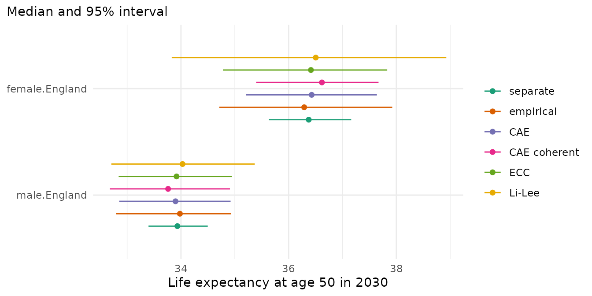

# Dependence between groups

Forecasts for groups of a population, such as sexes, regions or
deprivation quintiles, are often combined: into totals over the groups,
into gaps between them and into measures of inequality. The uncertainty
of these combinations depends on how the forecasts of the groups move
together. This vignette shows why, describes the ways in which mortensor
gives forecasts of several groups their dependence, and compares them on
the deprivation quintiles of England.

## Why dependence matters

A forecast is a set of draws, each a possible future of all groups. The
interval of a total comes from the totals of the draws, and the interval
of a gap from the gaps of the draws. For two groups A and B,

- Var(A + B) = Var(A) + Var(B) + 2 Cov(A, B),
- Var(A - B) = Var(A) + Var(B) - 2 Cov(A, B).

The mortality of groups in one country often moves together: medical
progress, epidemics and cold winters reach all of them. Their forecast
errors are then positively correlated. Separate models, one per group,
draw the future of each group independently, so the covariance of their
draws is zero. Totals then get intervals that are too narrow, and gaps
get intervals that are too wide. Where groups move in opposite
directions, the covariance is negative and the errors are reversed:
totals get intervals that are too wide and gaps intervals that are too
narrow. The forecast of each group on its own does not depend on the
other groups; dependence matters for quantities computed from several
groups.

## Joint models

Joint models fit all groups together. Their draws carry the dependence
of the model.

- [`li_lee()`](../reference/li_lee.md) (Li and Lee 2005): an age pattern
  and a period index common to all groups, and a deviation of each group
  whose period index follows an AR(1) process. The deviations return to
  their mean over the fitting years, so the forecasts of the groups stay
  together (coherent forecasts), and the common index makes them move
  together.
- [`coherent_fdm()`](../reference/coherent_fdm.md) (Hyndman, Booth and
  Yasmeen 2013): the product-ratio method. The geometric mean of the
  groups follows a time-series model, and the ratio of each group to it
  is a stationary process.
- [`cae()`](../reference/cae.md) (Kleinow 2015): the common age effect
  model. All groups share their age effects, and each group has its own
  period effects, estimated with the same weight for every group.
  Kleinow (2015) does not forecast. By default the period effects of all
  groups follow one random walk with drift whose innovations are
  correlated between the groups (a package-specific choice, see
  [`?cae`](../reference/cae.md)). Each group keeps its own drift, so the
  forecasts of the groups can drift apart. `cae(index = "coherent")`
  forecasts with the model of Enchev, Kleinow and Cairns (2017): the
  first period effects of all groups follow a random walk with one
  common drift, and further period effects revert to zero. The expected
  log rates of the groups then do not drift apart; with one period
  effect (`order = 1`) they keep their differences of the last year.

## Coupling separate forecasts

Sometimes a separate model per group gives the best forecast of each
group, but its draws are independent. Ensemble copula coupling (ECC;
Schefzik, Thorarinsdottir and Gneiting 2013) keeps the forecast of each
cell (an age, a year and a group) of such a base model and takes the
dependence from the draws of a joint model, the template. In each cell
the values of the base model are sorted and handed to the draws in the
order of the template: the draw in which the template is lowest receives
the lowest value of the base model, and so on. Five draws of one cell:

``` r

base <- c(0.012, 0.010, 0.011, 0.014, 0.013)
template <- c(0.021, 0.025, 0.019, 0.022, 0.020)
sort(base)[rank(template)]
#> [1] 0.012 0.014 0.010 0.013 0.011
```

Each cell keeps exactly the values of the base model. The draws as a
whole take the ranks of the template, between groups, between ages and
between years. `coupled(lee_carter(), template = cae())` couples inside
a model, `reconciled(..., dependence = "ecc", template = cae())` couples
before reconciling, and [`mt_couple()`](../reference/coupled.md) couples
two sets of forecast draws.

The Schaake shuffle (Clark et al. 2004) reorders the draws in the same
way, with the ranks of past observations in place of a model’s draws.
With `reconciled(..., dependence = "schaake")`, the template of a cell
in forecast year `h` holds the observed changes of its log rate over `h`
years from several distinct training years, the same years for all
groups and ages. Five draws of one cell and the observed changes from
five training years:

``` r

past <- c(-0.031, -0.012, -0.024, -0.040, -0.018)
sort(base)[rank(past)]
#> [1] 0.011 0.014 0.012 0.010 0.013
```

The draw matched to the year with the largest fall receives the lowest
value, in every group, so the groups move together as they did in the
training years. The template has one value per training year, and it
assumes that the dependence of the past holds in the future (Clark et
al. 2004). The observed changes carry the random variation of the
deaths, which is independent between groups and weakens their dependence
where deaths are few. ECC takes the dependence from a joint model
instead.

Both reorder every cell on its own, so they also set how the ages and
years of one group move together.
`reconciled(..., dependence = "empirical")` applies the Schaake shuffle
with the group as margin: the path of a group in one draw, all its ages
and years, moves as a whole. The paths of each group are ranked by the
mean annual change of the group’s log age-standardised rate over the
forecast years, and they take the ranks of the observed annual changes
of the same rate in distinct training years, the same years for all
groups. Five paths of one group and the observed annual changes in five
training years:

``` r

path_change <- c(-0.021, -0.015, -0.018, -0.009, -0.012)
past_change <- c(-0.031, -0.012, -0.024, -0.040, -0.018)
order(path_change)[rank(past_change)]
#> [1] 3 4 2 1 5
```

The fourth training year had the largest fall, and the draw matched to
it receives path 1, the path with the steepest fall. In every group, the
draw matched to a year receives the path whose rank equals the rank of
that year’s change in the group, so groups whose changes ranked alike in
the same years move together in the forecast. Each group keeps exactly
its paths, so its forecast, also of measures over ages such as life
expectancy, stays that of its model; only which path of one group goes
with which path of another changes. The age-standardised rate gives each
age its weight in the population, and it carries less random variation
than the rate of a single age.

## Example: deprivation quintiles in England

Deaths and populations by sex and deprivation quintile (`ons_data`), at
ages 50 and over. Q1 is the most deprived quintile. The totals are
England by sex.

``` r

library(mortensor)
library(data.table)
x <- mt_data(deaths = ons_data, population = ons_data, by = c("sex", "imd_decile"), age = "age_group",
             value = c(deaths = "all_causes", population = "population"))
x <- mt_as_exposure(x, type = "midyear")
x <- mt_group_levels(x, "imd_decile", function(d) paste0("Q", ceiling(as.numeric(d) / 2)), name = "quintile")
x <- mt_subset(x, ages = c(50, Inf))
h <- mt_hierarchy(quintile = list(total = "England"))
```

[`cae()`](../reference/cae.md) needs more years than age groups (Kleinow
2015, Section 2). The nine age groups from 50 leave room for training
windows of ten years and more. The number of common age effects
(`order`) and whether women and men share them (`common_by`) can be
chosen by the approximate BIC of Kleinow (2015, eq. 5):

``` r

bic <- CJ(order = 1:3, common_by = c("none", "sex"))
bic[, bic := mapply(function(p, cb) {
  mt_fit(cae(order = p, common_by = if (cb == "none") NULL else cb), x)$fits$bic
}, order, common_by)]
bic
#> Key: <order, common_by>
#>    order common_by        bic
#>    <int>    <char>      <num>
#> 1:     1      none -11161.068
#> 2:     1       sex -11120.442
#> 3:     2      none -10318.541
#> 4:     2       sex -10238.413
#> 5:     3      none  -9417.570
#> 6:     3       sex  -9248.438
```

One common age effect for both sexes has the lowest BIC. The
correlations of the innovations of the period effects between the
quintiles of women:

``` r

fit_cae <- mt_fit(cae(), x)
cr <- mt_parameters(fit_cae)[parameter == "cor_kappa1" & grepl("female", stratum) & grepl("female", index)]
dcast(cr[, .(stratum, index, value = round(value, 2))], stratum ~ index)
#> Key: <stratum>
#>      stratum female.Q1 female.Q2 female.Q3 female.Q4 female.Q5
#>       <char>     <num>     <num>     <num>     <num>     <num>
#> 1: female.Q1      1.00      0.68      0.86      0.68      0.81
#> 2: female.Q2      0.68      1.00      0.68      0.55      0.80
#> 3: female.Q3      0.86      0.68      1.00      0.65      0.79
#> 4: female.Q4      0.68      0.55      0.65      1.00      0.70
#> 5: female.Q5      0.81      0.80      0.79      0.70      1.00
```

The quintiles move together: in a year in which the mortality of one
quintile falls more than its trend, that of the others mostly does too.

### Forecasts

Six models, each with the totals for England as the sums of the
quintiles in every draw (`method = "bottom_up"`), so that the totals
show the dependence of the parts:

- **separate**: a Lee-Carter model for each group;
- **empirical**: the Lee-Carter models of each group, their paths
  reordered by the observed annual changes of the training years;
- **CAE**: the common age effect model;
- **CAE coherent**: the common age effect model with one drift for all
  groups (`index = "coherent"`);
- **ECC**: the Lee-Carter models of each group, coupled to the CAE
  model;
- **Li-Lee**: the Li-Lee model with a common factor for each sex.

``` r

specs <- list(
  separate = reconciled(lee_carter(), h, method = "bottom_up"),
  empirical = reconciled(lee_carter(), h, method = "bottom_up", dependence = "empirical"),
  CAE = reconciled(cae(), h, method = "bottom_up"),
  "CAE coherent" = reconciled(cae(index = "coherent"), h, method = "bottom_up"),
  ECC = reconciled(lee_carter(), h, method = "bottom_up", dependence = "ecc", template = cae()),
  "Li-Lee" = reconciled(li_lee(common_by = "sex"), h, method = "bottom_up"))
fcs <- lapply(specs, function(s) mt_forecast(mt_fit(s, x), to = 2030, n_draws = 500, seed = 1))
```

The correlation between the paths of life expectancy at 50 of women in
Q1 and Q5 in 2030:

``` r

e50 <- lapply(fcs, life_expectancy, at = 50, paths = TRUE)
round(sapply(e50, function(e) cor(e["2030", "female.Q1", ], e["2030", "female.Q5", ])), 2)
#>     separate    empirical          CAE CAE coherent          ECC       Li-Lee 
#>        -0.02         0.79         0.80         0.75         0.82         0.95
```

Life expectancy at 50 in 2030, median and 95% interval, for women in Q1
and Q5 and in England:

``` r

mt_compare_forecasts(fcs, periods = 2030, at = 50, strata = c("female.Q1", "female.Q5", "female.England"),
                     digits = 2)
#> Key: <label, period>
#>             label period            separate           empirical
#>            <char>  <num>              <char>              <char>
#> 1: female.England   2030 36.37 (35.63-37.16) 36.29 (34.71-37.92)
#> 2:      female.Q1   2030 32.66 (30.16-34.77) 32.66 (30.16-34.77)
#> 3:      female.Q5   2030 39.07 (37.54-40.75) 39.07 (37.54-40.75)
#>                    CAE        CAE coherent                 ECC
#>                 <char>              <char>              <char>
#> 1: 36.43 (35.21-37.64) 36.62 (35.40-37.67) 36.41 (34.78-37.83)
#> 2: 32.82 (31.10-34.53) 33.66 (31.97-35.23) 32.66 (30.16-34.77)
#> 3: 38.84 (37.83-40.00) 38.56 (37.46-39.64) 39.07 (37.54-40.75)
#>                 Li-Lee
#>                 <char>
#> 1: 36.50 (33.83-38.93)
#> 2: 33.71 (30.62-36.63)
#> 3: 38.27 (35.81-40.40)
```

Life expectancy at 50 in 2030 for England, the sum of the quintiles:

``` r

mt_plot_compare(fcs, at = 50, strata = c("female.England", "male.England"), periods = 2030)
```



The observed gap in life expectancy at 50 between Q1 and Q5 widened:

``` r

e_obs <- life_expectancy(mt_array(x, "deaths") / mt_array(x, "exposure"), mt_grid(x)$age, at = 50)
yrs <- c("2001", "2010", "2019")
round(e_obs[yrs, c("female.Q1", "male.Q1")] - e_obs[yrs, c("female.Q5", "male.Q5")], 2)
#>       stratum
#> period female.Q1 male.Q1
#>   2001     -3.97   -5.43
#>   2010     -4.53   -5.73
#>   2019     -5.57   -6.14
```

The forecast gap in 2030, path by path:

``` r

gap <- rbindlist(lapply(names(fcs), function(n) {
  g <- mt_contrast(fcs[[n]], var = "quintile", ref = "Q5", at = 50)
  cbind(model = n, g[period == 2030 & level == "Q1", .(sex, q0.025, q0.5, q0.975)])
}))
gap[, width := q0.975 - q0.025]
gap[, (3:6) := lapply(.SD, round, 2), .SDcols = 3:6]
gap
#>            model    sex q0.025  q0.5 q0.975 width
#>           <char> <char>  <num> <num>  <num> <num>
#>  1:     separate female  -9.28 -6.48  -3.78  5.51
#>  2:     separate   male  -8.23 -6.51  -4.88  3.35
#>  3:    empirical female  -8.23 -6.45  -5.30  2.92
#>  4:    empirical   male  -7.37 -6.51  -5.68  1.69
#>  5:          CAE female  -7.09 -6.09  -5.13  1.96
#>  6:          CAE   male  -7.32 -6.33  -5.34  1.98
#>  7: CAE coherent female  -6.05 -4.94  -3.86  2.19
#>  8: CAE coherent   male  -6.61 -5.57  -4.61  2.00
#>  9:          ECC female  -7.84 -6.46  -5.28  2.56
#> 10:          ECC   male  -7.47 -6.51  -5.65  1.81
#> 11:       Li-Lee female  -5.58 -4.59  -3.62  1.96
#> 12:       Li-Lee   male  -5.78 -5.23  -4.71  1.07
```

Separate models draw the quintiles independently: the correlation of
their paths is close to zero. With the shuffle of stratum paths
(`empirical`), CAE and ECC it is about 0.8, with CAE coherent 0.75 and
with Li-Lee 0.95. The shuffle and ECC keep the forecast of each quintile
from the Lee-Carter models, so Q1 and Q5 have the same intervals as with
the separate models; the totals and the gaps change. The 95% interval of
the life expectancy of women in England is 1.53 years wide with separate
models, 3.21 years with the shuffle of stratum paths, 2.43 years with
CAE, 2.27 years with CAE coherent, 3.05 years with ECC and 5.10 years
with Li-Lee. For the gap between Q1 and Q5 the separate models give the
widest interval: 5.5 years for women, against 2.0 to 2.9 years with the
other five. Li-Lee and CAE coherent forecast smaller gaps than the other
models: the deviations of Li-Lee return towards their mean over the
fitting years, and CAE coherent has one drift for all quintiles.

The common drift holds the log rates of the quintiles together. In the
expected forecast, the log rate of an age falls at the same pace in all
quintiles of both sexes, so the differences between Q1 and Q5 stay those
of the fitted rates of 2019. These differences are between 0.90 and 1.15
at ages 50 to 69 and about 0.1 at 90 and over:

``` r

fit_coh <- mt_fit(cae(index = "coherent"), x)
m_fit <- fitted(fit_coh)
round(log(m_fit[, "2019", c("female.Q1", "male.Q1")] / m_fit[, "2019", c("female.Q5", "male.Q5")]), 2)
#>        stratum
#> age     female.Q1 male.Q1
#>   50-54      0.96    1.15
#>   55-59      0.94    1.08
#>   60-64      0.95    1.00
#>   65-69      0.94    0.90
#>   70-74      0.88    0.78
#>   75-79      0.74    0.64
#>   80-84      0.52    0.45
#>   85-89      0.32    0.28
#>   90+        0.11    0.09
e_fit <- life_expectancy(m_fit, mt_grid(x)$age, at = 50)
round(e_fit["2019", c("female.Q1", "male.Q1")] - e_fit["2019", c("female.Q5", "male.Q5")], 2)
#> female.Q1   male.Q1 
#>     -5.42     -6.07
g_coh <- mt_contrast(fcs[["CAE coherent"]], var = "quintile", ref = "Q5", at = 50)
g_coh <- g_coh[level == "Q1" & period %in% c(2020, 2025, 2030)][, q0.5 := round(q0.5, 2)]
dcast(g_coh, sex ~ period, value.var = "q0.5")
#> Key: <sex>
#>       sex  2020  2025  2030
#>    <char> <num> <num> <num>
#> 1: female -5.38 -5.17 -4.94
#> 2:   male -6.03 -5.82 -5.57
```

In the fitted rates of 2019 the gap in life expectancy at 50 is -5.42
years for women and -6.07 years for men. With the common drift its
median narrows to -4.94 and -5.57 years in 2030, although the
differences of the log rates stay the same: as mortality falls, a larger
part of the life after 50 is lived at old ages, where the quintiles
differ less. The observed gap widened from 2001 to 2019 (above). With
its own drift for each quintile, CAE continues this widening (-6.09 and
-6.33 years in 2030).

### Backtests

Forecasts from the origins 2010 to 2014, five years ahead, scored
against the observed rates and life expectancy at 50, and against the
gaps in life expectancy between each quintile and Q5 (`contrast`). The
data hold the totals, so that they are scored too.

``` r

xa <- mt_aggregate_strata(x, h)
bt <- mt_compare(specs, xa, origins = 2010:2014, h = 5, n_draws = 200, quantities = "life_expectancy",
                 contrast = c(var = "quintile", ref = "Q5"))
mt_score_table(bt, metrics = c("crps", "cov80", "cov95"), hierarchy = h, targets = c("rate", "life_expectancy"))
#>            model  level   crps cov80 cov95 crps_le cov80_le cov95_le
#>           <fctr> <fctr>  <num> <num> <num>   <num>    <num>    <num>
#>  1:     separate bottom 0.0378 0.559 0.746   0.301    0.512    0.752
#>  2:     separate  total 0.0392 0.262 0.416   0.349    0.140    0.320
#>  3:    empirical bottom 0.0378 0.559 0.746   0.301    0.512    0.752
#>  4:    empirical  total 0.0360 0.416 0.571   0.310    0.340    0.520
#>  5:          CAE bottom 0.0403 0.465 0.690   0.327    0.368    0.668
#>  6:          CAE  total 0.0390 0.349 0.587   0.339    0.280    0.540
#>  7: CAE coherent bottom 0.0407 0.479 0.702   0.336    0.376    0.704
#>  8: CAE coherent  total 0.0394 0.344 0.598   0.342    0.280    0.580
#>  9:          ECC bottom 0.0378 0.560 0.746   0.301    0.508    0.772
#> 10:          ECC  total 0.0358 0.460 0.662   0.308    0.440    0.660
#> 11:       Li-Lee bottom 0.0414 0.576 0.765   0.337    0.548    0.780
#> 12:       Li-Lee  total 0.0380 0.529 0.727   0.317    0.520    0.800
```

The columns ending in `_le` score life expectancy at 50. `bottom` are
the quintiles by sex and `total` England by sex. The gap between Q1 and
Q5:

``` r

mt_score_table(bt[quintile == "Q1"], metrics = c("crps", "cov50", "cov80", "cov95"),
               targets = "life_expectancy_gap")
#>           model crps_le_gap cov50_le_gap cov80_le_gap cov95_le_gap
#>          <fctr>       <num>        <num>        <num>        <num>
#> 1:     separate       0.153         0.92         1.00         1.00
#> 2:    empirical       0.130         0.72         1.00         1.00
#> 3:          CAE       0.152         0.36         0.80         0.98
#> 4: CAE coherent       0.331         0.10         0.30         0.68
#> 5:          ECC       0.117         0.52         0.98         1.00
#> 6:       Li-Lee       0.534         0.02         0.08         0.14
```

The quintiles (`bottom`) are forecast equally well by the separate
models, by the shuffle of stratum paths and by ECC (CRPS 0.0378). The
shuffle keeps the draws of every quintile, so all its scores of the
quintiles equal those of the separate models. ECC keeps the forecast of
each cell; the small differences in coverage come from the Poisson
variation of the deaths, which is drawn after the coupling. CAE
(0.0405), CAE coherent (0.0404) and Li-Lee (0.0414) forecast the
quintiles less accurately than the Lee-Carter models.

The totals show the effect of the dependence. With separate models, the
95% intervals for England contain 42% of the observed rates and 32% of
the observed life expectancies at 50: sums of independent parts vary too
little. With the shuffle of stratum paths they contain 57% and 52%, with
CAE 61% and 54%, with CAE coherent 60% and 58%, with ECC 66% and 68%,
and with Li-Lee 73% and 80%. ECC has the lowest CRPS for the totals
(0.0358 for the rates, 0.308 for life expectancy), the shuffle of
stratum paths the second lowest (0.0360 and 0.310). Every model stays
below 95%, as in the vignette “Coherent forecasts: totals and their
parts”: mortality improved more slowly after 2011 than in the training
years.

The gap between Q1 and Q5 shows the other side. The intervals of the
separate models are too wide: their 50% intervals contain 92% of the
observed gaps. The shuffle of stratum paths (72%), CAE (38%) and ECC
(52%) come closer to 50%, and ECC has the lowest CRPS (0.115, the
shuffle of stratum paths 0.130). The observed gap widened (see above),
and two models did not follow. CAE coherent keeps the differences of the
fitted log rates of the last training year: its 50% intervals contain
12% and its 95% intervals 72% of the observed gaps, and its CRPS (0.328)
is more than twice that of CAE with its own drifts (0.150). Li-Lee
forecasts the gap to return towards its mean over the fitting years; its
95% intervals contain 14% of the observed gaps.

Each score of the totals and of the gap rests on 50 values per model
(two sexes, five origins, five horizons) from overlapping forecasts. The
results describe these data and years; for other data, a backtest of the
totals and gaps that matter shows which method suits them.

## Choosing a method

- For totals and gaps, use draws that carry the dependence between the
  groups: a joint model, or separate models given a dependence by
  reordering their draws.
- The shuffle of stratum paths (`dependence = "empirical"`) keeps the
  forecast of each group, also over ages and years, and takes how the
  groups move together from their observed annual changes; the random
  variation of the deaths in these changes weakens the dependence where
  deaths are few.
- ECC keeps the forecast of each cell from the base model and takes how
  groups, ages and years move together from the template; check the
  template’s dependence in a backtest of totals and gaps, as above.
- A joint model whose deviations return to their mean over the fitting
  years, such as [`li_lee()`](../reference/li_lee.md), forecasts gaps
  that return towards their past level. A common drift, as in
  `cae(index = "coherent")`, keeps the differences of the log rates of
  the last year, and here the gap in life expectancy narrows. Where gaps
  are widening, check this in a backtest.

## References

Clark M, Gangopadhyay S, Hay L, Rajagopalan B, Wilby R (2004). The
Schaake shuffle: a method for reconstructing space-time variability in
forecasted precipitation and temperature fields. *Journal of
Hydrometeorology* 5(1): 243-262.

Enchev V, Kleinow T, Cairns AJG (2017). Multi-population mortality
models: fitting, forecasting and comparisons. *Scandinavian Actuarial
Journal* 2017(4): 319-342. <doi:10.1080/03461238.2015.1133450>.

Hyndman RJ, Booth H, Yasmeen F (2013). Coherent mortality forecasting:
the product-ratio method with functional time series models.
*Demography* 50(1): 261-283.

Kleinow T (2015). A common age effect model for the mortality of
multiple populations. *Insurance: Mathematics and Economics* 63:
147-152.

Li N, Lee R (2005). Coherent mortality forecasts for a group of
populations: an extension of the Lee-Carter method. *Demography* 42(3):
575-594.

Schefzik R, Thorarinsdottir TL, Gneiting T (2013). Uncertainty
quantification in complex simulation models using ensemble copula
coupling. *Statistical Science* 28(4): 616-640.
