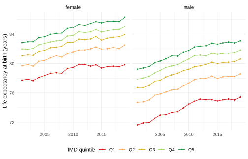
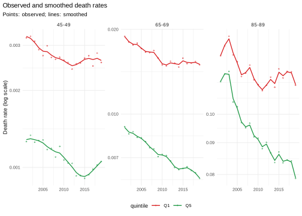
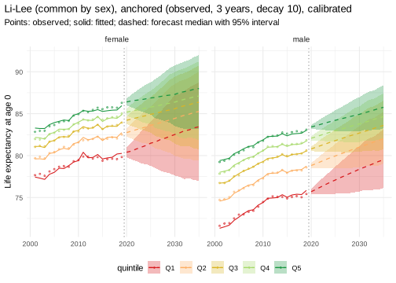
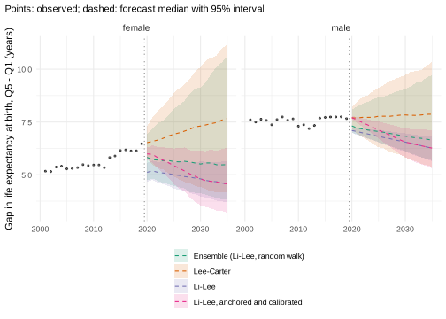

# Forecasting mortality by deprivation quintile

*This vignette is precomputed (`dev/precompute-vignettes.R`) because its
backtests take a few minutes.*

Forecasts of mortality by deprivation answer two questions at once: how
mortality will develop in each group, and how the gaps between the
groups will develop. The second question depends strongly on the model,
because each model makes an assumption about the gaps. This vignette
forecasts mortality in England by sex and quintile of the Index of
Multiple Deprivation (IMD) and works through the choices:

1.  what the observed data say about the gaps;
2.  what the models assume about them, and how they forecast each
    quintile in backtests;
3.  how the forecast intervals can be calibrated on the last ten years;
4.  whether smoothing the rates over time helps, and how the forecast
    starts from the last observed year (the jump-off);
5.  forecasts of life expectancy, of the gap and of the slope index of
    inequality, and their sensitivity to the model and the fitting
    period.

``` r

library(mortensor)
library(data.table)
library(ggplot2)
```

## Data

`ons_data` holds deaths and mid-year populations by sex, 5-year age
group and IMD decile, England 2001-2019 (Source: Office for National
Statistics licensed under the Open Government Licence v3.0). Deciles are
combined to quintiles; Q1 is the most deprived quintile.

``` r

x <- mt_data(deaths = ons_data, population = ons_data, by = c("sex", "imd_decile"), age = "age_group",
             value = c(deaths = "all_causes", population = "population"))
x <- mt_as_exposure(x, type = "midyear")
x <- mt_group_levels(x, "imd_decile", function(d) paste0("Q", ceiling(as.numeric(d) / 2)), name = "quintile")
x
#> <mt_data> 10 strata by sex, quintile, omega = 110
#>   deaths     mixed widths (1,4,5) 0-89, 90+; periods 2001-2019 (width 1); 3800 cells
#>   exposure   mixed widths (1,4,5) 0-89, 90+; periods 2001-2019 (width 1); 3800 cells
#>   population mixed widths (1,4,5) 0-89, 90+; periods 2001-2019 (width 1); 3800 cells
#>   grid       <mt_axis: age, 20 intervals> 0 1-4 5-9 10-14 ... 80-84 85-89 90+
#>              <mt_axis: period, 19 intervals> 2001 2002 2003 2004 ... 2017 2018 2019
```

The deciles follow the IMD version current at the time of registration
(2004, 2007, 2010, 2015 and 2019), so areas change quintile during the
period. Gaps between quintiles therefore compare the most and least
deprived areas of each year, which is the usual target of monitoring.

## The past

Life expectancy at birth, with intervals for the Poisson variation of
the deaths:

``` r

e0 <- life_expectancy(x)
dcast(e0[period %in% c(2001, 2011, 2019), .(sex, quintile, period, e0 = round(q0.5, 1))],
      sex + quintile ~ period, value.var = "e0")
#>        sex quintile 2001 2011 2019
#>  1: female       Q1 77.7 79.9 79.8
#>  2: female       Q2 79.7 81.8 82.5
#>  3: female       Q3 81.0 83.3 83.9
#>  4: female       Q4 82.0 84.3 85.0
#>  5: female       Q5 82.8 85.3 86.3
#>  6:   male       Q1 71.6 74.9 75.4
#>  7:   male       Q2 74.7 77.7 78.6
#>  8:   male       Q3 76.7 79.6 80.6
#>  9:   male       Q4 77.9 81.1 81.8
#> 10:   male       Q5 79.2 82.2 83.1
```

``` r

ggplot(e0, aes(period, q0.5, colour = quintile)) +
  geom_line() +
  geom_point(size = 0.8) +
  facet_wrap(~ sex) +
  scale_colour_mortensor() +
  labs(x = NULL, y = "Life expectancy at birth (years)", colour = "IMD quintile") +
  theme_mortensor()
```



plot of chunk plot-e0-observed

Until 2011, life expectancy rose in every quintile. From 2011 to 2019 it
rose by about one year in the least deprived quintile and stayed almost
constant in the most deprived quintile of women. The annual decline of
the age-standardised death rate (European Standard Population 2013)
shows the same break (per cent per year):

``` r

a <- asr(x)
a[, .(decline_2001_2011 = round(100 * (1 - (q0.5[period == 2011] / q0.5[period == 2001])^(1 / 10)), 2),
      decline_2011_2019 = round(100 * (1 - (q0.5[period == 2019] / q0.5[period == 2011])^(1 / 8)), 2)),
  by = .(sex, quintile)]
#>        sex quintile decline_2001_2011 decline_2011_2019
#>  1: female       Q1              1.57             -0.18
#>  2: female       Q2              1.80              0.62
#>  3: female       Q3              2.18              0.74
#>  4: female       Q4              2.27              0.85
#>  5: female       Q5              2.50              1.25
#>  6:   male       Q1              2.17              0.45
#>  7:   male       Q2              2.42              0.82
#>  8:   male       Q3              2.48              1.18
#>  9:   male       Q4              2.87              0.84
#> 10:   male       Q5              2.82              1.11
```

The gap between the extreme quintiles uses only Q1 and Q5; the slope
index of inequality (SII) uses all quintiles, weighted by their
populations, and gives the difference in life expectancy between the
bottom and the top of the deprivation scale. Both are computed path by
path. The female gap widened from 5.2 to 6.5 years, most of it after
2011; the male gap stayed near 7.5 years:

``` r

gap <- mt_contrast(x, var = "quintile", ref = "Q1")[level == "Q5"]
sii <- mt_inequality(x, "quintile", order = paste0("Q", 1:5), quantity = "life_expectancy")[index == "sii"]
tab <- rbind(gap[, .(measure = "gap Q5 - Q1", sex, period, q0.025, q0.5, q0.975)],
             sii[, .(measure = "SII", sex, period, q0.025, q0.5, q0.975)])
tab[period %in% c(2001, 2011, 2019)][, c("q0.025", "q0.5", "q0.975") := lapply(.SD, round, 2),
                                     .SDcols = c("q0.025", "q0.5", "q0.975")][]
#>         measure    sex period q0.025 q0.5 q0.975
#>  1: gap Q5 - Q1 female   2001   5.01 5.17   5.33
#>  2: gap Q5 - Q1 female   2011   5.31 5.46   5.62
#>  3: gap Q5 - Q1 female   2019   6.31 6.46   6.63
#>  4: gap Q5 - Q1   male   2001   7.44 7.60   7.78
#>  5: gap Q5 - Q1   male   2011   7.20 7.37   7.54
#>  6: gap Q5 - Q1   male   2019   7.50 7.66   7.83
#>  7:         SII female   2001   6.15 6.33   6.51
#>  8:         SII female   2011   6.55 6.72   6.91
#>  9:         SII female   2019   7.53 7.70   7.87
#> 10:         SII   male   2001   9.00 9.19   9.39
#> 11:         SII   male   2011   8.88 9.07   9.26
#> 12:         SII   male   2019   9.05 9.24   9.43
```

The relative excess mortality of Q1 over Q5 is largest in mid-life and
has grown at ages 60 to 84:

``` r

ages <- c("40-44", "50-54", "60-64", "70-74", "80-84", "90+")
rr <- rbindlist(lapply(ages, function(a) {
  mt_contrast(x, var = "quintile", ref = "Q5", quantity = "rate", type = "ratio", age = a)[
    level == "Q1" & period %in% c(2001, 2019)][, age := a]
}))
dcast(rr[, .(age, sex, period, ratio = round(q0.5, 2))], age ~ sex + period, value.var = "ratio")
#>      age female_2001 female_2019 male_2001 male_2019
#> 1: 40-44        2.38        2.82      3.62      3.28
#> 2: 50-54        2.31        2.42      3.01      3.07
#> 3: 60-64        2.02        2.65      2.35      2.61
#> 4: 70-74        1.87        2.32      1.84      2.28
#> 5: 80-84        1.27        1.73      1.30      1.60
#> 6:   90+        0.99        1.18      1.01      1.14
```

## What the models assume about the gaps

- [`lee_carter()`](../reference/lee_carter.md) per stratum: each
  quintile follows its own trend. Gaps change linearly on the log scale,
  so the widening of the last years continues if it dominates the
  fitting period.
- `li_lee(common_by = "sex")`: the quintiles of each sex share a common
  trend; their deviations from it follow stationary processes. Gaps
  return towards their average in the fitting period.
- `rwd(observation_noise = TRUE)`: a random walk with drift per age and
  quintile, the benchmark of no structure.
- [`ensemble()`](../reference/ensemble.md): a mixture; its intervals
  cover the disagreement between the components.

## Backtests by quintile

Forecasts from the origins 2008 to 2014, five years ahead, scored
against the observed deaths:

``` r

specs <- list(lee_carter(), li_lee(common_by = "sex"), rwd(observation_noise = TRUE),
              ensemble(lc = lee_carter(), rw = rwd()),
              ensemble(ll = li_lee(common_by = "sex"), rw = rwd(observation_noise = TRUE)))
bt <- rbindlist(lapply(specs, function(sp) mt_backtest(sp, x, origins = 2008:2014, h = 5, n_draws = 200)))
rnd <- function(d) {
  num <- names(d)[vapply(d, is.numeric, logical(1))]
  d[, (num) := lapply(.SD, round, 4), .SDcols = num][]
}
rnd(mt_score(bt, by = "model")[, .(model, crps, mae, cov80, cov95, pit_mean)])
#>                                model   crps    mae  cov80  cov95 pit_mean
#> 1:                        Lee-Carter 0.0678 0.0940 0.6540 0.8290   0.5552
#> 2:            Li-Lee (common by sex) 0.0666 0.0927 0.6731 0.8467   0.5586
#> 3: Random walk with drift plus noise 0.0761 0.1045 0.6317 0.8073   0.5947
#> 4:                 Ensemble (lc, rw) 0.0703 0.0963 0.7839 0.9294   0.5663
#> 5:                 Ensemble (ll, rw) 0.0666 0.0933 0.7176 0.8899   0.5776
```

``` r

sq <- mt_score(bt, by = c("model", "quintile"))
rnd(dcast(sq, model ~ quintile, value.var = "crps"))
#>                                model     Q1     Q2     Q3     Q4     Q5
#> 1:                 Ensemble (lc, rw) 0.0636 0.0697 0.0697 0.0739 0.0746
#> 2:                 Ensemble (ll, rw) 0.0649 0.0649 0.0669 0.0684 0.0678
#> 3:                        Lee-Carter 0.0619 0.0681 0.0651 0.0699 0.0739
#> 4:            Li-Lee (common by sex) 0.0728 0.0639 0.0633 0.0670 0.0660
#> 5: Random walk with drift plus noise 0.0682 0.0741 0.0795 0.0798 0.0789
rnd(dcast(sq, model ~ quintile, value.var = "cov95"))
#>                                model     Q1     Q2     Q3     Q4     Q5
#> 1:                 Ensemble (lc, rw) 0.9171 0.9314 0.9400 0.9200 0.9386
#> 2:                 Ensemble (ll, rw) 0.8536 0.8707 0.8936 0.9057 0.9257
#> 3:                        Lee-Carter 0.8000 0.8200 0.8357 0.8314 0.8579
#> 4:            Li-Lee (common by sex) 0.7457 0.8386 0.8593 0.8921 0.8979
#> 5: Random walk with drift plus noise 0.8064 0.7993 0.8086 0.8014 0.8207
```

Li-Lee and its mixture with the random walk are the most accurate models
overall, and Li-Lee is the least accurate in Q1: its common trend
carries the improvement of the other quintiles into Q1, where mortality
stopped improving after 2011. Lee-Carter per quintile is the most
accurate model for Q1. A `pit_mean` above 0.5 means that observed rates
were higher than the forecasts on average, the signature of the
slowdown. The mixtures are closest to nominal coverage.

## Calibration on the last ten years

[`calibrated()`](../reference/calibrated.md) refits a model at several
origins in the last `years` of the training data, compares its forecasts
with the observed rates of that window, and rescales the spread of the
draws (here with a separate factor per quintile, `by = "quintile"`). The
factors $`s(h) = s_1 h^\gamma`$ depend on the horizon $`h`$:

``` r

fit_cal <- mt_fit(calibrated(li_lee(common_by = "sex"), years = 10, by = "quintile"), x)
rnd(fit_cal$calibration[, .(group, scale_h1, slope, crps_before, crps_after, cov95_before, cov95_after)])
#>    group scale_h1  slope crps_before crps_after cov95_before cov95_after
#> 1:   all   0.7801 0.3171      0.0732     0.0725       0.8405      0.8812
#> 2:    Q1   1.0313 0.3176      0.0802     0.0776       0.7400      0.8692
#> 3:    Q2   0.6217 0.4336      0.0705     0.0699       0.8292      0.8692
#> 4:    Q3   0.8260 0.2333      0.0687     0.0682       0.8533      0.8858
#> 5:    Q4   0.6671 0.3330      0.0726     0.0723       0.8792      0.8975
#> 6:    Q5   1.0233 0.0155      0.0731     0.0731       0.8958      0.9025
```

In the window 2010-2019, Li-Lee covered 74% of the Q1 observations with
its 95% intervals; the calibrated draws cover 87%. A spread factor below
1 at horizon 1 with a positive slope narrows short-term intervals and
widens long-term ones; beyond horizon 10, the longest horizon of the
window, the factor stays constant.

Separate factors per quintile scale the common trend of Li-Lee
differently in each quintile, so it no longer cancels in the gaps
between quintiles, and their intervals widen. For forecasts of gaps, the
pooled calibration (one factor for all strata) is used below.

The window starts in 2010 because the data start in 2001 and the model
needs eight years. To check calibration out of sample, it is nested in a
backtest; each outer origin has fewer training years, so the window is
shorter here (five years, origins 2013 and 2014):

``` r

cal_specs <- list(li_lee(common_by = "sex"),
                  calibrated(li_lee(common_by = "sex"), years = 5, n_origins = 3),
                  calibrated(li_lee(common_by = "sex"), years = 5, n_origins = 3, by = "quintile"),
                  ensemble(ll = li_lee(common_by = "sex"), rw = rwd(observation_noise = TRUE)),
                  calibrated(ensemble(ll = li_lee(common_by = "sex"), rw = rwd(observation_noise = TRUE)),
                             years = 5, n_origins = 3))
bc <- rbindlist(lapply(cal_specs, function(sp) mt_backtest(sp, x, origins = 2013:2014, h = 5, n_draws = 200)))
rnd(mt_score(bc, by = "model")[, .(model, crps, cov80, cov95)])
#>                                             model   crps  cov80  cov95
#> 1:                         Li-Lee (common by sex) 0.0719 0.6380 0.8180
#> 2:             Li-Lee (common by sex), calibrated 0.0717 0.6435 0.8225
#> 3: Li-Lee (common by sex), calibrated by quintile 0.0716 0.6395 0.8260
#> 4:                              Ensemble (ll, rw) 0.0715 0.6740 0.8640
#> 5:                  Ensemble (ll, rw), calibrated 0.0709 0.6690 0.8495
rnd(dcast(mt_score(bc, by = c("model", "quintile")), model ~ quintile, value.var = "cov95"))
#>                                             model     Q1     Q2     Q3     Q4
#> 1:                              Ensemble (ll, rw) 0.8175 0.8525 0.8525 0.8925
#> 2:                  Ensemble (ll, rw), calibrated 0.7950 0.8350 0.8375 0.8750
#> 3:                         Li-Lee (common by sex) 0.6900 0.8100 0.8250 0.8800
#> 4:             Li-Lee (common by sex), calibrated 0.6950 0.8250 0.8225 0.8850
#> 5: Li-Lee (common by sex), calibrated by quintile 0.7750 0.8200 0.8000 0.8675
#>        Q5
#> 1: 0.9050
#> 2: 0.9050
#> 3: 0.8850
#> 4: 0.8850
#> 5: 0.8675
```

Calibration by quintile raised the 95% coverage of Li-Lee in Q1, where
it was too narrow, and the pooled calibration changed little; the
ensemble was narrowed slightly. Calibration helps where a model is too
narrow in a way that persists, and it cannot anticipate changes after
the window. With two outer origins these differences are small and
uncertain; the help page of [`calibrated()`](../reference/calibrated.md)
summarises longer backtests on HMD data, where calibration raised the
95% coverage of Lee-Carter from 0.75 to 0.88.

## Smoothing and the jump-off

Two choices concern the last observed years. Smoothing the rates over
time before fitting removes year-to-year noise from the training data;
the forecast then starts from a smooth level.
[`mt_smooth_check()`](../reference/mt_smooth_check.md) shows how far a
smoother moves the data:

``` r

xs <- mt_smooth(x, along = "period", method = "whittaker")
rnd(mt_smooth_check(x, xs)[, .(label, mad_log, dispersion, trend_ratio)])
#>         label mad_log dispersion trend_ratio
#>  1: female.Q1  0.0120     0.5287      0.2370
#>  2: female.Q2  0.0114     0.4244      0.2679
#>  3: female.Q3  0.0087     0.3800      0.2869
#>  4: female.Q4  0.0166     0.5353      0.2219
#>  5: female.Q5  0.0145     0.4821      0.2319
#>  6:   male.Q1  0.0147     0.9880      0.1773
#>  7:   male.Q2  0.0165     0.9682      0.1589
#>  8:   male.Q3  0.0196     0.9837      0.1206
#>  9:   male.Q4  0.0170     0.7134      0.1958
#> 10:   male.Q5  0.0176     0.6753      0.1626
```

The smoothed rates differ from the observed ones by a median of 1-2%
(`mad_log`). The mean squared Pearson residual (`dispersion`) is below 1
in every stratum: the variation around the smoothed trend is no larger
than Poisson noise, so the smoother removes noise and no visible signal.
The year-to-year changes of the smoothed rates have 12-29% of the
variance of the observed changes (`trend_ratio`).

``` r

mt_plot_smooth(x, xs, ages = c("45-49", "65-69", "85-89"), strata = c("female.Q1", "female.Q5"))
```



plot of chunk plot-smooth

Li-Lee starts its forecasts from the fitted rates of 2019, which differ
from the observed ones, and its deviations from the common trend begin
to return towards their mean in the first forecast year.
[`mt_jump_off()`](../reference/mt_jump_off.md) reports the step from the
last observed year to the median of the first forecast year;
[`anchored()`](../reference/anchored.md) moves the start towards the
observed level of the last three years, with the offsets fading out over
ten years:

``` r

fc_ll <- mt_forecast(mt_fit(li_lee(common_by = "sex"), x), h = 5, n_draws = 500, seed = 1)
fc_an <- mt_forecast(mt_fit(anchored(li_lee(common_by = "sex"), years = 3), x), h = 5, n_draws = 500, seed = 1)
rnd(merge(mt_jump_off(fc_ll)[, .(label, observed, fitted, li_lee = forecast)],
          mt_jump_off(fc_an)[, .(label, anchored = forecast)], by = "label", sort = FALSE))
#>         label observed  fitted  li_lee anchored
#>  1: female.Q1  79.8332 80.2616 80.8909  80.3740
#>  2: female.Q2  82.4987 82.7431 82.8888  82.7112
#>  3: female.Q3  83.9315 84.0149 84.1699  84.1874
#>  4: female.Q4  85.0173 84.8781 85.0373  85.1519
#>  5: female.Q5  86.2951 85.9539 86.0079  86.3633
#>  6:   male.Q1  75.4307 75.8441 76.1210  75.7236
#>  7:   male.Q2  78.5978 78.7380 78.9657  78.8304
#>  8:   male.Q3  80.6050 80.5609 80.7945  80.8163
#>  9:   male.Q4  81.8200 81.7528 81.9753  82.0844
#> 10:   male.Q5  83.0900 83.0188 83.2118  83.4247
```

For women in Q1, life expectancy in the first forecast year (2020) lies
1.1 years above the observed value of 2019 under Li-Lee: 0.4 years come
from the fit of 2019, the rest from one year of forecast. Anchored, the
step is 0.5 years; in the other strata it is 0.1 to 0.3 years, about one
year of improvement.

Backtests from the origins 2008 to 2014 compare the options for the
rates and for life expectancy at birth (`quantities`):

``` r

ll <- li_lee(common_by = "sex")
smooth_t <- mt_prep(step_smooth(along = "period", method = "whittaker"))
variants <- list("Li-Lee" = list(ll, NULL),
                 "Li-Lee, anchored" = list(anchored(ll, years = 3), NULL),
                 "Li-Lee, observed jump-off" = list(li_lee(common_by = "sex", jump_off = "observed"), NULL),
                 "Li-Lee, smoothed over time" = list(ll, smooth_t))
bj <- rbindlist(lapply(names(variants), function(n) {
  mt_backtest(variants[[n]][[1]], x, origins = 2008:2014, h = 5, n_draws = 200, prep = variants[[n]][[2]],
              quantities = "life_expectancy")[, model := n]
}))
rnd(merge(mt_score(bj)[, .(model, crps, cov95)],
          mt_score(bj, target = "life_expectancy")[, .(model, crps_e0 = crps, cov95_e0 = cov95)],
          by = "model", sort = FALSE))
#>                         model   crps  cov95 crps_e0 cov95_e0
#> 1:                     Li-Lee 0.0666 0.8467  0.3356   0.8114
#> 2:           Li-Lee, anchored 0.0658 0.8579  0.3126   0.8429
#> 3:  Li-Lee, observed jump-off 0.0709 0.8480  0.3151   0.8257
#> 4: Li-Lee, smoothed over time 0.0669 0.7736  0.3482   0.6057
rnd(dcast(mt_score(bj, by = c("model", "quintile"), target = "life_expectancy"), model ~ quintile,
          value.var = "crps"))
#>                         model     Q1     Q2     Q3     Q4     Q5
#> 1:                     Li-Lee 0.5835 0.3475 0.2889 0.2580 0.2002
#> 2:           Li-Lee, anchored 0.4953 0.3087 0.2755 0.2742 0.2093
#> 3:  Li-Lee, observed jump-off 0.4787 0.3205 0.2710 0.2797 0.2256
#> 4: Li-Lee, smoothed over time 0.5586 0.3630 0.3092 0.3074 0.2030
```

`crps_e0` is in years of life expectancy at birth. Anchoring improved
the rates slightly and life expectancy more, most of all in Q1, where
the step of Li-Lee is largest (Q4 and Q5 became slightly worse). The
observed jump-off of one year forecast life expectancy about as well,
but the rates worse: it carries the noise of single ages in the last
year into the forecast. Smoothing over time did not improve the
forecasts here and narrowed the intervals: the smoothed period index
varies less from year to year, so its random walk is narrower, and the
95% coverage of life expectancy fell from 0.81 to 0.61. With noise of
the order of Poisson variation, as in these data, smoothing over time
has little to remove. It is more useful for sparse data (causes of
death, small areas), and then with
[`calibrated()`](../reference/calibrated.md) on top, which restores part
of the coverage:

``` r

bsc <- rbindlist(list(
  mt_backtest(ll, x, origins = 2013:2014, h = 5, n_draws = 200, prep = smooth_t)[, model := "smoothed"],
  mt_backtest(calibrated(ll, years = 5, n_origins = 3), x, origins = 2013:2014, h = 5, n_draws = 200,
              prep = smooth_t)[, model := "smoothed + calibrated"]))
rnd(mt_score(bsc)[, .(model, crps, cov80, cov95)])
#>                    model   crps  cov80  cov95
#> 1:              smoothed 0.0734 0.5605 0.7415
#> 2: smoothed + calibrated 0.0723 0.6125 0.7865
```

## Forecasts to 2035

Four forecasts, which differ in their assumption about the gaps and in
where they start:

``` r

final <- list("Lee-Carter" = lee_carter(),
              "Li-Lee" = li_lee(common_by = "sex"),
              "Li-Lee, anchored and calibrated" = calibrated(anchored(li_lee(common_by = "sex")), years = 10),
              "Ensemble (Li-Lee, random walk)" = ensemble(ll = li_lee(common_by = "sex"),
                                                          rw = rwd(observation_noise = TRUE)))
fcs <- lapply(final, function(sp) mt_forecast(mt_fit(sp, x), to = 2035, n_draws = 1000, seed = 1))
e0_fc <- rbindlist(lapply(names(fcs), function(n) life_expectancy(fcs[[n]])[, model := n]))
dcast(e0_fc[period == 2035, .(model, sex, quintile, e0 = round(q0.5, 1))], model + sex ~ quintile,
      value.var = "e0")
#>                              model    sex   Q1   Q2   Q3   Q4   Q5
#> 1:  Ensemble (Li-Lee, random walk) female 82.1 84.8 86.3 87.3 88.6
#> 2:  Ensemble (Li-Lee, random walk)   male 78.8 81.9 83.7 84.8 86.0
#> 3:                      Lee-Carter female 81.5 84.6 86.4 87.5 89.1
#> 4:                      Lee-Carter   male 78.5 81.7 83.8 85.0 86.3
#> 5:                          Li-Lee female 83.4 85.3 86.4 87.1 88.0
#> 6:                          Li-Lee   male 79.5 82.0 83.6 84.6 85.8
#> 7: Li-Lee, anchored and calibrated female 83.4 85.3 86.4 87.1 88.0
#> 8: Li-Lee, anchored and calibrated   male 79.5 82.0 83.6 84.6 85.8
```

``` r

mt_plot_life_expectancy(fcs[["Li-Lee, anchored and calibrated"]], facet = "sex", data = x)
```



plot of chunk plot-e0-forecast

The gap between Q5 and Q1 and the SII, with 95% intervals:

``` r

gaps <- rbindlist(lapply(names(fcs), function(n) {
  rbind(mt_contrast(fcs[[n]], var = "quintile", ref = "Q1")[level == "Q5"][, measure := "gap Q5 - Q1"],
        mt_inequality(fcs[[n]], "quintile", order = paste0("Q", 1:5),
                      quantity = "life_expectancy")[index == "sii"][, measure := "SII"],
        fill = TRUE)[, model := n]
}))
gaps[period == 2035, .(measure, model, sex, q0.025 = round(q0.025, 1), q0.5 = round(q0.5, 1),
                        q0.975 = round(q0.975, 1))][order(measure, sex)]
#>         measure                           model    sex q0.025 q0.5 q0.975
#>  1:         SII                      Lee-Carter female    5.2  9.1   12.9
#>  2:         SII                          Li-Lee female    4.4  5.5    6.7
#>  3:         SII Li-Lee, anchored and calibrated female    3.8  5.5    7.4
#>  4:         SII  Ensemble (Li-Lee, random walk) female    4.6  6.5   12.0
#>  5:         SII                      Lee-Carter   male    6.5  9.4   12.2
#>  6:         SII                          Li-Lee   male    6.8  7.5    8.2
#>  7:         SII Li-Lee, anchored and calibrated   male    6.4  7.6    8.6
#>  8:         SII  Ensemble (Li-Lee, random walk)   male    6.8  8.0   11.5
#>  9: gap Q5 - Q1                      Lee-Carter female    4.2  7.7   11.2
#> 10: gap Q5 - Q1                          Li-Lee female    3.7  4.6    5.6
#> 11: gap Q5 - Q1 Li-Lee, anchored and calibrated female    3.2  4.6    6.3
#> 12: gap Q5 - Q1  Ensemble (Li-Lee, random walk) female    3.8  5.5   10.6
#> 13: gap Q5 - Q1                      Lee-Carter   male    5.4  7.9   10.4
#> 14: gap Q5 - Q1                          Li-Lee   male    5.6  6.3    6.8
#> 15: gap Q5 - Q1 Li-Lee, anchored and calibrated   male    5.3  6.3    7.1
#> 16: gap Q5 - Q1  Ensemble (Li-Lee, random walk)   male    5.7  6.6    9.7
```

``` r

obs_gap <- gap[, .(period, sex, q0.5)]
ggplot(gaps[measure == "gap Q5 - Q1"], aes(period)) +
  geom_ribbon(aes(ymin = q0.025, ymax = q0.975, fill = model), alpha = 0.15) +
  geom_line(aes(y = q0.5, colour = model), linetype = "dashed") +
  geom_point(data = obs_gap, aes(y = q0.5), size = 0.8, alpha = 0.6) +
  geom_vline(xintercept = 2019.5, linetype = "dotted", colour = "grey50") +
  facet_wrap(~ sex) +
  scale_colour_mortensor(type = "categorical") +
  scale_fill_mortensor(type = "categorical") +
  labs(x = NULL, y = "Gap in life expectancy at birth, Q5 - Q1 (years)", colour = NULL, fill = NULL,
       subtitle = "Points: observed; dashed: forecast median with 95% interval") +
  theme_mortensor() +
  theme(legend.direction = "vertical")
```



plot of chunk plot-gap-forecast

Lee-Carter extrapolates the quintile-specific trends of 2001-2019, so
the female gap keeps widening, with wide intervals. Li-Lee forecasts a
female gap below the observed gap of 2019: its deviations from the
common trend return towards zero, and its forecasts start from the
fitted rates of 2019, which for women give a life expectancy 0.4 years
above the observed one in Q1 and 0.3 years below it in Q5, so the
forecast gap starts about 0.8 years below the observed gap. Anchored,
Li-Lee starts closer to the observed gap and joins the medians of Li-Lee
once the offsets have faded (after ten years, so the values of 2035
agree); the calibration widens its intervals. The mixture lies between
Lee-Carter and Li-Lee.

## Sensitivity to the fitting period

The break around 2011 makes the fitting period a decision. Fitting on
2011-2019 only describes the recent trends:

``` r

x11 <- mt_subset(x, periods = c(2011, NA))
recent <- lapply(final[c("Lee-Carter", "Li-Lee")], function(sp) {
  mt_forecast(mt_fit(sp, x11), to = 2035, n_draws = 1000, seed = 1)
})
e0_recent <- rbindlist(lapply(names(recent), function(n) life_expectancy(recent[[n]])[, model := n]))
rbind(e0_fc[period == 2035 & model %in% names(recent)][, fitted := "2001-2019"],
      e0_recent[period == 2035][, fitted := "2011-2019"])[
  quintile %in% c("Q1", "Q5"), .(model, fitted, sex, quintile, q0.025 = round(q0.025, 1),
                                 q0.5 = round(q0.5, 1), q0.975 = round(q0.975, 1))][order(model, sex, quintile)]
#>          model    fitted    sex quintile q0.025 q0.5 q0.975
#>  1: Lee-Carter 2001-2019 female       Q1   78.5 81.5   84.1
#>  2: Lee-Carter 2011-2019 female       Q1   77.0 79.4   83.1
#>  3: Lee-Carter 2001-2019 female       Q5   86.7 89.1   91.4
#>  4: Lee-Carter 2011-2019 female       Q5   84.2 88.0   91.2
#>  5: Lee-Carter 2001-2019   male       Q1   76.5 78.5   80.5
#>  6: Lee-Carter 2011-2019   male       Q1   74.5 75.8   76.6
#>  7: Lee-Carter 2001-2019   male       Q5   84.8 86.3   87.7
#>  8: Lee-Carter 2011-2019   male       Q5   83.1 84.6   85.8
#>  9:     Li-Lee 2001-2019 female       Q1   79.5 83.4   86.9
#> 10:     Li-Lee 2011-2019 female       Q1   72.0 81.7   84.1
#> 11:     Li-Lee 2001-2019 female       Q5   85.1 88.0   90.6
#> 12:     Li-Lee 2011-2019 female       Q5   80.0 86.9   88.2
#> 13:     Li-Lee 2001-2019   male       Q1   77.4 79.5   81.8
#> 14:     Li-Lee 2011-2019   male       Q1   74.6 76.8   78.9
#> 15:     Li-Lee 2001-2019   male       Q5   84.2 85.8   87.5
#> 16:     Li-Lee 2011-2019   male       Q5   82.2 84.3   86.2
```

Fitted on 2011-2019, both models forecast lower life expectancy in 2035,
most of all in Q1: Lee-Carter for men in Q1 gives 75.8 years (95%
interval 74.5 to 76.6) against 78.5 (76.5 to 80.5) when fitted on
2001-2019. The intervals describe the uncertainty given the fitting
period; the choice of the period adds uncertainty of its own, here
larger than the intervals. With nine years, Li-Lee estimates the
deviations of the quintiles poorly, and its intervals become wide and
skewed.

## Reporting

- The gap forecast follows from the model’s assumption about the gaps;
  report forecasts of more than one model, or a mixture, and state the
  fitting period.
- Backtests by quintile show where a model fails; here pooled models
  fail for the most deprived quintile.
- [`calibrated()`](../reference/calibrated.md) adjusts the spread to the
  recent forecast errors; check its effect in an outer backtest.
- [`mt_jump_off()`](../reference/mt_jump_off.md) shows the step from the
  last observed year into the forecast;
  [`anchored()`](../reference/anchored.md) reduces it without carrying
  the noise of a single year into the forecast. Smoothing over time
  narrows the intervals and needs a backtest (and usually
  [`calibrated()`](../reference/calibrated.md)) before it is used.
- Gaps and indices are computed path by path
  ([`mt_contrast()`](../reference/mt_contrast.md),
  [`mt_inequality()`](../reference/mt_inequality.md)), so their
  intervals include the dependence between quintiles.
