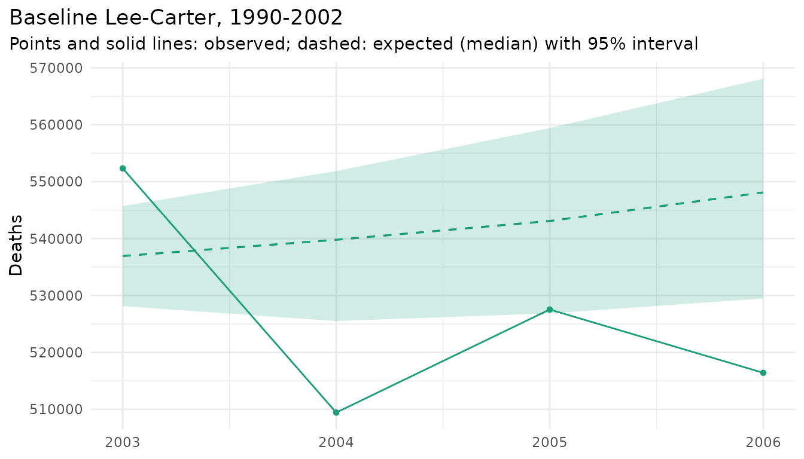
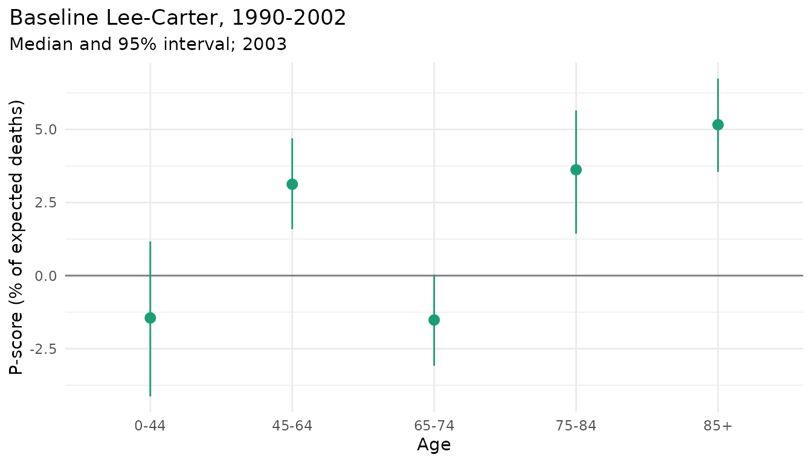
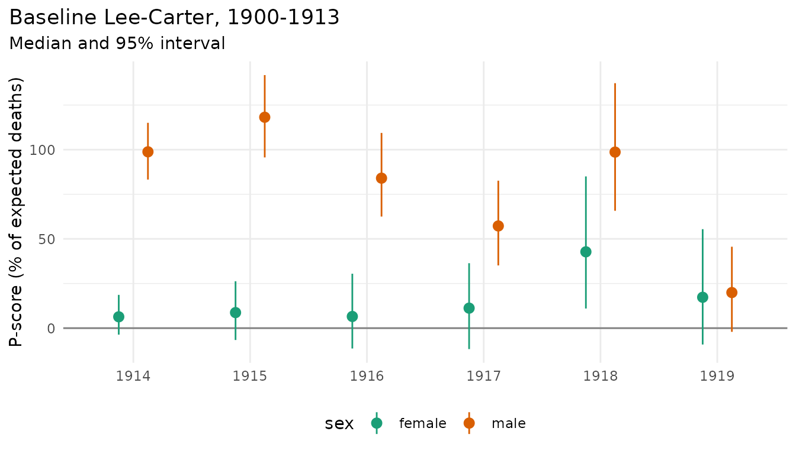
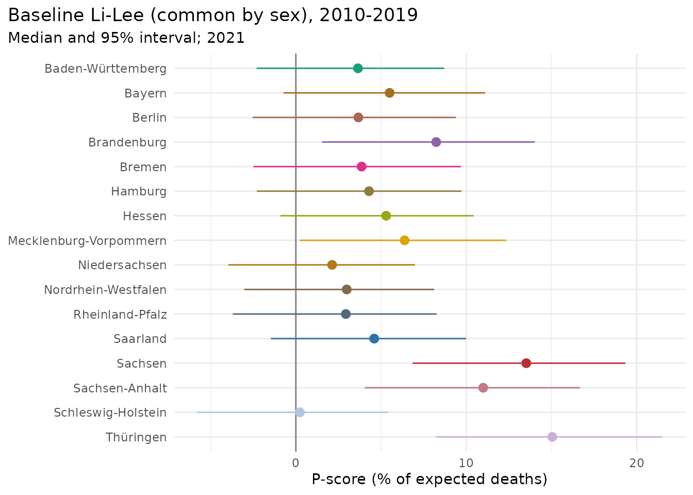

# Excess mortality

Excess deaths are the deaths observed in a period of crisis (a heatwave,
an epidemic, a war) minus the deaths expected without it. The expected
deaths are not observed; they come from a model of the years before the
crisis, the *baseline*. [`mt_excess()`](../reference/mt_excess.md) fits
any mortality model of the package to the baseline years, forecasts the
later years with the observed exposures, and compares the observed
deaths with each simulated path of expected deaths. The intervals
therefore contain the uncertainty of the baseline trend and the random
variation of the death counts: they are prediction intervals for the
realised excess under the baseline model. The WHO estimates of the
excess mortality of the COVID-19 pandemic follow this approach with
their own baseline model (Msemburi et al. 2023).

The results are

- the **excess**: observed minus expected deaths;
- the **P-score**: the excess in percent of the expected deaths;
- `p_positive`: the share of paths in which the observed deaths exceed
  the expected deaths;

by year, and optionally by age group, stratum, and summed over years.

## The heatwave of August 2003 in France

Deaths and exposures of France (Human Mortality Database, via the
demography package), single years of age to 100+. The baseline is a
Lee-Carter model of the years 1990-2002:

``` r

library(mortensor)
library(data.table)
fr <- as_mt_data(demography::fr.mort)
x <- mt_regroup(mt_subset(fr, periods = c(1990, 2006)), age = 0:100)
fit <- mt_fit(lee_carter(), mt_subset(x, periods = c(1990, 2002)))
ex <- mt_excess(fit, x, by = character(), seed = 1)
ex[, list(period, observed, expected_q0.5, excess_q0.025, excess_q0.5, excess_q0.975, p_score_q0.5)]
#>    period observed expected_q0.5 excess_q0.025 excess_q0.5 excess_q0.975
#>     <num>    <num>         <num>         <num>       <num>         <num>
#> 1:   2003   552339      536931.5      6624.225     15407.5     24207.650
#> 2:   2004   509429      539789.0    -42437.625    -30360.0    -16082.050
#> 3:   2005   527535      543092.0    -31888.450    -15557.0       682.875
#> 4:   2006   516416      548104.5    -51667.575    -31688.5    -13050.350
#>    p_score_q0.5
#>           <num>
#> 1:     2.869547
#> 2:    -5.624420
#> 3:    -2.864524
#> 4:    -5.781471
```

`by = character()` sums women and men. In 2003, about 15,000 more people
died than expected (95% interval 6,600 to 24,200), 2.9% more than
expected. Fouillet et al. (2006) counted about 15,000 excess deaths
between 1 and 20 August 2003 against the mortality of 2000-2002, so the
rest of the year was close to the baseline.

``` r

mt_plot_excess(ex)
```



The years after 2003 lie below the baseline: 30,000 fewer deaths than
expected in 2004 and as many in 2006. Part of the deficit of 2004 may be
deaths brought forward by the heatwave, but the deficit continues: from
2003 mortality fell faster than the trend of 1990-2002. A baseline
extrapolated over several years becomes uncertain, and so do excess
deaths far from the baseline period.

By sex and age group:

``` r

mt_excess(fit, x, periods = 2003, seed = 1)[, list(sex, observed, excess_q0.025, excess_q0.5, excess_q0.975)]
#>       sex observed excess_q0.025 excess_q0.5 excess_q0.975
#>    <char>    <num>         <num>       <num>         <num>
#> 1: female   273315      3662.975     11716.5     18782.100
#> 2:   male   279024      -423.375      3877.5      8718.475
ex_age <- mt_excess(fit, x, periods = 2003, by = character(), ages = c(0, 45, 65, 75, 85), seed = 1)
ex_age[, list(age, observed, excess_q0.5, p_score_q0.025, p_score_q0.5, p_score_q0.975)]
#>       age observed excess_q0.5 p_score_q0.025 p_score_q0.5 p_score_q0.975
#>    <char>    <num>       <num>          <num>        <num>          <num>
#> 1:   0-44    29115      -428.0      -4.132683    -1.448736     1.16936356
#> 2:  45-64    81495      2469.0       1.589854     3.124288     4.69657168
#> 3:  65-74    89304     -1377.0      -3.085393    -1.518510     0.03105528
#> 4:  75-84   167633      5854.5       1.435597     3.618837     5.64991291
#> 5:    85+   184792      9069.0       3.547467     5.160964     6.74166633
```

``` r

mt_plot_excess(ex_age, type = "p_score")
```



Three quarters of the excess were women, and most were 75 and older; the
P-score was highest at 85+. Fouillet et al. (2006) also found the excess
concentrated among women and at old ages. `ages` gives the start of each
age group; the deaths are summed path by path before the quantiles are
taken.

The same comparison on the scale of life expectancy: the observed life
expectancy at birth minus that of each path of expected rates.

``` r

le <- mt_excess(fit, x, periods = 2003, quantity = "life_expectancy", seed = 1)
le[, list(sex, observed, expected_q0.5, excess_q0.025, excess_q0.5, excess_q0.975)]
#>       sex observed expected_q0.5 excess_q0.025 excess_q0.5 excess_q0.975
#>    <char>    <num>         <num>         <num>       <num>         <num>
#> 1: female 82.95594      83.20438    -0.5308777  -0.2484383    0.08556622
#> 2:   male 75.87930      76.01581    -0.3704429  -0.1365119    0.07779665
```

Life expectancy of women was 0.25 years lower than expected; the
interval includes zero, because an annual life expectancy hides a shock
of two weeks.

## The choice of baseline

The baseline is an assumption. A few alternatives, each fitted to the
years before 2003:

``` r

base <- list("Lee-Carter 1990-2002" = fit,
             "Lee-Carter 1993-2002" = mt_fit(lee_carter(), mt_subset(x, periods = c(1993, 2002))),
             "random walk 1990-2002" = mt_fit(rwd(), mt_subset(x, periods = c(1990, 2002))),
             "Li-Lee 1990-2002" = mt_fit(li_lee(), mt_subset(x, periods = c(1990, 2002))))
rbindlist(lapply(names(base), function(b) {
  mt_excess(base[[b]], x, periods = 2003, by = character(), seed = 1)[, baseline := b]
}))[, list(baseline, excess_q0.025, excess_q0.5, excess_q0.975, p_score_q0.5)]
#>                 baseline excess_q0.025 excess_q0.5 excess_q0.975 p_score_q0.5
#>                   <char>         <num>       <num>         <num>        <num>
#> 1:  Lee-Carter 1990-2002      6560.475    15558.00      23824.10     2.898389
#> 2:  Lee-Carter 1993-2002      6841.425    15558.50      23485.87     2.898485
#> 3: random walk 1990-2002      6604.257    15194.38      26120.47     2.828732
#> 4:      Li-Lee 1990-2002       174.350    14839.00      28411.90     2.760744
```

The medians agree within 800 deaths. Li-Lee, whose common factor ties
the trends of women and men together, gives the widest interval of the
sum: when the trend errors of the parts are correlated, they do not
cancel in the total. Report the baseline model and years with the
results, and compare a few.

## A large shock: France 1918

The influenza pandemic of 1918 against a baseline of 1900-1913 (ages
0-94 and 95+, because some exposures at the oldest ages are zero in
these years):

``` r

y <- mt_regroup(mt_subset(fr, periods = c(1900, 1919)), age = 0:95)
e18 <- mt_excess(lee_carter(), y, baseline = c(1900, 1913), seed = 1)
e18[, list(sex, period, excess_q0.025, excess_q0.5, excess_q0.975, p_score_q0.5)]
#>        sex period excess_q0.025 excess_q0.5 excess_q0.975 p_score_q0.5
#>     <char>  <num>         <num>       <num>         <num>        <num>
#>  1: female   1914    -11344.650     17967.5      47219.97     6.358185
#>  2: female   1915    -21425.050     24139.5      62661.12     8.714857
#>  3: female   1916    -36893.200     17593.0      66988.12     6.538593
#>  4: female   1917    -38849.175     29459.5      77968.67    11.209280
#>  5: female   1918     37376.625    112934.5     173221.62    42.766475
#>  6: female   1919    -30836.325     45057.5     109011.72    17.291865
#>  7:   male   1914    279363.850    305607.0     328975.65    98.789724
#>  8:   male   1915    318055.825    352372.0     381504.15   118.155237
#>  9:   male   1916    201987.600    239766.5     274307.60    84.025849
#> 10:   male   1917    114019.325    159651.0     198354.65    57.254799
#> 11:   male   1918    221010.225    276639.0     322274.53    98.633727
#> 12:   male   1919     -6935.175     54779.5     103200.12    19.942843
```

``` r

mt_plot_excess(e18, type = "p_score")
```



The excess of men starts in 1914, with the First World War, so for men
it mixes war deaths and the pandemic. That of women is concentrated in
1918: 113,000 deaths (95% interval 37,000 to 173,000), 43% more than
expected. The intervals widen from 1914 on, because the expected deaths
of 1918 are forecast five years ahead of the baseline. By age, for 1918:

``` r

e18a <- mt_excess(lee_carter(), y, baseline = c(1900, 1913), periods = 1918, ages = c(0, 15, 45, 65), seed = 1)
e18a[, list(sex, age, observed, excess_q0.5, p_score_q0.5)]
#>       sex    age observed excess_q0.5 p_score_q0.5
#>    <char> <char>    <num>       <num>        <num>
#> 1: female   0-14    56670     25922.0     84.30467
#> 2: female  15-44   102306     55691.0    119.47013
#> 3: female  45-64    71760     14830.0     26.04953
#> 4: female    65+   146271     16140.0     12.40289
#> 5:   male   0-14    60876     26249.5     75.80755
#> 6:   male  15-44   275811    226852.5    463.35672
#> 7:   male  45-64    94349     15977.5     20.38688
#> 8:   male    65+   126074      7672.0      6.47962
```

Women aged 15-44 died at more than twice the expected rate, a mark of
the 1918 pandemic, which was most lethal for young adults.

## Germany, 2020-2024, by Land

The German data of the package (Destatis) give deaths by Land, sex and
age group. A few small cells are suppressed;
[`mt_fill_suppressed()`](../reference/mt_fill_suppressed.md) estimates
them from the totals of Germany:

``` r

library(mortensor)
library(data.table)
de <- mt_data(deaths = de_deaths[de_deaths$cause == "all", ], population = de_population, by = c("region", "sex"))
de <- mt_as_exposure(de, type = "dec31")
de <- mt_regroup(mt_subset(de, periods = c(2010, 2024)), age = "deaths")
de <- mt_fill_suppressed(de, mt_hierarchy(region = "Deutschland"))
laender <- mt_subset(de, region != "Deutschland", drop = TRUE)
```

The populations are given by Land, so the national total is formed by
summing the Länder
([`mt_aggregate_strata()`](../reference/mt_aggregate_strata.md)). A
Lee-Carter model of the national total, both sexes, fitted to 2010-2019:

``` r

h <- mt_hierarchy(region = "Deutschland", sex = "both")
germany <- mt_subset(mt_aggregate_strata(laender, h), region == "Deutschland" & sex == "both", drop = TRUE)
ex_de <- mt_excess(lee_carter(), germany, baseline = c(2010, 2019), by = character(), seed = 1)
ex_de[, list(period, observed, excess_q0.025, excess_q0.5, excess_q0.975, p_score_q0.5, p_positive)]
#>    period observed excess_q0.025 excess_q0.5 excess_q0.975 p_score_q0.5
#>     <num>    <num>         <num>       <num>         <num>        <num>
#> 1:   2020   985572      2311.300     26267.5      52377.22     2.738182
#> 2:   2021  1023687     15661.950     57406.5      94859.87     5.940977
#> 3:   2022  1066341     50894.150    101402.0     146893.22    10.508644
#> 4:   2023  1028206      6046.075     63961.0     118533.40     6.633273
#> 5:   2024  1007758    -35162.625     31518.0      95599.50     3.228509
#>    p_positive
#>         <num>
#> 1:      0.982
#> 2:      0.998
#> 3:      1.000
#> 4:      0.982
#> 5:      0.842
mt_excess(lee_carter(), germany, baseline = c(2010, 2019), by = character(), cumulative = TRUE,
          seed = 1)[, list(from, period, excess_q0.025, excess_q0.5, excess_q0.975)]
#>     from period excess_q0.025 excess_q0.5 excess_q0.975
#>    <num>  <num>         <num>       <num>         <num>
#> 1:  2020   2020       2311.30     26267.5      52377.22
#> 2:  2020   2021      24021.85     83942.5     146951.52
#> 3:  2020   2022      79598.40    185328.0     292246.35
#> 4:  2020   2023      98231.30    249652.5     403424.02
#> 5:  2020   2024      71029.15    281336.0     494946.17
```

The excess rose from about 26,000 in 2020 to 101,000 in 2022 and fell
afterwards; from 2020 to 2022 it summed to 185,000, with a wide interval
(80,000 to 292,000). The interval is wide because the expected deaths of
2022 are a forecast three years beyond a baseline of ten years.

Summing separate models of the 32 strata (Land by sex) instead gives a
much narrower interval for the same total:

``` r

mt_excess(lee_carter(), laender, baseline = c(2010, 2019), by = character(),
          seed = 1)[, list(period, excess_q0.025, excess_q0.5, excess_q0.975)]
#>    period excess_q0.025 excess_q0.5 excess_q0.975
#>     <num>         <num>       <num>         <num>
#> 1:   2020     11846.200     19819.0      27936.45
#> 2:   2021     36992.925     48672.0      59548.20
#> 3:   2022     76783.600     91649.0     106078.55
#> 4:   2023     36012.875     55313.5      72157.88
#> 5:   2024      1588.225     22743.0      41031.38
```

Separate models draw their trend errors independently, so these cancel
in the sum, while in reality the Länder share much of their trend. For a
total, use a model of the total, or a joint model of its parts such as
[`li_lee()`](../reference/li_lee.md), whose common factor carries the
shared trend. The warning suppressed here concerns the oldest men of
Bremen, a small population.

P-scores of the Länder in 2021, from a Li-Lee model with one common
factor per sex:

``` r

ex_l <- mt_excess(li_lee(common_by = "sex"), laender, baseline = c(2010, 2019), by = "region", periods = 2021,
                  seed = 1)
ex_l[order(-p_score_q0.5), list(region, p_score_q0.025, p_score_q0.5, p_score_q0.975, cells, skipped)]
#>                     region p_score_q0.025 p_score_q0.5 p_score_q0.975 cells
#>                     <char>          <num>        <num>          <num> <int>
#>  1:              Thüringen      8.2139112   15.0511173      21.503461    36
#>  2:                Sachsen      6.8553909   13.5246191      19.342746    36
#>  3:         Sachsen-Anhalt      4.0430413   10.9956839      16.683186    36
#>  4:            Brandenburg      1.5361014    8.2373372      14.024362    36
#>  5: Mecklenburg-Vorpommern      0.2290761    6.3847594      12.354611    36
#>  6:                 Bayern     -0.7342602    5.5024026      11.109088    36
#>  7:                 Hessen     -0.9070643    5.2978926      10.429007    36
#>  8:               Saarland     -1.4714408    4.5975748       9.993489    36
#>  9:                Hamburg     -2.2928389    4.2946483       9.722956    36
#> 10:                 Bremen     -2.4942770    3.8608077       9.690832    34
#> 11:                 Berlin     -2.5349797    3.6690816       9.388032    36
#> 12:      Baden-Württemberg     -2.3032827    3.6462279       8.712516    36
#> 13:    Nordrhein-Westfalen     -3.0283399    2.9866045       8.118214    36
#> 14:        Rheinland-Pfalz     -3.6987771    2.9342018       8.260803    36
#> 15:          Niedersachsen     -3.9596874    2.1275509       6.986354    36
#> 16:     Schleswig-Holstein     -5.7930055    0.2356595       5.424224    36
#>     skipped
#>       <int>
#>  1:       0
#>  2:       0
#>  3:       0
#>  4:       0
#>  5:       0
#>  6:       0
#>  7:       0
#>  8:       0
#>  9:       0
#> 10:       2
#> 11:       0
#> 12:       0
#> 13:       0
#> 14:       0
#> 15:       0
#> 16:       0
```

``` r

mt_plot_excess(ex_l, type = "p_score")
```



In 2021 the excess was highest in Thüringen, Sachsen and Sachsen-Anhalt
(P-scores 11-15%); in most western Länder the interval contains zero.
`cells` and `skipped` count the observed cells used and left out: cells
whose deaths were estimated (suppressed cells filled above) are not
compared unless `include_estimated = TRUE`.

## Do the intervals hold?

When the baseline model describes the years without a shock, the 95%
interval of the excess should contain the true excess in 95% of cases.
The validation suite of the package checks this on simulated data
([`mt_example()`](../reference/mt_example.md), a Lee-Carter baseline,
deaths at ages 70 and older raised by 10% in two years, 20 replicates):
the intervals contained zero where there was no shock in 98% of the
cases, and the injected deaths in 98% of the cases where there was one.
On real data, the coverage depends on how well the baseline model
forecasts the years of the shock; a backtest of the baseline model on
years without a shock ([`mt_backtest()`](../reference/mt_backtest.md))
shows how wide its intervals need to be.

## References

Acosta RJ, Irizarry RA (2022). A flexible statistical framework for
estimating excess mortality. *Epidemiology* 33(3): 346-353.
<doi:10.1097/EDE.0000000000001445>.

Fouillet A, Rey G, Laurent F, Pavillon G, Bellec S, Guihenneuc-Jouyaux
C, Clavel J, Jougla E, Hémon D (2006). Excess mortality related to the
August 2003 heat wave in France. *International Archives of Occupational
and Environmental Health* 80(1): 16-24. <doi:10.1007/s00420-006-0089-4>.

Msemburi W, Karlinsky A, Knutson V, Aleshin-Guendel S, Chatterji S,
Wakefield J (2023). The WHO estimates of excess mortality associated
with the COVID-19 pandemic. *Nature* 613: 130-137.
<doi:10.1038/s41586-022-05522-2>.
