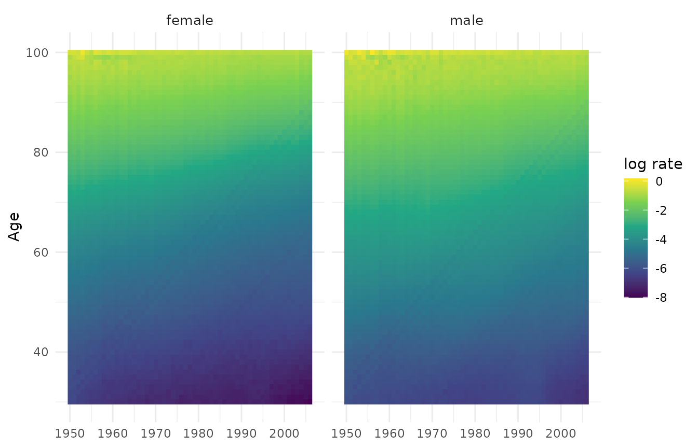
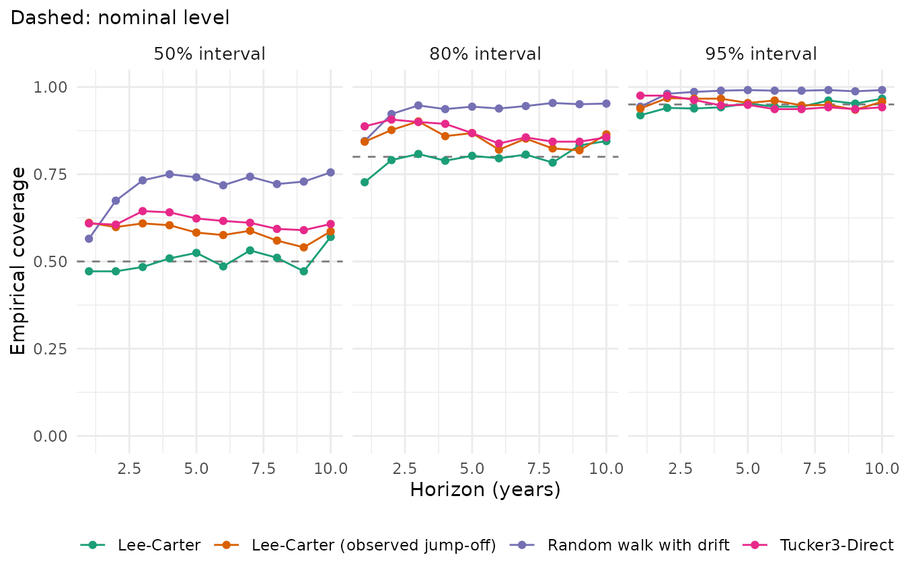
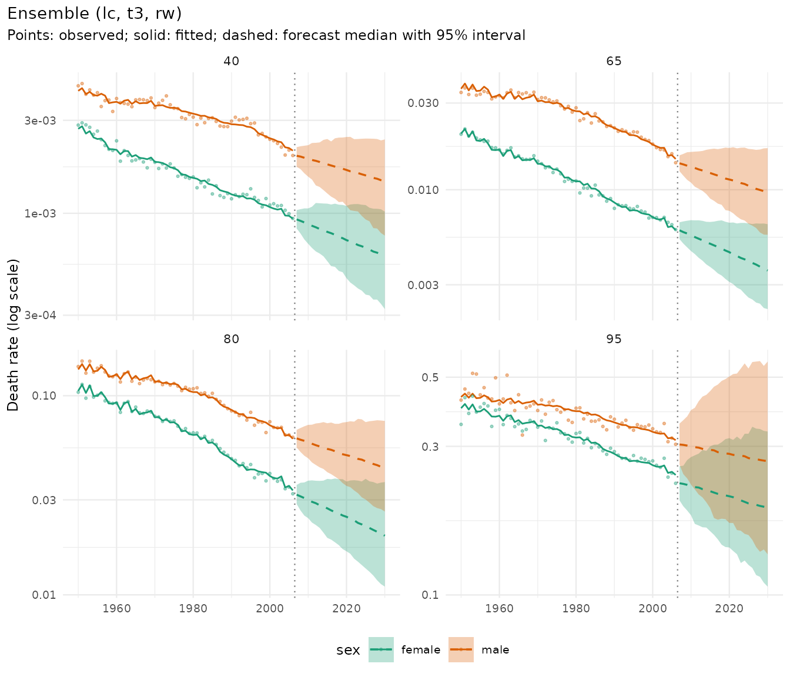
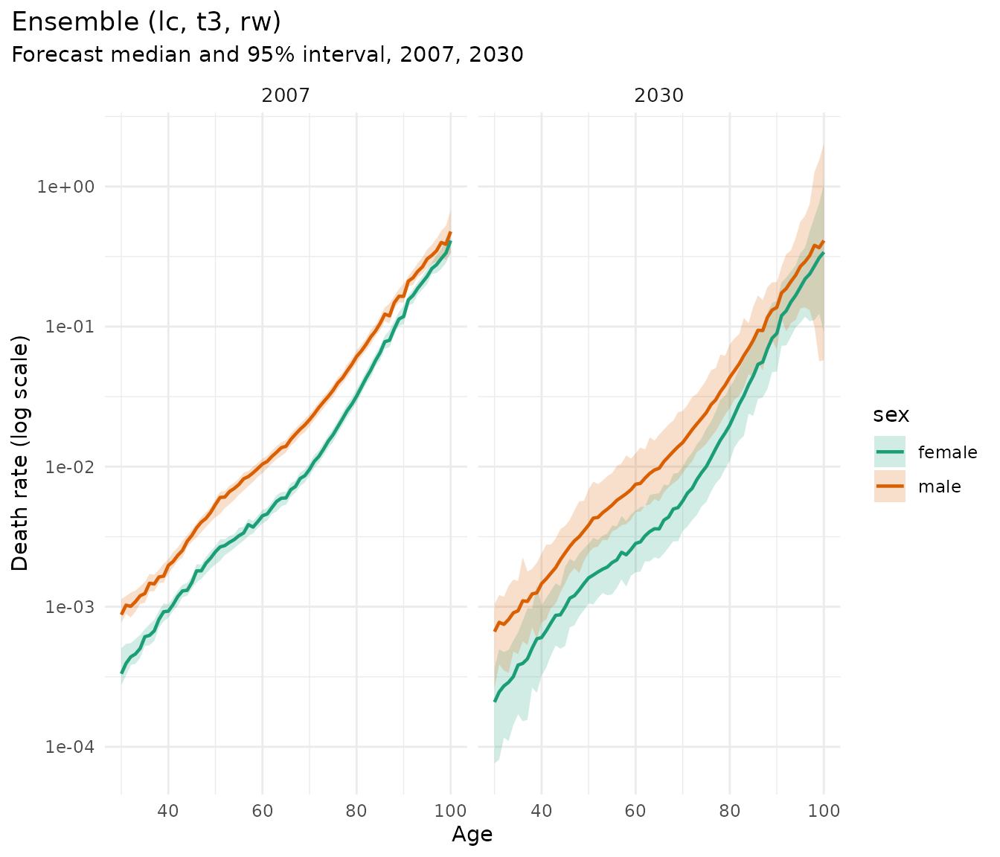
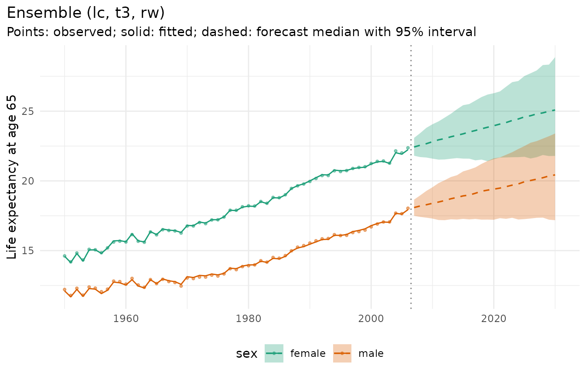

# Forecasting and backtesting with HMD data

This vignette forecasts mortality for France with Human Mortality
Database (HMD) data
([`demography::fr.mort`](https://pkg.robjhyndman.com/demography/reference/fr.mort.html)),
compares models in an honest rolling-origin backtest, and combines them
in an ensemble. A second example with England & Wales
([`StMoMo::EWMaleData`](https://rdrr.io/pkg/StMoMo/man/EWMaleData.html))
shows a case where the classic Lee-Carter intervals are too narrow.

``` r

library(mortensor)
library(data.table)
```

## Data

Women and men aged 30 and over, 1950-2006, with single years of age up
to 99 and an open interval 100+ (aggregated from the HMD’s 110+ table):

``` r

fr <- suppressWarnings(as_mt_data(demography::fr.mort, years = 1950:2006))
fr <- mt_regroup(fr, age = 30:100)
fr
#> <mt_data> 2 strata by sex, omega = 110
#>   deaths     single years 30-99, 100+; periods 1950-2006 (width 1); 8094 cells
#>   exposure   single years 30-99, 100+; periods 1950-2006 (width 1); 8094 cells
#>   grid       <mt_axis: age, 71 intervals> 30 31 32 33 ... 98 99 100+
#>              <mt_axis: period, 57 intervals> 1950 1951 1952 1953 ... 2004 2005 2006
```

``` r

mt_plot_rates(fr)
```



## Models

All models share one interface. Each returns simulated paths of future
death rates.

| Constructor | Model |
|----|----|
| [`rwd()`](../reference/rwd.md) | Random walk with drift on log rates per age (benchmark) |
| [`lee_carter()`](../reference/lee_carter.md) | Lee-Carter, Poisson (Brouhns et al. 2002) or SVD (Lee and Carter 1992) |
| [`tucker3()`](../reference/tucker3.md) | Tucker3 tensor decomposition of the age x period x stratum array, fitted jointly for women and men |
| [`arima_series()`](../reference/arima_series.md), [`ets_series()`](../reference/arima_series.md) | ARIMA and exponential smoothing per age (package forecast) |
| [`apc_bayes()`](../reference/apc_bayes.md) | Bayesian age-period-cohort model (package bamp; see its vignette) |
| [`ensemble()`](../reference/ensemble.md) | Mixture of the draws of several models |

``` r

fit_lc <- mt_fit(lee_carter(), fr)
head(mt_parameters(fit_lc)[parameter == "b"])
#>    stratum parameter  index      value
#>     <char>    <char> <char>      <num>
#> 1:  female         b     30 0.01700986
#> 2:  female         b     31 0.01701723
#> 3:  female         b     32 0.01583856
#> 4:  female         b     33 0.01550370
#> 5:  female         b     34 0.01517323
#> 6:  female         b     35 0.01507692
fit_t3 <- mt_fit(tucker3(), fr)
fit_t3$fits$fit_pct
#> [1] 99.92013
```

## Backtest

[`mt_backtest()`](../reference/mt_backtest.md) refits the model on data
up to each origin and scores predictive draws of the observed log death
rates in the following ten years. Scores are averaged over ages, years
ahead, sexes and origins. Smaller CRPS and WIS are better;
well-calibrated 50%, 80% and 95% intervals contain about 50%, 80% and
95% of the observations.

``` r

origins <- c(1986, 1989, 1992, 1995)
specs <- list(rwd(), lee_carter(), lee_carter(jump_off = "observed"), tucker3())
bt <- rbindlist(lapply(specs, function(sp) {
  b <- mt_backtest(sp, fr, origins = origins, h = 10, n_draws = 200)
  if (isTRUE(sp$params$jump_off == "observed")) b[, model := "Lee-Carter (observed jump-off)"]
  b
}))
#> Warning in check_draws_plausible(arr, fit$age, fit$strata, spec$label): Random
#> walk with drift: forecast death rates above 1 in 35.5% of the draws (strata
#> female, male; ages 95, 96, 97, 98). The model is unstable here, often because
#> of sparse counts; consider wider age groups (mt_regroup()), pooling
#> (li_lee(common_by = )), smoothing (step_smooth()) or an ensemble.
#> Warning in check_draws_plausible(arr, fit$age, fit$strata, spec$label): Random
#> walk with drift: forecast death rates above 1 in 26.0% of the draws (strata
#> female, male; ages 95, 96, 97, 98). The model is unstable here, often because
#> of sparse counts; consider wider age groups (mt_regroup()), pooling
#> (li_lee(common_by = )), smoothing (step_smooth()) or an ensemble.
#> Warning in check_draws_plausible(arr, fit$age, fit$strata, spec$label): Random
#> walk with drift: forecast death rates above 1 in 27.0% of the draws (strata
#> male; ages 97, 98, 99). The model is unstable here, often because of sparse
#> counts; consider wider age groups (mt_regroup()), pooling (li_lee(common_by =
#> )), smoothing (step_smooth()) or an ensemble.
#> Warning in check_draws_plausible(arr, fit$age, fit$strata, spec$label): Random
#> walk with drift: forecast death rates above 1 in 27.0% of the draws (strata
#> male; ages 97, 98, 99). The model is unstable here, often because of sparse
#> counts; consider wider age groups (mt_regroup()), pooling (li_lee(common_by =
#> )), smoothing (step_smooth()) or an ensemble.
#> Warning in check_draws_plausible(arr, fit$age, fit$strata, spec$label):
#> Tucker3-Direct: forecast death rates above 1 in 0.5% of the draws (strata male;
#> ages 99). The model is unstable here, often because of sparse counts; consider
#> wider age groups (mt_regroup()), pooling (li_lee(common_by = )), smoothing
#> (step_smooth()) or an ensemble.
mt_score(bt, by = "model")[order(crps)]
#>                             model       crps        wis        mae     mase
#>                            <char>      <num>      <num>      <num>    <num>
#> 1:                 Tucker3-Direct 0.05412541 0.04853517 0.07296594 1.427388
#> 2: Lee-Carter (observed jump-off) 0.05417153 0.04857804 0.07400185 1.447016
#> 3:                     Lee-Carter 0.06049163 0.05398945 0.08532748 1.651223
#> 4:         Random walk with drift 0.06156062 0.05523146 0.07678813 1.490622
#>        cov50     cov80     cov95  pit_mean     n
#>        <num>     <num>     <num>     <num> <int>
#> 1: 0.6140845 0.8691901 0.9503521 0.4557301  5680
#> 2: 0.5855634 0.8528169 0.9544014 0.4540421  5680
#> 3: 0.5031690 0.7980634 0.9459507 0.5127234  5680
#> 4: 0.7130282 0.9336268 0.9839789 0.4659921  5680
```

``` r

mt_plot_coverage(bt)
```



Scores by horizon show how quickly accuracy deteriorates:

``` r

dcast(mt_score(bt, by = c("model", "horizon")), horizon ~ model, value.var = "crps")
#> Key: <horizon>
#>     horizon Lee-Carter Lee-Carter (observed jump-off) Random walk with drift
#>       <num>      <num>                          <num>                  <num>
#>  1:       1 0.04305559                     0.03178328             0.03283419
#>  2:       2 0.04729962                     0.03581555             0.03877137
#>  3:       3 0.05328685                     0.04107764             0.04562030
#>  4:       4 0.05672088                     0.04628671             0.05322222
#>  5:       5 0.05912559                     0.05240824             0.05984053
#>  6:       6 0.06426341                     0.05836090             0.06686275
#>  7:       7 0.06627244                     0.06165492             0.07110105
#>  8:       8 0.06928442                     0.06690394             0.07663887
#>  9:       9 0.07334298                     0.07323166             0.08379047
#> 10:      10 0.07226453                     0.07419249             0.08692444
#>     Tucker3-Direct
#>              <num>
#>  1:     0.03252696
#>  2:     0.03843810
#>  3:     0.04354349
#>  4:     0.04804205
#>  5:     0.05327119
#>  6:     0.05890751
#>  7:     0.06146465
#>  8:     0.06433749
#>  9:     0.06972749
#> 10:     0.07099518
```

## Ensemble

An ensemble mixes the paths of its components. With `weights = "crps"`
the weights come from an inner backtest on the last years of the
training data, so they never use the years being forecast.

``` r

ens <- ensemble(lc = lee_carter(jump_off = "observed"), t3 = tucker3(), rw = rwd(), weights = "crps")
bt_ens <- mt_backtest(ens, fr, origins = origins, h = 10, n_draws = 200)
#> Warning in check_draws_plausible(arr, fit$age, fit$strata, spec$label): Random
#> walk with drift: forecast death rates above 1 in 27.0% of the draws (strata
#> female, male; ages 97, 98, 99). The model is unstable here, often because of
#> sparse counts; consider wider age groups (mt_regroup()), pooling
#> (li_lee(common_by = )), smoothing (step_smooth()) or an ensemble.
#> Warning in check_draws_plausible(arr, fit$age, fit$strata, spec$label): Random
#> walk with drift: forecast death rates above 1 in 27.5% of the draws (strata
#> female, male; ages 98, 99). The model is unstable here, often because of sparse
#> counts; consider wider age groups (mt_regroup()), pooling (li_lee(common_by =
#> )), smoothing (step_smooth()) or an ensemble.
#> Warning in check_draws_plausible(arr, fit$age, fit$strata, spec$label): Random
#> walk with drift: forecast death rates above 1 in 23.5% of the draws (strata
#> female, male; ages 96, 97, 98, 99). The model is unstable here, often because
#> of sparse counts; consider wider age groups (mt_regroup()), pooling
#> (li_lee(common_by = )), smoothing (step_smooth()) or an ensemble.
#> Warning in check_draws_plausible(arr, fit$age, fit$strata, spec$label): Random
#> walk with drift: forecast death rates above 1 in 30.5% of the draws (strata
#> female, male; ages 96, 97, 98, 99). The model is unstable here, often because
#> of sparse counts; consider wider age groups (mt_regroup()), pooling
#> (li_lee(common_by = )), smoothing (step_smooth()) or an ensemble.
mt_score(rbind(bt, bt_ens), by = "model")[order(crps)]
#>                             model       crps        wis        mae     mase
#>                            <char>      <num>      <num>      <num>    <num>
#> 1:          Ensemble (lc, t3, rw) 0.05341320 0.04793918 0.07102882 1.387234
#> 2:                 Tucker3-Direct 0.05412541 0.04853517 0.07296594 1.427388
#> 3: Lee-Carter (observed jump-off) 0.05417153 0.04857804 0.07400185 1.447016
#> 4:                     Lee-Carter 0.06049163 0.05398945 0.08532748 1.651223
#> 5:         Random walk with drift 0.06156062 0.05523146 0.07678813 1.490622
#>        cov50     cov80     cov95  pit_mean     n
#>        <num>     <num>     <num>     <num> <int>
#> 1: 0.6686620 0.9132042 0.9786972 0.4587736  5680
#> 2: 0.6140845 0.8691901 0.9503521 0.4557301  5680
#> 3: 0.5855634 0.8528169 0.9544014 0.4540421  5680
#> 4: 0.5031690 0.7980634 0.9459507 0.5127234  5680
#> 5: 0.7130282 0.9336268 0.9839789 0.4659921  5680
```

## Forecast to 2030

``` r

fit_ens <- mt_fit(ens, fr)
fit_ens$weights
#>        lc        t3        rw 
#> 0.3666762 0.2896811 0.3436428
fc <- mt_forecast(fit_ens, to = 2030, n_draws = 1000, seed = 2026)
#> Warning in check_draws_plausible(arr, fit$age, fit$strata, spec$label): Random
#> walk with drift: forecast death rates above 1 in 41.8% of the draws (strata
#> female, male; ages 95, 96, 97, 98). The model is unstable here, often because
#> of sparse counts; consider wider age groups (mt_regroup()), pooling
#> (li_lee(common_by = )), smoothing (step_smooth()) or an ensemble.
fc
#> <mt_draws> Ensemble (lc, t3, rw); origin 2006; 71 ages x 24 periods (2007-2030) x 2 strata x 1000 draws
```

``` r

mt_plot_forecast(fc, ages = c("40", "65", "80", "95"))
```



``` r

mt_plot_age(fc, periods = c(2007, 2030))
```



Life expectancy at 65, computed path by path:

``` r

e65 <- life_expectancy(fc, at = 65)
e65[period %in% c(2007, 2020, 2030), .(label, period, q0.025, q0.5, q0.975)]
#>     label period   q0.025     q0.5   q0.975
#>    <char>  <num>    <num>    <num>    <num>
#> 1: female   2007 21.80324 22.43112 23.08600
#> 2: female   2020 21.55237 23.95622 26.28707
#> 3: female   2030 21.79137 25.08470 28.87168
#> 4:   male   2007 17.49317 18.08927 18.65829
#> 5:   male   2020 17.21336 19.40833 21.61750
#> 6:   male   2030 17.18157 20.43159 23.39781
```

``` r

mt_plot_life_expectancy(fc, at = 65)
```



## A cautionary example: England & Wales

For men in England & Wales, Lee-Carter fitted to 1961 onwards forecasts
the decade after each origin with intervals that are far too narrow, and
is less accurate than the random walk. Lee-Carter intervals reflect only
the uncertainty of the period index; when the age pattern of mortality
improvement changes, as it did for British men from the 1970s, the
constant `b_x` misses it.

``` r

ew <- as_mt_data(StMoMo::EWMaleData)
ew <- mt_regroup(mt_set_grid(ew, age = single_ages(30, 100, open = FALSE)), age = single_ages(30, 100, open = FALSE))
bt_ew <- rbind(
  mt_backtest(lee_carter(), ew, origins = 1996:2001, h = 10, n_draws = 200),
  mt_backtest(rwd(), ew, origins = 1996:2001, h = 10, n_draws = 200),
  mt_backtest(tucker3(), ew, origins = 1996:2001, h = 10, n_draws = 200))
#> Warning in check_draws_plausible(arr, fit$age, fit$strata, spec$label): Random
#> walk with drift: forecast death rates above 1 in 54.0% of the draws (strata
#> male; ages 97, 98, 99, 100). The model is unstable here, often because of
#> sparse counts; consider wider age groups (mt_regroup()), pooling
#> (li_lee(common_by = )), smoothing (step_smooth()) or an ensemble.
#> Warning in check_draws_plausible(arr, fit$age, fit$strata, spec$label): Random
#> walk with drift: forecast death rates above 1 in 32.0% of the draws (strata
#> male; ages 98, 99, 100). The model is unstable here, often because of sparse
#> counts; consider wider age groups (mt_regroup()), pooling (li_lee(common_by =
#> )), smoothing (step_smooth()) or an ensemble.
#> Warning in check_draws_plausible(arr, fit$age, fit$strata, spec$label): Random
#> walk with drift: forecast death rates above 1 in 30.0% of the draws (strata
#> male; ages 97, 98, 99, 100). The model is unstable here, often because of
#> sparse counts; consider wider age groups (mt_regroup()), pooling
#> (li_lee(common_by = )), smoothing (step_smooth()) or an ensemble.
#> Warning in check_draws_plausible(arr, fit$age, fit$strata, spec$label): Random
#> walk with drift: forecast death rates above 1 in 42.5% of the draws (strata
#> male; ages 98, 99, 100). The model is unstable here, often because of sparse
#> counts; consider wider age groups (mt_regroup()), pooling (li_lee(common_by =
#> )), smoothing (step_smooth()) or an ensemble.
#> Warning in check_draws_plausible(arr, fit$age, fit$strata, spec$label): Random
#> walk with drift: forecast death rates above 1 in 35.0% of the draws (strata
#> male; ages 97, 98, 99, 100). The model is unstable here, often because of
#> sparse counts; consider wider age groups (mt_regroup()), pooling
#> (li_lee(common_by = )), smoothing (step_smooth()) or an ensemble.
#> Warning in check_draws_plausible(arr, fit$age, fit$strata, spec$label): Random
#> walk with drift: forecast death rates above 1 in 33.5% of the draws (strata
#> male; ages 98, 99, 100). The model is unstable here, often because of sparse
#> counts; consider wider age groups (mt_regroup()), pooling (li_lee(common_by =
#> )), smoothing (step_smooth()) or an ensemble.
#> Warning in check_draws_plausible(arr, fit$age, fit$strata, spec$label):
#> Tucker3-Direct: forecast death rates above 1 in 9.5% of the draws (strata male;
#> ages 100). The model is unstable here, often because of sparse counts; consider
#> wider age groups (mt_regroup()), pooling (li_lee(common_by = )), smoothing
#> (step_smooth()) or an ensemble.
#> Warning in check_draws_plausible(arr, fit$age, fit$strata, spec$label):
#> Tucker3-Direct: forecast death rates above 1 in 2.5% of the draws (strata male;
#> ages 100). The model is unstable here, often because of sparse counts; consider
#> wider age groups (mt_regroup()), pooling (li_lee(common_by = )), smoothing
#> (step_smooth()) or an ensemble.
#> Warning in check_draws_plausible(arr, fit$age, fit$strata, spec$label):
#> Tucker3-Direct: forecast death rates above 1 in 1.5% of the draws (strata male;
#> ages 100). The model is unstable here, often because of sparse counts; consider
#> wider age groups (mt_regroup()), pooling (li_lee(common_by = )), smoothing
#> (step_smooth()) or an ensemble.
#> Warning in check_draws_plausible(arr, fit$age, fit$strata, spec$label):
#> Tucker3-Direct: forecast death rates above 1 in 2.0% of the draws (strata male;
#> ages 100). The model is unstable here, often because of sparse counts; consider
#> wider age groups (mt_regroup()), pooling (li_lee(common_by = )), smoothing
#> (step_smooth()) or an ensemble.
#> Warning in check_draws_plausible(arr, fit$age, fit$strata, spec$label):
#> Tucker3-Direct: forecast death rates above 1 in 4.5% of the draws (strata male;
#> ages 100). The model is unstable here, often because of sparse counts; consider
#> wider age groups (mt_regroup()), pooling (li_lee(common_by = )), smoothing
#> (step_smooth()) or an ensemble.
#> Warning in check_draws_plausible(arr, fit$age, fit$strata, spec$label):
#> Tucker3-Direct: forecast death rates above 1 in 1.0% of the draws (strata male;
#> ages 100). The model is unstable here, often because of sparse counts; consider
#> wider age groups (mt_regroup()), pooling (li_lee(common_by = )), smoothing
#> (step_smooth()) or an ensemble.
mt_score(bt_ew, by = "model")
#>                     model       crps        wis        mae     mase     cov50
#>                    <char>      <num>      <num>      <num>    <num>     <num>
#> 1:             Lee-Carter 0.06868347 0.06196427 0.09468173 2.276649 0.2814554
#> 2: Random walk with drift 0.05859945 0.05244993 0.07524011 1.806958 0.6150235
#> 3:         Tucker3-Direct 0.06453556 0.05827886 0.08698994 2.146668 0.4223005
#>        cov80     cov95  pit_mean     n
#>        <num>     <num>     <num> <int>
#> 1: 0.5455399 0.7460094 0.4235839  4260
#> 2: 0.8516432 0.9666667 0.3779308  4260
#> 3: 0.6685446 0.8117371 0.3628478  4260
```

Backtests like this one are the reason mortensor reports interval
coverage alongside accuracy: a model can rank well on point accuracy and
still give misleading uncertainty.

### Ways to improve Lee-Carter here

Four modifications, each a general option that works with other models
too:

- `lee_carter(choose_period = TRUE)` fits only the longest recent period
  over which the period index was close to linear (Booth, Maindonald and
  Smith 2002);
- [`anchored()`](../reference/anchored.md) starts the forecast at the
  observed level of the last three years instead of the fitted rates;
- smoothing over time before fitting (`step_smooth(along = "period")`)
  with [`calibrated()`](../reference/calibrated.md), which fits the
  spread of the draws to the forecast errors of the last ten training
  years (smoothing alone would make the intervals narrower still,
  because the smoothed period index varies less).

The backtest also scores life expectancy at age 30 (`quantities`), the
quantity most reports are about:

``` r

smooth_t <- mt_prep(step_smooth(along = "period", method = "whittaker"))
variants <- list(list(lee_carter(choose_period = TRUE), NULL),
                 list(anchored(lee_carter(), years = 3), NULL),
                 list(calibrated(lee_carter()), smooth_t))
bt_v <- rbindlist(c(list(mt_backtest(lee_carter(), ew, origins = 1996:2001, h = 10, n_draws = 200,
                                     quantities = "life_expectancy")),
                    lapply(variants, function(v) {
                      mt_backtest(v[[1]], ew, origins = 1996:2001, h = 10, n_draws = 200, prep = v[[2]],
                                  quantities = "life_expectancy")
                    })))
bt_v[, model := c("Lee-Carter", "chosen period", "anchored", "smoothed + calibrated")[match(model, unique(model))]]
merge(mt_score(bt_v)[, .(model, crps, cov95)],
      mt_score(bt_v, target = "life_expectancy")[, .(model, crps_e30 = crps, cov95_e30 = cov95)], by = "model")
#> Key: <model>
#>                    model       crps     cov95  crps_e30 cov95_e30
#>                   <char>      <num>     <num>     <num>     <num>
#> 1:            Lee-Carter 0.06868347 0.7460094 0.4734708 0.9166667
#> 2:              anchored 0.06475877 0.7701878 0.4739414 0.9500000
#> 3:         chosen period 0.06147190 0.6887324 0.3179468 1.0000000
#> 4: smoothed + calibrated 0.06575973 0.8734742 0.4418967 1.0000000
```

`crps_e30` is in years of life expectancy. For the rates, all three
modifications are more accurate than Lee-Carter fitted to all years
(CRPS 0.061 to 0.066 against 0.069), and only the calibration brings the
95% coverage close to nominal (0.87 against 0.75). For life expectancy
at 30 the chosen period gives the largest gain (0.32 against 0.47
years), anchoring changes nothing, and smoothing with calibration helps
a little. The coverage of life expectancy is at or above 95% for all
four: the rates fall outside their intervals mostly through deviations
of single ages, which largely cancel in life expectancy. With six
origins of one population these differences are indicative only.

## References

Brouhns N, Denuit M, Vermunt JK (2002). A Poisson log-bilinear
regression approach to the construction of projected lifetables.
*Insurance: Mathematics and Economics* 31(3): 373-393.

Lee RD, Carter LR (1992). Modeling and forecasting U.S. mortality.
*Journal of the American Statistical Association* 87(419): 659-671.

Bracher J, Ray EL, Gneiting T, Reich NG (2021). Evaluating epidemic
forecasts in an interval format. *PLoS Computational Biology* 17(2):
e1008618.
