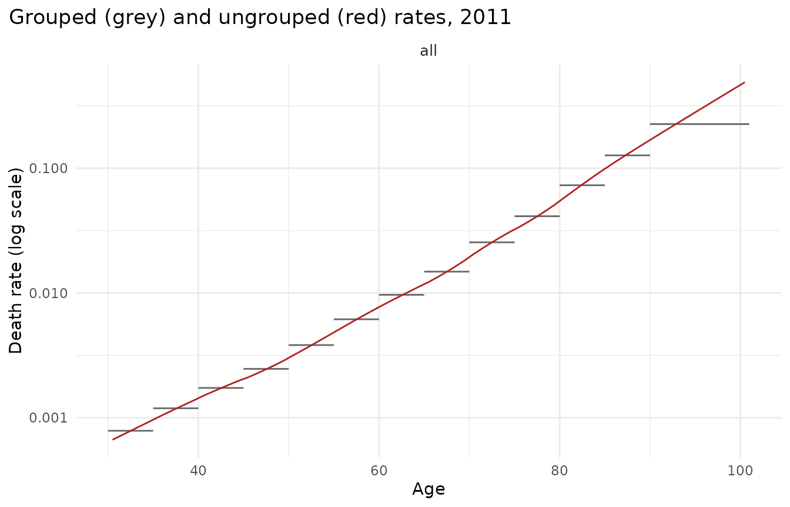
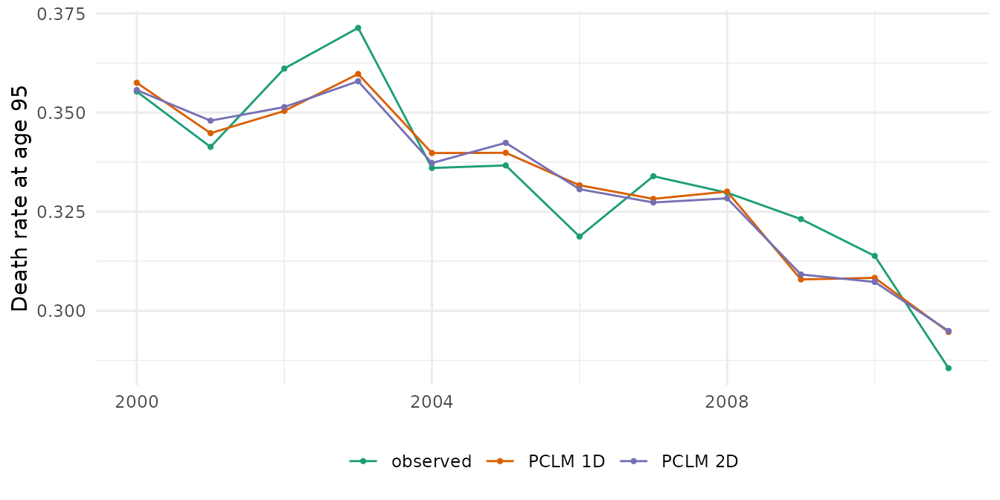

# Data at different granularities: ungrouping HMD data

Official statistics often report deaths in 5-year age groups with an
open interval (85+ or 90+), while populations are available by single
year of age, and models are easiest to use on single years. This
vignette shows how mortensor handles such data, using Human Mortality
Database (HMD) series that are shipped with the StMoMo and demography
packages:

- England & Wales, men, 1961-2011, ages 0-100
  ([`StMoMo::EWMaleData`](https://rdrr.io/pkg/StMoMo/man/EWMaleData.html));
- France, women and men, 1816-2006, ages 0-110+
  ([`demography::fr.mort`](https://pkg.robjhyndman.com/demography/reference/fr.mort.html)).

Both contain single-year deaths and exposures, so we can group them as
an official statistic would, ungroup them, and check the result against
what was actually observed.

``` r

library(mortensor)
library(data.table)
```

## Reading HMD data

[`as_mt_data()`](../reference/as_mt_data.md) converts the objects of
both packages. Deaths and exposures are stored per stratum (`sex`) with
their age and period intervals.

``` r

ew <- as_mt_data(StMoMo::EWMaleData)
ew
#> <mt_data> 1 stratum by sex, omega = 110
#>   deaths     single years 0-100; periods 1961-2011 (width 1); 5151 cells
#>   exposure   single years 0-100; periods 1961-2011 (width 1); 5151 cells
#>   grid       <mt_axis: age, 101 intervals> 0 1 2 3 ... 98 99 100
#>              <mt_axis: period, 51 intervals> 1961 1962 1963 1964 ... 2009 2010 2011
fr <- suppressWarnings(as_mt_data(demography::fr.mort, years = 1950:2006))
fr
#> <mt_data> 2 strata by sex, omega = 110
#>   deaths     single years 0-109, 110+; periods 1950-2006 (width 1); 12654 cells
#>   exposure   single years 0-109, 110+; periods 1950-2006 (width 1); 12654 cells
#>   grid       <mt_axis: age, 111 intervals> 0 1 2 3 ... 108 109 110+
#>              <mt_axis: period, 57 intervals> 1950 1951 1952 1953 ... 2004 2005 2006
mt_validate(fr)
#> <mt_validation> 2 finding(s): 0 error, 0 warning, 2 info
#>   [info] zero exposure (exposure, female, n = 69): cells with zero exposure
#>   [info] zero exposure (exposure, male, n = 108): cells with zero exposure
```

The France data use an open 110+ interval. For HMD data downloaded
directly (an account at <https://www.mortality.org> is needed),
[`mt_read_hmd()`](../reference/mt_from_hmd.md) returns the same
structure:

``` r

swe <- mt_read_hmd("SWE", years = 1950:2020)
swe
```

## Grouping and ungrouping deaths

We group the English and Welsh deaths at ages 30-100 into 30-34, …,
85-89 and 90-100, keep the exposures by single year, and restrict the
data to 1980-2011:

``` r

ages <- 30:100
yrs <- 1980:2011
D <- StMoMo::EWMaleData$Dxt[as.character(ages), as.character(yrs)]
E <- StMoMo::EWMaleData$Ext[as.character(ages), as.character(yrs)]
lo <- c(seq(30, 85, 5), 90)
grouped <- data.table(year = rep(yrs, each = length(lo)), age_lo = rep(lo, length(yrs)),
                      age_hi = rep(c(lo[-1], 101), length(yrs)),
                      deaths = as.vector(rowsum(D, findInterval(ages, lo))))
single <- data.table(year = rep(yrs, each = length(ages)), age_lo = rep(ages, length(yrs)),
                     age_hi = rep(ages + 1, length(yrs)), exposure = as.vector(E))
x <- mt_data(deaths = grouped, exposure = single, age = c("age_lo", "age_hi"))
x
#> <mt_data> 1 stratum, omega = 110
#>   deaths     mixed widths (5,11) 30-100; periods 1980-2011 (width 1); 416 cells
#>   exposure   single years 30-100; periods 1980-2011 (width 1); 2272 cells
#>   grid       <mt_axis: age, 71 intervals> 30 31 32 33 ... 98 99 100
#>              <mt_axis: period, 32 intervals> 1980 1981 1982 1983 ... 2009 2010 2011
```

[`mt_ungroup()`](../reference/mt_ungroup.md) fits the penalized
composite link model (PCLM) to the deaths of each year with the
single-year exposures as offset. The latent quantity is the rate
schedule, which is smooth over age; the irregularities caused by the
size of birth cohorts stay in the exposures. Estimated deaths in each
group are scaled to the observed group total.

``` r

t0 <- proc.time()
u1 <- mt_ungroup(x)
(proc.time() - t0)[["elapsed"]]
#> [1] 0.568
head(attr(u1, "ungroup"), 3)
#>    measure stratum period       method lambda_age lambda_period        ed
#>     <char>   <int> <char>       <char>      <num>         <num>     <num>
#> 1:  deaths       1   1980 pclm_rate_1d   7378.751            NA  9.586505
#> 2:  deaths       1   1981 pclm_rate_1d   1316.885            NA 11.536554
#> 3:  deaths       1   1982 pclm_rate_1d   1305.364            NA 11.540877
#>    max_rel_diff at_bound
#>           <num>   <lgcl>
#> 1:   0.02366659    FALSE
#> 2:   0.02518569    FALSE
#> 3:   0.02304707    FALSE
```

``` r

mt_plot_ungroup(x, u1, period = 2011)
```



Comparison with the observed single-year rates (median absolute log
error, which for small values is close to the relative error). The
observed rates contain Poisson noise, so even the true rates would not
reach zero: the noise floor is about 0.012 at ages 30-89 and 0.021 at
90-100.

``` r

obs <- D / E
err <- function(u) {
  est <- mt_array(u, "deaths")[, , 1] / mt_array(u, "exposure")[, , 1]
  le <- abs(log(est / obs))
  c(ages_30_89 = median(le[ages < 90, ]), ages_90_100 = median(le[ages >= 90, ]))
}
round(err(u1), 4)
#>  ages_30_89 ages_90_100 
#>      0.0152      0.0243
```

### Smoothing over time (2D)

With `dims = 2` the PCLM estimates a smooth age-period surface, which
reduces year-to-year noise. It is slower and, inside backtests, must be
refitted on each training window (use `step_ungroup(dims = 2)` in the
preprocessing).

``` r

x_recent <- mt_subset(x, periods = c(2000, NA))
u2 <- mt_ungroup(x_recent, dims = 2)
attr(u2, "ungroup")
#>    measure stratum period       method lambda_age lambda_period       ed
#>     <char>   <int> <char>       <char>      <num>         <num>    <num>
#> 1:  deaths       1    all pclm_rate_2d    2971.66      150.3953 52.90981
#>    max_rel_diff at_bound
#>           <num>   <lgcl>
#> 1:   0.06915425    FALSE
obs_recent <- obs[, as.character(2000:2011)]
est2 <- mt_array(u2, "deaths")[, , 1] / mt_array(u2, "exposure")[, , 1]
est1 <- (mt_array(u1, "deaths")[, , 1] / mt_array(u1, "exposure")[, , 1])[, as.character(2000:2011)]
mae <- function(est) {
  le <- abs(log(est / obs_recent))
  c(ages_30_89 = median(le[ages < 90, ]), ages_90_100 = median(le[ages >= 90, ]))
}
round(rbind(dims_1 = mae(est1), dims_2 = mae(est2)), 4)
#>        ages_30_89 ages_90_100
#> dims_1     0.0162      0.0272
#> dims_2     0.0159      0.0252
```

``` r

long <- rbind(
  data.table(source = "observed", year = 2000:2011, rate = obs_recent["95", ]),
  data.table(source = "PCLM 1D", year = 2000:2011, rate = est1["95", ]),
  data.table(source = "PCLM 2D", year = 2000:2011, rate = est2["95", ]))
ggplot2::ggplot(long, ggplot2::aes(year, rate, colour = source)) +
  ggplot2::geom_line() + ggplot2::geom_point(size = 0.8) +
  ggplot2::labs(x = NULL, y = "Death rate at age 95", colour = NULL) +
  scale_colour_mortensor(type = "categorical") +
  theme_mortensor()
```



### Without exposures

If only deaths are available, they can be ungrouped as counts per year
of age. mortensor warns, because the split of the oldest group (here
90-100) is then determined by the smoothness assumption alone, and
refuses 2D smoothing of counts: cohort-size waves run diagonally through
the age-period surface of death counts and cannot be represented by a
smooth surface.

``` r

x_counts <- x
x_counts$obs$exposure <- NULL
uc <- mt_ungroup(x_counts)
#> Warning in mt_ungroup(x_counts): Deaths are ungrouped as counts without
#> exposures; the split of the open interval is weakly identified.
est_c <- mt_array(uc, "deaths")[, , 1] / E
round(c(ages_30_89 = median(abs(log(est_c / obs))[ages < 90, ]),
        ages_90_100 = median(abs(log(est_c / obs))[ages >= 90, ])), 3)
#>  ages_30_89 ages_90_100 
#>       0.028       0.122
```

``` r

mt_ungroup(x_counts, dims = 2)
#> Error in `mt_ungroup()`:
#> ! 2D ungrouping of death counts without exposures is not supported: smoothing counts over time cannot represent cohort-size waves. Add exposures on the grid or use dims = 1.
```

## Grouped exposures and open intervals

For France we group the exposures at ages 30-84 into 5-year groups, keep
the open interval 85+, and ungroup them again. Exposures are counts, so
they are ungrouped without offset; the monotone spline of cumulative
exposures reproduces group totals exactly.

``` r

fr2 <- mt_regroup(mt_subset(fr, periods = c(1990, NA)), age = 30:85)
fr_grouped <- fr2
fr_grouped$obs$exposure <- mt_regroup(fr2, age = seq(30, 85, 5))$obs$exposure
fr_grouped$obs$deaths <- NULL
fr_grouped <- mt_set_grid(fr_grouped, age = single_ages(30, 85))
truth <- mt_array(fr2, "exposure")
for (method in c("pclm", "monotone")) {
  est <- mt_array(mt_ungroup(fr_grouped, exposure_method = method), "exposure")
  cat(sprintf("%-9s median abs log error, ages 30-84: %.4f\n", method, median(abs(log(est / truth))[1:55, , ])))
}
#> pclm      median abs log error, ages 30-84: 0.0209
#> monotone  median abs log error, ages 30-84: 0.0165
```

Splitting the **open** interval itself is a different matter. Asking for
single years up to 100+ forces the method to extrapolate the age pattern
inside 85+ from the totals alone; mortensor warns, and the comparison
with the observed exposures shows why:

``` r

fr3 <- mt_regroup(mt_subset(fr, periods = c(1990, NA)), age = 30:100)
fr3_grouped <- fr3
fr3_grouped$obs$exposure <- mt_regroup(fr3, age = seq(30, 85, 5))$obs$exposure
fr3_grouped$obs$deaths <- NULL
fr3_grouped <- mt_set_grid(fr3_grouped, age = single_ages(30, 100))
est <- mt_array(mt_ungroup(fr3_grouped), "exposure")
#> Warning: The open exposure interval from age 85 is split into 16 grid cells
#> from its total alone; the age pattern inside it is extrapolated and can be
#> badly wrong. Prefer data with a higher open age or a grid whose open interval
#> starts at 85.
le <- abs(log(est / mt_array(fr3, "exposure")))
round(c(ages_85_99 = median(le[56:70, , ]), age_100_plus = median(le[71, , ])), 2)
#>   ages_85_99 age_100_plus 
#>         0.27         1.84
```

Errors of this size (a factor of several at 100+) make such estimates
unusable. Use population data with a higher open age (single-year
populations up to 100+ are published by many statistical offices), or
keep the open interval of the grid where the data have it.

## Regrouping

[`mt_regroup()`](../reference/mt_regroup.md) aggregates exactly. Cells
that would straddle a target boundary raise an error; target cells that
are only partly observed are dropped with a warning.

``` r

mt_regroup(fr, age = c(0, 1, seq(5, 100, 5)), period = seq(1950, 2005, 5))
#> <mt_data> 2 strata by sex, omega = 110
#>   deaths     mixed widths (1,4,5) 0-99, 100+; periods 1950-2006 (width 5,2); 528 cells
#>   exposure   mixed widths (1,4,5) 0-99, 100+; periods 1950-2006 (width 5,2); 528 cells
#>   grid       <mt_axis: age, 22 intervals> 0 1-4 5-9 10-14 ... 90-94 95-99 100+
#>              <mt_axis: period, 12 intervals> 1950-1954 1955-1959 1960-1964 1965-1969 ... 1995-1999 2000-2004 2005-2006
```

## Summary

- Ungroup deaths as rates, with exposures on the target grid as offset.
  On these HMD data the error is close to the Poisson noise of the
  observed single-year rates.
- Ungroup exposures first when only grouped exposures are available, but
  do not split an open interval of exposures from its total alone.
- Deaths without exposures can be ungrouped in 1D, with weak information
  about the oldest ages.
- Inside forecasting pipelines, ungrouping is a preprocessing step that
  is refitted on each training window (see the forecasting vignette).
