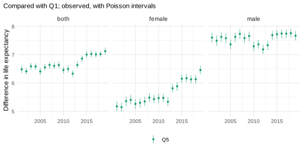
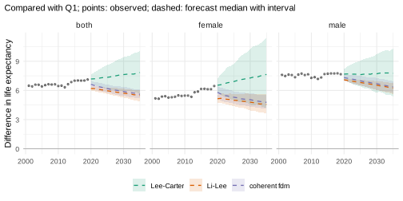
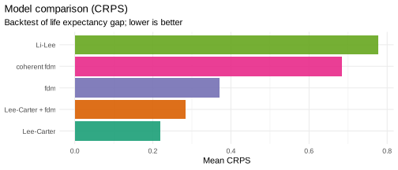
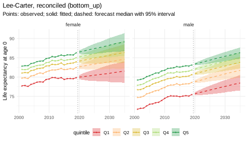
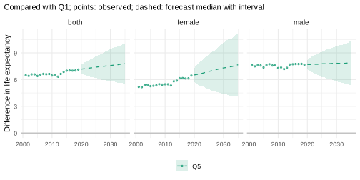
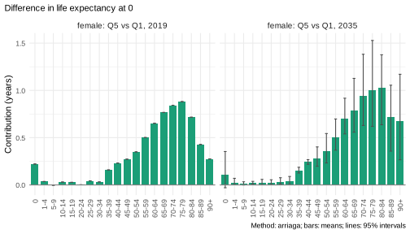
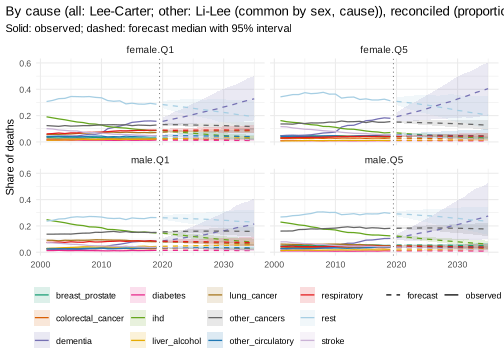
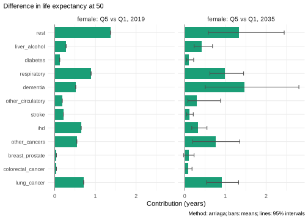

# Inequality in England: life expectancy and causes of death by deprivation

*This vignette is precomputed (`dev/precompute-vignettes.R`) because its
backtests take several minutes.*

How large will the gap in life expectancy between the least and the most
deprived areas of England be in 2035, and which causes of death will
make it up? A forecast of a gap is more than two forecasts: it depends
on how the forecasts of the groups move relative to each other. This
vignette builds a pipeline in which every step is chosen in a backtest
of the quantity the question is about, the gap. Each step refers to the
vignette that explains it.

``` r

library(mortensor)
library(data.table)
```

## Data

Deaths and mid-year populations by sex, 5-year age group and decile of
the Index of Multiple Deprivation, England 2001-2019 (`ons_data`;
Source: Office for National Statistics, Open Government Licence v3.0),
combined into quintiles (Q1 most deprived, Q5 least deprived):

``` r

x <- mt_data(deaths = ons_data, population = ons_data, by = c("sex", "imd_decile"), age = "age_group",
             value = c(deaths = "all_causes", population = "population"))
x <- mt_as_exposure(x, type = "midyear")
x <- mt_group_levels(x, "imd_decile", function(d) paste0("Q", ceiling(as.numeric(d) / 2)), name = "quintile")
mt_validate(x)
#> <mt_validation> no findings
```

**The hierarchy.** The ten series of sex by quintile add up to England
and to both sexes. All forecasts below are made for the ten series and
summed (`reconciled(method = "bottom_up")`), so that England is the sum
of its quintiles in every path (“Coherent forecasts: totals and their
parts”):

``` r

h <- mt_hierarchy(sex = "both", quintile = list(total = "England"))
xa <- mt_aggregate_strata(x, h)
bu <- function(model) reconciled(model, h, method = "bottom_up")
```

The observed gap in life expectancy at birth between Q5 and Q1:

``` r

gap_obs <- mt_contrast(xa, var = "quintile", ref = "Q1")
mt_plot_contrast(observed = gap_obs, levels = "Q5")
```



For women the gap widened from about 5.2 years in 2001 to 6.5 years in
2019, most of it after 2011. For men it stayed at about 7.5 years, with
a dip around 2010.

## Part 1: the gap in life expectancy

### What the models assume about the gap

The candidates differ in how the quintiles may move relative to each
other (“Choosing and combining models”):

- **Lee-Carter** and the **functional demographic model (fdm)**, fitted
  to each quintile separately: each quintile continues its own trend, so
  a gap that widened keeps widening;
- **Li-Lee** and the **coherent fdm** (product-ratio method): the
  quintiles of each sex share a common trend, and their deviations from
  it are stationary, so gaps return towards their past level;
- an **ensemble** of Lee-Carter and fdm.

The gap between Q5 and Q1 forecast by three of them:

``` r

cand <- list("Lee-Carter" = bu(lee_carter()), "fdm" = bu(hyndman_ullah()),
             "Li-Lee" = bu(li_lee(common_by = "sex")), "coherent fdm" = bu(coherent_fdm(common_by = "sex")),
             "Lee-Carter + fdm" = bu(ensemble(lc = lee_carter(), fdm = hyndman_ullah())))
gaps <- lapply(cand[c("Lee-Carter", "Li-Lee", "coherent fdm")], function(m) {
  mt_contrast(mt_forecast(mt_fit(m, xa), to = 2035, n_draws = 500, seed = 1), var = "quintile", ref = "Q1", at = 0)
})
mt_plot_contrast(gaps, observed = gap_obs, levels = "Q5")
```



The assumption decides the answer: Lee-Carter continues the widening of
the female gap. The two coherent models start below the observed gap of
2019, because their fitted rates of the last year already pull the
quintiles towards the common trend, and narrow it further.

### Which model forecast the gap best

A backtest from the origins 2010-2014, five years ahead each, scores the
rates and life expectancy of every series, and the gap between each
quintile and Q1 path by path (`contrast`, “Backtesting and scores”):

``` r

bt <- mt_compare(cand, xa, origins = 2010:2014, h = 5, n_draws = 200, quantities = "life_expectancy",
                 contrast = c(var = "quintile", ref = "Q1"))
#> Warning in report_fit_problems(diagnostics, spec$label, classes): Li-Lee
#> (common by sex): Li-Lee: the AR(1) coefficient of the stratum index is bounded
#> at |phi| = 0.99 in 1 stratum/strata (female.Q4): their deviations from the
#> common trend are close to a unit root and revert very slowly; coherence may not
#> suit them. (diagnostics of 10 stratum/strata of the fit).
mt_score_table(bt, metrics = c("crps", "cov95"), targets = c("rate", "life_expectancy"), hierarchy = h)
#>                model     level   crps cov95 crps_le cov95_le
#>  1:       Lee-Carter    bottom 0.0673 0.793   0.330    0.780
#>  2:       Lee-Carter aggregate 0.0560 0.661   0.355    0.520
#>  3:       Lee-Carter     total 0.0476 0.412   0.401    0.240
#>  4:              fdm    bottom 0.0728 0.809   0.362    0.748
#>  5:              fdm aggregate 0.0597 0.697   0.337    0.594
#>  6:              fdm     total 0.0496 0.486   0.336    0.320
#>  7:           Li-Lee    bottom 0.0677 0.802   0.390    0.760
#>  8:           Li-Lee aggregate 0.0563 0.729   0.391    0.674
#>  9:           Li-Lee     total 0.0479 0.658   0.376    0.720
#> 10:     coherent fdm    bottom 0.0707 0.755   0.407    0.532
#> 11:     coherent fdm aggregate 0.0608 0.651   0.400    0.480
#> 12:     coherent fdm     total 0.0544 0.504   0.380    0.440
#> 13: Lee-Carter + fdm    bottom 0.0664 0.858   0.330    0.860
#> 14: Lee-Carter + fdm aggregate 0.0542 0.749   0.332    0.611
#> 15: Lee-Carter + fdm     total 0.0442 0.556   0.353    0.360
```

``` r

mt_score_table(bt[quintile == "Q5" & sex != "both"], metrics = c("crps", "cov95"), targets = "life_expectancy_gap")
#>               model crps_le_gap cov95_le_gap
#> 1:       Lee-Carter       0.218         1.00
#> 2:              fdm       0.371         0.92
#> 3:           Li-Lee       0.778         0.06
#> 4:     coherent fdm       0.684         0.18
#> 5: Lee-Carter + fdm       0.283         1.00
```

``` r

mt_plot_scores(bt[quintile == "Q5" & sex != "both"], by = "model", target = "life_expectancy_gap")
```



The warning comes from Li-Lee: at the origin 2010, the deviation of
women in Q4 from the common trend of the quintiles is close to a unit
root (its AR(1) coefficient is bounded at 0.99), so it reverts very
slowly.

The models forecast the rates of the quintiles within about 10% of each
other, the ensemble best. The intervals of life expectancy are too
narrow for every model, most for the totals (95% coverage of Lee-Carter
0.78 for the quintiles and 0.24 for England): five years ahead, the
forecasts underestimate how far life expectancy can move. Lee-Carter
forecasts each quintile independently
([`reconciled()`](../reference/reconciled.md) keeps the draws as they
are), so the deviations of its draws partly cancel in the totals. The
gap separates the models clearly: Li-Lee and the coherent fdm forecast
it worst, and their intervals covered the observed gap in only 6% and
18% of the cases, because in 2010-2019 the female gap did not return to
its past level. Lee-Carter forecast the gap best, with intervals that
covered it in every case, the ensemble of Lee-Carter and fdm second. The
pipeline continues with Lee-Carter, chosen for the quantity of the
question.

### Smoothing and jump-off

Two further choices, each checked in the same backtest: smoothing the
rates over time before fitting (“Smoothing death rates”), and starting
the forecasts at the observed rates of the last year (Lee and Miller
2001; “Where a forecast starts: the jump-off”):

``` r

steps <- list("Lee-Carter" = cand[["Lee-Carter"]],
              "+ smoothed over time" = list(spec = cand[["Lee-Carter"]], prep = mt_prep(step_smooth(along = "period"))),
              "+ anchored" = bu(anchored(lee_carter())))
bt_steps <- mt_compare(steps, xa, origins = 2010:2014, h = 5, n_draws = 200, quantities = "life_expectancy",
                       contrast = c(var = "quintile", ref = "Q1"))
mt_score_table(bt_steps[sex != "both" & quintile != "England"], metrics = c("crps", "cov95"))
#>                   model   crps cov95 crps_le cov95_le crps_le_gap cov95_le_gap
#> 1:           Lee-Carter 0.0673 0.793   0.330    0.780       0.205        1.000
#> 2: + smoothed over time 0.0718 0.629   0.420    0.252       0.194        0.855
#> 3:           + anchored 0.0783 0.755   0.355    0.732       0.203        1.000
```

Smoothing over time made the forecasts of the rates worse and those of
life expectancy much worse (CRPS 0.420 against 0.330; 95% coverage of
the rates 0.63 against 0.79, of life expectancy 0.25 against 0.78): the
year-to-year variation of these rates is information about the
uncertainty, and removing it made the intervals too narrow. The gaps
were forecast slightly more accurately (CRPS 0.194 against 0.205), with
too narrow intervals (95% coverage 0.855 against 1.000). Anchoring made
the forecasts of the rates worse (CRPS 0.078 against 0.067) and those of
life expectancy slightly worse (0.355 against 0.330), and left the gap
nearly unchanged: the observed rates of a single year carry their random
variation into every forecast year. The pipeline uses neither.

### Forecast to 2035

``` r

fc <- mt_forecast(mt_fit(cand[["Lee-Carter"]], xa), to = 2035, n_draws = 1000, seed = 1)
```

``` r

mt_plot_life_expectancy(fc, at = 0, facet = "sex", strata = mt_strata(x)$label)
```



The gap between Q5 and Q1, path by path, and the slope index of
inequality (SII: the difference in life expectancy between the bottom
and the top of the deprivation distribution, estimated from all five
quintiles and their population shares):

``` r

gap <- mt_contrast(fc, var = "quintile", ref = "Q1", at = 0)
mt_plot_contrast(gap, observed = gap_obs, levels = "Q5")
```



``` r

sii <- mt_inequality(fc, "quintile", order = paste0("Q", 1:5), quantity = "life_expectancy")[index == "sii"]
sii_obs <- mt_inequality(x, "quintile", order = paste0("Q", 1:5), quantity = "life_expectancy")[index == "sii"]
rbind(sii_obs[period == 2019], sii[period %in% c(2025, 2035)])[
  , .(sex, period, sii = sprintf("%.1f (%.1f-%.1f)", q0.5, q0.025, q0.975))]
#>       sex period            sii
#> 1: female   2019  7.7 (7.5-7.9)
#> 2:   male   2019  9.2 (9.0-9.4)
#> 3: female   2025 8.2 (6.1-10.3)
#> 4: female   2035 9.1 (5.2-12.9)
#> 5:   male   2025 9.4 (7.9-10.9)
#> 6:   male   2035 9.4 (6.5-12.2)
#> 7:   both   2025 8.9 (7.5-10.2)
#> 8:   both   2035 9.3 (6.9-11.8)
```

The SII of women rises from 7.7 years in 2019 to 9.1 years in 2035 (95%
interval 5.2-12.9); that of men from 9.2 to 9.4 years (6.5-12.2).
Lee-Carter forecasts each quintile independently, so the intervals of
the gap and of the SII combine the uncertainty of the quintiles.

### Which ages make up the gap

The gap between Q5 and Q1 by age, in 2019 and 2035 (“Decomposing
differences in life expectancy”):

``` r

dg <- mt_decompose(fc, var = "quintile", ref = "Q1", periods = c(2019, 2035))
mt_plot_decomposition(dg, by = "age", comparisons = list(to = "Q5", sex = "female"))
```



In 2019 most of the female gap arose at ages 55-84; by 2035 the
contributions move to older ages, with wide intervals.

## Part 2: causes of death at ages 50 and over

### Data

`ons_cause_groups` combines the 29 causes of the ONS table into groups
with enough deaths in almost every cell at ages 50 and over. The causes
share the population of their stratum, so their rates add up to the
all-cause rate (`additive = "rates"`):

``` r

causes <- names(ons_data)[-(1:7)]
xc <- mt_data(deaths = ons_data, population = ons_data, by = c("sex", "imd_decile", "cause"),
              age = "age_group", value = list(deaths = c(all = "all_causes", causes), population = "population"))
xc <- mt_as_exposure(xc, type = "midyear")
xc <- mt_subset(xc, ages = c(50, Inf))
xc <- mt_group_levels(xc, "imd_decile", function(d) paste0("Q", ceiling(as.numeric(d) / 2)), name = "quintile")
xc <- mt_group_levels(xc, "cause", ons_cause_groups, other = "rest", total = "all", additive = "rates")
hc <- mt_hierarchy(cause = "all", additive = "rates")
mt_validate(xc, hierarchy = hc)
#> <mt_validation> 1 finding(s): 0 error, 0 warning, 1 info
#>   [info] hierarchy (deaths,exposure, 10 aggregate strata, n = 0): sums of parts agree with the totals within tolerance
```

### Model: causes that add up to all causes

Cause-specific counts per quintile are small, so the causes are forecast
with Li-Lee, the quintiles of each sex and cause pooled around a common
trend. Summed over the causes, such forecasts tend to be more
pessimistic than forecasts of all causes, because over many years the
sum is dominated by the causes that fall slowest or rise (Wilmoth 1995).
The alternative is to forecast all causes as well and scale the causes
to it, path by path, in proportion to their own forecasts
(`method = "proportional"` with the all-cause strata `fixed`). Part 1
showed that the all-cause gap is forecast best by Lee-Carter, so
[`stratified()`](../reference/stratified.md) uses Lee-Carter for the
all-cause strata and Li-Lee for the causes. Three candidates:

``` r

all_cause <- mt_strata(xc)[cause == "all", label]
ll <- li_lee(common_by = c("sex", "cause"))
cand_c <- list("summed" = reconciled(ll, hc, method = "bottom_up"),
               "scaled to Li-Lee total" = reconciled(ll, hc, method = "proportional", fixed = all_cause),
               "scaled to Lee-Carter total" = reconciled(stratified("cause", all = lee_carter(), .default = ll), hc,
                                                         method = "proportional", fixed = all_cause))
bt_c <- mt_compare(cand_c, xc, origins = c(2010, 2012, 2014), h = 5, n_draws = 200,
                   quantities = c("life_expectancy", "asr"), contrast = c(var = "quintile", ref = "Q1"))
#> Warning in report_fit_problems(diagnostics, spec$label, classes): Li-Lee
#> (common by sex, cause): Li-Lee: the AR(1) coefficient of the stratum index is
#> bounded at |phi| = 0.99 in 1 stratum/strata (female.Q1.ihd): their deviations
#> from the common trend are close to a unit root and revert very slowly;
#> coherence may not suit them. (diagnostics of 120 stratum/strata of the fit).
#> Warning in report_fit_problems(diagnostics, spec$label, classes): Li-Lee
#> (common by sex, cause): Li-Lee: the AR(1) coefficient of the stratum index is
#> bounded at |phi| = 0.99 in 1 stratum/strata (female.Q1.ihd): their deviations
#> from the common trend are close to a unit root and revert very slowly;
#> coherence may not suit them. (diagnostics of 130 stratum/strata of the fit).
#> Warning in report_fit_problems(diagnostics, spec$label, classes): Li-Lee
#> (common by sex, cause): Li-Lee: the AR(1) coefficient of the stratum index is
#> bounded at |phi| = 0.99 in 1 stratum/strata (female.Q1.ihd): their deviations
#> from the common trend are close to a unit root and revert very slowly;
#> coherence may not suit them. (diagnostics of 120 stratum/strata of the fit).
```

The warnings come from Li-Lee: for women in Q1, the deviation of
ischaemic heart disease from the common trend of the quintiles is close
to a unit root (its AR(1) coefficient is bounded at 0.99), so it reverts
very slowly.

For the causes: the age-standardised rates (`_asr`) and their
differences between each quintile and Q1 (`_asr_gap`, log rate ratios):

``` r

mt_score_table(bt_c[cause != "all"], metrics = c("crps", "cov95"), targets = c("asr", "asr_gap"))
#>                         model crps_asr cov95_asr crps_asr_gap cov95_asr_gap
#> 1:                     summed   0.0667     0.797       0.0572         0.562
#> 2:     scaled to Li-Lee total   0.0715     0.868       0.0467         0.723
#> 3: scaled to Lee-Carter total   0.0694     0.861       0.0353         0.944
```

For all causes: life expectancy at 50 (`_le`) and its gap to Q1
(`_le_gap`):

``` r

mt_score_table(bt_c[cause == "all"], metrics = c("crps", "cov95"), targets = c("life_expectancy", "life_expectancy_gap"))
#>                         model crps_le cov95_le crps_le_gap cov95_le_gap
#> 1:                     summed   0.276    0.733       0.502        0.108
#> 2:     scaled to Li-Lee total   0.329    0.780       0.331        0.433
#> 3: scaled to Lee-Carter total   0.292    0.740       0.153        1.000
```

For the causes the three are close: the summed forecasts are slightly
the most accurate for the age-standardised rates but the least accurate
for their gaps, and those scaled to Lee-Carter forecast the gaps best
(95% coverage 0.94). The intervals of the age-standardised rates are too
narrow for all three (95% coverage 0.80-0.87). For all causes the
difference is large: the summed causes and the Li-Lee total both pull
the gap back to its past level, and only the Lee-Carter total forecast
it well (CRPS of the gap 0.15 against 0.33 and 0.50).

### Forecasts to 2035

``` r

fc_c <- mt_forecast(mt_fit(cand_c[["scaled to Lee-Carter total"]], xc), to = 2035, n_draws = 1000, seed = 1)
#> Warning in report_fit_problems(diagnostics, spec$label, classes): Li-Lee
#> (common by sex, cause): Li-Lee: the AR(1) coefficient of the stratum index is
#> bounded at |phi| = 0.99 in 1 stratum/strata (female.Q1.ihd): their deviations
#> from the common trend are close to a unit root and revert very slowly;
#> coherence may not suit them. (diagnostics of 120 stratum/strata of the fit).
#> Warning in check_draws_plausible(arr, fit$age, fit$strata, fit$spec$label): By
#> cause (all: Lee-Carter; other: Li-Lee (common by sex, cause)): forecast death
#> rates above 1 in 0.6% of the draws (strata female.Q1.dementia,
#> female.Q2.dementia, female.Q3.dementia; ages 90+). The model is unstable here,
#> often because of sparse counts or a steep trend extrapolated far ahead;
#> consider wider age groups (mt_regroup()), pooling (li_lee(common_by = )),
#> smoothing (step_smooth()) or an ensemble.
mt_compare_forecasts(list(observed = mt_subset(xc, cause == "all"), forecast = fc_c), periods = c(2019, 2035),
                     strata = c("female.Q1.all", "female.Q5.all", "male.Q1.all", "male.Q5.all"))
#>            label period         observed         forecast
#> 1: female.Q1.all   2019 31.7 (31.6-31.8)             <NA>
#> 2: female.Q1.all   2035             <NA> 33.0 (30.1-35.6)
#> 3: female.Q5.all   2019 37.3 (37.2-37.3)             <NA>
#> 4: female.Q5.all   2035             <NA> 39.9 (37.6-42.2)
#> 5:   male.Q1.all   2019 28.3 (28.3-28.4)             <NA>
#> 6:   male.Q1.all   2035             <NA> 30.8 (29.1-32.5)
#> 7:   male.Q5.all   2019 34.5 (34.4-34.6)             <NA>
#> 8:   male.Q5.all   2035             <NA> 37.4 (36.0-38.7)
```

The first warning is that of Li-Lee above. The second concerns dementia
at ages 90 and over, whose recorded rates rose steeply in 2001-2019
(partly through changes in coding): a few paths extrapolate this rise to
rates above one.

Life expectancy at 50 from all causes, observed in 2019 and forecast for
2035. The ratio of the age-standardised death rates (ages 50 and over)
of Q1 to Q5 in 2035, path by path:

``` r

ratio <- mt_contrast(fc_c, var = "quintile", ref = "Q5", quantity = "asr", type = "ratio")
ratio[level == "Q1" & period == 2035 & cause != "all",
      .(sex, cause, ratio = sprintf("%.2f (%.2f-%.2f)", q0.5, q0.025, q0.975))][order(sex, cause)]
#>        sex             cause            ratio
#>  1: female   breast_prostate 1.45 (0.93-2.20)
#>  2: female colorectal_cancer 1.56 (1.02-2.32)
#>  3: female          dementia 1.67 (1.24-2.24)
#>  4: female          diabetes 2.84 (1.87-4.52)
#>  5: female               ihd 2.84 (1.87-4.39)
#>  6: female     liver_alcohol 3.56 (2.24-5.57)
#>  7: female       lung_cancer 3.58 (2.19-5.73)
#>  8: female     other_cancers 1.80 (1.16-2.74)
#>  9: female other_circulatory 1.93 (1.33-3.02)
#> 10: female       respiratory 4.31 (2.72-7.20)
#> 11: female              rest 1.96 (1.35-2.86)
#> 12: female            stroke 1.83 (1.25-2.72)
#> 13:   male   breast_prostate 1.19 (0.94-1.49)
#> 14:   male colorectal_cancer 1.59 (1.24-2.03)
#> 15:   male          dementia 1.65 (1.38-1.95)
#> 16:   male          diabetes 2.53 (1.94-3.47)
#> 17:   male               ihd 2.22 (1.72-2.88)
#> 18:   male     liver_alcohol 4.16 (3.02-5.63)
#> 19:   male       lung_cancer 3.05 (2.32-4.05)
#> 20:   male     other_cancers 1.67 (1.28-2.16)
#> 21:   male other_circulatory 1.73 (1.40-2.23)
#> 22:   male       respiratory 3.51 (2.75-4.66)
#> 23:   male              rest 1.83 (1.46-2.31)
#> 24:   male            stroke 1.87 (1.47-2.42)
#>        sex             cause            ratio
```

``` r

mt_plot_shares(fc_c, groups = c("female.Q1", "female.Q5", "male.Q1", "male.Q5"))
```



Proportional scaling has a consequence for these ratios: where the
all-cause gap widens, the widening is spread over all causes in
proportion to their forecasts, so the ratios of every cause rise
somewhat. Which causes will in fact drive a widening is not in the data.

### Which causes make up the gap

The gap in life expectancy at 50 between Q5 and Q1 by cause, observed in
2019 and forecast for 2035:

``` r

dc <- mt_decompose(fc_c, var = "quintile", ref = "Q1", periods = c(2019, 2035), cause = "cause")
mt_plot_decomposition(dc, by = "cause", comparisons = list(to = "Q5", sex = "female"))
```



In 2019 the residual group, chronic lower respiratory diseases, lung
cancer and ischaemic heart disease made up most of the female gap at 50.
The forecast for 2035 gives dementia the largest contribution, with a
wide interval from about half a year to almost three years: it
extrapolates the steep rise of recorded dementia deaths, which partly
reflects changes in coding. This is the least reliable part of the
result.

## Summary of the pipeline

| Step | Decision here | Evidence | Function | Explained in |
|----|----|----|----|----|
| Data | deciles to quintiles |  | [`mt_data()`](../reference/mt_data.md), [`mt_group_levels()`](../reference/mt_group_levels.md) | “Getting started” |
| Totals | England and both sexes as sums |  | [`mt_hierarchy()`](../reference/mt_hierarchy.md), `reconciled(method = "bottom_up")` | “Coherent forecasts” |
| Model | Lee-Carter per quintile | best backtest of the gap | `mt_compare(contrast = )` | “Choosing and combining models” |
| Smoothing | none | worse rates and life expectancy, too narrow intervals | [`step_smooth()`](../reference/mt_prep.md) | “Smoothing death rates” |
| Jump-off | the model’s own | anchoring made the rates worse | [`anchored()`](../reference/anchored.md) | “Where a forecast starts” |
| Inequality | gap Q5 - Q1 and SII, path by path |  | [`mt_contrast()`](../reference/mt_contrast.md), [`mt_inequality()`](../reference/mt_inequality.md) |  |
| Causes | Li-Lee, scaled to a Lee-Carter all-cause forecast | best backtest of the all-cause gap | [`stratified()`](../reference/stratified.md), `reconciled(method = "proportional", fixed = )` | “Coherent forecasts” |
| Drivers | ages and causes of the gap |  | [`mt_decompose()`](../reference/mt_decompose.md) | “Decomposing differences” |

## References

Lee R, Miller T (2001). Evaluating the performance of the Lee-Carter
method for forecasting mortality. *Demography* 38(4): 537-549.

Wilmoth JR (1995). Are mortality projections always more pessimistic
when disaggregated by cause of death? *Mathematical Population Studies*
5(4): 293-319. <doi:10.1080/08898489509525409>.
