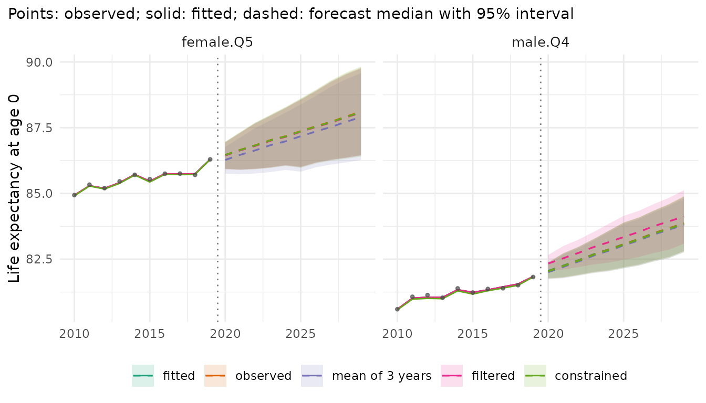

# Where a forecast starts: the jump-off

A forecast continues from some level in the last observed year, the
*jump-off*. Most models start from their own fitted rates of that year,
which differ from the observed rates: a model with few parameters does
not reproduce every age, year and stratum. The difference shows up as a
step between the last observed and the first forecast year. This
vignette shows when the step is large, the ways of placing the start,
and what they change.

``` r

library(mortensor)
library(data.table)
x <- mt_data(deaths = ons_data, population = ons_data, by = c("sex", "imd_decile"), age = "age_group",
             value = c(deaths = "all_causes", population = "population"))
x <- mt_as_exposure(x, type = "midyear")
x <- mt_group_levels(x, "imd_decile", function(d) paste0("Q", ceiling(as.numeric(d) / 2)), name = "quintile")
```

## When the step is large

The step is the distance between the model’s fitted rates and the
observed rates in the last year. Lee-Carter fitted to each stratum
separately has an age pattern and a period index of its own for every
stratum and follows each year closely. Li-Lee (Li and Lee 2005) pools
the quintiles of each sex: they share one trend and deviate from it by a
stationary factor, so the fit of a single quintile in a single year is
looser. [`mt_jump_off()`](../reference/mt_jump_off.md) reports life
expectancy at birth in the last observed year (2019), as fitted, and in
the first forecast year:

``` r

fc_lc <- mt_forecast(mt_fit(lee_carter(), x), h = 10, n_draws = 500, seed = 1)
fc_ll <- mt_forecast(mt_fit(li_lee(common_by = "sex"), x), h = 10, n_draws = 500, seed = 1)
merge(mt_jump_off(fc_lc)[, .(label, observed, lee_carter_fitted = fitted)],
      mt_jump_off(fc_ll)[, .(label, li_lee_fitted = fitted, li_lee_2020 = forecast)], by = "label")[
  , lapply(.SD, function(v) if (is.numeric(v)) round(v, 2) else v)]
#> Key: <label>
#>         label observed lee_carter_fitted li_lee_fitted li_lee_2020
#>        <char>    <num>             <num>         <num>       <num>
#>  1: female.Q1    79.83             79.85         80.26       80.92
#>  2: female.Q2    82.50             82.51         82.74       82.90
#>  3: female.Q3    83.93             83.97         84.01       84.17
#>  4: female.Q4    85.02             85.05         84.88       85.05
#>  5: female.Q5    86.30             86.29         85.95       86.02
#>  6:   male.Q1    75.43             75.48         75.84       76.10
#>  7:   male.Q2    78.60             78.60         78.74       78.96
#>  8:   male.Q3    80.61             80.66         80.56       80.78
#>  9:   male.Q4    81.82             81.84         81.75       81.96
#> 10:   male.Q5    83.09             83.15         83.02       83.20
```

Lee-Carter reproduces the observed life expectancy of 2019 to a few
hundredths of a year. Li-Lee puts women in Q1 0.4 years above the
observed value and women in Q5 0.3 years below it: it pulls the
quintiles towards their common trend. For women in Q1 its first forecast
year then adds another 0.7 years. The step carries into every forecast
year.

## Starting points

- **fitted** (default): the forecast continues from the model’s fitted
  rates of the last year;
- **observed**: it continues from the observed rates of the last year,
  with all their noise. Lee and Miller (2001) proposed this jump-off for
  Lee-Carter: the log ratio of observed to fitted rates of the last year
  is added to the log rates of every forecast year.
  [`anchored()`](../reference/anchored.md) applies it to any model;
  `lee_carter(jump_off = "observed")` and
  `li_lee(jump_off = "observed")` give the same forecasts.
- **mean of the last observed years**: Stoeldraijer, van Duin, van
  Wissen and Janssen (2018) average the observed log rates of the last
  `n` years, which reduces the noise of a single year.
  `lee_carter(jump_off = "observed", jump_off_years = n)` follows their
  definition: `a[x]` is the mean of the observed log rates of these
  years, and the index `k` is 0 at their midpoint. The random walk with
  drift carries the mean from the midpoint to the last year `T`, so the
  jump-off log rates are the mean plus `b[x] d (n - 1) / 2`, with `d`
  the drift of `k`. The forecast then does not depend on the fitted
  index of year `T`. The paper does not say how the index at the
  midpoint relates to the fitted index of `T`; this reading reproduces
  its results for French men (see the help of
  [`lee_carter()`](../reference/lee_carter.md)).
- **filtered**: De Jong and Tickle (2006) write the Lee-Carter model in
  state-space form. The vector of log rates of year `t` is
  `y[t] = a + b alpha[t] + eps[t]`, with independent normal errors of
  the same variance `sigma^2` at every age, and the index follows a
  random walk with drift,
  `alpha[t + 1] = delta + alpha[t] + lambda eta[t]`, where the
  signal-to-noise ratio `lambda` scales the innovations. The Kalman
  filter estimates the index of the last year from the log rates of all
  years up to it. It weighs the index of the last year alone, `z[T]`
  (the projection of its observed log rates on the age pattern `b`),
  against the trend of the earlier years: with `lambda = 0` the estimate
  is the value of the linear trend of `z` in year `T`, and with a large
  `lambda` it approaches `z[T]`. `lee_carter(jump_off = "filtered")`
  starts the forecast from the rates at this filtered index. `a` and `b`
  are those of the Lee-Carter fit; `sigma`, `lambda`, `delta` and the
  level of the index are estimated by maximum likelihood given them.
  Only the start changes: the forecast keeps the drift and the
  innovations of the Lee-Carter index.
- **constrained**: Li, Hardy and Tan (2009) build the jump-off into the
  fit. `lee_carter(jump_off = "constrained")` fixes `a[x]` at the
  observed log rates of the last year and `k[T]` at 0, and estimates `b`
  and `k` by maximum likelihood under these constraints (their Appendix
  2). The fitted rates of the last year are the observed ones. It needs
  `method = "poisson"`, the default. The paper combines it with negative
  binomial deaths with one dispersion per age group and a parametric
  bootstrap,
  `lee_carter(family = "nb", dispersion = "age", jump_off = "constrained", bootstrap = TRUE)`.

Stoeldraijer et al. (2018) compare six jump-offs for Lee-Carter. Their
names, and how to get each in mortensor:

| Stoeldraijer et al. (2018) | mortensor |
|----|----|
| model values (Lee and Carter 1992) | the model itself, for example [`lee_carter()`](../reference/lee_carter.md); `anchored(model, decay = 0)` |
| last observed values (Lee and Miller 2001) | `lee_carter(jump_off = "observed")`; `anchored(model)` for any model |
| average 2 years observed | `lee_carter(jump_off = "observed", jump_off_years = 2)` |
| average 3 years observed | `lee_carter(jump_off = "observed", jump_off_years = 3)` |
| average 4 years observed | `lee_carter(jump_off = "observed", jump_off_years = 4)` |
| average 5 years observed | `lee_carter(jump_off = "observed", jump_off_years = 5)` |

[`anchored()`](../reference/anchored.md) has further options.
`years = n` averages the offsets over the last `n` years: a variant of
the averaged jump-off for any model, specific to this package (reference
unknown). Its offset is the log ratio of the observed to the fitted
deaths of these years, so the forecast also keeps the change of the
fitted rates from these years to the last year.
`lee_carter(jump_off = "observed", jump_off_years = n)` moves the mean
of the same years to the last year with the drift of `k`, as the paper
defines it. `shrink = TRUE` shrinks the offsets of cells with few deaths
towards the mean of their stratum, and `decay` lets the offsets fade out
over that many years, so that the forecast returns to the model’s trend;
both are specific to this package. With `decay = 4` the weight of the
offset falls linearly from 1 in the first forecast year to 0 in the
fifth. Stoeldraijer et al. recommend such a move from the most accurate
jump-off in the first forecast year to the most robust one by the fifth
(their Appendix 6, without a formula for the weights). Where the last
observed values are the most accurate and the model values the most
robust, `anchored(model, decay = 4)` does this. The comparison for
Li-Lee includes one package-specific setting:

``` r

fc <- list(fitted = fc_ll,
           observed = mt_forecast(mt_fit(anchored(li_lee(common_by = "sex")), x), h = 10, n_draws = 500, seed = 1),
           "3 years, fading" = mt_forecast(mt_fit(anchored(li_lee(common_by = "sex"), years = 3, decay = 10,
                                                           shrink = TRUE), x), h = 10, n_draws = 500, seed = 1))
```

``` r

mt_plot_compare(fc, strata = c("female.Q1", "female.Q5"), periods = c(2010, 2029), data = x)
```


The solid line is the fitted Li-Lee model, the points the observed life
expectancy. The fitted forecast continues from the solid line, above the
last points for women in Q1. The other two forecasts start at the
observed level. By age, the observed start also carries the noise of
single cells, which the package-specific setting averages over three
years:

``` r

mt_plot_compare(fc, quantity = "rate", ages = c("45-49", "65-69", "85-89"), strata = c("female.Q1", "female.Q5"),
                periods = c(2010, 2025))
```


## The starts of Lee-Carter

For Lee-Carter fitted to each stratum, the five starts are options of
[`lee_carter()`](../reference/lee_carter.md). The table gives the
observed life expectancy at birth in 2019 and the median of each
forecast in 2020:

``` r

lc <- list(fitted = lee_carter(), observed = lee_carter(jump_off = "observed"),
           "mean of 3 years" = lee_carter(jump_off = "observed", jump_off_years = 3),
           filtered = lee_carter(jump_off = "filtered"), constrained = lee_carter(jump_off = "constrained"))
fit_lc <- lapply(lc, mt_fit, data = x)
fc_lc5 <- lapply(fit_lc, mt_forecast, h = 10, n_draws = 500, seed = 1)
jo <- rbindlist(lapply(names(lc), function(n) mt_jump_off(fc_lc5[[n]])[, start := factor(n, names(lc))]))
dcast(jo[, .(label, e0_2019 = observed, start, forecast)], label + e0_2019 ~ start,
      value.var = "forecast")[, lapply(.SD, function(v) if (is.numeric(v)) round(v, 2) else v)]
#> Key: <label, e0_2019>
#>         label e0_2019 fitted observed mean of 3 years filtered constrained
#>        <char>   <num>  <num>    <num>           <num>    <num>       <num>
#>  1: female.Q1   79.83  79.96    79.94           79.90    80.06       79.94
#>  2: female.Q2   82.50  82.65    82.64           82.53    82.65       82.64
#>  3: female.Q3   83.93  84.13    84.10           84.03    83.92       84.10
#>  4: female.Q4   85.02  85.19    85.16           85.05    85.08       85.16
#>  5: female.Q5   86.30  86.46    86.46           86.27    86.44       86.46
#>  6:   male.Q1   75.43  75.65    75.60           75.59    75.53       75.60
#>  7:   male.Q2   78.60  78.81    78.81           78.78    78.84       78.80
#>  8:   male.Q3   80.61  80.87    80.82           80.77    80.74       80.81
#>  9:   male.Q4   81.82  82.06    82.04           82.00    82.34       82.04
#> 10:   male.Q5   83.09  83.34    83.29           83.34    83.29       83.28
```

``` r

jo[start == "constrained", all.equal(fitted, observed)]
#> [1] TRUE
```

The constrained fit reproduces the observed rates of 2019, and with them
the observed life expectancy. Its forecasts for 2020 are within 0.01
years of those of the observed start. The mean of three years gives the
lowest start in six of the ten strata. For women in Q2, Q4 and Q5 its
first forecast year lies within 0.03 years of the observed life
expectancy of 2019, and the fitted start adds 0.15 to 0.18 years. The
filtered start departs most from the others for men in Q4: 0.52 years
above the observed value of 2019 and about 0.3 years above the other
starts.

``` r

mt_plot_compare(fc_lc5, strata = c("female.Q5", "male.Q4"), periods = c(2010, 2029), data = x)
```



For women in Q5 the last observed year lies above the years before it.
The forecasts that start from that year, or from the fit close to it,
run together; the mean of three years starts lower and stays below them.
For men in Q4 the filtered forecast runs above the others over the whole
horizon: the start changes, the drift stays.

[`mt_parameters()`](../reference/mt_parameters.md) reports the filter:
the filtered index of the last year (`k_filtered`) and its standard
error (`se_k_filtered`, which includes the uncertainty of the level and
the drift), and the maximum likelihood estimates `filter_sigma`,
`filter_lambda` and `filter_drift` (per year, in the units of `k`). The
table shortens their names and adds the index `k` of the Poisson fit in
2019 and its drift `drift_k`, which the forecast keeps:

``` r

show <- c(k = "k", k_filtered = "k_filtered", se = "se_k_filtered", drift_k = "drift_k",
          drift_filter = "filter_drift", lambda = "filter_lambda", sigma = "filter_sigma")
p <- mt_parameters(fit_lc$filtered)[parameter %in% show & (parameter != "k" | index == "2019")]
p[, name := factor(names(show)[match(parameter, show)], names(show))]
dcast(p, stratum ~ name, value.var = "value")[, lapply(.SD, function(v) if (is.numeric(v)) round(v, 2) else v)]
#> Key: <stratum>
#>       stratum     k k_filtered    se drift_k drift_filter lambda sigma
#>        <char> <num>      <num> <num>   <num>        <num>  <num> <num>
#>  1: female.Q1 -1.94      -2.20  0.25   -0.27        -0.31   1.58  0.07
#>  2: female.Q2 -2.77      -2.76  0.33   -0.34        -0.35   1.34  0.09
#>  3: female.Q3 -2.88      -2.41  0.37   -0.35        -0.28   1.51  0.10
#>  4: female.Q4 -3.51      -3.23  0.35   -0.41        -0.38   0.80  0.11
#>  5: female.Q5 -3.77      -3.73  0.33   -0.44        -0.43   0.74  0.11
#>  6:   male.Q1 -3.07      -2.82  0.26   -0.41        -0.41   1.81  0.07
#>  7:   male.Q2 -3.26      -3.33  0.34   -0.43        -0.43   1.35  0.09
#>  8:   male.Q3 -3.53      -3.25  0.30   -0.45        -0.41   1.00  0.09
#>  9:   male.Q4 -3.50      -4.13  0.25   -0.46        -0.48   0.51  0.09
#> 10:   male.Q5 -3.41      -3.29  0.31   -0.45        -0.42   1.18  0.09
```

The estimates of `lambda` range from 0.51 to 1.81. None is 0, so in
every stratum the filter weighs the index of 2019 against the trend of
the earlier years. The drifts of the filter differ from those of the
Poisson index by at most 0.07. For men in Q4 the filtered index of 2019
lies 0.6 below the Poisson index, more than twice its standard error.
The model of De Jong and Tickle gives the log rates of every age group
the same noise variance, and the Poisson fit weights each cell by its
deaths. Below age 45, the age groups of men in Q4 had 17 to 374 deaths
in 2019, those from age 65 several thousand:

``` r

round(mt_array(x, "deaths")[, "2019", "male.Q4"])
#>     0   1-4   5-9 10-14 15-19 20-24 25-29 30-34 35-39 40-44 45-49 50-54 55-59 
#>   172    17    19    28    57   145   156   191   246   374   640  1134  1579 
#> 60-64 65-69 70-74 75-79 80-84 85-89   90+ 
#>  2199  3397  5589  6980  8945  9158  8598
```

With `D` deaths, the standard error of an observed log rate is about
`1 / sqrt(D)`: 0.24 for the 17 deaths at ages 1-4 and 0.01 for the 9,158
deaths at ages 85-89. In the filter these noisy log rates count as much
as those of the old ages.

## Which start forecasts better

Stoeldraijer et al. (2018) judge a jump-off by two criteria. A forecast
is *accurate* if its out-of-sample errors in historical data are small:
they use the mean absolute error of the forecast life expectancy at 65
one and five years ahead. It is *robust* if it changes little when one
more year of data is added: the standard deviation of the changes of the
forecast life expectancy at 65 in 2020 between successive fitting
periods. In eight Western European countries the last observed values
were the most accurate for most countries and an average of observed
years the most robust; the more years averaged, the more robust and the
less accurate the forecast. The model values were the most accurate
where the model fitted the last years well.

A backtest fits each version to the years up to an origin and scores the
following five years:

``` r

ll <- li_lee(common_by = "sex")
bt <- mt_compare(list(fitted = ll, observed = anchored(ll),
                      "3 years, fading" = anchored(ll, years = 3, decay = 10, shrink = TRUE)),
                 x, origins = 2008:2014, h = 5, n_draws = 200, quantities = "life_expectancy")
#> Warning in report_fit_problems(diagnostics, spec$label, classes): Li-Lee
#> (common by sex): Li-Lee: the AR(1) coefficient of the stratum index is bounded
#> at |phi| = 0.99 in 1 stratum/strata (female.Q4): their deviations from the
#> common trend are close to a unit root and revert very slowly; coherence may not
#> suit them. (diagnostics of 10 stratum/strata of the fit).
#> Warning in report_fit_problems(diagnostics, spec$label, classes): Li-Lee
#> (common by sex): Li-Lee: the AR(1) coefficient of the stratum index is bounded
#> at |phi| = 0.99 in 1 stratum/strata (female.Q4): their deviations from the
#> common trend are close to a unit root and revert very slowly; coherence may not
#> suit them. (diagnostics of 10 stratum/strata of the fit).
#> Warning in report_fit_problems(diagnostics, spec$label, classes): Li-Lee
#> (common by sex): Li-Lee: the AR(1) coefficient of the stratum index is bounded
#> at |phi| = 0.99 in 1 stratum/strata (female.Q4): their deviations from the
#> common trend are close to a unit root and revert very slowly; coherence may not
#> suit them. (diagnostics of 10 stratum/strata of the fit).
#> Warning in report_fit_problems(diagnostics, spec$label, classes): Li-Lee
#> (common by sex): Li-Lee: the AR(1) coefficient of the stratum index is bounded
#> at |phi| = 0.99 in 1 stratum/strata (female.Q4): their deviations from the
#> common trend are close to a unit root and revert very slowly; coherence may not
#> suit them. (diagnostics of 10 stratum/strata of the fit).
#> Warning in report_fit_problems(diagnostics, spec$label, classes): Li-Lee
#> (common by sex): Li-Lee: the AR(1) coefficient of the stratum index is bounded
#> at |phi| = 0.99 in 1 stratum/strata (female.Q4): their deviations from the
#> common trend are close to a unit root and revert very slowly; coherence may not
#> suit them. (diagnostics of 10 stratum/strata of the fit).
#> Warning in report_fit_problems(diagnostics, spec$label, classes): Li-Lee
#> (common by sex): Li-Lee: the AR(1) coefficient of the stratum index is bounded
#> at |phi| = 0.99 in 1 stratum/strata (female.Q4): their deviations from the
#> common trend are close to a unit root and revert very slowly; coherence may not
#> suit them. (diagnostics of 10 stratum/strata of the fit).
mt_score_table(bt, metrics = c("crps", "cov95"))
#>              model   crps cov95 crps_le cov95_le
#>             <fctr>  <num> <num>   <num>    <num>
#> 1:          fitted 0.0671 0.810   0.338    0.806
#> 2:        observed 0.0714 0.808   0.316    0.834
#> 3: 3 years, fading 0.0661 0.824   0.321    0.831
```

``` r

mt_plot_scores(bt, target = "life_expectancy")
```


The warnings report that at some origins the deviation of women in Q4
from the common trend of Li-Lee is close to a unit root. `crps` scores
the log death rates, `crps_le` life expectancy at birth in years (lower
is better; see “Backtesting and scores”). The observed start forecasts
life expectancy more accurately than the fitted start (CRPS 0.316
against 0.338 years), because the step of Li-Lee at the jump-off is
large here. It forecasts the rates less accurately (0.071 against
0.067), because it carries the noise of single ages and years into every
forecast year. The package-specific setting, which averages the offsets
over three years, shrinks them and lets them fade out, gives the lowest
CRPS of the rates (0.066) and a CRPS of life expectancy close to that of
the observed start (0.321 years). The 95% intervals of all three cover
0.81 to 0.82 of the observed rates.

For Lee-Carter fitted to each stratum, whose step is small here, the
backtest compares the five starts of
[`lee_carter()`](../reference/lee_carter.md):

``` r

bt_lc <- mt_compare(lc, x, origins = 2008:2014, h = 5, n_draws = 200, quantities = "life_expectancy")
mt_score_table(bt_lc, metrics = c("crps", "cov95"))
#>              model   crps cov95 crps_le cov95_le
#>             <fctr>  <num> <num>   <num>    <num>
#> 1:          fitted 0.0683 0.793   0.293    0.814
#> 2:        observed 0.0788 0.759   0.310    0.803
#> 3: mean of 3 years 0.0727 0.773   0.320    0.777
#> 4:        filtered 0.0740 0.749   0.379    0.709
#> 5:     constrained 0.0876 0.729   0.318    0.771
```

Lee-Carter reproduces the last observed year closely, so the observed
start adds mainly the noise of that year: it forecasts the rates and
life expectancy less accurately than the fitted start (CRPS 0.079
against 0.068, and 0.310 against 0.293 years). The other starts are also
less accurate than the fitted one on these data. The mean of three years
comes closest for the rates (0.073), the constrained fit is the least
accurate for the rates (0.088) and the filtered start for life
expectancy (0.379 years, with 95% intervals that cover 0.71 of the
observed values).

[`mt_score()`](../reference/mt_score.md) gives the measures of
Stoeldraijer et al. for the forecasts of life expectancy at birth: `mae`
is the mean absolute error of the median forecast, here one and five
years ahead, and `measures = "revision"` the mean absolute revision, the
change of the median forecast of a stratum and year between consecutive
origins, each of which adds one year of data. The paper’s robustness is
the standard deviation of such changes for one target year and life
expectancy at 65; the revision averages their absolute values over all
years forecast from consecutive origins.

``` r

acc <- dcast(mt_score(bt_lc, by = c("model", "horizon"), target = "life_expectancy")[horizon %in% c(1, 5)],
             model ~ paste0("mae_", horizon), value.var = "mae")
rob <- mt_score(bt_lc, target = "life_expectancy", measures = "revision")[, .(model, revision)]
merge(acc, rob, by = "model")[, lapply(.SD, function(v) if (is.numeric(v)) round(v, 3) else v)]
#> Key: <model>
#>              model mae_1 mae_5 revision
#>             <fctr> <num> <num>    <num>
#> 1:          fitted 0.224 0.617    0.219
#> 2:        observed 0.224 0.652    0.223
#> 3: mean of 3 years 0.233 0.644    0.128
#> 4:        filtered 0.278 0.741    0.204
#> 5:     constrained 0.223 0.662    0.222
```

One year ahead, all starts except the filtered one have mean absolute
errors of 0.22 to 0.23 years; five years ahead the fitted start has the
smallest (0.617 years). The filtered start is the least accurate at both
horizons (0.278 and 0.741 years). The mean of three years is the most
robust: its forecasts change by 0.128 years between consecutive origins,
those of the other starts by 0.204 to 0.223 years. Compared with the
last observed values, it is less accurate one year ahead (0.233 against
0.224 years) and about as accurate five years ahead (0.644 against 0.652
years). This is the trade-off that Stoeldraijer et al. describe:
averaging the last years gains robustness and loses accuracy in the
first forecast year. The results depend on the data and on the seven
origins of this backtest; a backtest on the data at hand shows which
start suits them.

## Summary

| Start | How | When |
|----|----|----|
| fitted (“model values”) | default of every model | the model fits the last year closely (here Lee-Carter) |
| observed (Lee and Miller 2001) | `anchored(model)` around any model; `jump_off = "observed"` of [`lee_carter()`](../reference/lee_carter.md) and [`li_lee()`](../reference/li_lee.md) | the fit misses the level of the last year (here Li-Lee) |
| mean of the last `n` observed years (Stoeldraijer et al. 2018) | `lee_carter(jump_off = "observed", jump_off_years = n)` | forecasts that should change little when a year of data is added (here the most robust) |
| filtered (De Jong and Tickle 2006) | `lee_carter(jump_off = "filtered")` | a noisy last year of a Lee-Carter fit, with similar noise at all ages (here noisy young ages pull it away) |
| constrained (Li, Hardy and Tan 2009) | `lee_carter(jump_off = "constrained")` | the method of the paper, with `family = "nb", dispersion = "age", bootstrap = TRUE` |
| from the most accurate to the most robust start (Stoeldraijer et al. 2018, Appendix 6) | `anchored(model, decay = 4)`, from the last observed values to the model values | the last observed values are the most accurate and the model values the most robust |
| package-specific | `anchored(model, years = 3, decay = 10, shrink = TRUE)` | noisy last years, any model; check in a backtest |

[`mt_jump_off()`](../reference/mt_jump_off.md) shows the step of any
forecast; a backtest shows whether another start forecasts better on the
data at hand.

## References

De Jong P, Tickle L (2006). Extending Lee-Carter mortality forecasting.
*Mathematical Population Studies* 13(1): 1-18.
<doi:10.1080/08898480500452109>.

Lee RD, Carter LR (1992). Modeling and forecasting U.S. mortality.
*Journal of the American Statistical Association* 87(419): 659-671.
<doi:10.1080/01621459.1992.10475265>.

Lee R, Miller T (2001). Evaluating the performance of the Lee-Carter
method for forecasting mortality. *Demography* 38(4): 537-549.
<doi:10.1353/dem.2001.0036>.

Li JS-H, Hardy MR, Tan KS (2009). Uncertainty in mortality forecasting:
an extension to the classical Lee-Carter approach. *ASTIN Bulletin*
39(1): 137-164. <doi:10.2143/AST.39.1.2038060>.

Li N, Lee R (2005). Coherent mortality forecasts for a group of
populations: an extension of the Lee-Carter method. *Demography* 42(3):
575-594. <doi:10.1353/dem.2005.0021>.

Stoeldraijer L, van Duin C, van Wissen L, Janssen F (2018). Comparing
strategies for matching mortality forecasts to the most recently
observed data: exploring the trade-off between accuracy and robustness.
*Genus* 74: 16. <doi:10.1186/s41118-018-0041-y>.
