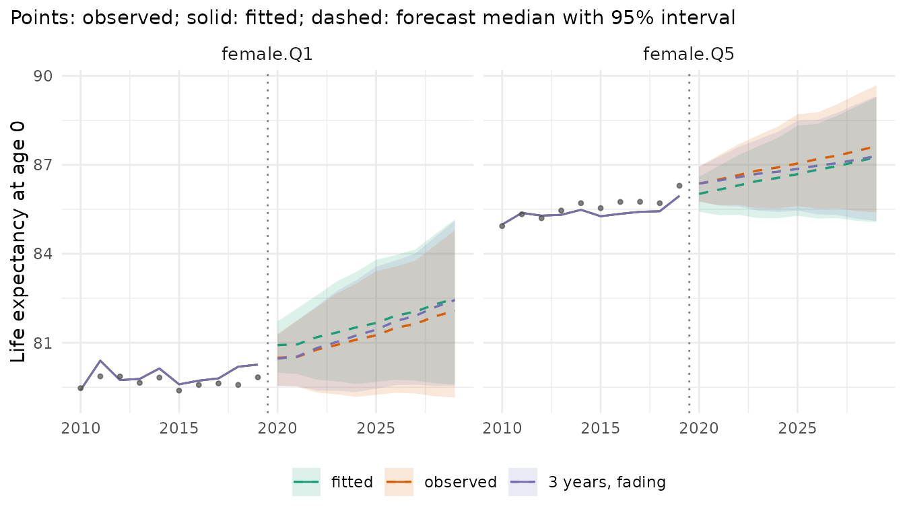
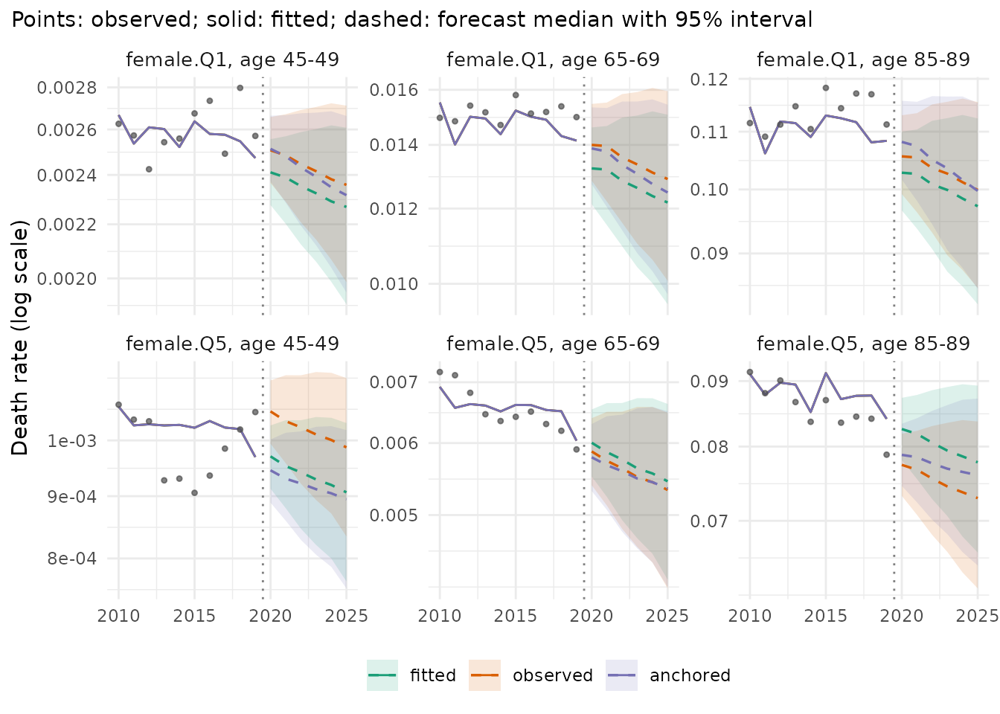
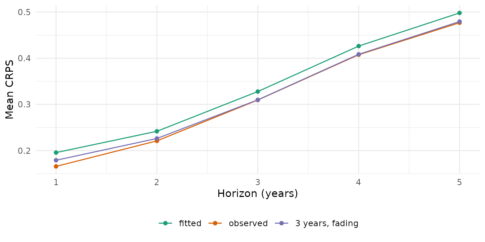

# Where a forecast starts: the jump-off

A forecast continues from some level in the last observed year, the
*jump-off*. Most models start from their own fitted rates of that year,
which differ from the observed rates: a model with few parameters does
not reproduce every age, year and stratum. The difference shows up as a
step between the last observed and the first forecast year. This
vignette shows when the step is large, the ways of placing the start,
and what they change.

``` r

library(mortensor)
library(data.table)
x <- mt_data(deaths = ons_data, population = ons_data, by = c("sex", "imd_decile"), age = "age_group",
             value = c(deaths = "all_causes", population = "population"))
x <- mt_as_exposure(x, type = "midyear")
x <- mt_group_levels(x, "imd_decile", function(d) paste0("Q", ceiling(as.numeric(d) / 2)), name = "quintile")
```

## When the step is large

The step is the distance between the model’s fitted rates and the
observed rates in the last year. Lee-Carter fitted to each stratum
separately has an age pattern and a period index of its own for every
stratum and follows each year closely. Li-Lee pools the quintiles of
each sex: they share one trend and deviate from it by a stationary
factor, so the fit of a single quintile in a single year is looser.
[`mt_jump_off()`](../reference/mt_jump_off.md) reports life expectancy
at birth in the last observed year (2019), as fitted, and in the first
forecast year:

``` r

fc_lc <- mt_forecast(mt_fit(lee_carter(), x), h = 10, n_draws = 500, seed = 1)
fc_ll <- mt_forecast(mt_fit(li_lee(common_by = "sex"), x), h = 10, n_draws = 500, seed = 1)
merge(mt_jump_off(fc_lc)[, .(label, observed, lee_carter_fitted = fitted)],
      mt_jump_off(fc_ll)[, .(label, li_lee_fitted = fitted, li_lee_2020 = forecast)], by = "label")[
  , lapply(.SD, function(v) if (is.numeric(v)) round(v, 2) else v)]
#> Key: <label>
#>         label observed lee_carter_fitted li_lee_fitted li_lee_2020
#>        <char>    <num>             <num>         <num>       <num>
#>  1: female.Q1    79.83             79.85         80.26       80.92
#>  2: female.Q2    82.50             82.51         82.74       82.90
#>  3: female.Q3    83.93             83.97         84.01       84.17
#>  4: female.Q4    85.02             85.05         84.88       85.05
#>  5: female.Q5    86.30             86.29         85.95       86.02
#>  6:   male.Q1    75.43             75.48         75.84       76.10
#>  7:   male.Q2    78.60             78.60         78.74       78.96
#>  8:   male.Q3    80.61             80.66         80.56       80.78
#>  9:   male.Q4    81.82             81.84         81.75       81.96
#> 10:   male.Q5    83.09             83.15         83.02       83.20
```

Lee-Carter reproduces the observed life expectancy of 2019 to a few
hundredths of a year. Li-Lee puts women in Q1 0.4 years above the
observed value and women in Q5 0.3 years below it: it pulls the
quintiles towards their common trend. For women in Q1 its first forecast
year then adds another 0.7 years. The step carries into every forecast
year.

## Starting points

- **fitted** (default): the forecast continues from the model’s fitted
  rates of the last year;
- **observed**: it continues from the observed rates of the last year,
  with all their noise. Lee and Miller (2001) proposed this jump-off for
  Lee-Carter: the log ratio of observed to fitted rates of the last year
  is added to the log rates of every forecast year.
  [`anchored()`](../reference/anchored.md) applies it to any model;
  `lee_carter(jump_off = "observed")` and
  `li_lee(jump_off = "observed")` give the same forecasts.

[`anchored()`](../reference/anchored.md) has further options, which are
specific to this package (reference unknown): `years` averages the
offsets over the last years, `shrink = TRUE` shrinks the offsets of
cells with few deaths towards the mean of their stratum, and `decay`
lets the offsets fade out over that many years, so that the forecast
returns to the model’s trend. The comparison includes one such setting:

``` r

fc <- list(fitted = fc_ll,
           observed = mt_forecast(mt_fit(anchored(li_lee(common_by = "sex")), x), h = 10, n_draws = 500, seed = 1),
           "3 years, fading" = mt_forecast(mt_fit(anchored(li_lee(common_by = "sex"), years = 3, decay = 10,
                                                           shrink = TRUE), x), h = 10, n_draws = 500, seed = 1))
```

``` r

mt_plot_compare(fc, strata = c("female.Q1", "female.Q5"), periods = c(2010, 2029), data = x)
```



The solid line is the fitted Li-Lee model, the points the observed life
expectancy. The fitted forecast continues from the solid line, above the
last points for women in Q1. The other two forecasts start at the
observed level. By age, the observed start also carries the noise of
single cells, which the package-specific setting averages over three
years:

``` r

mt_plot_compare(fc, quantity = "rate", ages = c("45-49", "65-69", "85-89"), strata = c("female.Q1", "female.Q5"),
                periods = c(2010, 2025))
```



## Which start forecasts better

A backtest fits each version to the years up to an origin and scores the
following five years:

``` r

ll <- li_lee(common_by = "sex")
bt <- mt_compare(list(fitted = ll, observed = anchored(ll),
                      "3 years, fading" = anchored(ll, years = 3, decay = 10, shrink = TRUE)),
                 x, origins = 2008:2014, h = 5, n_draws = 200, quantities = "life_expectancy")
#> Warning in report_fit_problems(diagnostics, spec$label, classes): Li-Lee
#> (common by sex): Li-Lee: the AR(1) coefficient of the stratum index is bounded
#> at |phi| = 0.99 in 1 stratum/strata (female.Q4): their deviations from the
#> common trend are close to a unit root and revert very slowly; coherence may not
#> suit them. (diagnostics of 10 stratum/strata of the fit).
#> Warning in report_fit_problems(diagnostics, spec$label, classes): Li-Lee
#> (common by sex): Li-Lee: the AR(1) coefficient of the stratum index is bounded
#> at |phi| = 0.99 in 1 stratum/strata (female.Q4): their deviations from the
#> common trend are close to a unit root and revert very slowly; coherence may not
#> suit them. (diagnostics of 10 stratum/strata of the fit).
#> Warning in report_fit_problems(diagnostics, spec$label, classes): Li-Lee
#> (common by sex): Li-Lee: the AR(1) coefficient of the stratum index is bounded
#> at |phi| = 0.99 in 1 stratum/strata (female.Q4): their deviations from the
#> common trend are close to a unit root and revert very slowly; coherence may not
#> suit them. (diagnostics of 10 stratum/strata of the fit).
#> Warning in report_fit_problems(diagnostics, spec$label, classes): Li-Lee
#> (common by sex): Li-Lee: the AR(1) coefficient of the stratum index is bounded
#> at |phi| = 0.99 in 1 stratum/strata (female.Q4): their deviations from the
#> common trend are close to a unit root and revert very slowly; coherence may not
#> suit them. (diagnostics of 10 stratum/strata of the fit).
#> Warning in report_fit_problems(diagnostics, spec$label, classes): Li-Lee
#> (common by sex): Li-Lee: the AR(1) coefficient of the stratum index is bounded
#> at |phi| = 0.99 in 1 stratum/strata (female.Q4): their deviations from the
#> common trend are close to a unit root and revert very slowly; coherence may not
#> suit them. (diagnostics of 10 stratum/strata of the fit).
#> Warning in report_fit_problems(diagnostics, spec$label, classes): Li-Lee
#> (common by sex): Li-Lee: the AR(1) coefficient of the stratum index is bounded
#> at |phi| = 0.99 in 1 stratum/strata (female.Q4): their deviations from the
#> common trend are close to a unit root and revert very slowly; coherence may not
#> suit them. (diagnostics of 10 stratum/strata of the fit).
mt_score_table(bt, metrics = c("crps", "cov95"))
#>              model   crps cov95 crps_le cov95_le
#>             <fctr>  <num> <num>   <num>    <num>
#> 1:          fitted 0.0671 0.810   0.338    0.806
#> 2:        observed 0.0714 0.808   0.316    0.834
#> 3: 3 years, fading 0.0661 0.824   0.321    0.831
```

``` r

mt_plot_scores(bt, target = "life_expectancy")
```



`crps` scores the log death rates, `crps_le` life expectancy at birth in
years (lower is better; see “Backtesting and scores”). The observed
start forecasts life expectancy more accurately than the fitted start
(CRPS 0.316 against 0.338 years), because the step of Li-Lee at the
jump-off is large here. It forecasts the rates less accurately (0.071
against 0.067), because it carries the noise of single ages and years
into every forecast year. The package-specific setting, which averages
the offsets over three years, shrinks them and lets them fade out, gives
the lowest CRPS of the rates (0.066) and a CRPS of life expectancy close
to that of the observed start (0.321 years). The 95% intervals of all
three cover 0.81 to 0.82 of the observed rates.

For Lee-Carter fitted to each stratum, whose step is small here:

``` r

bt_lc <- mt_compare(list(fitted = lee_carter(), observed = anchored(lee_carter())), x, origins = 2008:2014, h = 5,
                    n_draws = 200, quantities = "life_expectancy")
mt_score_table(bt_lc, metrics = c("crps", "cov95"))
#>       model   crps cov95 crps_le cov95_le
#>      <fctr>  <num> <num>   <num>    <num>
#> 1:   fitted 0.0683 0.793   0.293    0.814
#> 2: observed 0.0789 0.761   0.310    0.789
```

Lee-Carter reproduces the last observed year closely, so the observed
start adds mainly the noise of that year: it forecasts the rates and
life expectancy less accurately than the fitted start (CRPS 0.079
against 0.068, and 0.310 against 0.293 years).

## Summary

| Start | How | When |
|----|----|----|
| fitted | default of every model | the model fits the last year closely (here Lee-Carter) |
| observed (Lee and Miller 2001) | `anchored(model)` around any model; `jump_off = "observed"` of [`lee_carter()`](../reference/lee_carter.md) and [`li_lee()`](../reference/li_lee.md) | the fit misses the level of the last year (here Li-Lee) |
| package-specific | `anchored(model, years = 3, decay = 10, shrink = TRUE)` | noisy last years; check in a backtest |

[`mt_jump_off()`](../reference/mt_jump_off.md) shows the step of any
forecast; a backtest shows whether another start forecasts better on the
data at hand.

## References

Lee R, Miller T (2001). Evaluating the performance of the Lee-Carter
method for forecasting mortality. *Demography* 38(4): 537-549.
