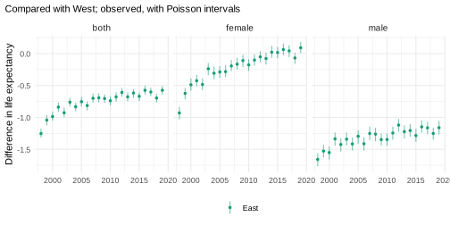
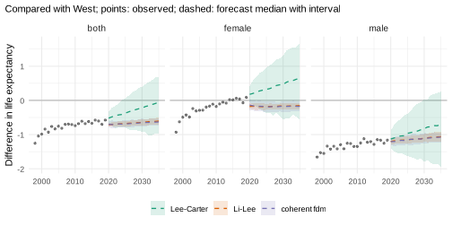
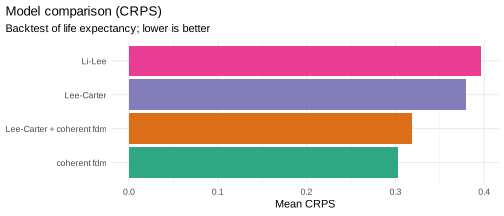
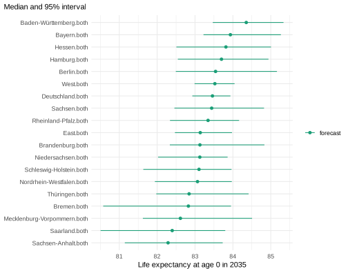
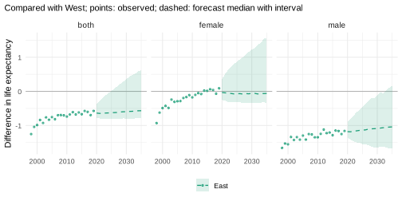
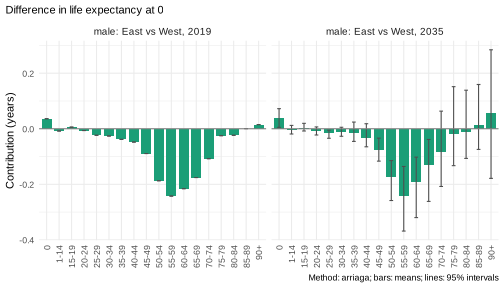

# Differences between the German Laender

*This vignette is precomputed (`dev/precompute-vignettes.R`) because its
backtests take about 20 minutes.*

How will life expectancy in the 16 German Laender develop until 2035,
and will the remaining gap between East and West Germany close? This
vignette answers with one complete pipeline: official tables with
suppressed cells, a hierarchy of Laender, East and West and Germany, a
model chosen in a backtest of both the Laender and the East-West gap,
and forecasts that add up at every level. Each step refers to the
vignette that explains it.

``` r

library(mortensor)
library(data.table)
```

## Data

`de_deaths` holds deaths by year, Land, sex, age group and ICD-10
chapter (Destatis, published by the Federal Health Monitoring,
GBE-Bund); `de_population` the populations on 31 December by single year
of age (GENESIS-Online, table 12411-0013). Both are licensed under the
Datenlizenz Deutschland - Namensnennung - Version 2.0.

``` r

x <- mt_data(deaths = de_deaths, population = de_population, by = c("region", "sex", "cause"))
#> Warning in ingest_obs(x, by, age, period, value, measure, age_open, missing =
#> missing, : 41396 missing deaths value(s) left out; suppressed counts can be
#> estimated with mt_fill_suppressed().
x <- mt_as_exposure(x, type = "dec31")
x <- mt_subset(x, periods = c(1998, 2019))
x <- mt_regroup(x, age = "deaths")
```

- **Exposures**: the person-years of year *t* are the mean of the
  populations on 31 December of *t* - 1 and *t* (`type = "dec31"`).
- **Years**: 1998-2019, before the COVID-19 pandemic.
- **Ages**: the age groups of the deaths (0, 1-14, 15-19, …, 90+).

**Suppressed cells.** The warning says that the source suppresses small
counts. The published totals constrain them: the Laender add up to
Germany and the chapters to all causes.
[`mt_fill_suppressed()`](../reference/mt_fill_suppressed.md) estimates
the suppressed counts by raking them to these totals (“Your own data”):

``` r

h_fill <- mt_hierarchy(region = "Deutschland", cause = list(total = "all", additive = "rates"))
x <- mt_fill_suppressed(x, h_fill)
attr(x, "fill")
#>    filled missing inconsistent iterations      max_gap
#> 1:  33225       0            0       1959 7.975615e-07
```

All totals are matched (`max_gap`). For all causes only a few cells at
young ages were suppressed, so the estimates matter little here.

## The hierarchy

The 16 Laender by sex are the bottom series. East (with Berlin) and West
Germany, Germany, and both sexes are their sums. All forecasts below are
made for the 32 bottom series and summed
(`reconciled(method = "bottom_up")`, “Coherent forecasts: totals and
their parts”):

``` r

xa <- mt_subset(x, cause == "all", region != "Deutschland", drop = TRUE)
laender <- unique(mt_strata(xa)$region)
east <- c("Berlin", "Brandenburg", "Mecklenburg-Vorpommern", "Sachsen", "Sachsen-Anhalt",
          grep("^Th", laender, value = TRUE))
h <- mt_hierarchy(region = list(total = "Deutschland", groups = list(West = setdiff(laender, east), East = east)),
                  sex = "both")
xh <- mt_aggregate_strata(xa, h)
mt_strata(xh, h)[, .N, by = level]
#>        level  N
#> 1:    bottom 32
#> 2: aggregate 24
#> 3:     total  1
bu <- function(model) reconciled(model, h, method = "bottom_up")
```

The observed difference in life expectancy at birth between East and
West:

``` r

gap_obs <- mt_contrast(xh, var = "region", ref = "West")
mt_plot_contrast(observed = gap_obs, levels = "East")
```



Women in the East caught up with the West by about 2014 and lived 0.1
years longer in 2019. Men in the East still live about 1.2 years less
(1.7 years in 1998).

## Model: a backtest of candidates

Small Laender such as Bremen and Saarland have few deaths per age group,
so their rates are noisy. The candidates differ in how the Laender may
move relative to each other (“Choosing and combining models”):

- **Lee-Carter** for each Land and sex: each Land continues its own
  trend;
- **Li-Lee** and the **coherent fdm** (product-ratio method with
  functional data models): the Laender of each sex share a common trend
  and deviate from it with stationary factors, so small Laender borrow
  strength from the others and gaps return towards their past level;
- the **ensemble** of Lee-Carter and the coherent fdm.

The East-West gap forecast by three of them:

``` r

cand <- list("Lee-Carter" = bu(lee_carter()), "Li-Lee" = bu(li_lee(common_by = "sex")),
             "coherent fdm" = bu(coherent_fdm(common_by = "sex")),
             "Lee-Carter + coherent fdm" = bu(ensemble(lc = lee_carter(), cf = coherent_fdm(common_by = "sex"))))
gaps <- lapply(cand[c("Lee-Carter", "Li-Lee", "coherent fdm")], function(m) {
  mt_contrast(mt_forecast(mt_fit(m, xh), to = 2035, n_draws = 300, seed = 1), var = "region", ref = "West", at = 0)
})
mt_plot_contrast(gaps, observed = gap_obs, levels = "East")
```



The backtest fits each candidate to the years up to 2008, 2011 and 2014,
forecasts the following five years, and scores the rates and life
expectancy of every series and the gap between each region and the West
(`contrast`, “Backtesting and scores”):

``` r

bt <- mt_compare(cand, xh, origins = c(2008, 2011, 2014), h = 5, n_draws = 200, quantities = "life_expectancy",
                 contrast = c(var = "region", ref = "West"))
mt_score_table(bt, metrics = c("crps", "cov95"), targets = c("rate", "life_expectancy"), hierarchy = h)
#>                         model     level   crps cov95 crps_le cov95_le
#>  1:                Lee-Carter    bottom 0.0921 0.774   0.379   0.7630
#>  2:                Lee-Carter aggregate 0.0681 0.626   0.381   0.4530
#>  3:                Lee-Carter     total 0.0513 0.296   0.410   0.0667
#>  4:                    Li-Lee    bottom 0.0900 0.812   0.396   0.7760
#>  5:                    Li-Lee aggregate 0.0653 0.731   0.366   0.6720
#>  6:                    Li-Lee     total 0.0508 0.585   0.346   0.5330
#>  7:              coherent fdm    bottom 0.0826 0.825   0.303   0.6190
#>  8:              coherent fdm aggregate 0.0603 0.710   0.280   0.4690
#>  9:              coherent fdm     total 0.0480 0.467   0.275   0.2670
#> 10: Lee-Carter + coherent fdm    bottom 0.0824 0.856   0.318   0.7580
#> 11: Lee-Carter + coherent fdm aggregate 0.0594 0.749   0.305   0.5780
#> 12: Lee-Carter + coherent fdm     total 0.0456 0.489   0.325   0.2670
```

``` r

mt_score_table(bt[region == "East" & sex != "both"], metrics = c("crps", "cov95"), targets = "life_expectancy_gap")
#>                        model crps_le_gap cov95_le_gap
#> 1:                Lee-Carter      0.0736        1.000
#> 2:                    Li-Lee      0.1580        0.367
#> 3:              coherent fdm      0.1490        0.400
#> 4: Lee-Carter + coherent fdm      0.0746        1.000
```

``` r

mt_plot_scores(bt[region %in% laender & sex != "both"], by = "model", target = "life_expectancy")
```



Lee-Carter continues the trends of 1998-2019: the gap of men keeps
narrowing, and women in the East pull further ahead. Li-Lee and the
coherent fdm hold the gaps near their recent level, with women in the
East slightly behind again. The backtest decides between these
assumptions:

- For the Laender, the ensemble and the coherent fdm are the most
  accurate (CRPS of the rates 0.0824 and 0.0826, against 0.090 for
  Li-Lee and 0.092 for Lee-Carter); the coherent fdm forecasts their
  life expectancy best (CRPS 0.303 years, ensemble 0.318). The
  ensemble’s intervals cover the rates best (95% coverage 0.856). The
  intervals of life expectancy are too narrow for every model (95%
  coverage 0.62 to 0.78).
- For the totals (East, West and Germany), the ensemble forecasts the
  rates most accurately, but all intervals are too narrow there (95%
  coverage of the rates of Germany 0.296 to 0.585). Lee-Carter forecasts
  each Land independently, so the deviations of its draws partly cancel
  in the totals: its intervals of life expectancy for Germany covered
  one of the 15 observed values.
- The East-West gap is forecast best by Lee-Carter and the ensemble
  (CRPS 0.074 and 0.075), whose intervals covered every observed gap;
  those of Li-Lee and the coherent fdm covered it in only 37% and 40% of
  the cases.

The ensemble of Lee-Carter and the coherent fdm forecasts the rates of
the Laender as accurately as the coherent fdm alone, and the gap almost
as accurately as Lee-Carter. No single model does as well on both, so
the pipeline continues with the ensemble.

### Jump-off

Starting the forecasts at the observed rates of the last year
([`anchored()`](../reference/anchored.md), Lee and Miller 2001; “Where a
forecast starts: the jump-off”), checked in the same backtest:

``` r

ens <- ensemble(lc = lee_carter(), cf = coherent_fdm(common_by = "sex"))
bt_anchor <- mt_compare(list("+ anchored" = bu(anchored(ens))), xh, origins = c(2008, 2011, 2014),
                        h = 5, n_draws = 200, quantities = "life_expectancy", contrast = c(var = "region", ref = "West"))
bt_steps <- rbind(bt[model == "Lee-Carter + coherent fdm"], bt_anchor)
mt_score_table(bt_steps[sex != "both"], metrics = c("crps", "cov95"))
#>                        model   crps cov95 crps_le cov95_le crps_le_gap
#> 1: Lee-Carter + coherent fdm 0.0774 0.828   0.320    0.709       0.104
#> 2:                + anchored 0.0849 0.817   0.314    0.736       0.102
#>    cov95_le_gap
#> 1:        1.000
#> 2:        0.996
```

Anchoring made the forecasts of the rates worse (CRPS 0.085 against
0.077): the observed rates of a single year carry their random variation
into every forecast year, and those of small Laender are noisy. It made
the forecasts of life expectancy slightly more accurate (0.314 against
0.320) and left those of the East-West gap nearly unchanged (0.102
against 0.104). In this example the jump-off changes little: the
forecasts with and without it differ by about 0.006 years in the CRPS of
life expectancy and 0.002 in that of the gap. The pipeline keeps it
because the question concerns life expectancy and the gap and anchoring
to the last observed year is the published practice (Lee and Miller
2001). With other data the effect can be larger or go the other way, so
check it in a backtest.

## Forecasts to 2035

``` r

fc <- mt_forecast(mt_fit(bu(anchored(ens)), xh), to = 2035, n_draws = 1000, seed = 1)
```

Life expectancy at birth in 2035, both sexes, with 95% intervals:

``` r

e35 <- life_expectancy(fc)[period == 2035 & sex == "both"]
mt_plot_compare(list(forecast = fc), periods = 2035, strata = rev(e35[order(q0.5), label]))
```



The intervals of small Laender are the widest. The paths of the Laender
add up to those of East, West and Germany, so these intervals are
consistent with each other.

## The East-West gap

The difference in life expectancy at birth between East and West
Germany, path by path, with the observed differences:

``` r

gap <- mt_contrast(fc, var = "region", ref = "West", at = 0)
mt_plot_contrast(gap, observed = gap_obs, levels = "East")
```



``` r

gap[level == "East" & period %in% c(2025, 2035),
    .(sex, period, gap = sprintf("%.2f (%.2f to %.2f)", q0.5, q0.025, q0.975))]
#>       sex period                    gap
#> 1: female   2025  -0.07 (-0.32 to 0.86)
#> 2: female   2035  -0.06 (-0.35 to 1.56)
#> 3:   male   2025 -1.13 (-1.54 to -0.46)
#> 4:   male   2035  -1.04 (-1.68 to 0.16)
#> 5:   both   2025  -0.63 (-0.80 to 0.02)
#> 6:   both   2035  -0.57 (-0.77 to 0.62)
```

In 2035, women in the East are forecast to live about as long as those
in the West (0.06 years less, 95% interval -0.35 to 1.56), men 1.0 years
less (-1.68 to 0.16). The forecast continues the slow narrowing of the
male gap (1.13 years in 2025), but the gap most likely does not close by
2035.

Which ages make up the gap of men in 2019 and in 2035 (“Decomposing
differences in life expectancy”):

``` r

dg <- mt_decompose(fc, var = "region", ref = "West", periods = c(2019, 2035))
mt_plot_decomposition(dg, by = "age", comparisons = list(to = "East", sex = "male"))
```



The male gap arises at ages 45 to 74, in 2019 as in 2035; at older ages
the contributions are small and uncertain.

## Summary of the pipeline

| Step | Decision here | Evidence | Function | Explained in |
|----|----|----|----|----|
| Exposures | mean of 31 December populations |  | `mt_as_exposure(type = "dec31")` | “Your own data” |
| Suppressed cells | raking to Land and national totals | all totals matched | [`mt_fill_suppressed()`](../reference/mt_fill_suppressed.md) | “Your own data” |
| Hierarchy | Laender, East and West, Germany; sexes |  | [`mt_hierarchy()`](../reference/mt_hierarchy.md), [`mt_aggregate_strata()`](../reference/mt_aggregate_strata.md) | “Coherent forecasts” |
| Coherence | bottom-up sums of the Laender |  | `reconciled(method = "bottom_up")` | “Coherent forecasts” |
| Model | ensemble of Lee-Carter and coherent fdm | most accurate for the rates of the Laender, second for the gap | [`ensemble()`](../reference/ensemble.md), [`coherent_fdm()`](../reference/coherent_fdm.md), `mt_compare(contrast = )` | “Choosing and combining models” |
| Jump-off | observed rates of the last year (Lee and Miller 2001) | slightly better life expectancy, gap nearly unchanged, worse rates | [`anchored()`](../reference/anchored.md) | “Where a forecast starts” |
| Gap | East - West, path by path |  | [`mt_contrast()`](../reference/mt_contrast.md), [`mt_decompose()`](../reference/mt_decompose.md) | “Decomposing differences” |

## References

Hyndman RJ, Booth H, Yasmeen F (2013). Coherent mortality forecasting:
the product-ratio method with functional time series models.
*Demography* 50(1): 261-283.

Lee R, Miller T (2001). Evaluating the performance of the Lee-Carter
method for forecasting mortality. *Demography* 38(4): 537-549.
