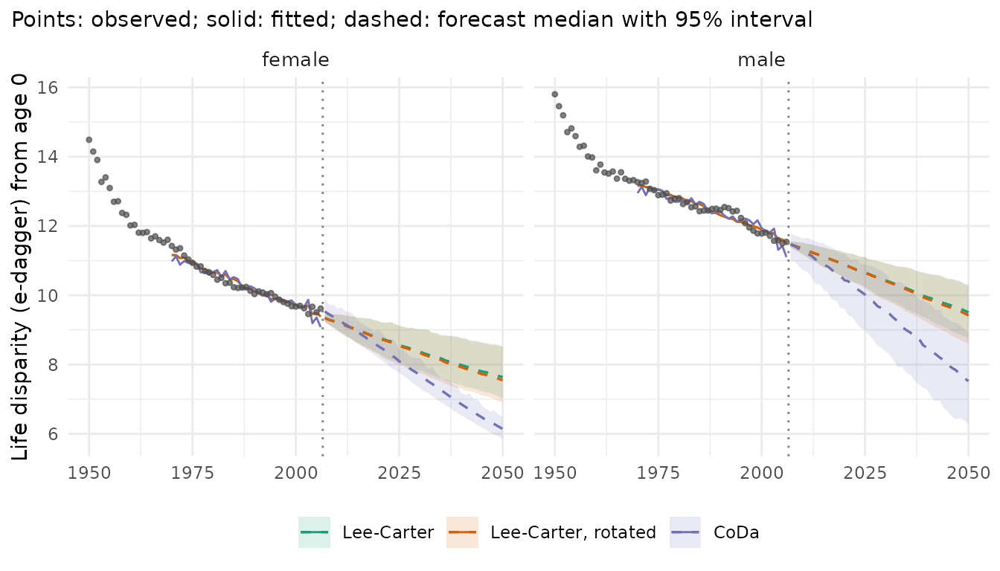
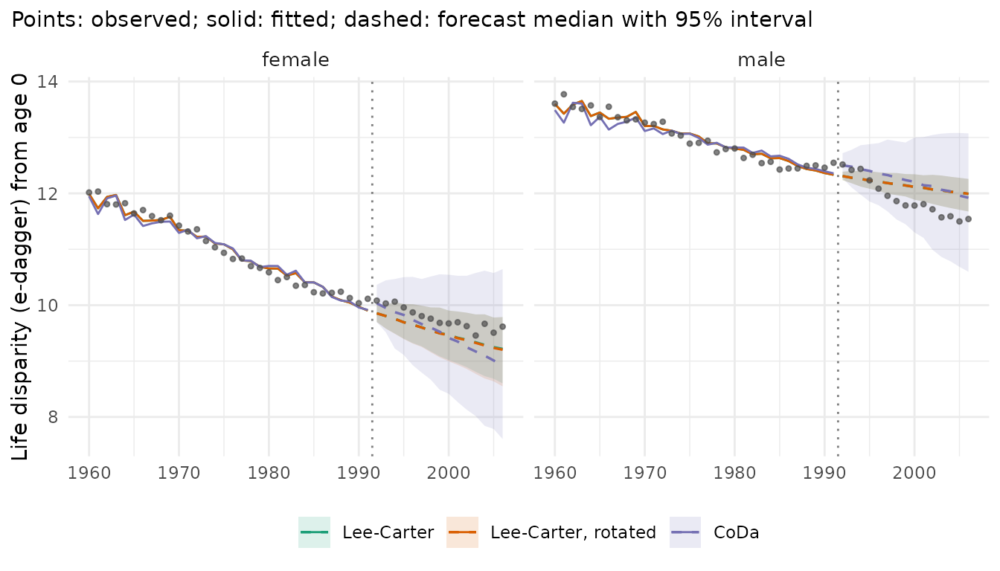

# Lifespan variation

Life expectancy is the mean age at death of a period life table. Two
populations with the same life expectancy can differ in how unequal
their lifespans are: in one most people die at similar ages, in the
other many die young and many very old. Indices of lifespan variation
measure this spread.
[`lifespan_variation()`](../reference/lifespan_variation.md) computes
them from observed rates (with Poisson intervals) and from forecast
draws (path by path, like
[`life_expectancy()`](../reference/life_expectancy.md)). The measures
follow the R package LifeIneq (van Raalte, Riffe and Dudel 2024):

| Measure | `measure` | Meaning |
|----|----|----|
| Life disparity | `"edagger"` | average remaining life expectancy lost at death, in years (Vaupel 1986) |
| Life-table entropy | `"entropy"` | e-dagger divided by life expectancy (Keyfitz 1977; Goldman and Lord 1986) |
| Gini coefficient | `"gini"` | mean absolute difference between two ages at death, relative to the mean (Shkolnikov, Andreev and Begun 2003) |
| Standard deviation, variance, coefficient of variation | `"sd"`, `"var"`, `"cv"` | spread of the age at death around its mean |
| Interquartile range | `"iqr"` | years between the ages by which a quarter and three quarters have died |

All are computed for the survivors to an age `at` (default the first
age): `at = 65` measures the variation of the ages at death above 65.

## Observed lifespan variation in France

Women and men in France, 1950-2006, from the Human Mortality Database
(via the demography package), in single years of age to 100+:

``` r

library(mortensor)
library(data.table)
fr <- as_mt_data(demography::fr.mort)
x <- mt_regroup(mt_subset(fr, periods = c(1950, 2006)), age = 0:100)
lv <- lifespan_variation(x, measure = c("edagger", "gini", "sd"))
lv[period %in% c(1950, 1975, 2006), list(sex, period, measure, mean, q0.025, q0.975)]
#>        sex period measure        mean      q0.025      q0.975
#>     <char>  <num>  <char>       <num>       <num>       <num>
#>  1: female   1950 edagger 14.48901802 14.43759796 14.53980455
#>  2: female   1975 edagger 10.93527140 10.90016107 10.97485945
#>  3: female   2006 edagger  9.61796420  9.57733046  9.65053932
#>  4:   male   1950 edagger 15.80116829 15.75533967 15.84824937
#>  5:   male   1975 edagger 12.89052615 12.84818422 12.93178081
#>  6:   male   2006 edagger 11.54213382 11.50857050 11.57921372
#>  7: female   1950    gini  0.15765978  0.15695199  0.15837964
#>  8: female   1975    gini  0.10377954  0.10336546  0.10426511
#>  9: female   2006    gini  0.08243246  0.08206303  0.08275584
#> 10:   male   1950    gini  0.18511625  0.18438466  0.18585481
#> 11:   male   1975    gini  0.13375868  0.13320337  0.13432691
#> 12:   male   2006    gini  0.10707010  0.10669301  0.10746077
#> 13: female   1950      sd 22.09717810 22.02210120 22.16975497
#> 14: female   1975      sd 16.35642086 16.29327819 16.43593681
#> 15: female   2006      sd 13.93768953 13.86875567 13.99526408
#> 16:   male   1950      sd 22.85119865 22.79330458 22.91015475
#> 17:   male   1975      sd 17.83002918 17.76886406 17.89445866
#> 18:   male   2006      sd 15.77479171 15.71858386 15.83637820
```

The intervals are narrow, because the deaths of a whole country leave
little random variation. All three measures fell by a quarter to a half:
the ages at death became more similar as deaths in childhood and middle
age became rare. e-dagger of women fell from 14.5 to 9.6 years, while
their life expectancy rose from 69 to 84 years. Across countries and
years, high life expectancy and low life disparity go together (Vaupel,
Zhang and van Raalte 2011).

Above age 65 the picture differs:

``` r

lv65 <- lifespan_variation(x, measure = "edagger", at = 65)
lv65[period %in% c(1950, 1975, 2006), list(sex, period, mean)]
#>       sex period     mean
#>    <char>  <num>    <num>
#> 1: female   1950 6.866434
#> 2: female   1975 6.948235
#> 3: female   2006 7.138844
#> 4:   male   1950 6.575271
#> 5:   male   1975 6.978772
#> 6:   male   2006 7.517069
```

e-dagger at 65 rose slightly: the decline of mortality at old ages
spread the ages at death above 65 further out, so the fall of lifespan
variation at birth came from deaths before 65.

## The open age interval

The life table assumes a constant death rate in the open age interval,
while the death rate keeps rising with age. The ages at death in that
interval are therefore spread too widely, and every measure depends on
where the open interval starts:

``` r

open_at <- function(o) {
  r <- lifespan_variation(mt_regroup(x, age = 0:o), measure = c("edagger", "gini", "sd", "iqr"))
  r[period == 2006, list(sex, measure, open = paste0(o, "+"), value = mean)]
}
dcast(rbindlist(lapply(c(85, 90, 95, 100), open_at)), sex + measure ~ open, value.var = "value")
#> Key: <sex, measure>
#>       sex measure        100+        85+         90+         95+
#>    <char>  <char>       <num>      <num>       <num>       <num>
#> 1: female edagger  9.61796420 11.7453299 10.22568749  9.77491776
#> 2: female    gini  0.08243246  0.0724665  0.07914172  0.08213527
#> 3: female     iqr 13.44660072 12.2966754 12.71691174 13.44339330
#> 4: female      sd 13.93768953 13.6268146 13.78205434 13.91529084
#> 5:   male edagger 11.54213382 12.5239285 11.74989108 11.58373603
#> 6:   male    gini  0.10707010  0.1042746  0.10640110  0.10706179
#> 7:   male     iqr 18.00869613 17.1892414 18.01023500 18.00692767
#> 8:   male      sd 15.77479171 15.7138475 15.72797432 15.77179271
```

For women in 2006, e-dagger is 2.1 years higher with an open interval
from 85 than with single years to 100+, and the Gini coefficient and the
interquartile range are lower; from 95 the differences are small. Data
that end at 85+ or 90+ (as many official tables) give biased levels of
lifespan variation, more so in recent years with many deaths above these
ages. Compare measures only between tables with the same open age.

## Forecasts

Forecasts of the rates imply forecasts of lifespan variation. Models
with the same life expectancy can imply different variation, because
they differ in the ages at which mortality falls. Three models fitted to
1970-2006:

- **Lee-Carter** ([`lee_carter()`](../reference/lee_carter.md)): each
  age declines at a fixed relative pace `b(x)`;
- **rotated Lee-Carter** (`lee_carter(rotate = TRUE)`): as life
  expectancy rises above 80, the decline moves to older ages (Li, Lee
  and Gerland 2013); life expectancy at birth stays that of Lee-Carter;
- **CoDa** ([`coda()`](../reference/coda.md)): the Lee-Carter model of
  the life-table distribution of deaths, which forecasts the shape of
  the age-at-death distribution directly (Oeppen 2008; Bergeron-Boucher
  et al. 2017).

``` r

xf <- mt_subset(x, periods = c(1970, 2006))
specs <- list("Lee-Carter" = lee_carter(), "Lee-Carter, rotated" = lee_carter(rotate = TRUE), "CoDa" = coda())
fc <- lapply(specs, function(s) mt_forecast(mt_fit(s, xf), to = 2050, n_draws = 500, seed = 1))
mt_compare_forecasts(fc, periods = 2050)
#> Key: <label, period>
#>     label period       Lee-Carter Lee-Carter, rotated             CoDa
#>    <char>  <num>           <char>              <char>           <char>
#> 1: female   2050 91.4 (87.8-94.2)    91.4 (87.8-94.2) 94.6 (93.8-95.3)
#> 2:   male   2050 85.1 (82.3-87.6)    85.1 (82.3-87.6) 89.2 (85.6-92.3)
mt_compare_forecasts(fc, quantity = "lifespan_variation", periods = 2050, digits = 2)
#> Key: <label, period>
#>     label period        Lee-Carter Lee-Carter, rotated             CoDa
#>    <char>  <num>            <char>              <char>           <char>
#> 1: female   2050  7.64 (7.05-8.53)    7.55 (6.92-8.50) 6.15 (5.86-6.47)
#> 2:   male   2050 9.51 (8.76-10.29)   9.42 (8.61-10.27) 7.58 (6.37-9.01)
```

``` r

mt_plot_compare(fc, quantity = "lifespan_variation", data = x)
```



- **Lee-Carter** continues the decline of e-dagger at a slower pace than
  in the past, to 7.6 years for women and 9.5 for men in 2050.
- The **rotation** lowers e-dagger only slightly here. French women
  reached a life expectancy of 80 in 1986, so the rotation is active
  from the jump-off. Their decline above 65 was already faster than the
  ultimate pattern assumes, so the rotation moves decline mostly from
  childhood, where few deaths are left, to ages 15-64; that changes the
  spread of the ages at death little. For men it starts when their
  forecast life expectancy passes 80, after 2015.
- **CoDa** forecasts a higher life expectancy (94.6 years for women and
  89.2 for men in 2050) and a faster fall of e-dagger (to 6.15 years for
  women and 7.6 for men). It extrapolates the past concentration of
  deaths at old ages directly. For men its intervals are wider than
  those of Lee-Carter. For women they narrow towards the end of the
  forecast and are narrower than those of Lee-Carter in 2050.

Lee-Carter starts from the fitted rates of 2006 (the default
`jump_off = "fitted"`), so its first year lies below the observed
e-dagger; CoDa starts from the observed deaths.

Gaps between strata work path by path, as for life expectancy:

``` r

mt_contrast(fc[["CoDa"]], var = "sex", ref = "female", quantity = "lifespan_variation")[
  period %in% c(2030, 2050), list(level, ref, period, q0.025, q0.5, q0.975)]
#>     level    ref period    q0.025     q0.5   q0.975
#>    <char> <char>  <num>     <num>    <num>    <num>
#> 1:   male female   2030 0.6219860 1.898914 3.047744
#> 2:   male female   2050 0.2134672 1.426234 2.848197
```

## Which forecast was right in the past?

The same three models fitted to 1960-1991 forecast the years 1992-2006,
which can be compared with the observed e-dagger:

``` r

xp <- mt_subset(x, periods = c(1960, 1991))
fc_past <- lapply(specs, function(s) mt_forecast(mt_fit(s, xp), to = 2006, n_draws = 500, seed = 1))
mt_plot_compare(fc_past, quantity = "lifespan_variation", data = x, periods = c(1960, 2006))
```



``` r

obs <- lifespan_variation(x, "edagger")[period == 2006, list(label = sex, observed = mean)]
merge(obs, mt_compare_forecasts(fc_past, quantity = "lifespan_variation", periods = 2006, digits = 2),
      by = "label")
#> Key: <label>
#>     label  observed period          Lee-Carter Lee-Carter, rotated
#>    <char>     <num>  <num>              <char>              <char>
#> 1: female  9.617964   2006    9.22 (8.60-9.79)    9.20 (8.55-9.79)
#> 2:   male 11.542134   2006 11.99 (11.68-12.26) 11.99 (11.68-12.26)
#>                   CoDa
#>                 <char>
#> 1:    8.99 (8.55-9.45)
#> 2: 12.05 (11.68-12.25)
```

For women, all three forecasts of 2006 were below the observed 9.6 years
(Lee-Carter 9.2, CoDa 9.0); the intervals of Lee-Carter contain it, that
of CoDa (8.55-9.45) does not. For men, all were above the observed 11.5
years (Lee-Carter 11.99, CoDa 12.05), and none of the intervals contains
it. The rotation changed the forecast for women by 0.02 years and not at
all for men, whose life expectancy stayed below 80.

One period of one country is a small test.
[`mt_backtest()`](../reference/mt_backtest.md) scores the forecast rates
and life expectancy over many origins; for lifespan variation, repeat
the comparison above from several origins.

## References

Bergeron-Boucher M-P, Canudas-Romo V, Oeppen J, Vaupel JW (2017).
Coherent forecasts of mortality with compositional data analysis.
*Demographic Research* 37(17): 527-566.

Goldman N, Lord G (1986). A new look at entropy and the life table.
*Demography* 23(2): 275-282.

Keyfitz N (1977). Mortality comparisons; the male-female ratio. In
*Applied Mathematical Demography*, 54-76. John Wiley and Sons.

Li N, Lee R, Gerland P (2013). Extending the Lee-Carter method to model
the rotation of age patterns of mortality decline for long-term
projections. *Demography* 50(6): 2037-2051.

Oeppen J (2008). Coherent forecasting of multiple-decrement life tables:
a test using Japanese cause of death data. CODAWORK’08, Universitat de
Girona.

Shkolnikov VM, Andreev EM, Begun AZ (2003). Gini coefficient as a life
table function: computation from discrete data, decomposition of
differences and empirical examples. *Demographic Research* 8: 305-358.

van Raalte A, Riffe T, Dudel C (2024). LifeIneq: Calculate indices of
lifespan variation. R package version 00.04.09.
<https://github.com/alysonvanraalte/LifeIneq>

Vaupel JW (1986). How change in age-specific mortality affects life
expectancy. *Population Studies* 40(1): 147-157.

Vaupel JW, Zhang Z, van Raalte AA (2011). Life expectancy and disparity:
an international comparison of life table data. *BMJ Open* 1(1):
e000128. <doi:10.1136/bmjopen-2011-000128>.
