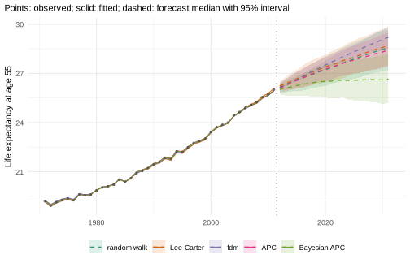
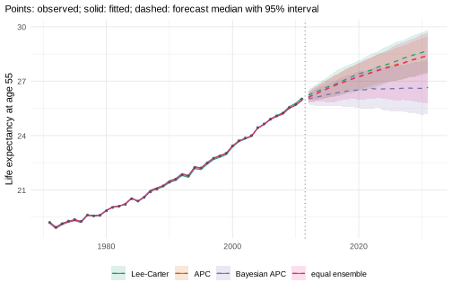

# Choosing and combining models

*This vignette is precomputed (`dev/precompute-vignettes.R`) because the
Bayesian model and the backtests take several minutes.*

mortensor does not have a preferred model. It implements some models
directly and wraps others from established packages (demography, StMoMo,
bamp, forecast), and all of them are fitted with
[`mt_fit()`](../reference/mt_fit.md), forecast with
[`mt_forecast()`](../reference/mt_forecast.md) and return simulated
paths in the same form. They can therefore be compared in the same
backtest and combined into ensembles of any composition. This vignette
shows both, on one population, and leaves smoothing and the jump-off
aside (see their own vignettes).

## The models

| Model | Constructor | Source | Idea |
|----|----|----|----|
| Random walk with drift | [`rwd()`](../reference/rwd.md) | mortensor | each log rate continues its average change; the standard benchmark of forecasting |
| Lee-Carter | [`lee_carter()`](../reference/lee_carter.md) | mortensor | one time index, with an age pattern of change (Lee and Carter 1992) |
| Functional demographic model | [`hyndman_ullah()`](../reference/hyndman_ullah.md) | demography | rates smoothed over age, several components (Hyndman and Ullah 2007) |
| Lee-Carter, CBD, APC, Renshaw-Haberman, M6 | `stmomo("lc")`, `"cbd"`, `"apc"`, `"rh"`, `"m6"` | StMoMo | generalised age-period-cohort models (Villegas et al. 2018) |
| Bayesian Lee-Carter, RH, APC, CBD, M6 | `stanmomo("lc")`, `"rh"`, … | StanMoMo | the StMoMo models fitted with Stan, with posterior uncertainty of all parameters (Barigou et al. 2023) |
| Bayesian APC | [`apc_bayes()`](../reference/apc_bayes.md) | bamp | age, period and cohort effects with random-walk priors (Schmid and Held 2007) |
| Time series per age | [`arima_series()`](../reference/arima_series.md), [`ets_series()`](../reference/arima_series.md) | forecast | a separate ARIMA or exponential smoothing model for each age |
| Tensor decomposition | [`tucker3()`](../reference/tucker3.md) | mortensor | age, period and stratum factors |
| Several populations | [`li_lee()`](../reference/li_lee.md), [`product_ratio()`](../reference/li_lee.md), [`cause_shares()`](../reference/cause_shares.md) | mortensor | strata pooled around a common trend, or causes of death as shares |
| Coherent functional demographic model | [`coherent_fdm()`](../reference/coherent_fdm.md) | demography | product-ratio method with functional data models (Hyndman, Booth and Yasmeen 2013) |

The models for several populations are used in the applied vignettes;
the “Model reference” lists the assumptions and the sources of
uncertainty of every model.

## One population, many models

Men in England & Wales, single years of age 55-90, 1971-2011 (Human
Mortality Database, via StMoMo):

``` r

library(mortensor)
library(data.table)
ew <- as_mt_data(StMoMo::EWMaleData)
ew <- mt_regroup(mt_set_grid(ew, age = single_ages(55, 90, open = FALSE)), age = single_ages(55, 90, open = FALSE))
ew <- mt_subset(ew, periods = c(1971, 2011))
models <- list("random walk" = rwd(),
               "Lee-Carter" = lee_carter(),
               "fdm" = hyndman_ullah(),
               "CBD" = stmomo("cbd"),
               "APC" = stmomo("apc"),
               "M6" = stmomo("m6"),
               "Bayesian APC" = apc_bayes(mcmc = mcmc_control("fast")),
               "Bayesian RH" = stanmomo("rh", h_max = 20, cores = 4))
set.seed(1)  # the MCMC samplers of bamp and Stan draw their seeds from R
fc <- lapply(models, function(m) mt_forecast(mt_fit(m, ew), h = 20, n_draws = 500, seed = 1))
#> Warning in report_fit_problems(diagnostics, spec$label): Functional demographic
#> model: warnings in 1 stratum/strata, for example male: smooth.demogdata()
#> failed (initial parameters not feasible); smoothed without the monotonicity
#> constraint. (see the diagnostics of the fit).
```

The warning comes from fdm: its default smoothing over age, a spline
that must increase above age 65
([`demography::smooth.demogdata()`](https://pkg.robjhyndman.com/demography/reference/smooth.demogdata.html)),
could not be fitted to these ages, so the rates were smoothed without
that constraint. The same warning recurs at each backtest origin below,
where it is not shown again.

Life expectancy at 55 (all models use the same ages) in 2021 and 2031:

``` r

mt_compare_forecasts(fc, periods = c(2021, 2031))
#>    label period      random walk       Lee-Carter              fdm
#> 1:  male   2021 27.4 (26.4-28.2) 27.5 (26.5-28.3) 27.7 (27.4-28.0)
#> 2:  male   2031 28.6 (27.2-29.7) 28.7 (27.5-29.8) 29.2 (28.5-29.8)
#>                 CBD              APC               M6     Bayesian APC
#> 1: 27.5 (26.6-28.3) 27.4 (26.6-28.1) 27.2 (26.3-28.0) 26.5 (25.5-27.6)
#> 2: 28.7 (27.6-29.7) 28.4 (27.4-29.5) 28.1 (26.8-29.0) 26.6 (25.2-28.2)
#>         Bayesian RH
#> 1: 27.5 (26.5-28.4)
#> 2: 28.5 (27.2-29.9)
```

``` r

mt_plot_compare(fc[c("random walk", "Lee-Carter", "fdm", "APC", "Bayesian APC")], data = ew)
```



All models forecast a further rise, at different paces and with
different uncertainty. By 2031 the medians range from 26.6 to 29.2
years:

- **fdm** gives the highest forecast and the narrowest interval.
- The period models (**random walk**, **Lee-Carter**, **CBD**) agree
  closely, at about 28.7 years.
- The cohort models **APC** and **M6** are lower (28.4 and 28.1 years);
  the **Bayesian RH** (StanMoMo: Lee-Carter with a cohort effect, fitted
  with Stan) lies between them and the period models (28.5 years).
- The **Bayesian APC** barely moves. Its default priors are first-order
  random walks for period and cohort (`period = "rw1"`), which carry the
  last period effect forward without a trend; only the cohorts entering
  the age range change the forecast (see “Bayesian age-period-cohort
  models with bamp” for the alternative with second-order random walks).

The width of an interval reflects what each model treats as uncertain.
Whether the medians are accurate and the intervals wide enough can only
be checked against data the models did not see.

## Which model forecast best

A backtest from three origins, each forecasting ten years, scores the
log death rates and life expectancy at 55 (`_le`, in years):

``` r

bt <- mt_compare(models, ew, origins = c(1991, 1996, 2001), h = 10, n_draws = 200, quantities = "life_expectancy")
mt_score_table(bt, metrics = c("crps", "cov95"))
#>           model   crps cov95 crps_le cov95_le
#> 1:  random walk 0.0514 0.973   0.388    0.767
#> 2:   Lee-Carter 0.0564 0.751   0.366    0.933
#> 3:          fdm 0.0516 0.557   0.320    0.333
#> 4:          CBD 0.0554 0.782   0.371    0.833
#> 5:          APC 0.0392 0.959   0.261    1.000
#> 6:           M6 0.0316 0.981   0.184    1.000
#> 7: Bayesian APC 0.0709 0.708   0.561    0.633
#> 8:  Bayesian RH 0.0457 0.891   0.278    1.000
```

``` r

mt_plot_scores(bt, by = "model", target = "life_expectancy")
```


- **M6** and **APC** forecast best, both the rates and life expectancy,
  and their intervals covered the observed values.
- The **Bayesian RH** comes third, and its intervals covered well (95%
  coverage 0.89 for the rates).
- The period models and the random walk lie close together; the random
  walk forecast the single rates slightly better than Lee-Carter.
- **fdm** forecast life expectancy fairly accurately, but its intervals
  are far too narrow (95% coverage 0.33).
- The **Bayesian APC** is the least accurate: a forecast without a trend
  falls behind when mortality keeps declining.

Two cautions. Life expectancy is scored on 30 forecasts (3 origins times
10 years), so a coverage of 0.93 and one of 0.77 differ by five
forecasts. And the ranking holds for this population and these years; in
other data, a period model may forecast best.

## Ensembles of any combination

[`ensemble()`](../reference/ensemble.md) combines any models,
implemented or wrapped. Each draw of the ensemble comes from one of the
components, chosen in proportion to the weights, so the ensemble is a
mixture: where the components disagree, its intervals are wider than
those of each component. That is often what is needed, because the
disagreement between plausible models is part of the uncertainty about
the future.

Weights can be equal, set by hand, or estimated from an inner backtest
on the training data only (`weights = "crps"`: inversely proportional to
the CRPS of each component; `"stack"`: the combination that minimised
the error of the median forecasts), and `top_k` keeps the best
components:

``` r

ens <- list(
  "equal: Lee-Carter, fdm, APC, M6, Bayesian APC" =
    ensemble(lc = lee_carter(), fdm = hyndman_ullah(), apc = stmomo("apc"), m6 = stmomo("m6"),
             bamp = apc_bayes(mcmc = mcmc_control("fast"))),
  "CRPS weights, best 3 of 6" =
    ensemble(rw = rwd(), lc = lee_carter(), fdm = hyndman_ullah(), cbd = stmomo("cbd"), apc = stmomo("apc"),
             m6 = stmomo("m6"), weights = "crps", top_k = 3))
fit_ens <- mt_fit(ens[[2]], ew)
round(fit_ens$weights, 2)
#>   rw   lc  fdm  cbd  apc   m6 
#> 0.26 0.00 0.00 0.00 0.35 0.38
```

On the data up to 2011, the inner backtest kept the random walk, APC and
M6, weighted by their CRPS. The ensembles in the same backtest as the
single models:

``` r

bt_ens <- mt_compare(ens, ew, origins = c(1991, 1996, 2001), h = 10, n_draws = 200, quantities = "life_expectancy")
mt_score_table(rbind(bt, bt_ens), metrics = c("crps", "cov95"))
#>                                             model   crps cov95 crps_le cov95_le
#>  1:                                   random walk 0.0514 0.973   0.388    0.767
#>  2:                                    Lee-Carter 0.0564 0.751   0.366    0.933
#>  3:                                           fdm 0.0516 0.557   0.320    0.333
#>  4:                                           CBD 0.0554 0.782   0.371    0.833
#>  5:                                           APC 0.0392 0.959   0.261    1.000
#>  6:                                            M6 0.0316 0.981   0.184    1.000
#>  7:                                  Bayesian APC 0.0709 0.708   0.561    0.633
#>  8:                                   Bayesian RH 0.0457 0.891   0.278    1.000
#>  9: equal: Lee-Carter, fdm, APC, M6, Bayesian APC 0.0423 0.932   0.298    0.933
#> 10:                     CRPS weights, best 3 of 6 0.0342 0.988   0.225    1.000
```

- The **equal-weight ensemble** is more accurate than the average of its
  components (CRPS of the rates 0.042 against 0.050), and its intervals
  cover. This always holds: the CRPS is a convex function of the
  forecast distribution, so the CRPS of a mixture is never larger than
  the weighted mean of the CRPS of its components. It includes the weak
  Bayesian APC, which pulls it behind APC and M6.
- The **CRPS-weighted ensemble** comes close to M6, the best single
  model, without knowing beforehand which model that would be: its
  weights were estimated anew at each origin from the years before it.

An ensemble rarely beats the best single model in hindsight. Its value
is that it does not depend on picking that model in advance, and that
its intervals include the disagreement between the models:

``` r

fc_ens <- mt_forecast(mt_fit(ens[[1]], ew), h = 20, n_draws = 500, seed = 1)
mt_plot_compare(c(fc[c("Lee-Carter", "APC", "Bayesian APC")], list("equal ensemble" = fc_ens)), data = ew)
```



## How to choose

- Start from a few models that differ in their assumptions (period trend
  only, cohort effects, smooth age pattern) and a benchmark
  ([`rwd()`](../reference/rwd.md)).
- Compare them in a backtest on the quantity the analysis is about, with
  the accuracy (CRPS) and the coverage of the intervals.
- Where no model is clearly best, or the single models are too narrow,
  use an ensemble; estimated weights (`weights = "crps"`, `top_k`) are
  re-estimated at every backtest origin, so they can be checked in the
  same way.
- For several populations (sexes, regions, deprivation groups) add the
  pooled models ([`li_lee()`](../reference/li_lee.md),
  [`product_ratio()`](../reference/li_lee.md)) and make totals coherent
  ([`reconciled()`](../reference/reconciled.md)); see the applied
  vignettes.

## References

Barigou K, Goffard P-O, Loisel S, Salhi Y (2023). Bayesian model
averaging for mortality forecasting using leave-future-out validation.
*International Journal of Forecasting* 39(2): 674-690.

Hyndman RJ, Booth H, Yasmeen F (2013). Coherent mortality forecasting:
the product-ratio method with functional time series models.
*Demography* 50(1): 261-283.

Hyndman RJ, Ullah MS (2007). Robust forecasting of mortality and
fertility rates: a functional data approach. *Computational Statistics &
Data Analysis* 51(10): 4942-4956.

Lee RD, Carter LR (1992). Modeling and forecasting U.S. mortality.
*Journal of the American Statistical Association* 87(419): 659-671.

Schmid VJ, Held L (2007). Bayesian age-period-cohort modeling and
prediction - BAMP. *Journal of Statistical Software* 21(8): 1-15.

Villegas AM, Kaishev VK, Millossovich P (2018). StMoMo: an R package for
stochastic mortality modeling. *Journal of Statistical Software* 84(3):
1-38.
