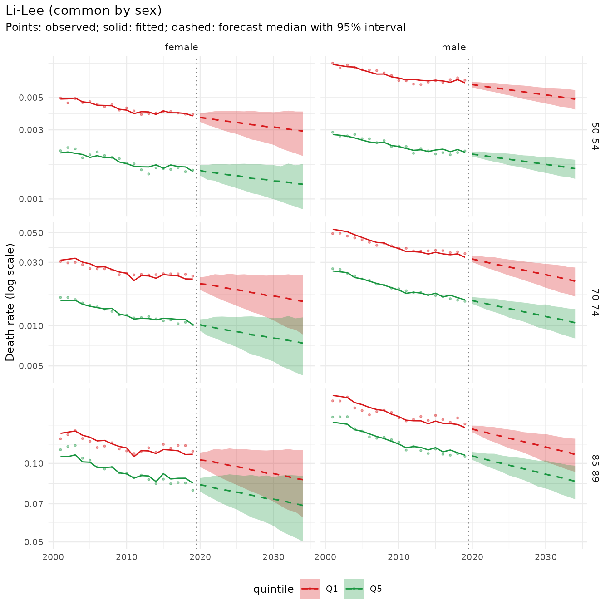
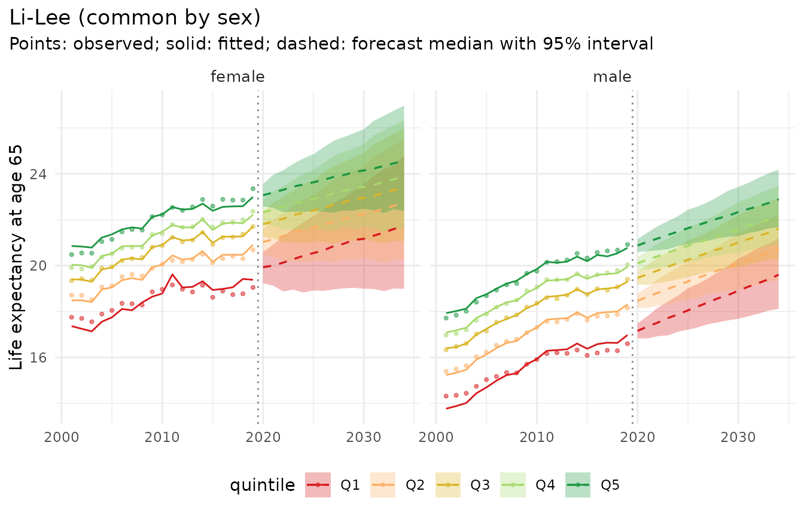
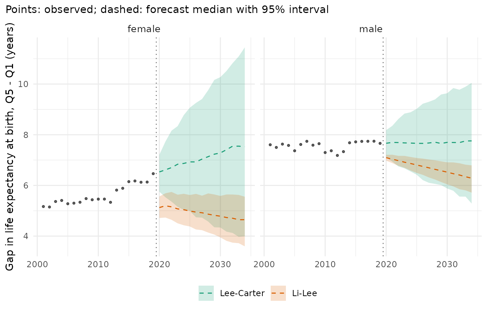
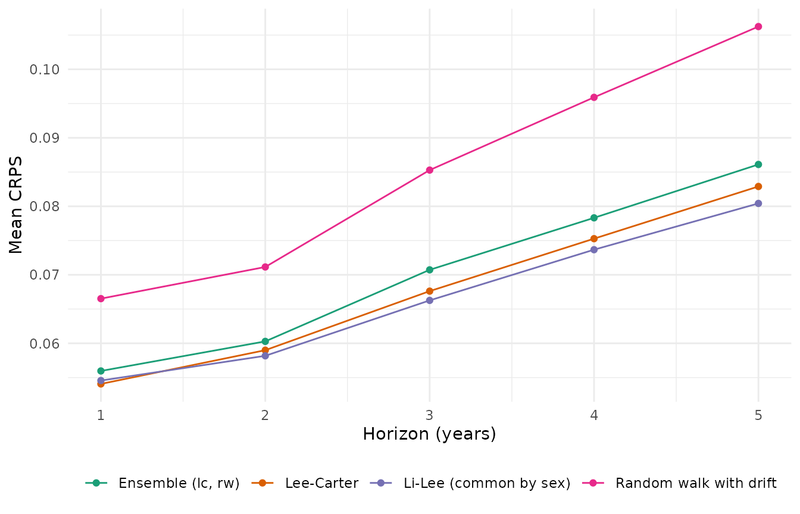
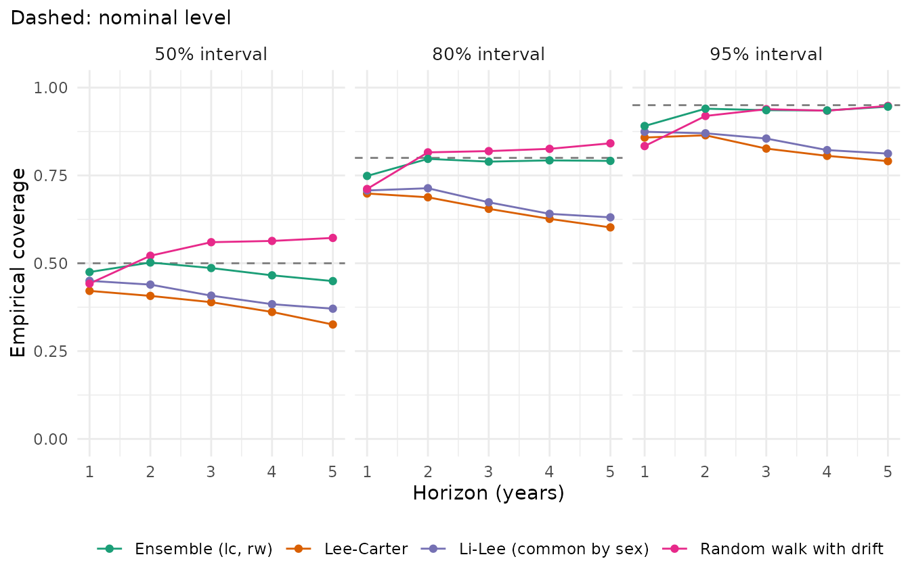

# Getting started with mortensor

*mortensor is experimental software written largely with AI coding
assistants (“vibe-coded”). Use it at your own risk and check results
independently.*

mortensor builds probabilistic mortality forecasts from data observed at
different granularities. A forecast is assembled from interchangeable
parts:

1.  **data** in their original resolution
    ([`mt_data()`](../reference/mt_data.md)), prepared with general
    steps: subsets of ages, years and strata
    ([`mt_subset()`](../reference/mt_subset.md)), aggregation layers
    such as deprivation quintiles or cause groups
    ([`mt_group_levels()`](../reference/mt_group_levels.md)), exposures
    from populations
    ([`mt_as_exposure()`](../reference/mt_as_exposure.md)),
2.  **harmonisation** onto a modelling grid
    ([`mt_ungroup()`](../reference/mt_ungroup.md),
    [`mt_smooth()`](../reference/mt_smooth.md),
    [`mt_regroup()`](../reference/mt_regroup.md)), bundled as a
    preprocessing pipeline ([`mt_prep()`](../reference/mt_prep.md)),
3.  a **model** ([`lee_carter()`](../reference/lee_carter.md),
    [`li_lee()`](../reference/li_lee.md),
    [`rwd()`](../reference/rwd.md),
    [`tucker3()`](../reference/tucker3.md),
    [`apc_bayes()`](../reference/apc_bayes.md), …), fitted with
    [`mt_fit()`](../reference/mt_fit.md) and forecast with
    [`mt_forecast()`](../reference/mt_forecast.md) as simulated paths,
4.  **derived quantities** computed path by path
    ([`life_expectancy()`](../reference/life_expectancy.md),
    [`prob_dying()`](../reference/derived.md),
    [`asr()`](../reference/derived.md)) and their decomposition by age,
    cause and subgroup
    ([`mt_decompose()`](../reference/mt_decompose.md)), and
5.  **evaluation** with rolling-origin backtests
    ([`mt_backtest()`](../reference/mt_backtest.md),
    [`mt_score()`](../reference/mt_score.md)).

This vignette forecasts mortality in England by sex and deprivation.

``` r

library(mortensor)
library(data.table)
```

## Data

`ons_data` holds death registrations and mid-year populations by sex,
5-year age group and decile of the Index of Multiple Deprivation (IMD),
England 2001-2019, from an ONS ad hoc release (Source: Office for
National Statistics licensed under the Open Government Licence v3.0).
Decile 1 is the most deprived.

``` r

head(ons_data[, 1:8])
#>   year    sex age_group imd_decile imd_version population all_causes
#> 1 2001 female        <1          1        2004      35977        307
#> 2 2001 female        <1          2        2004      32042        234
#> 3 2001 female        <1          3        2004      28759        169
#> 4 2001 female        <1          4        2004      27016        152
#> 5 2001 female        <1          5        2004      25451         89
#> 6 2001 female        <1          6        2004      24814         94
#>   breast_cancer
#> 1             0
#> 2             0
#> 3             0
#> 4             0
#> 5             0
#> 6             0
```

[`mt_data()`](../reference/mt_data.md) reads tables in long format, one
row per cell: here the all-cause deaths and the mid-year populations,
with sex and IMD decile as stratum variables (`by`). Age groups such as
`"<1"`, `"01-04"` and `"90+"` are recognised.
[`mt_as_exposure()`](../reference/mt_as_exposure.md) takes the mid-year
population as the person-years at risk:

``` r

x <- mt_data(deaths = ons_data, population = ons_data, by = c("sex", "imd_decile"), age = "age_group",
             value = c(deaths = "all_causes", population = "population"))
x <- mt_as_exposure(x, type = "midyear")
```

Deciles are combined to quintiles with
[`mt_group_levels()`](../reference/mt_group_levels.md), which adds an
aggregation layer to any stratum variable (cause groups, regions,
deprivation): deaths and exposures of deciles 1 and 2 are summed to
quintile 1, and so on. A function maps the deciles to the quintiles, and
`name` labels the new layer:

``` r

x <- mt_group_levels(x, "imd_decile", function(d) paste0("Q", ceiling(as.numeric(d) / 2)), name = "quintile")
x
#> <mt_data> 10 strata by sex, quintile, omega = 110
#>   deaths     mixed widths (1,4,5) 0-89, 90+; periods 2001-2019 (width 1); 3800 cells
#>   exposure   mixed widths (1,4,5) 0-89, 90+; periods 2001-2019 (width 1); 3800 cells
#>   population mixed widths (1,4,5) 0-89, 90+; periods 2001-2019 (width 1); 3800 cells
#>   grid       <mt_axis: age, 20 intervals> 0 1-4 5-9 10-14 ... 80-84 85-89 90+
#>              <mt_axis: period, 19 intervals> 2001 2002 2003 2004 ... 2017 2018 2019
mt_strata(x)
#>     stratum    sex quintile     label
#>       <int> <char>   <char>    <char>
#>  1:       1 female       Q1 female.Q1
#>  2:       2 female       Q2 female.Q2
#>  3:       3 female       Q3 female.Q3
#>  4:       4 female       Q4 female.Q4
#>  5:       5 female       Q5 female.Q5
#>  6:       6   male       Q1   male.Q1
#>  7:       7   male       Q2   male.Q2
#>  8:       8   male       Q3   male.Q3
#>  9:       9   male       Q4   male.Q4
#> 10:      10   male       Q5   male.Q5
```

The deciles are defined by the IMD version current at the time of
registration, so areas move between deciles four times in this period
(column `imd_version` of `ons_data`: 2004, 2007, 2010, 2015 and 2019).

[`mt_validate()`](../reference/mt_validate.md) checks plausibility
(deaths without exposure, rates above 1, missing values, strata without
deaths or exposures, levels that look like totals, gaps in the grid, and
the sums of aggregate strata):

``` r

mt_validate(x)
#> <mt_validation> no findings
```

Observed life expectancy at birth shows the deprivation gradient:

``` r

e0 <- life_expectancy(x)
dcast(e0[period %in% c(2001, 2010, 2019)], sex + quintile ~ period, value.var = "q0.5")[
  , lapply(.SD, function(v) if (is.numeric(v)) round(v, 1) else v)]
#> Key: <sex, quintile>
#>        sex quintile  2001  2010  2019
#>     <char>   <char> <num> <num> <num>
#>  1: female       Q1  77.7  79.5  79.8
#>  2: female       Q2  79.7  81.6  82.5
#>  3: female       Q3  81.0  82.9  83.9
#>  4: female       Q4  82.0  83.8  85.0
#>  5: female       Q5  82.8  84.9  86.3
#>  6:   male       Q1  71.6  74.5  75.4
#>  7:   male       Q2  74.7  77.3  78.6
#>  8:   male       Q3  76.7  79.2  80.6
#>  9:   male       Q4  77.9  80.6  81.8
#> 10:   male       Q5  79.2  81.8  83.1
```

On data, [`life_expectancy()`](../reference/life_expectancy.md)
describes the observed rates with Poisson intervals (columns `q0.025`
and `q0.975`); the table shows the medians.

## Harmonisation

The data have 5-year age groups (with `<1`, `1-4` and `90+`), and the
grid is set to them, so models can be fitted directly. When single years
of age are needed, [`mt_ungroup()`](../reference/mt_ungroup.md)
estimates single-year deaths and exposures with the penalized composite
link model; deaths are ungrouped as rates with the exposures as offset,
and the estimates add up to the observed totals.

``` r

xs <- mt_subset(x, periods = c(2019, 2019))
u <- mt_ungroup(xs)
u
#> <mt_data> 10 strata by sex, quintile, omega = 110
#>   deaths     single years 0-89, 90+; periods 2019-2019 (width 1); 910 cells
#>   exposure   single years 0-89, 90+; periods 2019-2019 (width 1); 910 cells
#>   population mixed widths (1,4,5) 0-89, 90+; periods 2019-2019 (width 1); 200 cells
#>   grid       <mt_axis: age, 91 intervals> 0 1 2 3 ... 88 89 90+
#>              <mt_axis: period, 1 interval> 2019
```

The grid keeps the open interval 90+ of the data: splitting it into
single years would rest on its total alone.

``` r

mt_plot_ungroup(xs, u, period = 2019, strata = c("female.Q1", "female.Q5"))
```


In a forecasting pipeline, ungrouping is a preprocessing step
(`mt_prep(step_ungroup())`), so that backtests refit it on every
training window. Whether it improves forecasts is a question for the
backtest below; here we model the 5-year groups.

## Fitting and forecasting

[`lee_carter()`](../reference/lee_carter.md) fits one model per stratum.
[`li_lee()`](../reference/li_lee.md) adds a common trend: with
`common_by = "sex"` the five quintiles of each sex share one trend, and
their deviations from it follow stationary processes, so the gaps
between quintiles can neither vanish nor explode.

``` r

fit_lc <- mt_fit(lee_carter(), x)
fit_ll <- mt_fit(li_lee(common_by = "sex"), x)
fc_ll <- mt_forecast(fit_ll, h = 15, n_draws = 500, seed = 1)
fc_ll
#> <mt_draws> Li-Lee (common by sex); origin 2019; 20 ages x 15 periods (2020-2034) x 10 strata x 500 draws
```

The forecast holds 500 simulated paths per age, year and stratum.
[`mt_summarise()`](../reference/mt_draws.md) returns means and
quantiles:

``` r

s <- mt_summarise(fc_ll)
s[age == "70-74" & period %in% c(2020, 2034) & quintile %in% c("Q1", "Q5"),
  .(sex, quintile, period, q0.025, q0.5, q0.975)]
#>       sex quintile period      q0.025        q0.5     q0.975
#>    <char>   <char>  <num>       <num>       <num>      <num>
#> 1: female       Q1   2020 0.018573773 0.020674320 0.02313683
#> 2: female       Q1   2034 0.008592021 0.015289518 0.02397031
#> 3: female       Q5   2020 0.009180348 0.010173502 0.01118482
#> 4: female       Q5   2034 0.004239325 0.007402958 0.01156942
#> 5:   male       Q1   2020 0.030048397 0.031722143 0.03336626
#> 6:   male       Q1   2034 0.016567964 0.021632564 0.02741178
#> 7:   male       Q5   2020 0.014600171 0.015474987 0.01643349
#> 8:   male       Q5   2034 0.008034508 0.010540826 0.01336269
```

``` r

mt_plot_forecast(fc_ll, ages = c("50-54", "70-74", "85-89"),
                 strata = c("female.Q1", "female.Q5", "male.Q1", "male.Q5"))
```



## Derived quantities

Life expectancy is computed for every path, so its interval reflects the
joint uncertainty of all ages:

``` r

e0_fc <- life_expectancy(fc_ll, at = 0)
e0_fc[period %in% c(2020, 2034) & quintile %in% c("Q1", "Q5"), .(sex, quintile, period, q0.025, q0.5, q0.975)]
#>       sex quintile period   q0.025     q0.5   q0.975
#>    <char>   <char>  <num>    <num>    <num>    <num>
#> 1: female       Q1   2020 79.98232 80.87661 81.72902
#> 2: female       Q1   2034 79.70041 83.21191 87.14373
#> 3: female       Q5   2020 85.41720 85.99727 86.60943
#> 4: female       Q5   2034 85.19136 87.84302 90.69563
#> 5:   male       Q1   2020 75.64466 76.10026 76.54680
#> 6:   male       Q1   2034 77.41158 79.41642 81.55305
#> 7:   male       Q5   2020 82.83987 83.19343 83.52941
#> 8:   male       Q5   2034 84.19037 85.70021 87.26512
```

``` r

mt_plot_life_expectancy(fc_ll, at = 65)
```



Because the draws are paths, differences between strata carry their own
uncertainty. [`mt_contrast()`](../reference/mt_contrast.md) computes the
gap in life expectancy at birth between the least (Q5) and the most
deprived quintile (Q1), path by path, for Li-Lee and for separate
Lee-Carter models, and for the observed years (with Poisson intervals):

``` r

fc_lc <- mt_forecast(fit_lc, h = 15, n_draws = 500, seed = 1)
gaps <- rbind(mt_contrast(fc_ll, var = "quintile", ref = "Q1", at = 0)[level == "Q5"][, model := "Li-Lee"],
              mt_contrast(fc_lc, var = "quintile", ref = "Q1", at = 0)[level == "Q5"][, model := "Lee-Carter"])
gaps[period %in% c(2020, 2034), .(model, sex, period, q0.025, q0.5, q0.975)]
#>         model    sex period   q0.025     q0.5    q0.975
#>        <char> <char>  <num>    <num>    <num>     <num>
#> 1:     Li-Lee female   2020 4.713791 5.125331  5.562037
#> 2:     Li-Lee female   2034 3.595500 4.647554  5.553060
#> 3:     Li-Lee   male   2020 6.974062 7.094211  7.206043
#> 4:     Li-Lee   male   2034 5.715001 6.284249  6.791622
#> 5: Lee-Carter female   2020 5.753233 6.531984  7.208464
#> 6: Lee-Carter female   2034 3.993687 7.528309 11.447951
#> 7: Lee-Carter   male   2020 7.106714 7.663175  8.183264
#> 8: Lee-Carter   male   2034 5.285351 7.757173 10.046574
observed_gap <- mt_contrast(x, var = "quintile", ref = "Q1", at = 0)[level == "Q5"]
```

``` r

library(ggplot2)
ggplot(gaps, aes(period)) +
  geom_ribbon(aes(ymin = q0.025, ymax = q0.975, fill = model), alpha = 0.2) +
  geom_line(aes(y = q0.5, colour = model), linetype = "dashed") +
  geom_point(data = observed_gap, aes(y = q0.5), size = 0.8, alpha = 0.6) +
  geom_vline(xintercept = 2019.5, linetype = "dotted", colour = "grey50") +
  facet_wrap(~ sex) +
  scale_colour_mortensor(type = "categorical") +
  scale_fill_mortensor(type = "categorical") +
  labs(x = NULL, y = "Gap in life expectancy at birth, Q5 - Q1 (years)", colour = NULL, fill = NULL,
       subtitle = "Points: observed; dashed: forecast median with 95% interval") +
  theme_mortensor()
```



The two models make different assumptions, and the data cannot decide
between them. The observed gap was stable for men and widened for women,
with a step in 2013, when the deciles switched to IMD 2015. Separate
Lee-Carter models extrapolate each quintile’s own trend, so the female
gap keeps widening, with wide intervals. Li-Lee lets the quintiles
deviate from a common trend only through stationary processes, so gaps
return towards their average of the training years. Its forecasts also
start from the fitted rates of 2019, which for women in Q1 are about 0.4
years of life expectancy above the observed ones.
`li_lee(jump_off = "observed")` removes this step, but in backtests on
these data it forecast worse (CRPS 0.071 against 0.067).

Other quantities work the same way, for example the probability of dying
between ages 40 and 75 and age-standardised rates (European Standard
Population 2013):

``` r

prob_dying(fc_ll, from = 40, to = 75)[period == 2034 & quintile %in% c("Q1", "Q5"),
                                      .(sex, quintile, q0.025, q0.5, q0.975)]
#>       sex quintile     q0.025       q0.5    q0.975
#>    <char>   <char>      <num>      <num>     <num>
#> 1: female       Q1 0.12793903 0.19597011 0.2711846
#> 2: female       Q5 0.06053106 0.09411311 0.1336645
#> 3:   male       Q1 0.23357345 0.28033008 0.3287580
#> 4:   male       Q5 0.10323963 0.12711076 0.1529341
asr(fc_ll)[period == 2034 & quintile %in% c("Q1", "Q5"), .(sex, quintile, q0.025, q0.5, q0.975)]
#>       sex quintile   q0.025      q0.5    q0.975
#>    <char>   <char>    <num>     <num>     <num>
#> 1: female       Q1 555.5445  802.2508 1088.1373
#> 2: female       Q5 388.2925  535.1839  706.5104
#> 3:   male       Q1 892.6927 1064.9272 1250.9199
#> 4:   male       Q5 566.6843  666.9886  774.8543
```

## Honest backtests

[`mt_backtest()`](../reference/mt_backtest.md) cuts the data at each
forecast origin, refits the preprocessing and the model on the training
window, and scores predictive draws against the observed deaths. Here
the forecasts from origins 2008 to 2014 are scored on 2009 to 2019.

``` r

origins <- 2008:2014
specs <- list(lee_carter(), li_lee(common_by = "sex"), rwd(),
              ensemble(lc = lee_carter(), rw = rwd()))
bt <- rbindlist(lapply(specs, function(sp) mt_backtest(sp, x, origins = origins, h = 5, n_draws = 200)))
mt_score(bt, by = "model")
#>                     model       crps        wis        mae     mase     cov50
#>                    <char>      <num>      <num>      <num>    <num>     <num>
#> 1:             Lee-Carter 0.06777174 0.06095879 0.09395225 1.357161 0.3810000
#> 2: Li-Lee (common by sex) 0.06661856 0.05973344 0.09266528 1.447387 0.4102857
#> 3: Random walk with drift 0.08502155 0.07617632 0.11484454 1.530626 0.5318571
#> 4:      Ensemble (lc, rw) 0.07028030 0.06304565 0.09627202 1.368822 0.4757143
#>        cov80     cov95  pit_mean     n     unit
#>        <num>     <num>     <num> <int>   <char>
#> 1: 0.6540000 0.8290000 0.5552149  7000 log rate
#> 2: 0.6731429 0.8467143 0.5585903  7000 log rate
#> 3: 0.8027143 0.9147143 0.5763921  7000 log rate
#> 4: 0.7838571 0.9294286 0.5662695  7000 log rate
```

Lower CRPS and WIS are better; `cov50`, `cov80` and `cov95` are the
shares of observations inside the central 50%, 80% and 95% intervals.
Li-Lee is the most accurate; like Lee-Carter its intervals are too
narrow, while the mixture of Lee-Carter and the random walk is close to
nominal coverage at a small cost in accuracy.

``` r

mt_plot_scores(bt, by = "horizon")
```



``` r

mt_plot_coverage(bt)
```



## Where next

- “Forecasting mortality by deprivation quintile”: gaps between
  quintiles, backtests by quintile, calibration of the intervals on the
  last ten years.
- “Coherent forecasts: what reconciliation changes”: forecasts that add
  up over strata (quintiles and sexes to England), method by method.
- “Decomposing differences in life expectancy”: the ages, causes and
  subgroup composition behind gaps and changes, observed and forecast.
- “Causes of death by deprivation”: cause-specific forecasts that add up
  to all causes, on the same ONS data.
- “Coherent forecasts by sex, region and cause”: the 16 German Laender,
  with suppressed cells, pooling and smoothing of sparse cause-specific
  data.
- “Your own data, from CSV to report”: reading official exports with
  their peculiarities, and a report from them.
- “Data at different granularities: ungrouping HMD data”: ungrouping and
  its accuracy on HMD data with known single-year rates.
- “Forecasting and backtesting with HMD data”, “Bayesian
  age-period-cohort models with bamp” and “Comparison with demography,
  bamp and StMoMo”.
- “Model reference” and “Frequently asked questions”.
