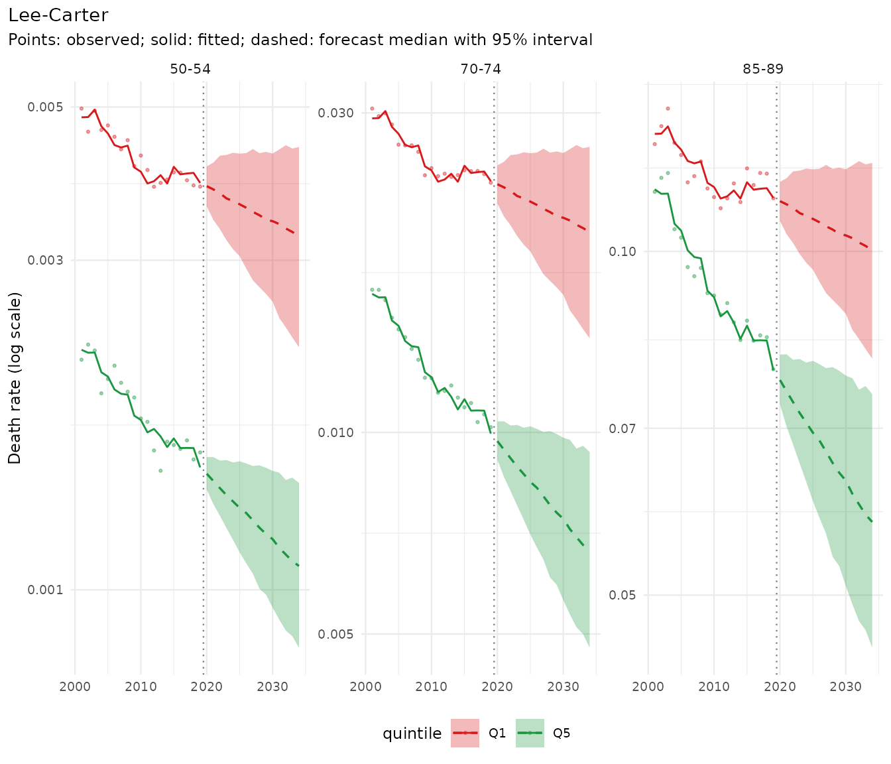
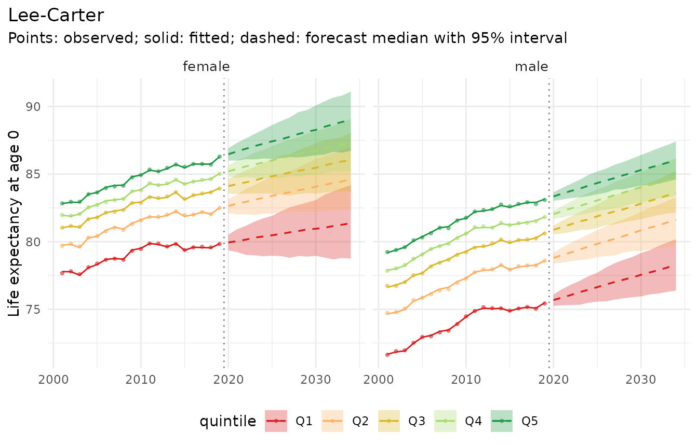
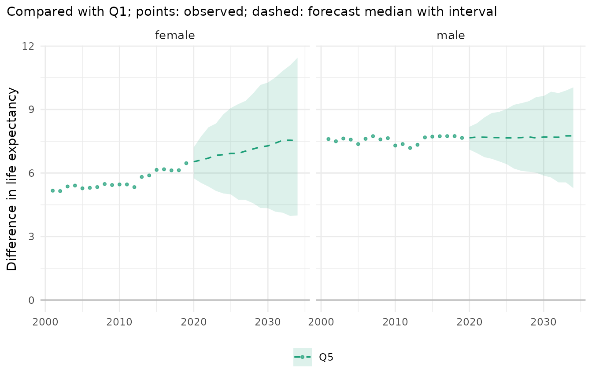

# Getting started with mortensor

*mortensor is experimental software written largely with AI coding
assistants (“vibe-coded”). Use it at your own risk and check results
independently.*

mortensor builds probabilistic mortality forecasts: simulated paths of
future death rates, from which life expectancy, gaps between groups and
other quantities follow with their uncertainty. Any model can be used,
implemented in the package or wrapped from demography, StMoMo, StanMoMo
or bamp, and models can be combined. This vignette goes once through the
main steps with one simple model; the other vignettes take one step at a
time.

``` r

library(mortensor)
library(data.table)
```

## 1. Data

`ons_data` holds deaths and mid-year populations in England by sex,
5-year age group and decile of the Index of Multiple Deprivation (decile
1 most deprived), 2001-2019 (Source: Office for National Statistics,
licensed under the Open Government Licence v3.0).
[`mt_data()`](../reference/mt_data.md) reads them,
[`mt_as_exposure()`](../reference/mt_as_exposure.md) takes the mid-year
populations as person-years at risk, and
[`mt_group_levels()`](../reference/mt_group_levels.md) combines the
deciles into quintiles:

``` r

x <- mt_data(deaths = ons_data, population = ons_data, by = c("sex", "imd_decile"), age = "age_group",
             value = c(deaths = "all_causes", population = "population"))
x <- mt_as_exposure(x, type = "midyear")
x <- mt_group_levels(x, "imd_decile", function(d) paste0("Q", ceiling(as.numeric(d) / 2)), name = "quintile")
x
#> <mt_data> 10 strata by sex, quintile, omega = 110
#>   deaths     mixed widths (1,4,5) 0-89, 90+; periods 2001-2019 (width 1); 3800 cells
#>   exposure   mixed widths (1,4,5) 0-89, 90+; periods 2001-2019 (width 1); 3800 cells
#>   population mixed widths (1,4,5) 0-89, 90+; periods 2001-2019 (width 1); 3800 cells
#>   grid       <mt_axis: age, 20 intervals> 0 1-4 5-9 10-14 ... 80-84 85-89 90+
#>              <mt_axis: period, 19 intervals> 2001 2002 2003 2004 ... 2017 2018 2019
```

[`mt_validate()`](../reference/mt_validate.md) checks the data for
impossible values, gaps and inconsistent totals:

``` r

mt_validate(x)
#> <mt_validation> no findings
```

## 2. The past

Life expectancy at birth by quintile, with Poisson intervals:

``` r

mt_compare_forecasts(list(observed = x), periods = c(2001, 2019), strata = c("female.Q1", "female.Q5",
                                                                              "male.Q1", "male.Q5"))
#> Key: <label, period>
#>        label period         observed
#>       <char>  <num>           <char>
#> 1: female.Q1   2001 77.7 (77.5-77.8)
#> 2: female.Q1   2019 79.8 (79.7-79.9)
#> 3: female.Q5   2001 82.8 (82.7-83.0)
#> 4: female.Q5   2019 86.3 (86.2-86.4)
#> 5:   male.Q1   2001 71.6 (71.5-71.8)
#> 6:   male.Q1   2019 75.4 (75.3-75.5)
#> 7:   male.Q5   2001 79.2 (79.1-79.4)
#> 8:   male.Q5   2019 83.1 (83.0-83.2)
```

## 3. A model and a forecast

Lee-Carter, fitted to each sex and quintile separately, as a simple
example. [`mt_forecast()`](../reference/mt_forecast.md) simulates 500
paths of future death rates:

``` r

fit <- mt_fit(lee_carter(), x)
fc <- mt_forecast(fit, h = 15, n_draws = 500, seed = 1)
fc
#> <mt_draws> Lee-Carter; origin 2019; 20 ages x 15 periods (2020-2034) x 10 strata x 500 draws
```

``` r

mt_plot_forecast(fc, ages = c("50-54", "70-74", "85-89"), strata = c("female.Q1", "female.Q5"))
```



## 4. Results

Life expectancy is computed for every path, so its interval contains the
uncertainty of all ages together:

``` r

mt_plot_life_expectancy(fc, at = 0)
```



The gap between the least (Q5) and the most deprived quintile (Q1), also
path by path:

``` r

gap <- mt_contrast(fc, var = "quintile", ref = "Q1", at = 0)
mt_plot_contrast(gap, observed = mt_contrast(x, var = "quintile", ref = "Q1"), levels = "Q5")
```



Separate Lee-Carter models continue each quintile’s own trend, so the
female gap, which widened after 2011, keeps widening, with intervals
that grow quickly. Whether that is plausible is a question of model
choice (“Choosing and combining models”); a model that pools the
quintiles behaves differently.

Other quantities work the same way: [`asr()`](../reference/derived.md)
(age-standardised rates), [`prob_dying()`](../reference/derived.md),
[`mt_inequality()`](../reference/mt_inequality.md) (slope and relative
index of inequality), [`mt_decompose()`](../reference/mt_decompose.md)
(contributions of ages and causes to a gap).

## 5. Was the model any good?

A backtest fits the model to the years up to 2008, …, 2014, forecasts
five years from each, and scores the forecasts against the observed
rates:

``` r

bt <- mt_compare(list("Lee-Carter" = lee_carter()), x, origins = 2008:2014, h = 5, n_draws = 200)
mt_score_table(bt, metrics = c("crps", "cov80", "cov95"))
#>         model   crps cov80 cov95
#>        <fctr>  <num> <num> <num>
#> 1: Lee-Carter 0.0683 0.617 0.793
```

The 95% intervals contained 79% of the observed rates, fewer than 95%:
Lee-Carter’s intervals are too narrow on these data. “Backtesting and
scores” explains the scores, “Tuning and recalibration” how to widen the
intervals.

## Where next

| Step | Vignette |
|----|----|
| Your own tables | “Your own data, from CSV to report” |
| Age groups and single years | “Ungrouping age groups: methods and diagnostics” |
| Smoothing | “Smoothing death rates” |
| Where a forecast starts | “Where a forecast starts: the jump-off” |
| Scores and backtests | “Backtesting and scores” |
| Choosing settings, widening intervals | “Tuning and recalibration” |
| Models and ensembles | “Choosing and combining models”, “Model reference” |
| Published sources of the methods | “Methods and sources” (package website) |
| Totals and parts | “Coherent forecasts” |
| What drives a gap | “Decomposing differences in life expectancy” |
| How unequal lifespans are | “Lifespan variation” |
| Deaths above the expected | “Excess mortality” |
| Complete analyses | “Inequality in England”, “Differences between the German Laender” |
