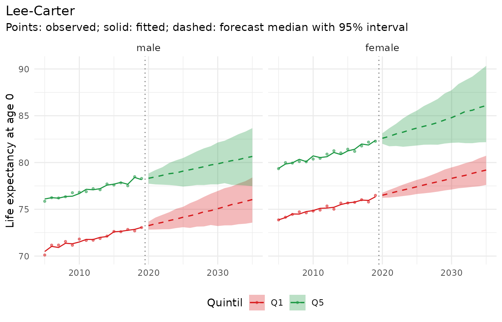

# Your own data, from CSV to report

This vignette goes from files as a statistical office publishes them to
a report with forecasts, observed indicators and inequality measures.
The files are simulated, with the peculiarities of real exports: German
column names and age labels, sexes coded 1 and 2, small counts
suppressed as `"."`, zeros written as `"-"`, rows with totals over all
ages, and populations on 31 December.

``` r

library(mortensor)
library(data.table)
```

## The files

The code below writes two CSV files (semicolon-separated, as in many
European exports). With your own data, you start from your files.

``` r

set.seed(42)
ages <- c("unter 1 Jahr", "1 bis unter 5 Jahre", paste(seq(5, 85, 5), "bis unter", seq(10, 90, 5), "Jahre"),
          "90 Jahre und mehr")
lo <- c(0, 1, seq(5, 90, 5))
g <- CJ(Jahr = 2005:2022, Geschlecht = 1:2, Quintil = 1:5, k = seq_along(ages))
g[, Altersgruppe := ages[k]]
g[, bev := round(4e4 * exp(-lo[k] / 45) * (1 + 0.1 * (Quintil == 1)))]
g[, rate := exp(-10.1 + 0.09 * (lo[k] + 2) + 0.3 * (Geschlecht == 1) + 0.12 * (5 - Quintil) - 0.015 * (Jahr - 2005))]
g[k == 1, rate := 0.004]
g[Jahr %in% 2020:2022, rate := rate * 1.12]                 # pandemic years
g[, Gestorbene := rpois(.N, bev * pmin(rate, 0.7))]
deaths <- g[, .(Jahr, Geschlecht, Quintil, Altersgruppe,
                Gestorbene = ifelse(Gestorbene == 0, "-", ifelse(Gestorbene < 3, ".", Gestorbene)))]
totals <- g[, .(Altersgruppe = "Insgesamt", Gestorbene = as.character(sum(Gestorbene))),
            by = .(Jahr, Geschlecht, Quintil)]
deaths <- rbind(deaths, totals)
pop <- g[, .(Stichtag = Jahr, Geschlecht, Quintil, Altersgruppe, Bevoelkerung = bev)]
pop <- rbind(pop[Stichtag == 2005][, Stichtag := 2004], pop)   # 31 December of the year before
f_deaths <- file.path(tempdir(), "gestorbene.csv")
f_pop <- file.path(tempdir(), "bevoelkerung.csv")
fwrite(deaths, f_deaths, sep = ";")
fwrite(pop, f_pop, sep = ";")
```

## Reading

[`read.csv2()`](https://rdrr.io/r/utils/read.table.html) reads
semicolon-separated files; reading every column as text keeps symbols
such as `"."` intact. [`mt_data()`](../reference/mt_data.md) then gets
the names of the columns: stratum variables (`by`), age, period and the
value of each table.

``` r

d <- read.csv2(f_deaths, colClasses = "character")
p <- read.csv2(f_pop, colClasses = "character")
head(d)
#>   Jahr Geschlecht Quintil          Altersgruppe Gestorbene
#> 1 2005          1       1          unter 1 Jahr        194
#> 2 2005          1       1   1 bis unter 5 Jahre          4
#> 3 2005          1       1  5 bis unter 10 Jahre          9
#> 4 2005          1       1 10 bis unter 15 Jahre         10
#> 5 2005          1       1 15 bis unter 20 Jahre         13
#> 6 2005          1       1 20 bis unter 25 Jahre         13
```

The population table names the year `Stichtag`, so it is added with
[`mt_add_population()`](../reference/mt_add.md) and its own column
names:

``` r

x <- mt_data(deaths = d, by = c("Geschlecht", "Quintil"), age = "Altersgruppe", period = "Jahr",
             value = "Gestorbene")
#> Warning in ingest_obs(x, by, age, period, value, measure, age_open, missing =
#> missing, : 180 row(s) of the deaths table with age or period labelled as a
#> total ("Insgesamt") are left out.
#> Warning in ingest_obs(x, by, age, period, value, measure, age_open, missing =
#> missing, : 142 missing deaths value(s) left out; suppressed counts can be
#> estimated with mt_fill_suppressed().
x <- mt_add_population(x, p, age = "Altersgruppe", period = "Stichtag", value = "Bevoelkerung")
x
#> <mt_data> 10 strata by Geschlecht, Quintil, omega = 110
#>   deaths     mixed widths (1,4,5) 0-89, 90+; periods 2005-2022 (width 1); 3458 cells
#>   population mixed widths (1,4,5) 0-89, 90+; periods 2004-2022 (width 1); 3800 cells
#>   grid       <mt_axis: age, 20 intervals> 0 1-4 5-9 10-14 ... 80-84 85-89 90+
#>              <mt_axis: period, 19 intervals> 2004 2005 2006 2007 ... 2020 2021 2022
```

The warnings report what [`mt_data()`](../reference/mt_data.md) did with
the peculiarities: rows labelled `"Insgesamt"` (totals over all ages)
are left out, `"-"` is read as zero and the suppressed cells (`"."`) as
missing.

## Preparing

Each step is a decision; the functions make it explicit.

``` r

x <- mt_relabel(x, "Geschlecht", c("1" = "male", "2" = "female"))
x <- mt_relabel(x, "Quintil", c("1" = "Q1", "2" = "Q2", "3" = "Q3", "4" = "Q4", "5" = "Q5"))
x <- mt_as_exposure(x, type = "dec31")      # populations on 31 December
mt_validate(x)
#> <mt_validation> 1 finding(s): 0 error, 0 warning, 1 info
#>   [info] grid coverage (deaths, all, n = 142): grid cells not covered by observations
```

Without published totals, suppressed counts are estimated within the
range that the suppression rule implies (here 1 or 2 deaths), as
expected deaths at the pooled rate of the age group and year:

``` r

x <- mt_fill_suppressed(x, lower = 1, upper = 2)
attr(x, "fill")
#>    filled missing inconsistent iterations max_gap
#>     <int>   <int>        <int>      <int>   <num>
#> 1:    142       0            0          0       0
```

The pandemic years 2020-2022 are left out of the fitting period:

``` r

x <- mt_subset(x, periods = c(2005, 2019))
```

## The past: observed indicators

Life expectancy, age-standardised rates and the gap between quintiles
are computed from the observed rates; the intervals reflect Poisson
variation of the death counts.

``` r

e0 <- life_expectancy(x)
e0[period == 2019, .(Geschlecht, Quintil, q0.025, q0.5, q0.975)]
#>     Geschlecht Quintil   q0.025     q0.5   q0.975
#>         <char>  <char>    <num>    <num>    <num>
#>  1:       male      Q1 72.54543 73.04539 73.51449
#>  2:       male      Q2 74.09485 74.56581 75.04868
#>  3:       male      Q3 74.85565 75.37452 75.93295
#>  4:       male      Q4 76.61382 77.15026 77.65594
#>  5:       male      Q5 77.76514 78.29824 78.77255
#>  6:     female      Q1 76.02923 76.48933 76.95673
#>  7:     female      Q2 77.32803 77.79383 78.30203
#>  8:     female      Q3 79.20649 79.72020 80.29379
#>  9:     female      Q4 79.45129 80.06467 80.59933
#> 10:     female      Q5 81.76054 82.30710 82.86119
gap <- mt_contrast(x, var = "Quintil", ref = "Q5")
gap[period == 2019 & level == "Q1"]
#>    Geschlecht  level    ref period      mean    q0.025      q0.5    q0.975
#>        <char> <char> <char>  <num>     <num>     <num>     <num>     <num>
#> 1:       male     Q1     Q5   2019 -5.256117 -5.983747 -5.245298 -4.533949
#> 2:     female     Q1     Q5   2019 -5.808297 -6.503961 -5.804167 -5.091491
#>    p_positive        quantity       type
#>         <num>          <char>     <char>
#> 1:          0 life_expectancy difference
#> 2:          0 life_expectancy difference
mt_inequality(x, "Quintil", order = paste0("Q", 5:1), quantity = "life_expectancy")[period == 2019]
#>    Geschlecht  index period       mean     q0.025       q0.5     q0.975
#>        <char> <char>  <num>      <num>      <num>      <num>      <num>
#> 1:       male    sii   2019 -6.6178416 -7.4097300 -6.6029343 -5.7903053
#> 2:       male    rii   2019  0.9161847  0.9065701  0.9163918  0.9263074
#> 3:     female    sii   2019 -7.0098431 -7.7955650 -7.0266418 -6.1376267
#> 4:     female    rii   2019  0.9152828  0.9062260  0.9150688  0.9253027
#>           quantity
#>             <char>
#> 1: life_expectancy
#> 2: life_expectancy
#> 3: life_expectancy
#> 4: life_expectancy
```

## Choosing a model

Three candidates are compared in a backtest with three forecast origins
and five years ahead: Lee-Carter per stratum; Li-Lee with a common trend
per sex, which keeps the quintiles from diverging; and an ensemble of
Lee-Carter and random walks that are robust to small counts.

``` r

cand <- list("Lee-Carter" = lee_carter(), "Li-Lee" = li_lee(common_by = "Geschlecht"),
             "Lee-Carter + random walk" = ensemble(lc = lee_carter(), rw = rwd(observation_noise = TRUE)))
bt <- mt_compare(cand, x, origins = 2012:2014, h = 5, n_draws = 200)
#> Warning in check_draws_plausible(arr, fit$age, fit$strata, spec$label):
#> Lee-Carter: forecast death rates above 1 in 22.0% of the draws (strata
#> female.Q3; ages 10-14). The model is unstable here, often because of sparse
#> counts or a steep trend extrapolated far ahead; consider wider age groups
#> (mt_regroup()), pooling (li_lee(common_by = )), smoothing (step_smooth()) or an
#> ensemble.
#> Warning in check_draws_plausible(arr, fit$age, fit$strata, spec$label):
#> Lee-Carter: forecast death rates above 1 in 4.5% of the draws (strata
#> female.Q3; ages 10-14). The model is unstable here, often because of sparse
#> counts or a steep trend extrapolated far ahead; consider wider age groups
#> (mt_regroup()), pooling (li_lee(common_by = )), smoothing (step_smooth()) or an
#> ensemble.
#> Warning in check_draws_plausible(arr, fit$age, fit$strata, spec$label):
#> Lee-Carter: forecast death rates above 1 in 22.0% of the draws (strata
#> female.Q3; ages 10-14). The model is unstable here, often because of sparse
#> counts or a steep trend extrapolated far ahead; consider wider age groups
#> (mt_regroup()), pooling (li_lee(common_by = )), smoothing (step_smooth()) or an
#> ensemble.
#> Warning in check_draws_plausible(arr, fit$age, fit$strata, spec$label):
#> Lee-Carter: forecast death rates above 1 in 4.5% of the draws (strata
#> female.Q3; ages 10-14). The model is unstable here, often because of sparse
#> counts or a steep trend extrapolated far ahead; consider wider age groups
#> (mt_regroup()), pooling (li_lee(common_by = )), smoothing (step_smooth()) or an
#> ensemble.
scores <- mt_score_table(bt, metrics = c("crps", "cov95"))
scores
#>                       model  crps cov95
#>                      <fctr> <num> <num>
#> 1:               Lee-Carter 0.147 0.921
#> 2:                   Li-Lee 0.167 0.898
#> 3: Lee-Carter + random walk 0.150 0.936
```

Warnings about implausible rates in some backtest fits point to young
age groups with few deaths. The model with the lowest CRPS (the rows
follow the order of the list) is used for the forecast:

``` r

best <- cand[[which.min(scores$crps)]]
best$label
#> [1] "Lee-Carter"
```

## Forecasting

``` r

fit <- mt_fit(best, x)
summary(fit)
#> Lee-Carter
#>   data: 10 strata; ages 0 to 90+; periods 2005-2019
#>   model and uncertainty:
#>     log m(x,t) = a(x) + b(x) k(t), estimated by Poisson maximum likelihood
#>     (Brouhns et al. 2002; Lee and Carter 1992). k(t) follows a random walk with
#>     drift; draws include its innovations and the uncertainty of the drift. a(x)
#>     and b(x) are fixed (parameter uncertainty with bootstrapped()). Jump-off:
#>     fitted rates.
#>   fit: Poisson deviance 2444.4 on 3000 cells (0.81 per cell); 2.8% of deviance residuals beyond +/-2
fc <- mt_forecast(fit, to = 2035, n_draws = 500, seed = 1)
e0_fc <- life_expectancy(fc)
e0_fc[period == 2035, .(Geschlecht, Quintil, q0.025, q0.5, q0.975)]
#>     Geschlecht Quintil   q0.025     q0.5   q0.975
#>         <char>  <char>    <num>    <num>    <num>
#>  1:       male      Q1 73.57374 76.03999 78.39900
#>  2:       male      Q2 74.60033 77.18183 80.10067
#>  3:       male      Q3 75.40007 77.73687 80.69338
#>  4:       male      Q4 76.87715 79.84113 83.15670
#>  5:       male      Q5 77.47300 80.64732 83.67783
#>  6:     female      Q1 77.60533 79.19567 80.72109
#>  7:     female      Q2 78.11247 80.55551 83.13545
#>  8:     female      Q3 77.51242 83.08963 90.00569
#>  9:     female      Q4 78.87688 82.59816 87.23809
#> 10:     female      Q5 82.17562 86.08796 90.33716
mt_contrast(fc, var = "Quintil", ref = "Q5")[period == 2035 & level == "Q1"]
#>    Geschlecht  level    ref period      mean     q0.025      q0.5     q0.975
#>        <char> <char> <char>  <num>     <num>      <num>     <num>      <num>
#> 1:       male     Q1     Q5   2035 -4.658111  -8.527998 -4.674236 -0.7185934
#> 2:     female     Q1     Q5   2035 -6.920323 -11.364036 -6.920468 -2.6235216
#>    p_positive        quantity       type
#>         <num>          <char>     <char>
#> 1:      0.012 life_expectancy difference
#> 2:      0.000 life_expectancy difference
```

``` r

mt_plot_life_expectancy(fc, facet = "Geschlecht", strata = c("male.Q1", "male.Q5", "female.Q1", "female.Q5"))
```



## Report tables

[`mt_export()`](../reference/mt_export.md) writes any of these tables,
or the forecast draws, as CSV:

``` r

f <- mt_export(e0_fc, tempdir(), file = "e0_forecast.csv", digits = 4)
head(read.csv(f), 3)
#>   stratum Geschlecht Quintil   label period  mean q0.025  q0.1  q0.5  q0.9
#> 1       1       male      Q1 male.Q1   2020 73.25  72.83 72.96 73.26 73.54
#> 2       1       male      Q1 male.Q1   2021 73.44  72.84 73.01 73.45 73.88
#> 3       1       male      Q1 male.Q1   2022 73.61  72.86 73.09 73.60 74.14
#>   q0.975 at
#> 1  73.68  0
#> 2  74.12  0
#> 3  74.41  0
```

## What to check in your own data

- the warnings of [`mt_data()`](../reference/mt_data.md): totals,
  unknown ages, symbols that are not declared, levels that differ
  between tables (for example `"F"` and `"female"`);
- [`mt_validate()`](../reference/mt_validate.md): impossible values,
  missing cells, levels that are totals of other levels;
- the type of the population counts in
  [`mt_as_exposure()`](../reference/mt_as_exposure.md);
- warnings of [`mt_fit()`](../reference/mt_fit.md) and
  [`mt_forecast()`](../reference/mt_forecast.md) about sparse counts and
  implausible rates, and `summary(fit)`.
