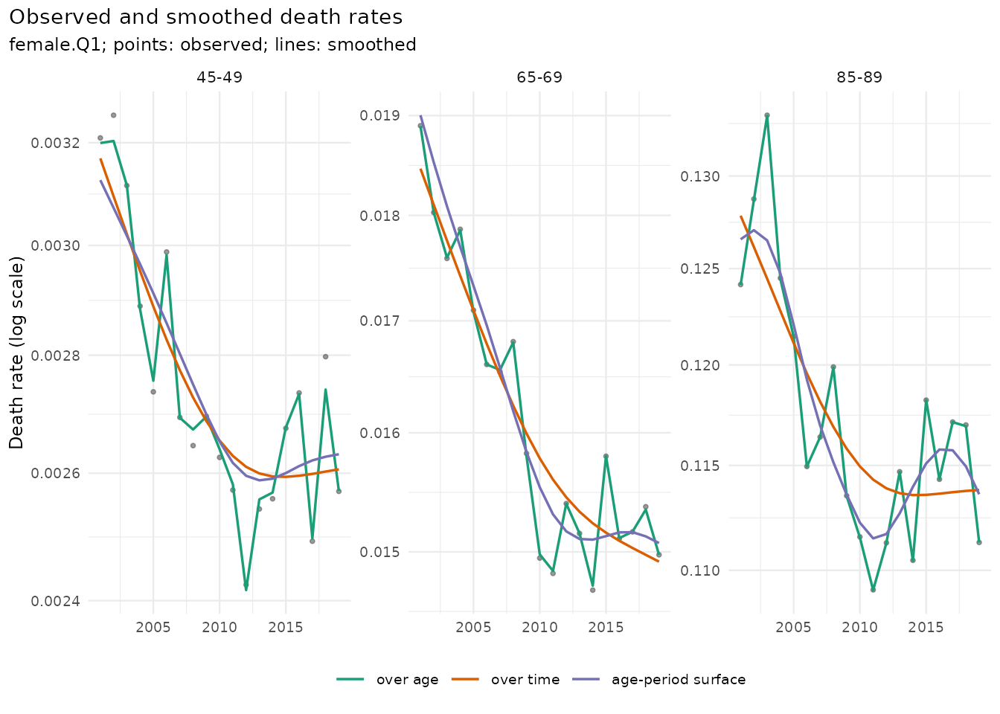
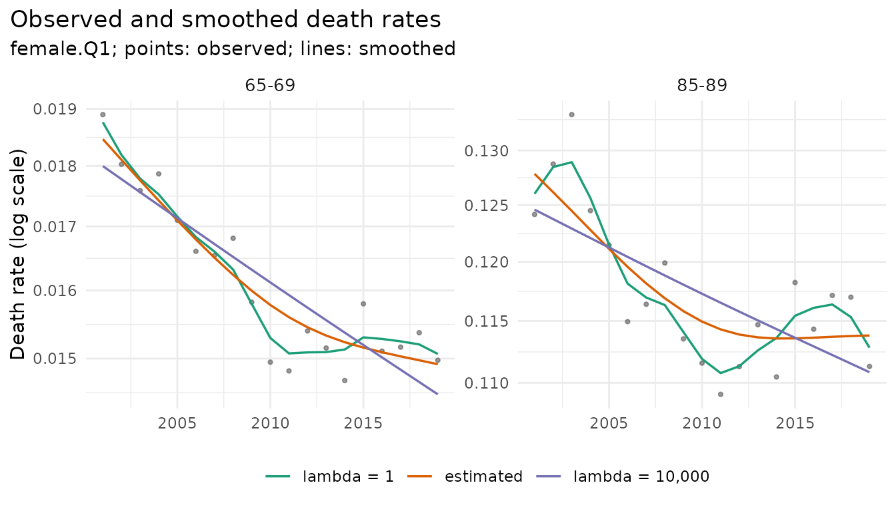
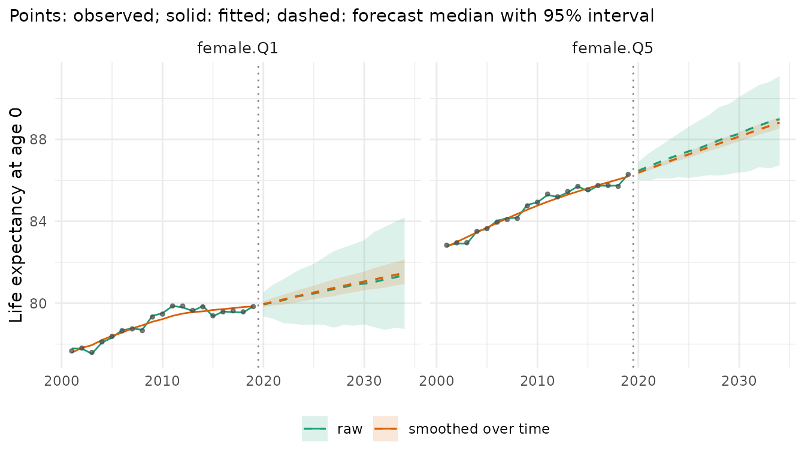

# Smoothing death rates

Observed death rates are a trend plus random variation: Poisson noise of
the death counts, and transient year effects such as a strong influenza
season. Smoothing estimates the trend. This vignette compares the
smoothing methods of mortensor on one data set, shows how much each one
smooths, and what smoothing does to a forecast. The forecasts use
Lee-Carter as a simple, well-known model; any other model works the same
way (see “Choosing and combining models”).

## Data

Deaths and mid-year populations in England by sex and deprivation
quintile (Index of Multiple Deprivation; Q1 most deprived), 5-year age
groups, 2001-2019 (ONS, Open Government Licence):

``` r

library(mortensor)
library(data.table)
x <- mt_data(deaths = ons_data, population = ons_data, by = c("sex", "imd_decile"), age = "age_group",
             value = c(deaths = "all_causes", population = "population"))
x <- mt_as_exposure(x, type = "midyear")
x <- mt_group_levels(x, "imd_decile", function(d) paste0("Q", ceiling(as.numeric(d) / 2)), name = "quintile")
```

## Three directions

[`mt_smooth()`](../reference/mt_smooth.md) smooths in one of three
directions:

- **over age**, each year separately (Poisson P-splines): removes noise
  between neighbouring ages, keeps every year as observed;
- **over time**, each age separately (Whittaker smoothing of the log
  rates): removes the year-to-year variation, keeps the age pattern of
  every year;
- **the age-period surface** (an additive model with a tensor-product
  spline `te(age, year)`, package mgcv): both at once.

``` r

sm <- list("over age" = mt_smooth(x),
           "over time" = mt_smooth(x, along = "period", method = "whittaker"),
           "age-period surface" = mt_smooth(x, dims = 2, method = "gam"))
```

``` r

mt_plot_smooth(x, sm, ages = c("45-49", "65-69", "85-89"), strata = "female.Q1")
```



The points are the observed rates of women in Q1. Smoothing over age
leaves almost all of the year-to-year variation, because with 5-year age
groups the neighbouring ages already agree closely; it matters for
single years of age and sparse data (small areas, causes of death).
Smoothing over time and the surface remove the year-to-year variation
and keep the trend, including the end of the decline after 2011. The
surface follows the last years a little more closely.

## How much was removed

[`mt_smooth_check()`](../reference/mt_smooth_check.md) compares the
smoothed with the observed rates:

- `dispersion`: variance of the observed deaths around the smoothed
  ones, relative to Poisson variance. About 1 means the smoother removed
  Poisson noise only; above 1 means it also removed year effects; well
  below 1 means it followed the noise.
- `trend_ratio`: variance of the year-to-year changes of the smoothed
  rates relative to the observed ones. Small values mean that most of
  the annual variation was removed.

``` r

chk <- rbindlist(lapply(names(sm), function(n) mt_smooth_check(x, sm[[n]])[, method := n]))
chk[, .(dispersion = round(mean(dispersion), 2), trend_ratio = round(mean(trend_ratio), 3)), by = method]
#>                method dispersion trend_ratio
#>                <char>      <num>       <num>
#> 1:           over age       0.49       0.860
#> 2:          over time       2.18       0.028
#> 3: age-period surface       2.05       0.052
```

Over age, the dispersion is below 1: with 20 age groups per year the
spline stays close to the points. Over time and on the surface, the
observed deaths vary about twice as much as Poisson noise around the
trend: the years differ by more than chance, and smoothing treats these
year effects as noise. Whether that is right depends on the question.
For the trend that a forecast continues, it usually is.

## How smooth: the smoothing parameter

Every smoother has a parameter that sets how closely it follows the
data. By default it is estimated from the data: by BIC for the P-splines
over age, by generalised cross-validation for smoothing over time (one
value per stratum, the same smoothness at every age), and by REML for
the surface. It can also be set by hand (`lambda`):

``` r

lam <- list("lambda = 1" = mt_smooth(x, along = "period", method = "whittaker", lambda = 1),
            "estimated" = sm[["over time"]],
            "lambda = 10,000" = mt_smooth(x, along = "period", method = "whittaker", lambda = 1e4))
mt_plot_smooth(x, lam, ages = c("65-69", "85-89"), strata = "female.Q1")
```



A small value follows the noise, a large one approaches a straight line.
When the choice matters for the forecast, it can be made by forecast
accuracy: try several values and keep the one that forecast the last
years best ([`mt_tune()`](../reference/mt_tune.md), see “Tuning and
recalibration”).

## What smoothing does to a forecast

Smoothing changes two things: the level from which a forecast starts,
and the variation from which the model estimates its uncertainty.
Smoothing is a preprocessing step of the fit (`prep`), so that backtests
repeat it on each training window and the model takes its observation
noise from the raw deaths:

``` r

smooth_t <- mt_prep(step_smooth(along = "period", method = "whittaker"))
fc <- list(raw = mt_forecast(mt_fit(lee_carter(), x), h = 15, n_draws = 500, seed = 1),
           "smoothed over time" = mt_forecast(mt_fit(lee_carter(), x, prep = smooth_t), h = 15, n_draws = 500,
                                              seed = 1))
mt_compare_forecasts(fc, periods = c(2025, 2034), strata = c("female.Q1", "female.Q5"))
#> Key: <label, period>
#>        label period              raw smoothed over time
#>       <char>  <num>           <char>             <char>
#> 1: female.Q1   2025 80.5 (79.0-81.9)   80.5 (80.2-80.9)
#> 2: female.Q1   2034 81.4 (78.7-84.2)   81.5 (80.9-82.1)
#> 3: female.Q5   2025 87.4 (86.1-88.6)   87.3 (87.1-87.4)
#> 4: female.Q5   2034 89.0 (86.7-91.1)   88.8 (88.5-89.1)
```

``` r

mt_plot_compare(fc, strata = c("female.Q1", "female.Q5"), data = x)
```



The central forecasts are close; the intervals of the smoothed fit are
much narrower (for women in Q1 in 2034, 80.9-82.1 against 78.7-84.2
years). Lee-Carter takes the uncertainty of its forecast from the
year-to-year variation of its period index, and smoothing over time has
removed most of it. Whether the narrower intervals are still right is a
question for a backtest: fit to the years up to an origin, forecast the
following years and count how often the observed rates fall inside the
intervals (see “Backtesting and scores”):

``` r

bt <- mt_compare(list(raw = lee_carter(), "smoothed over time" = list(spec = lee_carter(), prep = smooth_t)),
                 x, origins = 2010:2014, h = 5, n_draws = 200)
mt_score_table(bt, metrics = c("crps", "cov80", "cov95"))
#>                 model   crps cov80 cov95
#>                <fctr>  <num> <num> <num>
#> 1:                raw 0.0666 0.650 0.831
#> 2: smoothed over time 0.0754 0.468 0.640
```

`cov95` is the share of observed rates inside the 95% intervals, which
should be about 0.95. Without smoothing it is 0.83, with smoothing 0.64:
the smoothed intervals are much too narrow. The CRPS, a score of the
whole forecast distribution (lower is better), is also worse with
smoothing (0.075 against 0.067). On these data the year-to-year
variation, although about twice Poisson noise, carries information about
the uncertainty of the trend, and smoothing over time does not help the
forecast. It helps where counts are small (causes of death, small
areas), and then together with
[`recalibrated()`](../reference/recalibrated.md), which widens the
intervals to the errors of recent forecasts (see “Tuning and
recalibration”).

## Summary

| Question | Function |
|----|----|
| Smooth over age, time or both | `mt_smooth(dims = , along = , method = )` |
| How much was removed | [`mt_smooth_check()`](../reference/mt_smooth_check.md), [`mt_plot_smooth()`](../reference/mt_smooth_check.md) |
| Smoothing for a forecast | `mt_fit(..., prep = mt_prep(step_smooth(...)))` |
| Choose the smoothing parameter by accuracy | [`mt_tune()`](../reference/mt_tune.md) with `list(spec = , prep = )` |

Smooth inside the fit, never the data before fitting:
[`mt_fit()`](../reference/mt_fit.md) warns and
[`mt_backtest()`](../reference/mt_backtest.md) stops, because a model
fitted to smoothed data takes the smoothed rates for observations and
its intervals become too narrow.
