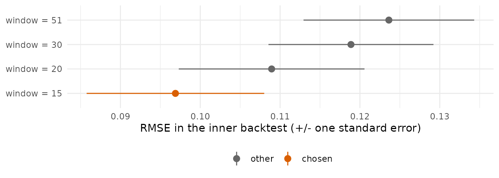
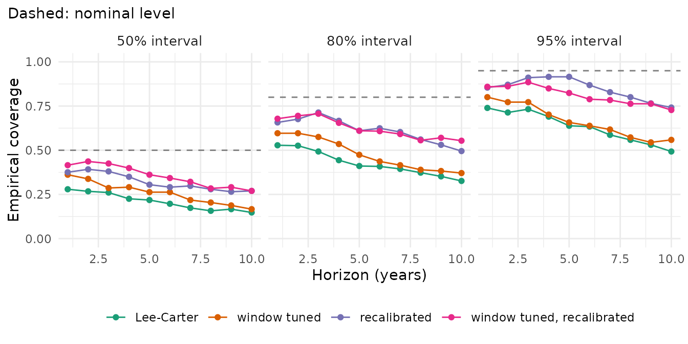

# Tuning and recalibration

Two questions are easily confused:

- **Tuning**: which settings of a model forecast best? For example the
  number of years the model is fitted to, the number of components, or
  the smoothing parameter. Tuning tries several settings and keeps the
  one that forecast the last observed years best.
- **Recalibration**: how wide should the intervals be? A model’s
  intervals describe the uncertainty of its own assumptions.
  Recalibration rescales them so that they match the errors the model
  made in recent years.

Tuning changes the forecast itself; recalibration keeps the model and
its central forecast and changes the width of the intervals. Both use
only the training data, so they can be checked in a backtest (see
“Backtesting and scores”). The examples use Lee-Carter on England &
Wales men, ages 30-100, 1961-2011 (Human Mortality Database, via the
StMoMo package).

``` r

library(mortensor)
library(data.table)
ew <- as_mt_data(StMoMo::EWMaleData)
ew <- mt_regroup(mt_set_grid(ew, age = single_ages(30, 100, open = FALSE)), age = single_ages(30, 100, open = FALSE))
```

## Tuning: the fitting window

Mortality decline in England & Wales changed pace in the 1970s.
Lee-Carter fitted to all years since 1961 averages over both regimes. A
shorter fitting window follows the recent pace but rests on fewer years.
Which window forecasts best? [`mt_tune()`](../reference/mt_tune.md) fits
each candidate to the years up to 2001, forecasts 2002-2011 (a hold-out
of the last ten years) and scores the forecasts. The window is a
preprocessing step ([`step_window()`](../reference/mt_prep.md)), so the
candidate is a model with its preprocessing:

``` r

window_model <- function(window) list(spec = lee_carter(), prep = mt_prep(step_window(window)))
tn <- mt_tune(window_model, data.frame(window = c(15, 20, 30, 51)), ew, inner_origins = 1, inner_h = 10,
              metric = "rmse")
tn$scores
#>    window       rmse         se selected
#>     <num>      <num>      <num>   <lgcl>
#> 1:     15 0.09688975 0.01112097     TRUE
#> 2:     20 0.10894032 0.01163030    FALSE
#> 3:     30 0.11887717 0.01033258    FALSE
#> 4:     51 0.12362359 0.01068757    FALSE
```

``` r

mt_plot_tuning(tn)
```



`rmse` is the root mean squared error of the forecast median of the log
rates; the bars show one standard error. The last 15 years forecast the
held-out decade best, but the neighbouring window of 20 years lies only
about one standard error behind: with a single hold-out, such a choice
is uncertain. [`tuned()`](../reference/mt_tune.md) wraps this choice
into a model: whenever it is fitted, it repeats the tuning on the data
it receives and then fits the chosen setting to all of them.

`inner_origins = 1` is a single hold-out. Several origins
(`inner_origins = 3, inner_h = 5`) average over more periods, and
`select = "one_se"` keeps the simplest setting whose score is within one
standard error of the best. `target = "life_expectancy"` tunes for life
expectancy instead of the rates.

Tuning pays where a setting changes the forecast substantively and
consistently. In outer backtests on England & Wales and France
(`dev/tuning.md` in the source repository) the tuned window improved
Lee-Carter clearly, while tuning the number of components and the
smoothing of [`hyndman_ullah()`](../reference/hyndman_ullah.md) the same
way did not: the chosen setting changed from one year to the next, a
sign that the differences between the settings were mostly noise of the
held-out years.

## Recalibration: the width of the intervals

[`recalibrated()`](../reference/recalibrated.md) refits the model at
several origins within the last ten training years, compares the
forecasts with what was observed, and rescales the spread of the draws
around their median by one factor for all horizons. The factor minimises
the CRPS of these recent forecasts. The closest published method is the
member-by-member post-processing of ensemble forecasts (Van Schaeybroeck
and Vannitsem 2015):

``` r

fit_cal <- mt_fit(recalibrated(lee_carter()), ew)
fit_cal$calibration[, .(scale_h1, crps_before, crps_after, cov95_before, cov95_after)]
#>    scale_h1 crps_before crps_after cov95_before cov95_after
#>       <num>       <num>      <num>        <num>       <num>
#> 1: 2.600246  0.07590544 0.06859299    0.4755869   0.8849765
```

The factor (`scale_h1`) is 2.6: Lee-Carter’s intervals were far too
narrow in the last decade. Within the window, recalibration raised the
95% coverage from 0.48 to 0.88 and lowered the CRPS from 0.076 to 0.069.

## Both together, checked in a backtest

The four versions in a backtest from the origins 1996-2001, forecasting
ten years each; tuning and recalibration are repeated at every origin
from its own training data:

``` r

tuned_lc <- tuned(window_model, data.frame(window = c(15, 20, 30, 51)), inner_origins = 1, inner_h = 10,
                  metric = "rmse", label = "Lee-Carter, window tuned")
bt <- mt_compare(list("Lee-Carter" = lee_carter(), "window tuned" = tuned_lc,
                      "recalibrated" = recalibrated(lee_carter()), "window tuned, recalibrated" = recalibrated(tuned_lc)),
                 ew, origins = 1996:2001, h = 10, n_draws = 200, quantities = "life_expectancy")
mt_score_table(bt, metrics = c("crps", "cov95"))
#>                         model   crps cov95 crps_le cov95_le
#>                        <fctr>  <num> <num>   <num>    <num>
#> 1:                 Lee-Carter 0.0709 0.632   0.470      0.9
#> 2:               window tuned 0.0584 0.664   0.285      1.0
#> 3:               recalibrated 0.0661 0.847   0.442      1.0
#> 4: window tuned, recalibrated 0.0563 0.811   0.293      1.0
```

``` r

mt_plot_coverage(bt)
```



The tuned window makes the forecasts more accurate: CRPS 0.058 against
0.071 for the rates, 0.29 against 0.47 years for life expectancy at 30
(`_le`). Recalibration widens the intervals: the 95% coverage of the
rates rises from 0.63 to 0.85, and from 0.66 to 0.81 for the tuned
model, whose recent errors were smaller, so its intervals widen less.
All versions remain below the nominal level, and their coverage falls
with the horizon: the base model is too narrow by more at long horizons,
and one factor for all horizons does not correct that. The coverage of
life expectancy is high for all versions: errors of single ages partly
cancel in life expectancy. Tuning and recalibration answer different
questions and combine: the tuned and recalibrated version has the lowest
CRPS of the rates (0.056).

## Options

- `recalibrated(by = "sex")`: separate factors for groups of strata
  (with joint models, contrasts between the groups then get wider
  intervals);
- `recalibrated(n_boot = 50)`: bootstrap intervals of the factors, which
  rest on few forecasts;
- `tuned(..., by = "sex")`: tune and fit groups of strata separately.

Further options of [`recalibrated()`](../reference/recalibrated.md) are
specific to this package (reference unknown):

- `scale = "horizon"`: a factor that changes with the horizon as a power
  law, `scale_h1 * h^slope`;
- `bias = TRUE`: a correction of the drift;
- `ages = c(50, 75)`: separate factors for age bands;
- `quantity = "life_expectancy"`: recalibrate the intervals of life
  expectancy instead of single rates.

## Summary

| Question | Function | Changes |
|----|----|----|
| Which settings forecast best? | [`mt_tune()`](../reference/mt_tune.md), [`tuned()`](../reference/mt_tune.md) | the forecast |
| How wide should the intervals be? | [`recalibrated()`](../reference/recalibrated.md) | the width of the intervals |
| Did it help? | [`mt_compare()`](../reference/mt_compare.md), [`mt_score_table()`](../reference/mt_compare.md) | nothing; it checks |

## References

Van Schaeybroeck B, Vannitsem S (2015). Ensemble post-processing using
member-by-member approaches: theoretical aspects. *Quarterly Journal of
the Royal Meteorological Society* 141(688): 807-818.
