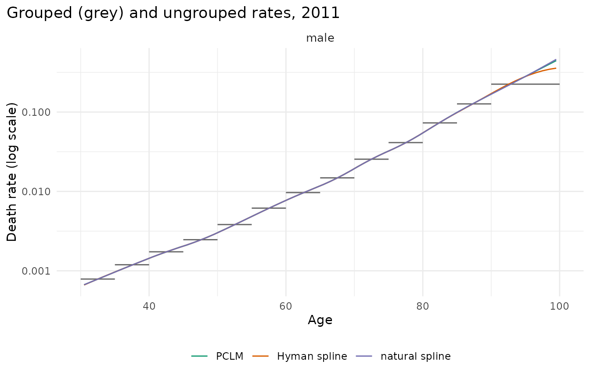
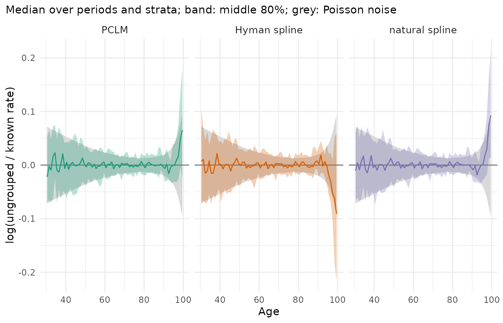
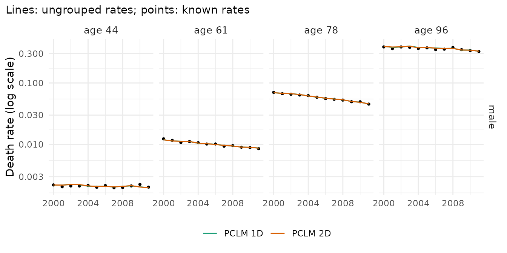
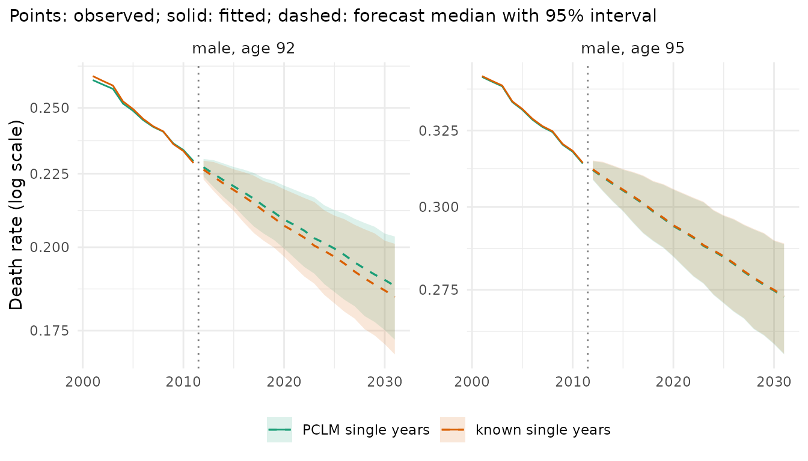

# Ungrouping age groups: methods and diagnostics

Official tables often give deaths in 5-year age groups and populations
by single year of age. Many models are easiest to use on single years.
There are two ways to bring the two together:

- **regroup** everything to the age groups of the deaths
  (`mt_regroup(x, age = "deaths")`) and model the groups; nothing is
  estimated, but the age detail is lost;
- **ungroup** the deaths: estimate single-year deaths that add up to the
  observed groups ([`mt_ungroup()`](../reference/mt_ungroup.md)).

This vignette compares the ungrouping methods, shows the diagnostics
that check a result, and the consequence for a forecast. The test case
is data whose single years are known: England & Wales men, 1980-2011,
ages 30-99 (Human Mortality Database, via the StMoMo package). Their
deaths are grouped as an official table would group them, ungrouped
again, and compared with what was observed.

``` r

library(mortensor)
ew <- as_mt_data(StMoMo::EWMaleData)
ew <- mt_subset(ew, ages = c(30, 100), periods = c(1980, 2011))
x <- mt_regroup(ew, age = c(seq(30, 85, 5), 90), measures = "deaths")
x
#> <mt_data> 1 stratum by sex, omega = 110
#>   deaths     mixed widths (5,10) 30-99; periods 1980-2011 (width 1); 416 cells
#>   exposure   single years 30-99; periods 1980-2011 (width 1); 2240 cells
#>   grid       <mt_axis: age, 70 intervals> 30 31 32 33 ... 97 98 99
#>              <mt_axis: period, 32 intervals> 1980 1981 1982 1983 ... 2009 2010 2011
```

The deaths are now in the groups 30-34, …, 85-89 and 90-99; the
exposures keep their single years (`measures = "deaths"` regroups only
the deaths). HMD data downloaded directly are read with
[`mt_read_hmd()`](../reference/mt_from_hmd.md).

## The methods

| `method` | Idea | Needs exposures |
|----|----|----|
| `"pclm"` (default) | penalized composite link model (Eilers 2007; Rizzi et al. 2015): a smooth rate schedule whose expected deaths add up to the groups; the exposures enter as offset | yes (or ungroups counts) |
| `"hyman_kannisto"` | monotone spline of the log group rates, Kannisto curve for the last group | yes |
| `"natural_gompertz"` | natural spline of the log group rates, log-linear (Gompertz) last group | yes |
| `"gam"` | smooth surface of the log group rates over age and year (mgcv), Kannisto tail | yes |
| `"monotone"` | monotone spline of the cumulative deaths, counts only | no |

With `dims = 2`, the PCLM estimates a smooth surface over age and year
instead of each year separately. All methods except `"monotone"`
estimate rates, so the irregular sizes of birth cohorts stay in the
exposures.

``` r

u <- list("PCLM" = mt_ungroup(x),
          "Hyman spline" = mt_ungroup(x, method = "hyman_kannisto"),
          "natural spline" = mt_ungroup(x, method = "natural_gompertz"))
```

## Diagnostic 1: do the estimates pass through the groups?

The observed rates of the age groups (grey steps) and the ungrouped
single-year rates in 2011:

``` r

mt_plot_ungroup(x, u, period = 2011)
```



All three pass through the steps and agree except in the last group,
where nothing in the data says how the rates rise between ages 90 and
99: there the methods differ by their assumptions about the shape of the
tail.

## Diagnostic 2: errors against the known single years

[`mt_ungroup_check()`](../reference/ungroup-diagnostics.md) compares the
estimates with the known rates by age band. `mae_log` is the median
absolute log error (close to the relative error for small values). The
known rates contain Poisson noise, so even perfect estimates would not
reach zero: `noise_log` is the error that perfect estimates would have.
`bias_log` is the median signed error.

``` r

mt_ungroup_check(u, reference = ew)
#>             method   band mae_log noise_log  bias_log at_bound max_rel_gap
#>             <fctr> <fctr>   <num>     <num>     <num>    <num>       <num>
#>  1:           PCLM  30-44 0.03180   0.03040  2.63e-04        0      0.0259
#>  2:           PCLM  45-64 0.01710   0.01510  7.07e-04        0      0.0259
#>  3:           PCLM  65-84 0.00942   0.00748 -9.29e-05        0      0.0259
#>  4:           PCLM    85+ 0.01550   0.01400  1.78e-03        0      0.0259
#>  5:   Hyman spline  30-44 0.03200   0.03040  4.82e-04        0          NA
#>  6:   Hyman spline  45-64 0.01630   0.01510  1.98e-04        0          NA
#>  7:   Hyman spline  65-84 0.00974   0.00748 -2.45e-04        0          NA
#>  8:   Hyman spline    85+ 0.01800   0.01400 -3.04e-03        0          NA
#>  9: natural spline  30-44 0.03030   0.03040 -4.81e-04        0          NA
#> 10: natural spline  45-64 0.01620   0.01510  1.34e-04        0          NA
#> 11: natural spline  65-84 0.00967   0.00748  4.05e-05        0          NA
#> 12: natural spline    85+ 0.01670   0.01400  1.73e-03        0          NA
```

In every age band the errors of all three methods exceed the noise floor
by at most 0.4 percentage points: the ungrouped rates are almost as
close to the observed single years as the true rates would be. Where the
methods differ shows in the log ratio of the estimated to the known
rates by age, with its range over the years (coloured) and the range of
the Poisson noise (grey):

``` r

mt_plot_ungroup(x, u, type = "error", reference = ew)
```



Up to age 95 the estimates scatter within the noise band. At the top of
the last group (ages 95-99) the methods go in different directions: the
Hyman spline with its Kannisto tail underestimates the rates at 99 by
about 9%, the natural spline overestimates them by about 9%, the PCLM by
about 7%. An open or wide last group is where ungrouping is least
reliable, and where methods should be compared.

## Diagnostic 3: stability over time

Ungrouping each year separately (`dims = 1`) can let single ages jump
from year to year. The two-dimensional PCLM (`dims = 2`) smooths over
the years as well. It is slower, so the comparison uses 2000-2011:

``` r

xr <- mt_subset(x, periods = c(2000, 2011))
u_time <- list("PCLM 1D" = mt_ungroup(xr), "PCLM 2D" = mt_ungroup(xr, dims = 2))
mt_ungroup_check(u_time, reference = ew)
#>     method   band mae_log noise_log bias_log at_bound max_rel_gap
#>     <fctr> <fctr>   <num>     <num>    <num>    <num>       <num>
#> 1: PCLM 1D  30-44 0.03380   0.02980 0.001800        0      0.0183
#> 2: PCLM 1D  45-64 0.01820   0.01590 0.001310        0      0.0183
#> 3: PCLM 1D  65-84 0.00903   0.00814 0.000724        0      0.0183
#> 4: PCLM 1D    85+ 0.01760   0.01150 0.005050        0      0.0183
#> 5: PCLM 2D  30-44 0.03270   0.02980 0.001560        0      0.0697
#> 6: PCLM 2D  45-64 0.01890   0.01590 0.001720        0      0.0697
#> 7: PCLM 2D  65-84 0.00882   0.00814 0.000439        0      0.0697
#> 8: PCLM 2D    85+ 0.01730   0.01150 0.004770        0      0.0697
```

``` r

mt_plot_ungroup(xr, u_time, type = "time", reference = ew)
```



The lines are the ungrouped rates at four ages, the points the known
rates. Both versions follow the year-to-year movements of the group
totals, because the estimates are scaled to the observed deaths of each
group and year (`preserve_totals = TRUE`). For these large counts the
difference between 1D and 2D is small; it matters more for small
populations, where the 2D surface borrows strength from neighbouring
years. Inside backtests, ungrouping in 2D must see only the training
years: use `step_ungroup(dims = 2)` in the preprocessing.

## Grouped exposures

When the populations are grouped as well, they are ungrouped first, as
counts (`exposure_method = "pclm"`) or by a monotone spline of the
cumulative counts (`"monotone"`, which reproduces the group totals
exactly). Here the exposures are grouped and the deaths kept by single
year, so the errors of the rates come from the exposures alone:

``` r

xe <- mt_regroup(ew, age = c(seq(30, 85, 5), 90), measures = "exposure")
mt_ungroup_check(list("PCLM" = mt_ungroup(xe), "monotone" = mt_ungroup(xe, exposure_method = "monotone")),
                 reference = ew)
#>      method   band mae_log noise_log  bias_log at_bound max_rel_gap
#>      <fctr> <fctr>   <num>     <num>     <num>    <num>       <num>
#> 1:     PCLM  30-44  0.0109   0.03040 -9.00e-04        0    0.000496
#> 2:     PCLM  45-64  0.0187   0.01510 -1.52e-03        0    0.000496
#> 3:     PCLM  65-84  0.0209   0.00748 -4.83e-05        0    0.000496
#> 4:     PCLM    85+  0.0644   0.01400 -1.22e-02        0    0.000496
#> 5: monotone  30-44  0.0105   0.03040 -1.90e-04        0    0.000000
#> 6: monotone  45-64  0.0159   0.01510 -7.44e-04        0    0.000000
#> 7: monotone  65-84  0.0168   0.00748 -7.52e-04        0    0.000000
#> 8: monotone    85+  0.1580   0.01400  2.36e-02        0    0.000000
```

Below age 85 both methods err by 1-2%, which at ages 65-84 is more than
the noise of the deaths. At ages 85 and over, where the population falls
steeply with age, the PCLM errs by about 6% and the monotone spline by
about 16%. Splitting an **open** interval of populations (for example
85+ into single years up to 100+) from its total alone is not reliable
at all: use population data with a higher open age, which many
statistical offices publish, or keep the open interval.

## The consequence for a forecast

Lee-Carter fitted to the age groups, to the PCLM estimates and to the
known single years, forecast to 2031. Life expectancy at 30 sums over
all ages, so it is the quantity least affected by the details within a
group:

``` r

fc <- list("age groups" = mt_forecast(mt_fit(lee_carter(), mt_regroup(x, age = "deaths")), h = 20, n_draws = 500,
                                      seed = 1),
           "PCLM single years" = mt_forecast(mt_fit(lee_carter(), u$PCLM), h = 20, n_draws = 500, seed = 1),
           "known single years" = mt_forecast(mt_fit(lee_carter(), ew), h = 20, n_draws = 500, seed = 1))
mt_compare_forecasts(fc, periods = c(2021, 2031), digits = 2)
#> Key: <label, period>
#>     label period          age groups   PCLM single years  known single years
#>    <char>  <num>              <char>              <char>              <char>
#> 1:   male   2021 52.39 (51.22-53.42) 52.02 (50.90-53.01) 52.02 (50.90-53.01)
#> 2:   male   2031 54.22 (52.73-55.50) 53.82 (52.37-55.27) 53.82 (52.37-55.27)
```

``` r

mt_plot_compare(fc, quantity = "rate", ages = c("92", "95"), periods = 2001:2031)
```



Forecasts from the PCLM estimates and from the known single years give
the same life expectancy at 30 to two decimals. The forecast from the
age groups is 0.4 years higher: its life table assumes that the deaths
of each group fall in the middle of the group, which overstates survival
where mortality rises steeply within a group, above all in the 10-year
group 90-99. The single-year rates at 92 and 95 forecast from the PCLM
estimates follow those from the known rates closely; a model of the
groups has no rates for single ages at all (the figure shows only the
two single-year forecasts). Ungrouping is worth its assumptions where
single ages are needed: for life tables of wide groups, for cohort
models, or for results at exact ages.

## Summary

- Ungroup deaths as rates, with the exposures on the target grid as
  offset ([`mt_ungroup()`](../reference/mt_ungroup.md), PCLM by
  default).
- Check every result:
  [`mt_plot_ungroup()`](../reference/ungroup-diagnostics.md) (profile,
  errors, stability over time) and
  [`mt_ungroup_check()`](../reference/ungroup-diagnostics.md) (fit
  diagnostics, and errors where single years are known).
- The last, wide or open age group is where methods differ; compare them
  there.
- Inside forecasting pipelines, ungrouping is a preprocessing step
  ([`step_ungroup()`](../reference/mt_prep.md)), refitted on each
  training window.

## References

Eilers PHC (2007). Ill-posed problems with counts, the composite link
model and penalized likelihood. *Statistical Modelling* 7(3): 239-254.

Rizzi S, Gampe J, Eilers PHC (2015). Efficient estimation of smooth
distributions from coarsely grouped data. *American Journal of
Epidemiology* 182(2): 138-147.
