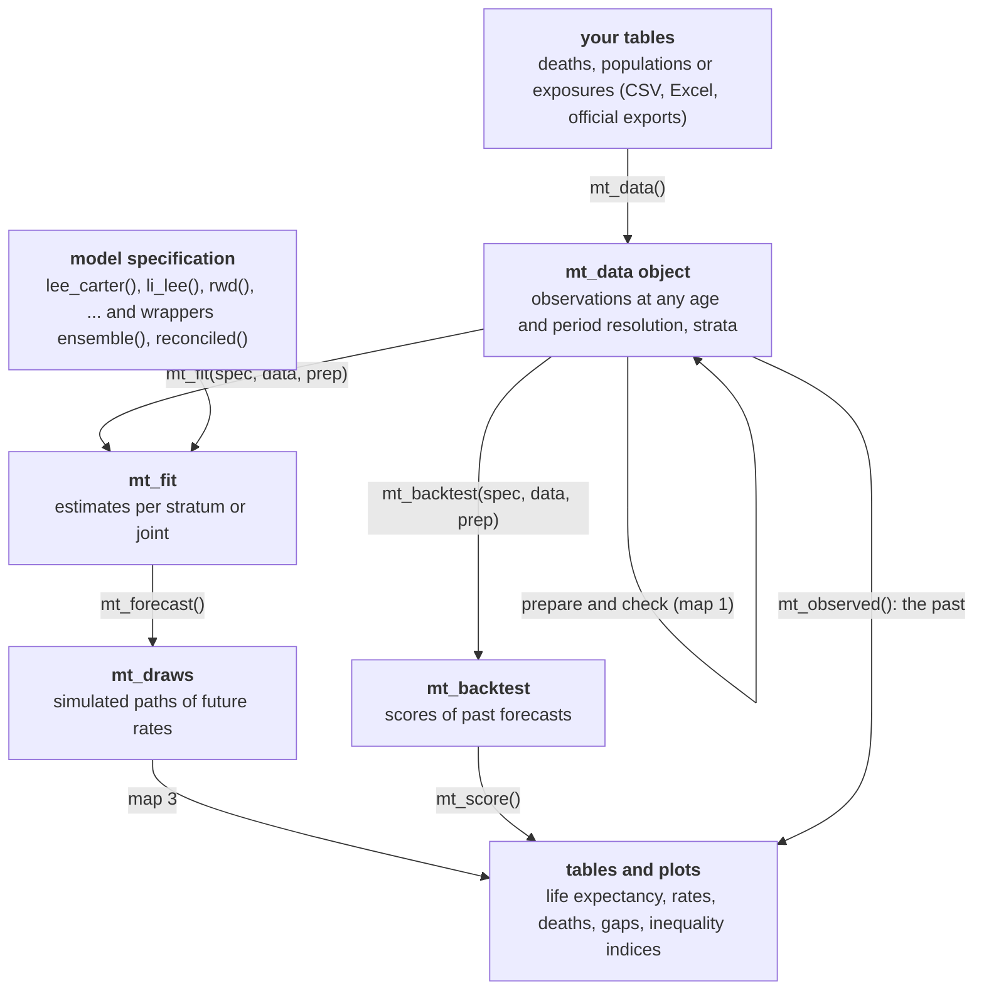
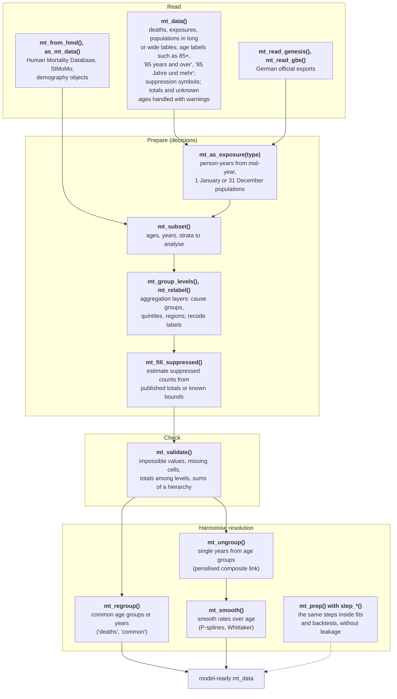
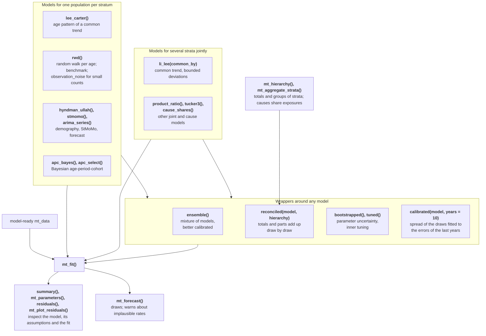
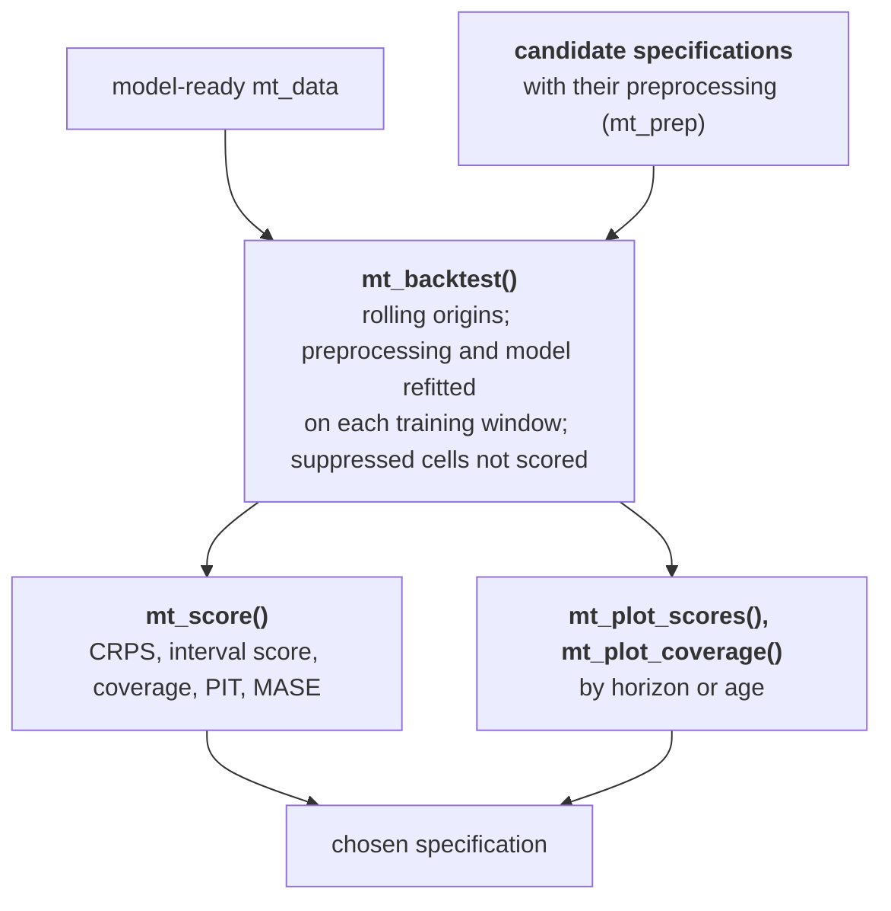
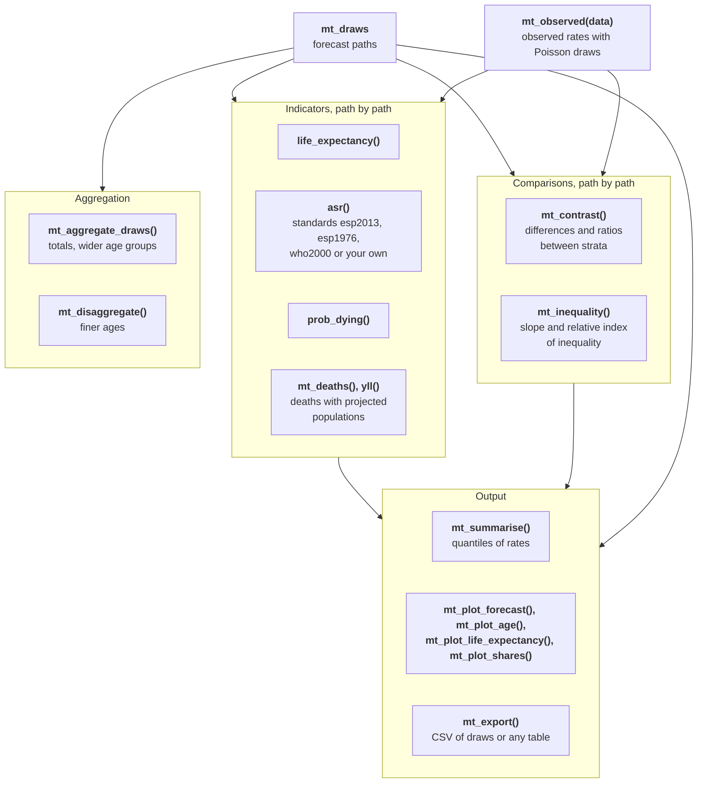

This page maps the functions of mortensor onto the steps of an analysis
and shows how their results feed into each other. Each box names a
function and its main purpose. Paths through the maps are workflows; the
section "What is not covered" lists steps that need other tools.

## The main path

Every analysis passes the same objects from left to right. Functions in
the boxes create the objects; the labels on the arrows are the functions
that connect them.

## Map 1: from tables to analysis-ready data

Each step is an analysis decision. Most data sets need only some of them.

## Map 2: models, coherence and evaluation

Choosing between specifications:

## Map 3: from draws to results

## Functions by purpose

| Step | Function | Purpose | Input | Output |
|---|---|---|---|---|
| Read | `mt_data()` | read deaths, exposures, populations (long or wide, suppression symbols, shared populations) | data frames | `mt_data` |
| Read | `mt_add()` | add or replace one table | `mt_data`, data frame | `mt_data` |
| Read | `mt_read_genesis()`, `mt_read_gbe()` | read German official exports | files | `mt_data`, table |
| Read | `mt_from_hmd()`, `as_mt_data()` | convert HMD, StMoMo, demography data | objects | `mt_data` |
| Prepare | `mt_as_exposure()` | exposures from populations (`type` required) | `mt_data` | `mt_data` |
| Prepare | `mt_subset()` | restrict ages, years, strata | `mt_data` | `mt_data` |
| Prepare | `mt_group_levels()`, `mt_relabel()` | aggregation layers, recode labels | `mt_data` | `mt_data` |
| Prepare | `mt_fill_suppressed()` | estimate suppressed counts | `mt_data`, hierarchy or bounds | `mt_data` |
| Check | `mt_validate()` | plausibility and hierarchy checks | `mt_data` | findings |
| Harmonise | `mt_regroup()`, `mt_ungroup()`, `mt_smooth()` | common resolution, single years, smoothing | `mt_data` | `mt_data` |
| Harmonise | `mt_prep()`, `step_*()` | preprocessing inside fits and backtests | steps | pipeline |
| Model | `lee_carter()`, `rwd()`, `li_lee()`, `product_ratio()`, `hyndman_ullah()`, `stmomo()`, `arima_series()`, `apc_bayes()`, `tucker3()`, `cause_shares()` | model specifications | settings | `mt_spec` |
| Combine | `ensemble()`, `reconciled()`, `bootstrapped()`, `tuned()` | mixtures, coherence, parameter uncertainty, tuning | `mt_spec` | `mt_spec` |
| Calibrate | `calibrated()` | rescale the spread (optionally the drift) of any model's draws to its forecast errors in the last years | `mt_spec` | `mt_spec` |
| Coherence | `mt_hierarchy()`, `mt_aggregate_strata()`, `mt_reconcile()`, `mt_aggregate_draws()` | define and apply totals of strata | hierarchy | `mt_data`, `mt_draws` |
| Fit | `mt_fit()` | estimate | `mt_spec`, `mt_data` | `mt_fit` |
| Inspect | `summary()`, `mt_parameters()`, `fitted()`, `residuals()`, `mt_plot_residuals()` | model, assumptions, estimates, fit | `mt_fit` | text, table, plot |
| Forecast | `mt_forecast()` | simulated paths | `mt_fit` | `mt_draws` |
| Evaluate | `mt_backtest()`, `mt_score()` | rolling-origin scores | `mt_spec`, `mt_data` | table |
| Describe | `mt_observed()` | observed rates as draws | `mt_data` | `mt_draws` |
| Report | `life_expectancy()`, `asr()`, `prob_dying()`, `yll()`, `mt_deaths()` | indicators path by path | `mt_draws` or `mt_data` | table |
| Report | `mt_contrast()`, `mt_inequality()` | gaps, ratios, SII, RII | `mt_draws` or `mt_data` | table |
| Report | `mt_plot_*()`, `mt_export()` | figures and CSV files | draws, tables | ggplot, file |
| Exchange | `as_demogdata()`, `as_stmomodata()` | cross-checks with demography and StMoMo | `mt_data` | `demogdata`, `StMoMoData` |

## What is not covered

These steps of a mortality analysis need other tools or are open
development points:

* **Population projections.** mortensor forecasts death rates; future
  exposures (for expected deaths) come from a population projection, for
  example of the statistical office, passed as `exposure`.
* **Spatial models for small areas.** There is no model with spatial
  smoothing between neighbouring regions (such as BYM models); pooling
  works through common trends (`li_lee()`) and Bayesian APC models per
  stratum.
* **Backtest targets other than death rates.** Backtests score log death
  rates per cell; life expectancy or age-standardised rates as targets are
  not yet available.
* **Multiple imputation of suppressed cells.** `mt_fill_suppressed()`
  returns one estimate; the uncertainty of suppressed counts is not carried
  into forecasts.
* **Causes of death with changing coding.** ICD revisions and coding
  changes (for example of dementia) are not bridged; cause groups that
  span the affected codes reduce the problem.
