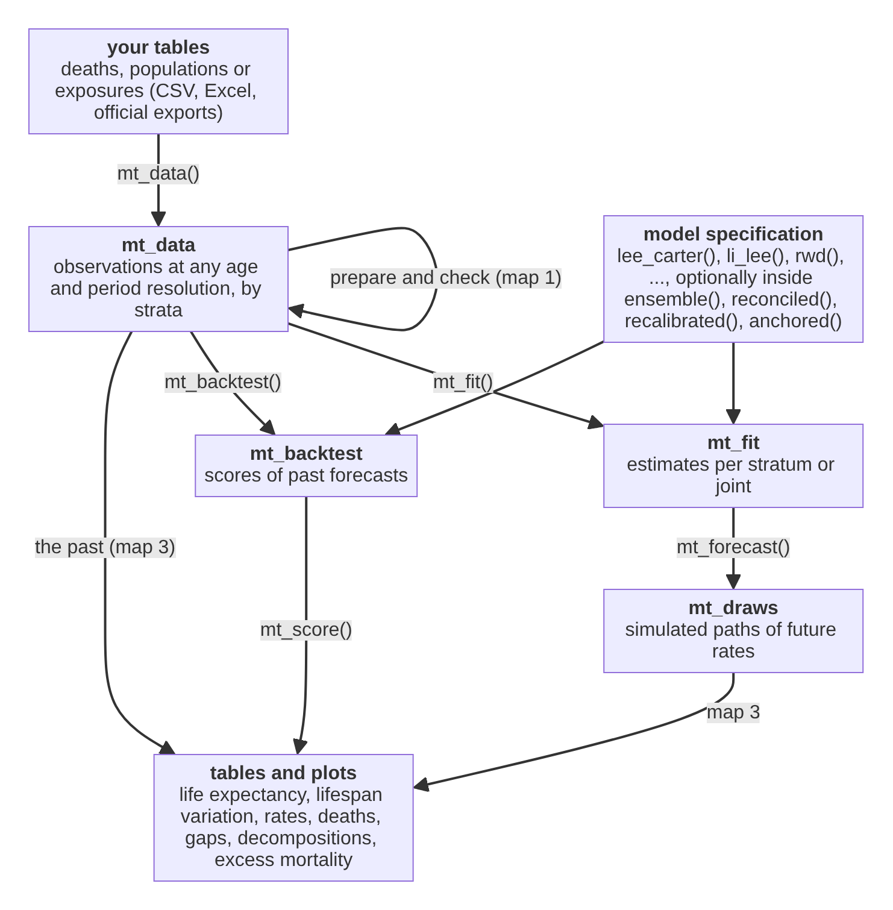
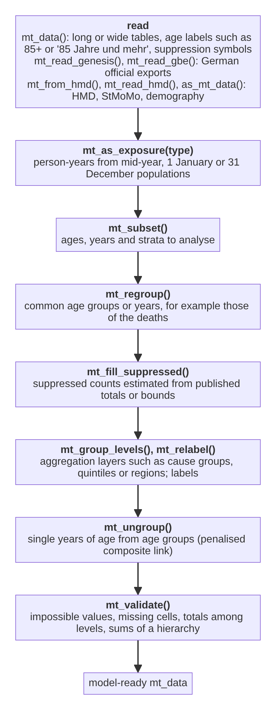
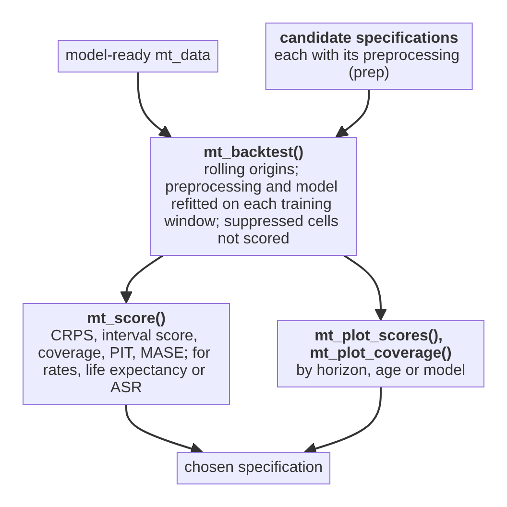
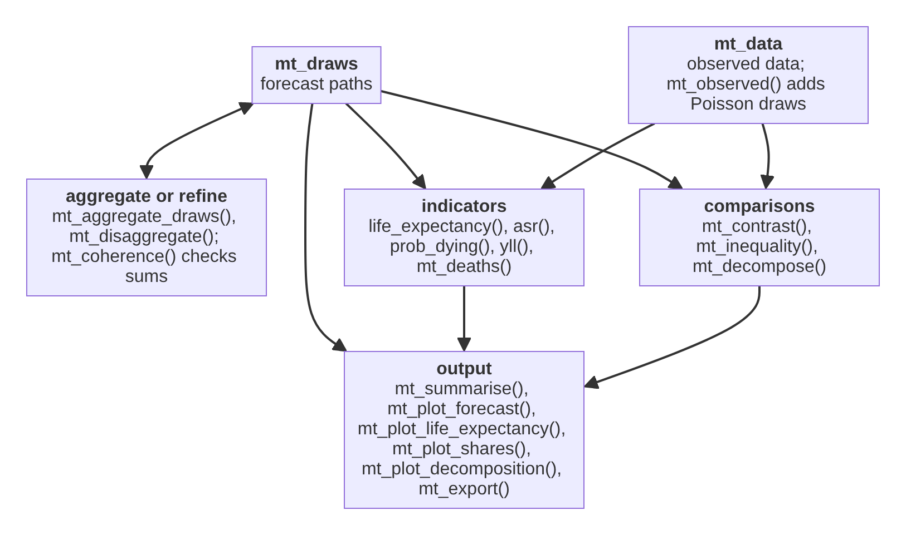

This page maps the functions of mortensor onto the steps of an analysis
and shows how their results feed into each other. Each box names a
function and its main purpose. Paths through the maps are workflows; the
section "What is not covered" lists steps that need other tools.

## The main path

Every analysis passes the same objects from top to bottom. The boxes are
objects; the labels on the arrows are the functions that connect them.

## Map 1: from tables to analysis-ready data

The steps in their usual order. Each is a decision about the data; skip
those a data set does not need. Every step returns an `mt_data` object.

Smoothing is not a step of this map. `mt_smooth()` with
`mt_smooth_check()` and `mt_plot_smooth()` shows what a smoother would do
to the data; for forecasts, smooth inside the fit with `step_smooth()`
(map 2), so that observation noise and backtests refer to the raw deaths.
`mt_fit()` warns about data smoothed beforehand and `mt_backtest()` refuses
them.

## Map 2: models, coherence and evaluation

A model specification is one model, optionally inside wrappers.
Preprocessing steps given as `prep` are repeated in every fit, so that
backtests do not see the test years.

Choosing between specifications:

`tuned()` and `mt_tune()` run the same comparison inside a fit, over a
grid of model and preprocessing settings (for example the number of
components and the smoothing of `hyndman_ullah()`, or the fitting
window), with rolling origins or a single hold-out of the last years.
`recalibrated()` keeps the chosen model and rescales the width of its
intervals.

## Map 3: from draws to results

Indicators and comparisons are computed path by path, so their intervals
include the joint uncertainty of all strata. The same functions describe
observed data.

## Functions by purpose

| Step | Function | Purpose | Input | Output |
|---|---|---|---|---|
| Read | `mt_data()` | read deaths, exposures, populations (long or wide, suppression symbols, shared populations) | data frames | `mt_data` |
| Read | `mt_add()`, `mt_add_deaths()`, `mt_add_exposure()`, `mt_add_population()` | add or replace one table | `mt_data`, data frame | `mt_data` |
| Read | `mt_read_genesis()`, `mt_read_gbe()` | read German official exports | files | `mt_data`, table |
| Read | `mt_from_hmd()`, `mt_read_hmd()`, `as_mt_data()` | read or convert HMD, StMoMo, demography data | objects, files | `mt_data` |
| Read | `parse_age_labels()`, `age_groups()`, `single_ages()`, `single_years()`, `period_groups()` | age and period axes from labels or bounds | labels | `mt_axis` |
| Read | `axis_widths()`, `axis_midpoints()`, `is_open()` | interval widths, midpoints and the open interval of an axis | `mt_axis` | vector |
| Prepare | `mt_as_exposure()` | exposures from populations (`type` required) | `mt_data` | `mt_data` |
| Prepare | `mt_subset()` | restrict ages, years, strata | `mt_data` | `mt_data` |
| Prepare | `mt_strata()`, `mt_obs()`, `mt_grid()`, `mt_set_grid()`, `mt_granularity()` | look at strata (with their level in a hierarchy), tables, their resolution and the modelling grid | `mt_data` | table, grid |
| Prepare | `mt_array()`, `mt_operator()` | data as arrays on the grid; the matrix that sums grid cells to observed cells (for your own models) | `mt_data` | array, matrix |
| Prepare | `mt_group_levels()`, `mt_relabel()` | aggregation layers, recode labels | `mt_data` | `mt_data` |
| Prepare | `mt_fill_suppressed()` | estimate suppressed counts | `mt_data`, hierarchy or bounds | `mt_data` |
| Check | `mt_validate()` | plausibility and hierarchy checks | `mt_data` | findings |
| Harmonise | `mt_regroup()`, `mt_ungroup()`, `mt_smooth()` | common resolution, single years (PCLM or monotone interpolation), smoothing over age, time or both | `mt_data` | `mt_data` |
| Harmonise | `mt_plot_ungroup()`, `mt_ungroup_check()` | ungrouped against grouped rates, stability over time, errors against known single years; several methods side by side | `mt_data` and ungrouped data (or a list) | ggplot, table |
| Harmonise | `mt_smooth_check()`, `mt_plot_smooth()` | how much smoothing removed (dispersion, trend ratio); several smoothers in one figure | `mt_data` pair or list | table, ggplot |
| Harmonise | `mt_prep()`, `mt_prep_apply()` with `step_ungroup()`, `step_smooth()`, `step_regroup()`, `step_grid()`, `step_shocks()`, `step_window()` | preprocessing inside fits and backtests | steps | pipeline |
| Model | `lee_carter()` (optionally rotated, with negative binomial deaths and a dispersion by age, or with averaged, filtered or constrained jump-off), `rwd()`, `p_splines()` (optionally with a dispersion by age), `cp_splines()`, `bohk_rau()`, `li_lee()`, `cae()` (optionally with a common drift), `saint()`, `relative_model()`, `hyndman_ullah()`, `coherent_fdm()`, `coda()` (also coherent), `coda_multiway()`, `stmomo()` (including the Plat model), `apci()`, `stanmomo()`, `arima_series()`, `ets_series()`, `apc_bayes()`, `nordpred_apc()`, `tucker3()`, `coda_causes()` (also 2S-CoDA); deprecated: `rwd(observation_noise = TRUE)` (use `arima_series(order = c(0, 1, 1), drift = TRUE)`), `tucker3(transform = "coda")` (use `coda_multiway()`) | model specifications | settings | `mt_spec` |
| Model | `apc_select()`, `mcmc_control()`, `mt_tune()` | choose random-walk orders, MCMC settings; model and preprocessing settings by forecast accuracy on the last years (hold-out or rolling origins; rates, life expectancy or ASR) | data, grid | table, `mt_spec` |
| Combine | `ensemble()` (weights equal, by stacking with the CRPS, by the life expectancy bias of Kontis et al. or inverse to the CRPS; optionally `top_k`), `stratified()`, `reconciled()` (also score-optimal, `method = "energy_score"`; weights from past errors, `covariance = "errors"`; Schaake shuffle, `dependence = "schaake"`, or of whole stratum paths, `dependence = "empirical"`), `coupled()`, `bootstrapped()`, `tuned()` | mixtures, different models for groups of strata, coherence, dependence between strata from a joint model (ensemble copula coupling) or from past years (Schaake shuffle), parameter uncertainty (and of smoothing, `type = "data"`), tuning | `mt_spec` | `mt_spec` |
| Combine | `mt_order_strata()` | keep an ordering between strata (for example women below men) path by path | `mt_draws` | `mt_draws` |
| Calibrate | `recalibrated()` | rescale the spread (optionally the drift) of any model's draws to its forecast errors in the last years, overall, by age band or by horizon, for rates, life expectancy or ASR; or add resampled errors of its past forecasts to its median (`method = "errors"`) | `mt_spec` | `mt_spec` |
| Jump-off | `anchored()`, `mt_jump_off()`; `lee_carter(jump_off = )` | start forecasts at the observed rates of the last year (optionally of several years, shrunk and fading out), at their mean over the last years, at the Kalman filter estimate or from a fit constrained to the last year; report the first-year step | `mt_spec`, `mt_draws` | `mt_spec`, table |
| Coherence | `mt_hierarchy()`, `mt_aggregate_strata()`, `mt_reconcile()` (with `fixed` nodes; `"proportional"` scales the parts of fixed nodes), `mt_aggregate_draws()` | define and apply totals of strata | hierarchy | `mt_data`, `mt_draws` |
| Coherence | `mt_coherence()`, `mt_plot_coherence()` | sum of parts over aggregate, per year | `mt_draws`, hierarchy | table, ggplot |
| Fit | `mt_fit()` | estimate | `mt_spec`, `mt_data` | `mt_fit` |
| Inspect | `summary()`, `mt_parameters()`, `fitted()`, `residuals()`, `mt_plot_residuals()` | model, assumptions, estimates, fit | `mt_fit` | text, table, plot |
| Forecast | `mt_forecast()`, `mt_summarise()` | simulated paths and their quantiles | `mt_fit` | `mt_draws`, table |
| Evaluate | `mt_backtest()`, `mt_score()` | rolling-origin scores of rates, life expectancy or ASR, and of gaps between strata (`contrast`); the number of cells without deaths, floored at half a death (`n_floored`); optional SAPE, 90% coverage and interval half-widths of life expectancy (Raftery et al. 2013) and revisions between consecutive origins, with the robustness of Stoeldraijer et al. 2018 (`measures`) | `mt_spec`, `mt_data` | table |
| Evaluate | `mt_compare()`, `mt_score_table()` | backtests of several models on the same origins; scores of rates, life expectancy and gaps side by side, by level of a hierarchy or by horizon | named list of `mt_spec`, `mt_data` | table |
| Evaluate | `mt_dm_test()` | Diebold-Mariano tests: is one model more accurate than another, per horizon, beyond chance? | backtest from `mt_compare()` | table |
| Evaluate | `mt_plot_scores()`, `mt_plot_coverage()`, `mt_plot_pit()`, `mt_plot_backtest_design()`, `mt_plot_tuning()` | scores by horizon or model, interval coverage, PIT histograms, the design of a backtest, tuning scores | backtest, tuning | ggplot |
| Describe | `mt_observed()` | observed rates as draws | `mt_data` | `mt_draws` |
| Report | `life_expectancy()`, `asr()`, `prob_dying()` | indicators path by path, observed or forecast | `mt_draws` or `mt_data` | table |
| Report | `lifespan_variation()` | e-dagger, entropy, Gini, standard deviation, coefficient of variation and interquartile range of the age at death | `mt_draws`, `mt_data` or rates | table, array |
| Report | `mt_pessimism()` | how much lower life expectancy is when causes are forecast separately and summed than in an all-cause forecast (Wilmoth 1995), by age and cause, or approximated from two observed periods | `mt_draws` (total and causes) or `mt_data` | table |
| Report | `mt_excess()`, `mt_plot_excess()` | excess deaths, P-scores and loss of life expectancy against the expected values of a baseline model, by age, stratum and year | `mt_fit` or `mt_spec`, `mt_data` | table, ggplot |
| Report | `yll()`, `mt_deaths()` | years of life lost, deaths with projected populations | `mt_draws` | table, array |
| Report | `life_table()`, `standard_population()` | life tables from rates (open interval closed by one of nine hazard laws or by AIC, `open`); standard populations esp2013, esp1976, who2000 | rates, name | table |
| Check | `mt_open_check()` | old-age hazard laws fitted below a cut age and scored against the observed deaths above it | `mt_data` | table |
| Report | `mt_contrast()`, `mt_inequality()`, `mt_plot_contrast()` | gaps, ratios, SII, RII; gaps over time | `mt_draws` or `mt_data` | table, ggplot |
| Report | `mt_compare_forecasts()`, `mt_plot_compare()` | one quantity of several forecasts (models, jump-off choices, reconciliation methods) side by side | named list of `mt_draws` or `mt_data` | table, ggplot |
| Report | `mt_decompose()`, `mt_plot_decomposition()` | differences in life expectancy (or other summaries) by age, cause and subgroup composition: Arriaga, Horiuchi, stepwise replacement, Kitagawa, Arriaga meets Kitagawa; jump-off share and changes of gaps | `mt_draws` or `mt_data` (or both; also census years with gaps) | `mt_decomposition`, table, ggplot |
| Report | `mt_plot_forecast()`, `mt_plot_age()`, `mt_plot_life_expectancy()`, `mt_plot_shares()`, `mt_plot_rates()`, `mt_plot_tucker()`, `mt_export()` | figures and CSV files | draws, data, tables | ggplot, file |
| Data | `ons_data`, `ons_cause_groups`, `de_deaths`, `de_population`, `de_cause_groups`, `mt_example()`, `mt_example_causes()`, `mt_example_regions()` | example data (published and simulated) | | tables, `mt_data` |
| Report | `theme_mortensor()`, `scale_colour_mortensor()`, `scale_fill_mortensor()`, `mt_palette()` | the package's plot style for your own figures | | theme, scales |
| Disaggregate | `mt_disaggregate()`, `mt_shape_rates()`, `mt_disaggregate_check()`, `mt_plot_disaggregation()` | forecasts on finer ages with a fixed age shape within each group | `mt_draws` | `mt_draws`, table, ggplot |
| Exchange | `as_demogdata()`, `as_stmomodata()` | cross-checks with demography and StMoMo | `mt_data` | `demogdata`, `StMoMoData` |
| Extend | `new_mt_spec()` | constructor for developers adding a model (methods for the internal generics `fit_model()` and `simulate_model()`) | model name, parameters | `mt_spec` |

## What is not covered

These steps of a mortality analysis need other tools or are open
development points:

* **Population projections.** mortensor forecasts death rates; future
  exposures (for expected deaths) come from a population projection, for
  example of the statistical office, passed as `exposure`.
* **Spatial models for small areas.** There is no model with spatial
  smoothing between neighbouring regions (such as BYM models), and no
  relational model for small populations (such as TOPALS); pooling works
  through common trends (`li_lee()`); Bayesian APC models smooth over age,
  period and cohort within each stratum.
* **Models of life expectancy.** Models that forecast life expectancy
  itself (such as the Bayesian models of the UN or the double-gap model)
  are not implemented; mortensor forecasts rates and derives life
  expectancy from them.
* **Multiple imputation of suppressed cells.** `mt_fill_suppressed()`
  returns one estimate; the uncertainty of suppressed counts is not carried
  into forecasts.
* **Causes of death with changing coding.** ICD revisions and coding
  changes (for example of dementia) are not bridged; cause groups that
  span the affected codes reduce the problem.
