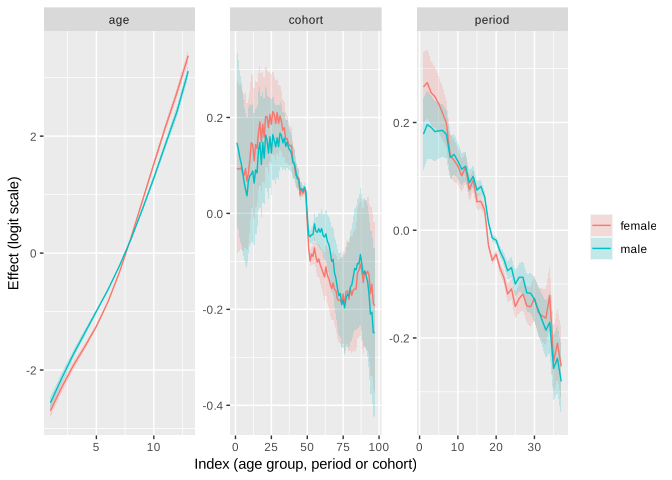
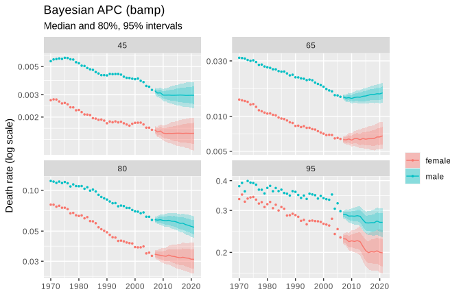
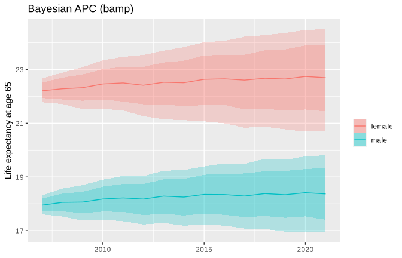
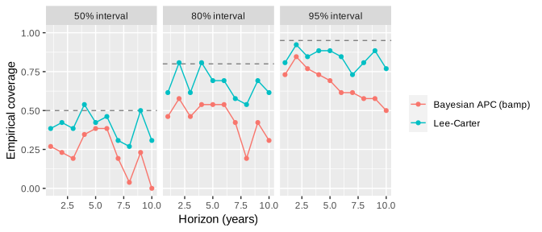

<!-- This vignette is precomputed because the MCMC runs take several minutes.
     Edit bayesian-apc.Rmd.orig and run dev/precompute-vignettes.R. -->


`apc_bayes()` wraps the bamp package (Schmid and Held 2007): a Bayesian
age-period-cohort (APC) model with binomial likelihood, random walk priors
for age, period and cohort effects and MCMC estimation. Forecasts
extrapolate the period and cohort effects as random walks for every
posterior draw, so they include parameter uncertainty.

Within mortensor, `apc_bayes()` behaves like every other model: same
`mt_fit()`, `mt_forecast()` and `mt_backtest()` calls, draws on the
single-year grid, life expectancy path by path, and ensembles.


```r
library(mortensor)
library(data.table)
```

## Data at the resolution of official statistics

We use HMD data for France (`demography::fr.mort`), 1970-2006, ages 40 and
over. To mimic official statistics, deaths are grouped into 5-year age
groups with an open 100+ interval; exposures stay in single years.


```r
fr <- suppressWarnings(as_mt_data(demography::fr.mort, years = 1970:2006))
fr <- mt_regroup(fr, age = 40:100)
x <- fr
x$obs$deaths <- mt_regroup(fr, age = seq(40, 100, 5))$obs$deaths
x
#> <mt_data> 2 strata by sex, omega = 110
#>   deaths     5-year groups 40-99, 100+; periods 1970-2006 (width 1); 962 cells
#>   exposure   single years 40-99, 100+; periods 1970-2006 (width 1); 4514 cells
#>   grid       <mt_axis: age, 61 intervals> 40 41 42 43 ... 98 99 100+
#>              <mt_axis: period, 37 intervals> 1970 1971 1972 1973 ... 2004 2005 2006
```

bamp is fitted where the deaths were observed: 5-year age groups with
annual periods (`periods_per_agegroup = 5`, Knorr-Held and Rainer 2001), so
that cohorts are defined by single birth years. The draws are then mapped to
single years of age with shape factors estimated from the ungrouped training
data (`step_ungroup()`).

## Fit

`mcmc_control("fast")` runs four chains of 5,000 iterations (burn-in 1,000,
thinning 5). The wrapper checks convergence with `bamp::checkConvergence()`
and refits with longer chains if needed; a stratum that does not converge is
reported as failed instead of being used.

The default priors are a second-order random walk for age and first-order
random walks for period and cohort (see "Choice of priors" below).


```r
prep <- mt_prep(step_ungroup())
t0 <- proc.time()
fit <- mt_fit(apc_bayes(mcmc = mcmc_control("fast")), x, prep = prep)
(proc.time() - t0)[["elapsed"]]
#> [1] 189.704
fit$diagnostics
#>    stratum status                              message seconds
#> 1:  female     ok                                       95.539
#> 2:    male     ok exposures rounded (max change 0.002)  90.889
```

Posterior medians and 90% credible intervals of the effects (logit scale,
identified with bamp's convention):


```r
eff <- apc_effects(fit)
eff[, .N, by = .(stratum, effect)]
#>    stratum effect  N
#> 1:  female    age 13
#> 2:  female period 37
#> 3:  female cohort 97
#> 4:    male    age 13
#> 5:    male period 37
#> 6:    male cohort 97
```


```r
ggplot2::ggplot(eff, ggplot2::aes(index, q0.5, colour = stratum, fill = stratum)) +
  ggplot2::geom_ribbon(ggplot2::aes(ymin = q0.05, ymax = q0.95), alpha = 0.2, colour = NA) +
  ggplot2::geom_line() +
  ggplot2::facet_wrap(~effect, scales = "free") +
  ggplot2::labs(x = "Index (age group, period or cohort)", y = "Effect (logit scale)", colour = NULL, fill = NULL)
```



## Forecast


```r
fc <- mt_forecast(fit, h = 15, n_draws = 1000, seed = 1)
fc
#> <mt_draws> Bayesian APC (bamp); origin 2006; 61 ages x 15 periods (2007-2021) x 2 strata x 1000 draws
mt_summarise(fc)[age %in% c("50", "70", "90") & period %in% c(2007, 2021),
                 .(label, age, period, q0.05 = q0.1, q0.5, q0.95 = q0.9)]
#>      label age period       q0.05        q0.5       q0.95
#>  1: female  50   2007 0.002287373 0.002389613 0.002496107
#>  2: female  70   2007 0.009821812 0.010253221 0.010687771
#>  3: female  90   2007 0.121700248 0.126300946 0.130740514
#>  4: female  50   2021 0.001852783 0.002225066 0.002682572
#>  5: female  70   2021 0.008535630 0.010081974 0.012049372
#>  6: female  90   2021 0.092991036 0.107860226 0.125603062
#>  7:   male  50   2007 0.005189661 0.005367916 0.005546749
#>  8:   male  70   2007 0.022274796 0.023040041 0.023780584
#>  9:   male  90   2007 0.169589385 0.174374077 0.178819370
#> 10:   male  50   2021 0.004040175 0.004661139 0.005392975
#> 11:   male  70   2021 0.019559979 0.022288084 0.025348748
#> 12:   male  90   2021 0.144170119 0.160650372 0.178952473
```


```r
mt_plot_forecast(fc, ages = c("45", "65", "80", "95"))
```




```r
mt_plot_life_expectancy(fc, at = 65)
```



## Backtest against Lee-Carter

One forecast origin (1996) with a ten-year horizon, scored against the
observed deaths in 5-year age groups:


```r
t0 <- proc.time()
bt <- rbind(
  mt_backtest(apc_bayes(mcmc = mcmc_control("fast")), x, origins = 1996, h = 10, prep = prep, n_draws = 500),
  mt_backtest(lee_carter(), x, origins = 1996, h = 10, prep = prep, n_draws = 500))
(proc.time() - t0)[["elapsed"]]
#> [1] 135.635
mt_score(bt, by = "model")
#>                  model       crps        wis        mae     mase     cov50
#> 1: Bayesian APC (bamp) 0.06680902 0.06070748 0.08879238 3.767262 0.2269231
#> 2:          Lee-Carter 0.03656689 0.03295069 0.04982160 2.026045 0.4000000
#>        cov80     cov95  pit_mean   n
#> 1: 0.4461538 0.6653846 0.2279085 260
#> 2: 0.6653846 0.8384615 0.5139384 260
```


```r
mt_plot_coverage(bt)
```



In this backtest the APC forecasts are less accurate than Lee-Carter and
too high: the mean PIT is well below 0.5 and the 95% intervals cover only
about two thirds of the observations. A first-order random walk carries the
last period effect forward without a trend, so the decline of mortality
after the origin is missed.

## Choice of priors

Second-order random walks for period and cohort extrapolate the most recent
trends, and their uncertainty grows quickly with the horizon. For French
women the 90% forecast interval of the death rate at ages 90-94 in 2021
(15 years ahead) is compared below for both choices:


```r
xf <- x
xf$obs <- lapply(xf$obs, function(o) o[o$stratum == 1])
xf$strata <- xf$strata[1]
fits <- list(
  "rw2 / rw1 / rw1 (default)" = fit,
  "rw2 / rw2 / rw2" = mt_fit(apc_bayes(period = "rw2", cohort = "rw2", mcmc = mcmc_control("fast")), xf, prep = prep))
rbindlist(lapply(names(fits), function(n) {
  f <- mt_forecast(fits[[n]], h = 15, n_draws = 1000, seed = 1)
  r <- f$rates[f$age$labels == "92", "2021", "female", ]
  data.table(priors = n, q0.05 = quantile(r, 0.05), q0.5 = median(r), q0.95 = quantile(r, 0.95))
}))
#>                       priors       q0.05       q0.5     q0.95
#> 1: rw2 / rw1 / rw1 (default) 0.114059840 0.13758837 0.1673836
#> 2:           rw2 / rw2 / rw2 0.004079141 0.07074083 0.5877700
```

With second-order random walks the interval spans two orders of magnitude,
which is not useful for planning; with first-order random walks it is narrow
but, as the backtest shows, biased when mortality keeps declining. Neither
choice is right for every dataset. Rolling-origin backtests are the way to
choose priors and the overdispersion term, and an ensemble with models that
carry a drift (`mt_ensemble()`) is a way to combine the strengths.

## Practical notes

* Runtime: about 1.5 minutes per stratum with `mcmc_control("fast")` for
  13 age groups and 37 years on one machine; `"final"` lets bamp choose the
  chain length and is several times slower.
* Heterogeneity terms (`"rw1+het"`, `"rw2+het"`) are not offered, because
  bamp 3.0.0 cannot forecast them.
* bamp needs whole numbers: deaths and exposures are rounded, and the
  largest relative change is reported in the diagnostics.
* The binomial likelihood uses exposures as denominators, which is close to
  the Poisson model for small rates.

## References

Knorr-Held L, Rainer E (2001). Prognosis of lung cancer mortality in West
Germany: a case study in Bayesian prediction. *Biostatistics* 2(1): 109-129.

Schmid VJ, Held L (2007). Bayesian age-period-cohort modeling and
prediction: BAMP. *Journal of Statistical Software* 21(8): 1-15.
