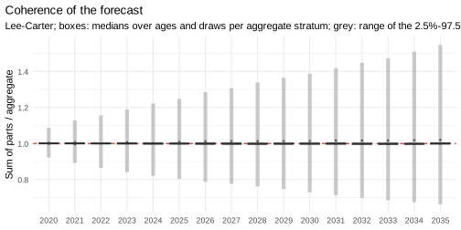
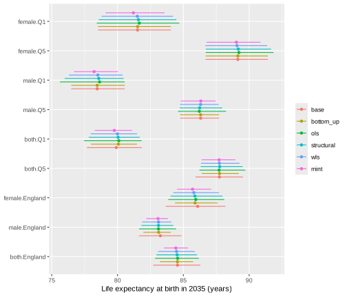

*This vignette is precomputed (`dev/precompute-vignettes.R`) because its
backtests take a few minutes.*

Mortality forecasts are often needed at several levels: for groups (here
sex by deprivation quintile), for their totals (each sex, each quintile)
and for the whole population. Forecasts made separately for each level do
not add up: the forecast deaths of England differ from the sum of the
forecast deaths of its quintiles. mortensor offers two routes to coherent
forecasts:

1. **coherent by construction**: forecast the bottom series and sum them
   (`method = "bottom_up"`), possibly with a joint model such as
   `li_lee()` that ties the bottom series together;
2. **reconciliation**: forecast every node of the hierarchy and adjust the
   forecasts so that they add up (`"ols"`, `"structural"`, `"wls"`,
   `"mint"`).

This vignette shows what each method changes: the coherence, the forecasts
of each level, their intervals and their accuracy in backtests.


```r
library(mortensor)
library(data.table)
library(ggplot2)
```

## Data and hierarchy

Deaths and mid-year populations in England by sex and IMD quintile,
2001-2019 (`ons_data`; Source: Office for National Statistics licensed
under the Open Government Licence v3.0):


```r
x <- mt_data(deaths = ons_data, population = ons_data, by = c("sex", "imd_decile"), age = "age_group",
             value = c(deaths = "all_causes", population = "population"))
x <- mt_as_exposure(x, type = "midyear")
x <- mt_group_levels(x, "imd_decile", function(d) paste0("Q", ceiling(as.numeric(d) / 2)), name = "quintile")
```

The hierarchy crosses two aggregation layers: the quintiles add up to
England and the sexes to both sexes. `mt_aggregate_strata()` adds the
aggregate strata (deaths and exposures are summed):


```r
h <- mt_hierarchy(sex = "both", quintile = list(total = "England"))
xa <- mt_aggregate_strata(x, h)
nodes <- mt_strata(xa, h)
nodes[, node := fifelse(level == "bottom", "sex x quintile",
                        fifelse(level == "total", "England",
                                fifelse(sex == "both", "quintile", "sex")))]
nodes[, .N, by = node]
#>              node  N
#> 1: sex x quintile 10
#> 2:            sex  2
#> 3:       quintile  5
#> 4:        England  1
```

Ten bottom series and eight aggregates: five quintiles (both sexes), two
sexes (England) and the total.

## Separate forecasts do not add up

Lee-Carter models fitted to each of the 18 strata and forecast to 2035:


```r
fc_base <- mt_forecast(mt_fit(lee_carter(), xa), to = 2035, n_draws = 1000, seed = 1)
```

Expected deaths (forecast rates times the exposures of 2019) of England
against the sum of the ten bottom series, in 2035:


```r
deaths_2035 <- function(fc) {
  D <- mt_deaths(fc, noise = FALSE)
  apply(D[, "2035", , , drop = FALSE], c(3, 4), sum)
}
D <- deaths_2035(fc_base)
bottom <- nodes[level == "bottom", label]
round(quantile(100 * (D["both.England", ] / colSums(D[bottom, ]) - 1), c(0.025, 0.5, 0.975)), 2)
#>   2.5%    50%  97.5% 
#> -15.84   0.32  20.10
```

The table gives quantiles of the difference in per cent over the paths.
In the median, the England model and the sum of its parts agree within
half a per cent. Path by path they differ by up to a fifth: the model of
England and the models of the quintiles draw their future trends
independently, so a path of England has no matching path of its parts.
Totals computed from the parts (for example their intervals) then differ
from the forecasts of the totals' own model. Life expectancy shows the
same: the female England model forecasts about 0.2 years more in 2035
than the sum of the female quintiles (table below, `base` against
`bottom_up`).

`mt_coherence()` and `mt_plot_coherence()` summarise the ratio of the sum
of the parts to each aggregate, per year: the boxes show how the median
ratios of the eight aggregates (over ages and draws) spread around 1. The
medians agree within 2%; single paths disagree far more (table above), and
`mt_coherence()` reports their 2.5% and 97.5% quantiles.


```r
mt_plot_coherence(fc_base, h)
```



## The methods

All methods of `mt_reconcile()` and `reconciled()` work draw by draw and
age by age on expected deaths. Bottom-up keeps the bottom forecasts and
replaces the aggregates by their sums. The other methods project the
forecasts of all 18 strata onto the coherent forecasts, with a weight
matrix $W$ that decides which strata absorb the adjustment (strata with
large weights move most):

| Method | $W$ | Adjustment falls on |
|---|---|---|
| `"bottom_up"` | (none) | the aggregates only |
| `"ols"` | identity | all strata equally, in deaths |
| `"structural"` | number of bottom series in each node | the aggregates, in proportion to their size in series |
| `"wls"` | variance of each stratum's draws | the most uncertain strata |
| `"mint"` | covariance of the draws, shrunk to its diagonal | uncertain strata, using their correlation |
| `"proportional"` | (none; needs `fixed` nodes) | the parts of each fixed node, in proportion to their forecasts |

MinT follows Wickramasuriya et al. (2019), with the covariance of the
forecast draws in place of in-sample residuals.


```r
methods <- c("bottom_up", "ols", "structural", "wls", "mint")
rec <- lapply(setNames(methods, methods), function(m) mt_reconcile(fc_base, h, method = m, seed = 1))
rbindlist(lapply(names(rec), function(m) {
  D <- deaths_2035(rec[[m]])
  data.table(method = m, gap_after = signif(max(abs(D["both.England", ] / colSums(D[bottom, ]) - 1)), 2),
             gap_before = round(rec[[m]]$reconciliation$max_relative_gap_before, 3))
}))
#>        method gap_after gap_before
#> 1:  bottom_up   2.2e-16      1.098
#> 2:        ols   1.2e-12      1.098
#> 3: structural   2.2e-16      1.098
#> 4:        wls   3.3e-16      1.098
#> 5:       mint   2.2e-16      1.098
```

After reconciliation every path adds up (`gap_after` is zero up to
rounding). `gap_before` is the largest relative gap over all ages, years
and aggregates of the base forecasts.

## What reconciliation changes in the forecasts

Life expectancy at birth in 2035, by node and method. The base forecasts
(`"base"`) are incoherent; all others are computed from the same base
draws, so the differences come from the reconciliation alone:


```r
all_fc <- c(list(base = fc_base), rec)
e0 <- rbindlist(lapply(names(all_fc), function(m) life_expectancy(all_fc[[m]])[period == 2035][, method := m]))
e0 <- merge(e0, nodes[, .(label, node)], by = "label")
e0[, method := factor(method, c("base", methods))]
dcast(e0[label %in% c("both.England", "female.England", "male.England", "both.Q1", "both.Q5", "female.Q1",
                      "male.Q5"), .(label, method, e0 = round(q0.5, 2))],
      label ~ method, value.var = "e0")
#>             label  base bottom_up   ols structural   wls  mint
#> 1:   both.England 84.55     84.55 84.57      84.53 84.48 84.43
#> 2:        both.Q1 79.91     80.06 80.10      80.04 79.99 79.75
#> 3:        both.Q5 87.74     87.75 87.72      87.76 87.74 87.72
#> 4: female.England 86.09     85.89 85.95      85.88 85.80 85.70
#> 5:      female.Q1 81.52     81.52 81.65      81.59 81.50 81.20
#> 6:   male.England 83.25     83.13 83.11      83.11 83.11 83.08
#> 7:        male.Q5 86.31     86.31 86.21      86.24 86.31 86.33
```


```r
show <- c("female.Q1", "female.Q5", "male.Q1", "male.Q5", "both.Q1", "both.Q5", "female.England",
          "male.England", "both.England")
ggplot(e0[label %in% show], aes(q0.5, factor(label, rev(show)), colour = method)) +
  geom_pointrange(aes(xmin = q0.025, xmax = q0.975), position = position_dodge(width = 0.7), size = 0.2) +
  scale_colour_mortensor(type = "categorical") +
  labs(x = "Life expectancy at birth in 2035 (years)", y = NULL, colour = NULL) +
  theme_mortensor(legend = "right")
```



How far each method moves the median and how it changes the width of the
95% interval, on average over the nodes of each type:


```r
base <- e0[method == "base", .(label, med0 = q0.5, width0 = q0.975 - q0.025)]
chg <- merge(e0[method != "base"], base, by = "label")
chg[, .(shift_median = round(mean(abs(q0.5 - med0)), 3),
        width_ratio = round(mean((q0.975 - q0.025) / width0), 2)), by = .(method, node)][
  , dcast(.SD, method ~ node, value.var = c("shift_median", "width_ratio"))]
#>        method shift_median_England shift_median_quintile shift_median_sex
#> 1:  bottom_up                0.006                 0.103            0.165
#> 2:        ols                0.012                 0.114            0.144
#> 3: structural                0.025                 0.096            0.177
#> 4:        wls                0.070                 0.065            0.216
#> 5:       mint                0.126                 0.044            0.285
#>    shift_median_sex x quintile width_ratio_England width_ratio_quintile
#> 1:                       0.000                0.70                 0.87
#> 2:                       0.114                0.93                 1.03
#> 3:                       0.081                0.86                 0.94
#> 4:                       0.045                0.78                 0.88
#> 5:                       0.148                0.52                 0.73
#>    width_ratio_sex width_ratio_sex x quintile
#> 1:            0.68                       1.00
#> 2:            0.90                       1.18
#> 3:            0.81                       1.09
#> 4:            0.73                       1.01
#> 5:            0.54                       0.86
```

* **Bottom-up** leaves the ten bottom forecasts unchanged (shift 0, width
  ratio 1) and replaces the aggregates by sums, whose intervals are
  narrower than those of the aggregates' own models.
* **OLS** moves bottom series and aggregates by similar amounts of deaths;
  the bottom intervals widen.
* **Structural** weights move the sexes and quintiles more than the bottom
  series.
* **WLS** moves the bottom series least among the projections.
* **MinT** moves every level and narrows every interval most (England to
  about half the width of its own model).

The intervals of England and of the two sexes narrow under every method:
sums of strata whose paths are only partly dependent vary less than the
aggregates' own models.

## Keeping a trusted total

Sometimes one node is trusted more than the others: an official
projection of the total population, or an all-cause forecast that the
causes of death must add up to. `fixed` keeps such nodes unchanged in
every draw (labels, or `"total"` for the grand total); the projection gives
them zero variance, so the other strata absorb the whole gap. It works
with every projection method:


```r
rec_fixed <- mt_reconcile(fc_base, h, method = "wls", fixed = "total", seed = 1)
rec_fixed$reconciliation$max_relative_change_fixed
#> [1] 1.098298e-09
e0_fixed <- life_expectancy(rec_fixed)[period == 2035][, method := "wls, England fixed"]
dcast(rbind(e0[method %in% c("base", "wls")], e0_fixed, fill = TRUE)[
  label %in% c("both.England", "female.England", "male.England", "female.Q1", "male.Q5"),
  .(label, method, e0 = round(q0.5, 2))], label ~ method, value.var = "e0")
#>             label  base   wls wls, England fixed
#> 1:   both.England 84.55 84.48              84.55
#> 2: female.England 86.09 85.80              85.88
#> 3:      female.Q1 81.52 81.50              81.65
#> 4:   male.England 83.25 83.11              83.12
#> 5:        male.Q5 86.31 86.31              86.24
```

England keeps the life expectancy of its own model (column `base`), and
the sexes and quintiles move towards it. In the backtest below (`"wls,
England fixed"`), England keeps the expected rates of its own model, but
its predictive draws add up the observation noise of the bottom series,
so its scores differ from those of its own model (CRPS 0.0452 against
0.0440). The quintiles and the bottom series absorb the trend of England
and become less accurate than with plain WLS (bottom series 0.0694 against
0.0677): here the total was not better informed than its parts.

`method = "proportional"` keeps the fixed nodes too, but scales the
parts below each of them in proportion to their own forecasts, draw by
draw (top-down allocation, Athanasopoulos et al. 2009), instead of moving
the most uncertain strata. It never sets a part to zero and is the usual
choice for causes of death that must add up to an all-cause forecast (see
"Causes of death by deprivation"); here the parts of England are the ten
sex-by-quintile strata:


```r
rec_prop <- mt_reconcile(fc_base, h, method = "proportional", fixed = "total", seed = 1)
e0_prop <- life_expectancy(rec_prop)[period == 2035][, method := "proportional, England fixed"]
dcast(rbind(e0_fixed, e0_prop, fill = TRUE)[
  label %in% c("both.England", "female.England", "male.England", "female.Q1", "male.Q5"),
  .(label, method, e0 = round(q0.5, 2))], label ~ method, value.var = "e0")
#>             label proportional, England fixed wls, England fixed
#> 1:   both.England                       84.55              84.55
#> 2: female.England                       85.90              85.88
#> 3:      female.Q1                       81.63              81.65
#> 4:   male.England                       83.14              83.12
#> 5:        male.Q5                       86.21              86.24
```

Here the two give almost the same life expectancies (differences of
at most 0.03 years). WLS moves each stratum in proportion to the
variance of its draws, which grows with the level of its rates, so both
methods move the strata with high rates most.

## What reconciliation changes in accuracy

The same comparison in a rolling-origin backtest, with the reconciliation
inside each fit (`reconciled()`), so that every origin is reconciled on its
own training data. A joint Li-Lee model with bottom-up aggregation is added
as a model that is coherent by construction:


```r
specs <- c(list(base = lee_carter()),
           setNames(lapply(methods, function(m) reconciled(lee_carter(), h, method = m)), methods),
           list("wls, England fixed" = reconciled(lee_carter(), h, method = "wls", fixed = "total"),
                "Li-Lee, bottom_up" = reconciled(li_lee(common_by = "sex"), h, method = "bottom_up"),
                "Ensemble, bottom_up" = reconciled(ensemble(ll = li_lee(common_by = "sex"),
                                                            rw = rwd(observation_noise = TRUE)),
                                                   h, method = "bottom_up")))
bt <- rbindlist(lapply(names(specs), function(n) {
  b <- mt_backtest(specs[[n]], xa, origins = 2008:2014, h = 5, n_draws = 200)
  b[, method := n]
}))
bt <- merge(bt, nodes[, .(label, node)], by = "label")
bt[, method := factor(method, names(specs))]
dcast(bt[, .(crps = round(mean(crps), 4)), by = .(method, node)], method ~ node, value.var = "crps")
#>                 method England quintile    sex sex x quintile
#> 1:                base  0.0440   0.0577 0.0467         0.0677
#> 2:           bottom_up  0.0455   0.0593 0.0483         0.0677
#> 3:                 ols  0.0449   0.0597 0.0483         0.0683
#> 4:          structural  0.0449   0.0593 0.0480         0.0678
#> 5:                 wls  0.0451   0.0591 0.0481         0.0677
#> 6:                mint  0.0458   0.0592 0.0484         0.0676
#> 7:  wls, England fixed  0.0452   0.0602 0.0491         0.0694
#> 8:   Li-Lee, bottom_up  0.0481   0.0574 0.0500         0.0665
#> 9: Ensemble, bottom_up  0.0465   0.0574 0.0503         0.0666
dcast(bt[, .(cov95 = round(mean(cov95), 3)), by = .(method, node)], method ~ node, value.var = "cov95")
#>                 method England quintile   sex sex x quintile
#> 1:                base   0.734    0.825 0.775          0.832
#> 2:           bottom_up   0.601    0.707 0.682          0.831
#> 3:                 ols   0.640    0.747 0.719          0.864
#> 4:          structural   0.620    0.730 0.700          0.847
#> 5:                 wls   0.616    0.709 0.686          0.833
#> 6:                mint   0.570    0.677 0.650          0.801
#> 7:  wls, England fixed   0.651    0.743 0.704          0.848
#> 8:   Li-Lee, bottom_up   0.666    0.756 0.786          0.845
#> 9: Ensemble, bottom_up   0.683    0.806 0.754          0.896
```

Reconciliation leaves the accuracy of the bottom series almost unchanged
and makes the aggregates slightly less accurate than their own models
(England: CRPS 0.0449 to 0.0458 against 0.0440). Their coverage drops more,
for England from 0.73 to between 0.57 and 0.64. On these data the
aggregates are large populations, and their own models capture common
movements of the quintiles (such as the slowdown after 2011) in their
trends; sums of bottom forecasts carry such movements only as far as the
dependence between the strata is reproduced. Li-Lee and the ensemble,
aggregated bottom-up, give the most accurate forecasts of the bottom
series and the quintiles, and the ensemble the best coverage of the bottom
series (0.90) and, among the coherent forecasts, of the quintiles (0.81)
and England (0.68). Here coherence costs a little accuracy and some coverage
of the totals. In hierarchies with noisy bottom series (small regions,
rare causes) the balance can differ; the regional vignette shows such a
case.

## Dependence between strata

Bottom-up sums of separately fitted models are only as wide as the
dependence between the strata allows. Independent draws cancel in the sum,
so the intervals of the totals are too narrow. By default, `reconciled()`
reorders the draws of separately fitted strata so that they move together
as the strata did in the training years (an empirical copula,
`dependence = "empirical"`):


```r
dep <- list(empirical = reconciled(lee_carter(), h, method = "bottom_up"),
            none = reconciled(lee_carter(), h, method = "bottom_up", dependence = "none"))
bd <- rbindlist(lapply(names(dep), function(n) {
  b <- mt_backtest(dep[[n]], xa, origins = 2008:2014, h = 5, n_draws = 200)
  b[, dependence := n]
}))
bd <- merge(bd, nodes[, .(label, node)], by = "label")
dcast(bd[, .(cov95 = round(mean(cov95), 3)), by = .(dependence, node)], dependence ~ node, value.var = "cov95")
#>    dependence England quintile   sex sex x quintile
#> 1:  empirical   0.601    0.707 0.682          0.831
#> 2:       none   0.461    0.744 0.596          0.829
```

Without the reordering, the 95% coverage of England falls from 0.60 to
0.46 and that of the sexes from 0.68 to 0.60; the quintiles (sums of two
strata) change little. The reordering restores part of the dependence; the
remaining under-coverage of the totals favours joint models or mixtures
for the bottom series.

## Choosing a method

* **Bottom-up** with a joint model or a mixture of the bottom series gave
  the most accurate forecasts of the bottom series and the quintiles here,
  and keeps the detailed forecasts as they are; the totals by sex and for
  England were less accurate than with the projections.
* Among the projections, **WLS** and **structural** weights keep the bottom
  series closest to their models; **OLS** treats a change of one death
  equally in all strata and widens the intervals of small strata.
* **MinT** gives the narrowest intervals; check that they still cover the
  observations (here they covered least).
* `fixed` keeps a node that is trusted more than the others (an official
  total, an all-cause forecast) and lets the rest of the hierarchy adapt;
  `"proportional"` scales the parts of fixed nodes without changing their
  composition. Fixed nodes whose forecasts do not add up (a node fixed
  together with all its parts) cannot all be kept; `mt_reconcile()` warns.
* Check the choice in a backtest at every level of the hierarchy, as above.
  When the totals are well estimated by their own models, report how much
  coherence changes them. The vignette "Coherent forecasts by sex, region
  and cause" compares the methods for the 16 German Laender, where small
  Laender make the differences larger.

## References

Athanasopoulos G, Ahmed RA, Hyndman RJ (2009). Hierarchical forecasts for
Australian domestic tourism. *International Journal of Forecasting* 25:
146-166.

Wickramasuriya SL, Athanasopoulos G, Hyndman RJ (2019). Optimal forecast
reconciliation for hierarchical and grouped time series through trace
minimization. *Journal of the American Statistical Association* 114(526):
804-819.

Clark M, Gangopadhyay S, Hay L, Rajagopalan B, Wilby R (2004). The Schaake
shuffle: a method for reconstructing space-time variability in forecasted
precipitation and temperature fields. *Journal of Hydrometeorology* 5(1):
243-262.
