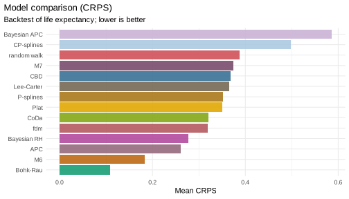

*This vignette is precomputed (`dev/precompute-vignettes.R`) because the
Bayesian model and the backtests take several minutes.*

mortensor does not have a preferred model. It implements some models
directly and wraps others from established packages (demography, StMoMo,
bamp, forecast), and all of them are fitted with `mt_fit()`, forecast with
`mt_forecast()` and return simulated paths in the same form. They can
therefore be compared in the same backtest and combined into ensembles of
any composition. This vignette shows both, on one population, and leaves
smoothing and the jump-off aside (see their own vignettes).

## The models

| Model | Constructor | Source | Idea |
|---|---|---|---|
| Random walk with drift | `rwd()` | mortensor | each log rate continues its average change; the standard benchmark of forecasting |
| Lee-Carter | `lee_carter()` | mortensor | one time index, with an age pattern of change (Lee and Carter 1992); `rotate = TRUE` moves the decline to older ages as life expectancy rises (Li, Lee and Gerland 2013) |
| Compositional data model | `coda()` | mortensor | the Lee-Carter model of the life-table distribution of deaths (Oeppen 2008; Bergeron-Boucher et al. 2017) |
| Functional demographic model | `hyndman_ullah()` | demography | rates smoothed over age, several components (Hyndman and Ullah 2007) |
| P-splines | `p_splines()` | mortensor | a smooth surface of the log rates over age and year, extended over the forecast years (Currie, Durban and Eilers 2004) |
| Constrained P-splines | `cp_splines()` | mortensor | the P-spline forecast, with the rates of ageing and of change of each age kept within their past range (Camarda 2019) |
| Rates of mortality improvement | `bohk_rau()` | mortensor | a Bayesian trend of the yearly improvement of each age, from smoothed rates (Bohk-Ewald and Rau 2017) |
| Lee-Carter, CBD, APC, Renshaw-Haberman, M6, M7, M8, Plat | `stmomo("lc")`, `"cbd"`, `"apc"`, `"rh"`, `"m6"`, `"m7"`, `"m8"`, `"plat"` | StMoMo | generalised age-period-cohort models (Cairns et al. 2009; Plat 2009; Villegas et al. 2018) |
| Bayesian Lee-Carter, RH, APC, CBD, M6 | `stanmomo("lc")`, `"rh"`, ... | StanMoMo | the StMoMo models fitted with Stan, with posterior uncertainty of all parameters (Barigou et al. 2023) |
| Bayesian APC | `apc_bayes()` | bamp | age, period and cohort effects with random-walk priors (Schmid and Held 2007) |
| Time series per age | `arima_series()`, `ets_series()` | forecast | a separate ARIMA or exponential smoothing model for each age |
| Tensor decomposition | `tucker3()` | mortensor | age, period and stratum factors |
| Several populations | `li_lee()`, `coda(coherent = TRUE)`, `coda_causes()` | mortensor | strata pooled around a common trend, or causes of death as shares |
| Coherent functional demographic model | `coherent_fdm()` | demography | product-ratio method with functional data models (Hyndman, Booth and Yasmeen 2013) |

The models for several populations are used in the applied vignettes; the
"Model reference" lists the assumptions and the sources of uncertainty of
every model.

## One population, many models

Men in England & Wales, single years of age 55-90, 1971-2011 (Human
Mortality Database, via StMoMo):


```r
library(mortensor)
library(data.table)
ew <- as_mt_data(StMoMo::EWMaleData)
ew <- mt_regroup(mt_set_grid(ew, age = single_ages(55, 90, open = FALSE)), age = single_ages(55, 90, open = FALSE))
ew <- mt_subset(ew, periods = c(1971, 2011))
models <- list("random walk" = rwd(),
               "Lee-Carter" = lee_carter(),
               "fdm" = hyndman_ullah(),
               "CBD" = stmomo("cbd"),
               "APC" = stmomo("apc"),
               "M6" = stmomo("m6"),
               "M7" = stmomo("m7"),
               "Plat" = stmomo("plat"),
               "CoDa" = coda(),
               "P-splines" = p_splines(),
               "CP-splines" = cp_splines(),
               "Bohk-Rau" = bohk_rau(),
               "Bayesian APC" = apc_bayes(mcmc = mcmc_control("fast")),
               "Bayesian RH" = stanmomo("rh", h_max = 20, cores = 4))
set.seed(1)  # the MCMC samplers of bamp and Stan draw their seeds from R
fc <- lapply(models, function(m) mt_forecast(mt_fit(m, ew), h = 20, n_draws = 500, seed = 1))
#> Warning in report_fit_problems(diagnostics, spec$label, classes): Functional
#> demographic model: smooth.demogdata() failed (initial parameters not feasible);
#> smoothed without the monotonicity constraint. (diagnostics of 1 stratum/strata
#> of the fit).
```

The warning comes from fdm: its default smoothing over age, a spline that
must increase above age 65 (`demography::smooth.demogdata()`), could not
be fitted to these ages, so the rates were smoothed without that
constraint. The same warning recurs at each backtest origin below, where it
is not shown again.

Life expectancy at 55 (all models use the same ages) in 2021 and 2031:


```r
mt_compare_forecasts(fc, periods = c(2021, 2031))
#>    label period      random walk       Lee-Carter              fdm
#> 1:  male   2021 27.4 (26.4-28.2) 27.5 (26.5-28.3) 27.7 (27.4-28.0)
#> 2:  male   2031 28.6 (27.2-29.7) 28.7 (27.5-29.8) 29.2 (28.5-29.8)
#>                 CBD              APC               M6               M7
#> 1: 27.5 (26.6-28.3) 27.4 (26.6-28.1) 27.2 (26.3-28.0) 27.5 (26.6-28.3)
#> 2: 28.7 (27.6-29.7) 28.4 (27.4-29.5) 28.1 (26.8-29.0) 28.8 (27.7-29.9)
#>                Plat             CoDa        P-splines       CP-splines
#> 1: 27.0 (26.1-27.8) 27.9 (26.1-29.0) 28.5 (27.7-29.3) 27.3 (27.1-27.5)
#> 2: 27.9 (26.6-28.9) 29.7 (27.8-30.9) 30.6 (28.3-32.1) 28.4 (28.2-28.6)
#>            Bohk-Rau     Bayesian APC      Bayesian RH
#> 1: 28.1 (27.5-28.2) 26.6 (25.4-27.6) 27.5 (26.5-28.4)
#> 2: 29.9 (29.1-30.1) 26.7 (25.1-28.2) 28.5 (27.1-29.8)
```


```r
mt_plot_compare(fc[c("random walk", "Lee-Carter", "fdm", "APC", "Bayesian APC")], data = ew)
```


All models forecast a further rise, at different paces and with
different uncertainty. By 2031 the medians range from 26.7 to 30.6 years:

* **P-splines**, **Bohk-Rau**, **CoDa** and **fdm** give the highest
  forecasts (30.6, 29.9, 29.7 and 29.2 years). The P-spline surface
  continues the trend of each age over the last years and has the widest
  interval (28.3-32.1). The interval of Bohk-Rau is narrow, and its median
  lies close to its upper bound (29.1-30.1): the forecast improvements
  are limited to 3.5% a year (the upper limit of the paper), which cuts
  off the upper part of the distribution.
* The period models (**random walk**, **Lee-Carter**, **CBD**) and **M7**
  agree closely, at about 28.7 years.
* The cohort models **APC** and **M6** are lower (28.4 and 28.1 years),
  and **Plat** is lower still (27.9 years); the **Bayesian RH** (StanMoMo:
  Lee-Carter with a cohort effect, fitted with Stan) lies between them and
  the period models (28.5 years).
* **CP-splines** forecast 28.4 years with the narrowest interval of all
  (28.2-28.6). Their draws carry the uncertainty of the fit only, without
  innovations of the trend.
* The **Bayesian APC** barely moves. Its default priors are first-order
  random walks for period and cohort (`period = "rw1"`), which carry the
  last period effect forward without a trend; only the cohorts entering
  the age range change the forecast (see "Bayesian age-period-cohort
  models with bamp" for the alternative with second-order random walks).

The width of an interval reflects what each model treats as uncertain.
Whether the medians are accurate and the intervals wide enough can only
be checked against data the models did not see.

## Which model forecast best

A backtest from three origins, each forecasting ten years, scores the
log death rates and life expectancy at 55 (`_le`, in years):


```r
bt <- mt_compare(models, ew, origins = c(1991, 1996, 2001), h = 10, n_draws = 200, quantities = "life_expectancy")
mt_score_table(bt, metrics = c("crps", "cov95"))
#>            model   crps cov95 crps_le cov95_le
#>  1:  random walk 0.0514 0.973   0.388    0.767
#>  2:   Lee-Carter 0.0571 0.688   0.365    0.933
#>  3:          fdm 0.0534 0.463   0.320    0.300
#>  4:          CBD 0.0565 0.713   0.368    0.833
#>  5:          APC 0.0393 0.947   0.261    1.000
#>  6:           M6 0.0316 0.981   0.184    1.000
#>  7:           M7 0.0523 0.816   0.374    0.800
#>  8:         Plat 0.0531 0.833   0.351    0.967
#>  9:         CoDa 0.0497 0.875   0.321    0.767
#> 10:    P-splines 0.0565 0.628   0.352    0.400
#> 11:   CP-splines 0.0624 0.359   0.497    0.100
#> 12:     Bohk-Rau 0.0337 0.682   0.108    0.867
#> 13: Bayesian APC 0.0736 0.690   0.586    0.667
#> 14:  Bayesian RH 0.0455 0.901   0.278    1.000
```


```r
mt_plot_scores(bt, by = "model", target = "life_expectancy")
```



* **M6** forecast the rates best (CRPS 0.032), followed by **Bohk-Rau**
  (0.034) and **APC** (0.039). The intervals of M6 and APC covered the
  observed values (95% coverage of the rates 0.98 and 0.95).
* **Bohk-Rau** forecast life expectancy best by far (CRPS 0.108 years,
  against 0.184 for M6), but its intervals are too narrow: they covered
  0.68 of the observed rates and 0.87 of the observed values of life
  expectancy.
* The **Bayesian RH** follows APC for the rates (0.0455); its 95%
  intervals covered 0.90 of the observed rates.
* **CoDa** forecast the rates (0.050) and life expectancy (0.321 years)
  less accurately than the cohort models; its intervals covered 0.88 of
  the rates and 0.77 of the values of life expectancy.
* The period models and the random walk lie close together; the random
  walk forecast the single rates slightly better than Lee-Carter and CBD.
  The intervals of Lee-Carter and CBD are too narrow for the rates (95%
  coverage 0.69 and 0.71): their draws add only the Poisson variation of
  the deaths to the forecast rates. Those of the random walk, which
  forecasts the observed rates themselves, cover 0.97. **M7**, CBD with a
  cohort effect, forecast the rates more accurately than CBD (0.052
  against 0.057), but not life expectancy. **Plat** forecast the rates
  about as accurately as M7 (0.053) and life expectancy slightly better
  than both (0.351 years).
* **P-splines** forecast the rates about as accurately as Lee-Carter
  (0.0565 against 0.0571), with intervals that are too narrow (95%
  coverage 0.63). **CP-splines** were less accurate (0.062), and their
  intervals covered only 0.36 of the observed rates and 0.10 of the
  values of life expectancy.
* **fdm** forecast life expectancy fairly accurately, but its intervals
  are far too narrow (95% coverage 0.46 for the rates and 0.30 for life
  expectancy).
* The **Bayesian APC** is the least accurate: a forecast without a trend
  falls behind when mortality keeps declining.

Two cautions. Life expectancy is scored on 30 forecasts (3 origins times
10 years), so a coverage of 0.93 and one of 0.77 differ by five
forecasts. And the ranking holds for this population and these years; in
other data, a period model may forecast best.

## Is the best model really better?

With three origins, a model can rank first by chance. `mt_dm_test()`
tests whether the mean score of a model differs from that of a reference
model by more than the origins vary (Diebold and Mariano 1995). By
default the variance of the mean difference is the equal-weighted cosine
estimate, with critical values from a t distribution (Lazarus, Lewis,
Stock and Watson 2018), so that the test keeps
its nominal size with few origins whose test years overlap. Three origins
are too few: the test would have one degree of freedom. A second backtest
from 16 origins (1991-2006), five years ahead, tests life expectancy at 55
against Bohk-Rau, the most accurate model for life expectancy above. To
save time it leaves out fdm, CBD, M7 and the Bayesian models of bamp and
Stan:


```r
fast <- models[c("random walk", "Lee-Carter", "APC", "M6", "Plat", "CoDa", "P-splines", "CP-splines", "Bohk-Rau")]
bt_dm <- mt_compare(fast, ew, origins = 1991:2006, h = 5, n_draws = 200, quantities = "life_expectancy")
dm <- mt_dm_test(bt_dm, ref = "Bohk-Rau", targets = "life_expectancy")
dm[horizon %in% c("1", "5", "all"), list(model, horizon, df, score, score_ref, mean_diff, p_value)]
#>           model horizon df      score  score_ref    mean_diff     p_value
#>  1: random walk       1  2 0.09724537 0.09099150  0.006253872 0.157400614
#>  2: random walk       5  2 0.33916424 0.11117290  0.227991344 0.010672063
#>  3: random walk     all  2 0.20274758 0.09241699  0.110330596 0.017752259
#>  4:  Lee-Carter       1  2 0.09869128 0.09099150  0.007699773 0.029304835
#>  5:  Lee-Carter       5  2 0.33400346 0.11117290  0.222830559 0.008694245
#>  6:  Lee-Carter     all  2 0.20342037 0.09241699  0.111003388 0.017919348
#>  7:         APC       1  2 0.10308853 0.09099150  0.012097025 0.139017394
#>  8:         APC       5  2 0.22542556 0.11117290  0.114252662 0.006023920
#>  9:         APC     all  2 0.15659917 0.09241699  0.064182182 0.010681374
#> 10:          M6       1  2 0.08185772 0.09099150 -0.009133784 0.240459083
#> 11:          M6       5  2 0.18850382 0.11117290  0.077330925 0.082025317
#> 12:          M6     all  2 0.12847414 0.09241699  0.036057156 0.057652444
#> 13:        Plat       1  2 0.08671621 0.09099150 -0.004275289 0.510662864
#> 14:        Plat       5  2 0.32694266 0.11117290  0.215769759 0.008177062
#> 15:        Plat     all  2 0.19160430 0.09241699  0.099187312 0.009181521
#> 16:        CoDa       1  2 0.15954209 0.09099150  0.068550585 0.095605371
#> 17:        CoDa       5  2 0.25731151 0.11117290  0.146138611 0.016253603
#> 18:        CoDa     all  2 0.19907843 0.09241699  0.106661448 0.005195717
#> 19:   P-splines       1  2 0.13070078 0.09099150  0.039709277 0.008357861
#> 20:   P-splines       5  2 0.39054479 0.11117290  0.279371893 0.050576023
#> 21:   P-splines     all  2 0.24080913 0.09241699  0.148392140 0.051245330
#> 22:  CP-splines       1  2 0.10823133 0.09099150  0.017239831 0.041965892
#> 23:  CP-splines       5  2 0.42735305 0.11117290  0.316180154 0.006180024
#> 24:  CP-splines     all  2 0.24483804 0.09241699  0.152421054 0.017647085
#>           model horizon df      score  score_ref    mean_diff     p_value
```

A positive `mean_diff` means a higher CRPS than Bohk-Rau, so a less
accurate forecast. With 16 origins the test has 2 degrees of freedom
(`df`) and finds only large and consistent differences. Bohk-Rau had the
lowest mean CRPS five years ahead and on average over the five horizons.
On average, the difference is significant at the 5% level against the
random walk, Lee-Carter, APC, Plat, CoDa and CP-splines (p from 0.005 to
0.018), but not against M6 (p = 0.058) and P-splines (p = 0.051). Five
years ahead it is significant against the same six models (p from 0.006
to 0.016), and again not against M6 (p = 0.082) and P-splines
(p = 0.051). One year ahead, M6 and Plat had a lower mean CRPS
than Bohk-Rau (p = 0.24 and 0.51), and the difference is significant
only against Lee-Carter, P-splines and CP-splines (p from 0.008 to
0.042). Forecasts from neighbouring origins share test years, which the
test allows for.
The version of `forecast::dm.test()` (`varestimator = "acf"`, with the
correction of Harvey, Leybourne and Newbold 1997) is an option; with few
overlapping origins it rejects too often when the models are equally
accurate (see `?mt_dm_test`).

## Ensembles of any combination

`ensemble()` combines any models, implemented or wrapped. Each draw of the
ensemble comes from one of the components, chosen in proportion to the
weights, so the ensemble is a mixture: where the components disagree, its
intervals are wider than those of each component. That is often what is
needed, because the disagreement between plausible models is part of the
uncertainty about the future.

Weights can be equal, set by hand, or estimated from an inner backtest on
the training data only (`weights = "crps"`: inversely proportional to the
CRPS of each component; `"stack"`: the combination that minimised the
error of the median forecasts), and `top_k` keeps the best components.
CRPS weights and `top_k` are package-specific (see the article "Methods
and sources"):


```r
ens <- list(
  "equal: Lee-Carter, fdm, APC, M6, Bayesian APC" =
    ensemble(lc = lee_carter(), fdm = hyndman_ullah(), apc = stmomo("apc"), m6 = stmomo("m6"),
             bamp = apc_bayes(mcmc = mcmc_control("fast"))),
  "CRPS weights, best 3 of 6" =
    ensemble(rw = rwd(), lc = lee_carter(), fdm = hyndman_ullah(), cbd = stmomo("cbd"), apc = stmomo("apc"),
             m6 = stmomo("m6"), weights = "crps", top_k = 3))
fit_ens <- mt_fit(ens[[2]], ew)
round(fit_ens$weights, 2)
#>   rw   lc  fdm  cbd  apc   m6 
#> 0.27 0.00 0.00 0.00 0.35 0.38
```

On the data up to 2011, the inner backtest kept the random walk, APC and
M6, weighted by their CRPS. The ensembles in the same backtest as the
single models:


```r
bt_ens <- mt_compare(ens, ew, origins = c(1991, 1996, 2001), h = 10, n_draws = 200, quantities = "life_expectancy")
mt_score_table(rbind(bt, bt_ens), metrics = c("crps", "cov95"))
#>                                             model   crps cov95 crps_le cov95_le
#>  1:                                   random walk 0.0514 0.973   0.388    0.767
#>  2:                                    Lee-Carter 0.0571 0.688   0.365    0.933
#>  3:                                           fdm 0.0534 0.463   0.320    0.300
#>  4:                                           CBD 0.0565 0.713   0.368    0.833
#>  5:                                           APC 0.0393 0.947   0.261    1.000
#>  6:                                            M6 0.0316 0.981   0.184    1.000
#>  7:                                            M7 0.0523 0.816   0.374    0.800
#>  8:                                          Plat 0.0531 0.833   0.351    0.967
#>  9:                                          CoDa 0.0497 0.875   0.321    0.767
#> 10:                                     P-splines 0.0565 0.628   0.352    0.400
#> 11:                                    CP-splines 0.0624 0.359   0.497    0.100
#> 12:                                      Bohk-Rau 0.0337 0.682   0.108    0.867
#> 13:                                  Bayesian APC 0.0736 0.690   0.586    0.667
#> 14:                                   Bayesian RH 0.0455 0.901   0.278    1.000
#> 15: equal: Lee-Carter, fdm, APC, M6, Bayesian APC 0.0426 0.952   0.298    1.000
#> 16:                     CRPS weights, best 3 of 6 0.0354 0.980   0.238    1.000
```

* The **equal-weight ensemble** is more accurate than the average of its
  components (CRPS of the rates 0.043 against 0.051), and its intervals
  cover. This always holds: the CRPS is a convex function of the forecast
  distribution, so the CRPS of a mixture is never larger than the weighted
  mean of the CRPS of its components. It includes the weak Bayesian APC,
  which pulls it behind APC and M6.
* The **CRPS-weighted ensemble** comes close to M6, the best single model
  for the rates (CRPS 0.035 against 0.032), without knowing beforehand
  which model that would be: its weights were estimated anew at each
  origin from the years before it.

An ensemble rarely beats the best single model in hindsight. Its value is
that it does not depend on picking that model in advance, and that its
intervals include the disagreement between the models:


```r
fc_ens <- mt_forecast(mt_fit(ens[[1]], ew), h = 20, n_draws = 500, seed = 1)
mt_plot_compare(c(fc[c("Lee-Carter", "APC", "Bayesian APC")], list("equal ensemble" = fc_ens)), data = ew)
```


## How to choose

* Start from a few models that differ in their assumptions (period trend
  only, cohort effects, smooth age pattern) and a benchmark (`rwd()`).
* Compare them in a backtest on the quantity the analysis is about, with
  the accuracy (CRPS) and the coverage of the intervals, and test whether
  the differences are larger than chance (`mt_dm_test()`); more origins
  make the test more sensitive.
* Where no model is clearly best, or the single models are too narrow,
  use an ensemble; estimated weights (`weights = "crps"`, `top_k`) are
  re-estimated at every backtest origin, so they can be checked in the
  same way.
* For several populations (sexes, regions, deprivation groups) add the
  pooled models (`li_lee()`, `coherent_fdm()`) and make totals coherent
  (`reconciled()`); see the applied vignettes.

## References

Barigou K, Goffard P-O, Loisel S, Salhi Y (2023). Bayesian model averaging
for mortality forecasting using leave-future-out validation. *International
Journal of Forecasting* 39(2): 674-690.

Bergeron-Boucher M-P, Canudas-Romo V, Oeppen J, Vaupel JW (2017).
Coherent forecasts of mortality with compositional data analysis.
*Demographic Research* 37(17): 527-566.

Bohk-Ewald C, Rau R (2017). Probabilistic mortality forecasting with
varying age-specific survival improvements. *Genus* 73(1): 1.

Cairns AJG, Blake D, Dowd K, Coughlan GD, Epstein D, Ong A, Balevich I
(2009). A quantitative comparison of stochastic mortality models using
data from England and Wales and the United States. *North American
Actuarial Journal* 13(1): 1-35.

Camarda CG (2019). Smooth constrained mortality forecasting.
*Demographic Research* 41(38): 1091-1130.

Currie ID, Durban M, Eilers PHC (2004). Smoothing and forecasting
mortality rates. *Statistical Modelling* 4(4): 279-298.

Diebold FX, Mariano RS (1995). Comparing predictive accuracy. *Journal of
Business & Economic Statistics* 13(3): 253-263.

Harvey D, Leybourne S, Newbold P (1997). Testing the equality of
prediction mean squared errors. *International Journal of Forecasting*
13(2): 281-291.

Hyndman RJ, Booth H, Yasmeen F (2013). Coherent mortality forecasting: the
product-ratio method with functional time series models. *Demography*
50(1): 261-283.

Hyndman RJ, Ullah MS (2007). Robust forecasting of mortality and fertility
rates: a functional data approach. *Computational Statistics & Data
Analysis* 51(10): 4942-4956.

Lazarus E, Lewis DJ, Stock JH, Watson MW (2018). HAR inference:
recommendations for practice. *Journal of Business & Economic
Statistics* 36(4): 541-559.

Lee RD, Carter LR (1992). Modeling and forecasting U.S. mortality.
*Journal of the American Statistical Association* 87(419): 659-671.

Li N, Lee R, Gerland P (2013). Extending the Lee-Carter method to model
the rotation of age patterns of mortality decline for long-term
projections. *Demography* 50(6): 2037-2051.

Oeppen J (2008). Coherent forecasting of multiple-decrement life tables:
a test using Japanese cause of death data. CODAWORK'08, Universitat de
Girona.

Plat R (2009). On stochastic mortality modeling. *Insurance: Mathematics
and Economics* 45(3): 393-404.

Schmid VJ, Held L (2007). Bayesian age-period-cohort modeling and
prediction - BAMP. *Journal of Statistical Software* 21(8): 1-15.

Villegas AM, Kaishev VK, Millossovich P (2018). StMoMo: an R package for
stochastic mortality modeling. *Journal of Statistical Software* 84(3):
1-38.
