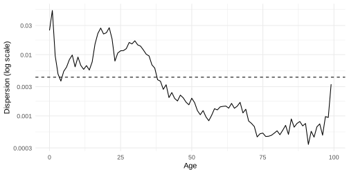
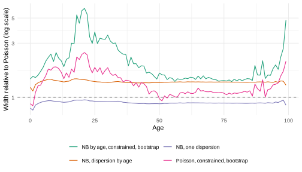
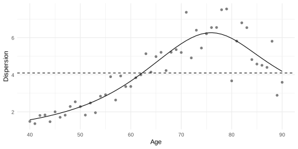
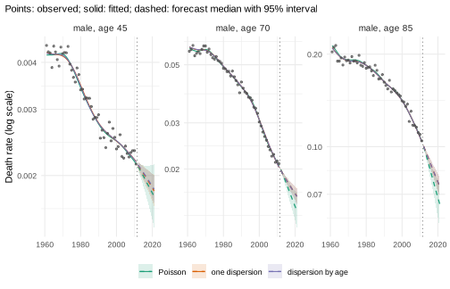
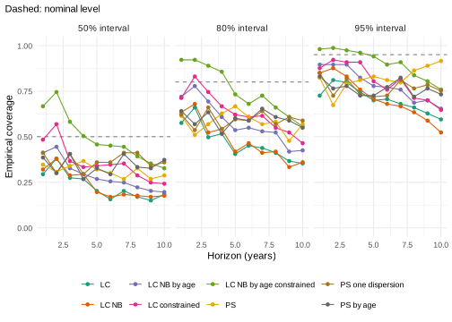

*This vignette is precomputed (`dev/precompute-vignettes.R`) because its
bootstraps and backtests take about a minute.*

Most models in this package treat the deaths of an age group in a year as
Poisson counts given the death rate. Real death counts often vary more.
This vignette explains where the extra variation comes from, shows the
published ways of modelling it for Lee-Carter and for P-splines, and what
they do to the forecast intervals.


```r
library(mortensor)
library(data.table)
```

## Why deaths vary more than Poisson counts

Poisson counts arise when everybody in a cell (an age group in a year)
has the same probability of dying, independently of the others. Their
variance equals their mean. Two things make real counts vary more:

* **Heterogeneity.** The people in a cell differ in health, occupation,
  education and region, and the mix changes from year to year. Deaths
  also cluster: an epidemic, a heat wave or a hard winter raises the
  deaths of many people in the same cells. Li, Hardy and Tan (2009) model
  this by clusters within each cell whose death rates differ by a gamma
  distributed factor.
* **Unmodelled variation.** A model with few parameters leaves part of the
  variation of the rates unexplained. Lee-Carter has one period index, so
  a year that is unusual at only some ages deviates from the fit. These
  deviations look like extra variation of the counts around the fitted
  means.

The counts are then *overdispersed*: their variance exceeds their mean.
Overdispersion is common in counts (McCullagh and Nelder 1989). A Poisson
model of overdispersed counts overstates the precision of its estimates,
and its interval forecasts are too narrow (Li, Hardy and Tan 2009, Section
3). Where a criterion of the Poisson deviance chooses the smoothness of a
surface, the surface follows the noise (Djeundje and Currie 2011).

`summary()` of a fit reports the Poisson deviance per cell, which is about
1 for Poisson counts around a correct model. The models below use two
forms of the extra variation:

| Variance of the deaths `D` with mean `mu` | Constructor | Source |
|---|---|---|
| `mu + alpha mu^2`, one `alpha` | `lee_carter(family = "nb")` | Delwarde, Denuit and Partrat (2007) |
| `mu + alpha[x] mu^2`, one `alpha` per age | `lee_carter(family = "nb", dispersion = "age")` | Li, Hardy and Tan (2009) |
| `phi mu`, one `phi` | `p_splines(overdispersion = TRUE)` | MortalitySmooth (Camarda 2015) |
| `phi[x] mu`, smooth over age | `p_splines(overdispersion = "age")` | Djeundje and Currie (2011) |

The first form is the negative binomial distribution: Poisson deaths
given a rate that varies around the model by a gamma distributed factor
with mean 1 and variance `alpha`. `sqrt(alpha)` is the coefficient of
variation of that factor. Its share of the variance grows with the mean,
so it dominates in cells with many deaths. The second form keeps the
Poisson relation between mean and variance and multiplies the variance by
`phi` (quasi-likelihood).

## Lee-Carter: one dispersion or one per age

The data are France, total population, ages 0-99, 1950-2006 (Human
Mortality Database, via the demography package). Li, Hardy and Tan (2009)
used the same ages and the years 1950-2004 for the United States and
Canada. The Poisson Lee-Carter model (Lee and Carter 1992; Brouhns,
Denuit and Vermunt 2002) first:


```r
fr <- as_mt_data(demography::fr.mort, series = "total", years = 1950:2006)
fr <- mt_subset(fr, ages = c(0, 100))
fit_p <- mt_fit(lee_carter(), fr)
summary(fit_p)
#> Lee-Carter
#>   data: 1 strata; ages 0 to 99; periods 1950-2006
#>   model and uncertainty:
#>     log m(x,t) = a(x) + b(x) k(t), estimated by Poisson maximum likelihood
#>     (Brouhns et al. 2002). k(t) follows a random walk with drift; draws include
#>     its innovations and the uncertainty of the drift. a(x) and b(x) are fixed
#>     (parameter uncertainty with bootstrapped()). Predictive draws add Poisson
#>     variation of the deaths given the rates. Jump-off: fitted rates.
#>   fit: Poisson deviance 62154.5 on 5700 cells (10.90 per cell); 44.9% of deviance residuals beyond +/-2
```

The Poisson deviance is 10.9 per cell, and 44.9% of the deviance
residuals lie beyond ±2 (about 5% for Poisson counts around a correct
model). The negative binomial versions estimate the extra variation, with
one dispersion for all ages (Delwarde, Denuit and Partrat 2007) or one per
age (Li, Hardy and Tan 2009):


```r
lc <- list("Poisson" = lee_carter(),
           "NB, one dispersion" = lee_carter(family = "nb"),
           "NB, dispersion by age" = lee_carter(family = "nb", dispersion = "age"))
fits <- lapply(lc, mt_fit, data = fr)
mt_parameters(fits[["NB, one dispersion"]])[parameter == "nb_dispersion"]
#>    stratum     parameter index       value
#> 1:   total nb_dispersion       0.004283558
disp <- mt_parameters(fits[["NB, dispersion by age"]])[parameter == "nb_dispersion"]
disp[index %in% c(0, 1, 10, 20, 30, 40, 60, 80, 90, 99), .(age = index, dispersion = signif(value, 2))]
#>     age dispersion
#>  1:   0    0.02500
#>  2:   1    0.05300
#>  3:  10    0.00910
#>  4:  20    0.02300
#>  5:  30    0.01700
#>  6:  40    0.00270
#>  7:  60    0.00140
#>  8:  80    0.00057
#>  9:  90    0.00075
#> 10:  99    0.00330
```

`mt_parameters()` reports the dispersions (`nb_dispersion`). The single
dispersion is 0.0043: the rate of a cell varies around the model by a
factor with a coefficient of variation of about 6.5% (`sqrt(0.0043)`). By
age, the dispersion ranges from 0.00034 at age 91 (1.8%) to 0.053 at age 1
(23%). The dashed line is the single dispersion:


```r
ggplot2::ggplot(disp, ggplot2::aes(as.numeric(index), value)) +
  ggplot2::geom_line() +
  ggplot2::geom_hline(yintercept = mt_parameters(fits[["NB, one dispersion"]])[parameter == "nb_dispersion", value],
                      linetype = "dashed") +
  ggplot2::scale_y_log10(labels = function(v) sprintf("%g", v)) +
  ggplot2::labs(x = "Age", y = "Dispersion (log scale)") +
  theme_mortensor()
```



The dispersion is highest in the first years of life and between ages 15
and 35, lowest from about age 70, and rises again at the highest ages.
The single dispersion is too high for the old ages and too low for young
adults. Li, Hardy and Tan (2009, Section 4.2) found that the dispersion
varies with age in their data and that one dispersion for all ages is
insufficient.

**Likelihood ratio.** The log-likelihood of each fit follows from its
parameters `a`, `b`, `k` and the dispersions. The number of parameters
counts `a` and `b` for 100 ages and `k` for 57 years, less the two
constraints `sum(b) = 1` and `sum(k) = 0`, plus the dispersions:


```r
loglik <- function(fit, data) {
  p <- mt_parameters(fit)
  mu <- mt_array(data, "exposure")[, , 1] *
    exp(p[parameter == "a", value] + outer(p[parameter == "b", value], p[parameter == "k", value]))
  D <- mt_array(data, "deaths")[, , 1]
  alpha <- p[parameter == "nb_dispersion", value]
  if (!length(alpha)) return(sum(stats::dpois(D, mu, log = TRUE)))
  sum(stats::dnbinom(D, size = 1 / alpha, mu = mu, log = TRUE))
}
n_age <- 100
n_year <- 57
ll <- vapply(fits, loglik, 0, data = fr)
n_par <- 2 * n_age + n_year - 2 + c(0, 1, n_age)
data.table(model = names(fits), loglik = round(ll), parameters = n_par, AIC = round(-2 * ll + 2 * n_par))
#>                    model loglik parameters    AIC
#> 1:               Poisson -58457        255 117423
#> 2:    NB, one dispersion -37648        256  75809
#> 3: NB, dispersion by age -36007        355  72725
c(lr = 2 * (ll[[3]] - ll[[2]]), df = n_age - 1, q99 = stats::qchisq(0.99, n_age - 1))
#>        lr        df       q99 
#> 3282.0369   99.0000  134.6416
```

One dispersion raises the log-likelihood by about 20,800. The dispersions
by age raise it by another 1,641 with 99 more parameters: the likelihood
ratio statistic is 3,282 on 99 degrees of freedom, far above the 99%
quantile of the chi-squared distribution (135). The AIC also prefers the
dispersion by age (72,725 against 75,809 and 117,423).

**Forecast origin correction.** With `sum(k) = 0`, the fitted rates of the
last year differ from the observed ones, and the forecast starts from the
fitted rates. Li, Hardy and Tan (2009, Section 3 and Appendix 2) fix
`a[x]` at the observed log rates of the last year and `k` at 0 in that
year, and estimate `b`, `k` and the dispersions by maximum likelihood
under these constraints (`jump_off = "constrained"`):


```r
fit_c <- mt_fit(lee_carter(family = "nb", dispersion = "age", jump_off = "constrained"), fr)
disp_c <- mt_parameters(fit_c)[parameter == "nb_dispersion", value]
c(loglik = loglik(fit_c, fr), median_ratio = stats::median(disp_c / disp$value))
#>        loglik  median_ratio 
#> -36772.619295      1.273315
```

The constraints lower the log-likelihood (-36,773 against -36,007). The
constrained fit leaves more variation around the fitted rates, and the
dispersions take it up: they are 1.27 times those of the fit without the
constraints (median over ages).

**Parametric bootstrap.** The draws of `lee_carter()` include the
innovations of `k` and the uncertainty of its drift; `a` and `b` are
fixed. `bootstrap = TRUE` adds the uncertainty of the parameters by the
parametric bootstrap of Li, Hardy and Tan (2009, Section 3). It simulates
deaths from the fitted model, refits `a`, `b` and `k` to each simulated
data set (with the constraint, `a` comes from the simulated deaths of the
last year), and simulates the forecast of `k` from each refit. The
dispersions stay at their estimates. The last model below is the paper's
method; 200 refits keep this vignette fast:


```r
set.seed(1)
fits[["Poisson, constrained, bootstrap"]] <- mt_fit(lee_carter(jump_off = "constrained", bootstrap = TRUE,
                                                               n_boot = 200), fr)
fits[["NB by age, constrained, bootstrap"]] <- mt_fit(lee_carter(family = "nb", dispersion = "age",
                                                                 jump_off = "constrained", bootstrap = TRUE,
                                                                 n_boot = 200), fr)
fc <- lapply(fits, mt_forecast, h = 10, n_draws = 1000, seed = 1)
fc_pred <- lapply(fits, mt_forecast, h = 10, n_draws = 1000, seed = 1, predictive = TRUE)
rbindlist(lapply(c("NB, dispersion by age", "NB by age, constrained, bootstrap"), function(m) {
  mt_jump_off(fc[[m]])[, .(model = m, observed = round(observed, 2), fitted = round(fitted, 2))]
}))
#>                                model observed fitted
#> 1:             NB, dispersion by age    80.69  80.65
#> 2: NB by age, constrained, bootstrap    80.69  80.69
```

`mt_jump_off()` shows life expectancy at birth in 2006: the constrained
fit reproduces the observed 80.69 years, the fit without the constraints
gives 80.65.

**Width of the intervals.** The table compares the widths of the 95%
intervals of the log death rates in 2016 (h = 10) with those of the
Poisson model, as the median over ages of their ratio: for the rates (the
draws of `mt_forecast()`) and for the observed rates (`predictive =
TRUE`, which adds negative binomial or Poisson variation of the deaths).
`sd_k` is the standard deviation of the yearly changes of `k`, `e0_width`
the width of the 95% interval of life expectancy at birth in 2016 in
years:


```r
width <- function(f, year = 2016) {
  s <- mt_summarise(f, probs = c(0.025, 0.975))[period == year]
  data.table(age = s$age_lo, width = log(s$q0.975) - log(s$q0.025))
}
w <- rbindlist(lapply(names(fc), function(m) width(fc[[m]])[, model := m]))
w[, ratio := width / width[model == "Poisson"], by = age]
wp <- rbindlist(lapply(names(fc_pred), function(m) width(fc_pred[[m]])[, model := m]))
wp[, ratio := width / width[model == "Poisson"], by = age]
e0 <- rbindlist(lapply(names(fc), function(m) life_expectancy(fc[[m]])[period == 2016, .(model = m, q0.025, q0.975)]))
tab <- data.table(model = names(fits),
                  sd_k = vapply(fits, function(f) mt_parameters(f)[parameter == "sd_k", value], 0),
                  ratio_rates = w[, stats::median(ratio), by = model]$V1,
                  ratio_predictive = wp[, stats::median(ratio), by = model]$V1,
                  e0_width = e0[, q0.975 - q0.025])
tab[, lapply(.SD, function(v) if (is.numeric(v)) round(v, 2) else v)]
#>                                model sd_k ratio_rates ratio_predictive e0_width
#> 1:                           Poisson 2.66        1.00             1.00     3.36
#> 2:                NB, one dispersion 2.37        0.89             1.20     2.98
#> 3:             NB, dispersion by age 3.61        1.36             1.43     4.60
#> 4:   Poisson, constrained, bootstrap 3.11        1.24             1.20     3.79
#> 5: NB by age, constrained, bootstrap 3.81        1.65             1.67     4.68
```

* The dispersion by age widens the intervals of the rates by a factor of
  1.36. Without the bootstrap, these intervals come from the forecast of
  `k` only, and the yearly changes of `k` vary more (standard deviation
  3.61 against 2.66). The interval of life expectancy widens from 3.36 to
  4.60 years.
* One dispersion narrows the intervals of the rates here (0.89): its `k`
  varies less (2.37). Its predictive intervals are wider (1.20), because
  its deaths are drawn with the dispersion.
* The forecast origin correction with the bootstrap widens the intervals
  further: by 1.24 for the Poisson model and by 1.65 for the dispersion by
  age.

The dispersions change `k` through the weights of the cells. The
information of a cell on `k[t]` is `b[x]^2 mu / (1 + alpha mu)`: `b[x]^2
mu` for Poisson counts, and at most `b[x]^2 / alpha` with a dispersion.
Summed over the years, the shares of four age groups in the information
on `k`:


```r
info_share <- function(fit) {
  p <- mt_parameters(fit)
  b <- p[parameter == "b", value]
  mu <- mt_array(fr, "exposure")[, , 1] * exp(p[parameter == "a", value] + outer(b, p[parameter == "k", value]))
  alpha <- p[parameter == "nb_dispersion", value]
  if (!length(alpha)) alpha <- 0
  info <- rowSums(b^2 * mu / (1 + alpha * mu))
  round(tapply(info, cut(0:99, c(-1, 14, 39, 64, 99), labels = c("0-14", "15-39", "40-64", "65-99")), sum) /
          sum(info), 3)
}
t(vapply(fits[names(lc)], info_share, numeric(4)))
#>                        0-14 15-39 40-64 65-99
#> Poisson               0.245 0.023 0.137 0.595
#> NB, one dispersion    0.370 0.145 0.184 0.301
#> NB, dispersion by age 0.076 0.026 0.194 0.704
```

One dispersion moves weight from the old ages, with the most deaths, to
the younger ages. The dispersion by age moves weight from ages 0-14, where
the dispersion and, in the early years, the deaths were high, to ages 40
and over, where the dispersion is small.

By age, the widths relative to the Poisson model:


```r
ggplot2::ggplot(w[model != "Poisson"], ggplot2::aes(age, ratio, colour = model)) +
  ggplot2::geom_hline(yintercept = 1, linetype = "dashed", colour = "grey50") +
  ggplot2::geom_line() +
  ggplot2::scale_y_log10() +
  ggplot2::labs(x = "Age", y = "Width relative to Poisson (log scale)", colour = NULL) +
  scale_colour_mortensor(type = "categorical") +
  theme_mortensor() +
  ggplot2::guides(colour = ggplot2::guide_legend(nrow = 2))
```




```r
w[age %in% c(0, 20, 40, 60, 80, 95), .(age, model, ratio = round(ratio, 2))][
  , dcast(.SD, age ~ model, value.var = "ratio")]
#>    age NB by age, constrained, bootstrap NB, dispersion by age
#> 1:   0                              1.45                  1.22
#> 2:  20                              5.81                  1.43
#> 3:  40                              1.98                  1.34
#> 4:  60                              1.48                  1.36
#> 5:  80                              1.39                  1.36
#> 6:  95                              1.93                  1.38
#>    NB, one dispersion Poisson Poisson, constrained, bootstrap
#> 1:               0.80       1                            0.88
#> 2:               0.94       1                            2.39
#> 3:               0.89       1                            1.26
#> 4:               0.89       1                            1.08
#> 5:               0.89       1                            1.08
#> 6:               0.91       1                            1.30
r <- w[model == "NB by age, constrained, bootstrap", width] / w[model == "Poisson, constrained, bootstrap", width]
round(c(min = min(r), median = stats::median(r), max = max(r)), 2)
#>    min median    max 
#>   1.12   1.39   2.45
```

The bootstrap with the dispersion by age widens the intervals most at
ages 15 to 30 (5.81 times the Poisson width at age 20) and at the highest
ages. At ages 15 to 30 the dispersion is high and the deaths are few. Every refit resamples the
deaths of the last year, so the jump-off varies between the refits: at
age 20 the dispersion of 0.023 alone gives the log rate of the last year
a standard deviation of about 0.15 (`sqrt(0.023)`). The paper compares
its method with the Poisson model with the same correction and bootstrap.
Here that ratio ranges from 1.12 to 2.45 over ages (median 1.39); the
paper reports increases of the widths from 25% to 92% for Canada and from
18% to more than 180% for the United States (Section 4.4).

## P-splines: a smooth dispersion by age

`p_splines()` smooths the log rates over age and year with a penalised
B-spline surface and extends the surface over the forecast years (Currie,
Durban and Eilers 2004). The smoothing parameters minimise the BIC of the
Poisson deviance. With overdispersed counts, this criterion rewards a
surface that follows the noise. `overdispersion = TRUE` divides the
deviance by one dispersion `phi`, as MortalitySmooth does.
`overdispersion = "age"` divides it by a dispersion `phi[x]` that varies
smoothly over age (Djeundje and Currie 2011, Model 3): the variance of the
deaths is `phi[x]` times their mean. These dispersions are bias-corrected
Pearson statistics by age, smoothed over age and iterated with the fit.

The data are England and Wales men, ages 40-90, 1961-2011 (Human
Mortality Database, via the StMoMo package). The paper's example has the
same ages (assured lives of the Continuous Mortality Investigation,
1950-2006).


```r
ew <- mt_subset(as_mt_data(StMoMo::EWMaleData), ages = c(40, 91))
ps <- list("Poisson" = p_splines(), "one dispersion" = p_splines(overdispersion = TRUE),
           "dispersion by age" = p_splines(overdispersion = "age"))
pfits <- lapply(ps, mt_fit, data = ew)
rbindlist(lapply(names(pfits), function(m) {
  p <- mt_parameters(pfits[[m]])
  data.table(model = m, lambda_age = signif(p[parameter == "lambda_age", value], 3),
             lambda_year = signif(p[parameter == "lambda_year", value], 3),
             ed = round(p[parameter == "ed", value], 1),
             dispersion = paste(unique(round(range(p[parameter == "dispersion", value]), 2)), collapse = " to "))
}))
#>                model lambda_age lambda_year    ed   dispersion
#> 1:           Poisson       81.4        60.3 102.6         3.87
#> 2:    one dispersion      944.0       538.0  47.7         4.09
#> 3: dispersion by age      960.0       575.0  48.0 1.57 to 6.27
```

The `dispersion` of the Poisson fit is its deviance divided by the number
of cells less the effective dimension `ed`: 3.87, well above 1. With the
dispersion in the criterion, the selected smoothing parameters are about
ten times larger and the effective dimension falls from 102.6 to 47.7 and
48.0: the surface is smoother. Djeundje and Currie (2011, Table 1) report
the same direction for their data (46, 36 and 33).


```r
pd <- mt_parameters(pfits[["dispersion by age"]])[parameter %in% c("dispersion", "dispersion_raw")]
ggplot2::ggplot(pd, ggplot2::aes(as.numeric(index), value)) +
  ggplot2::geom_point(data = pd[parameter == "dispersion_raw"], colour = "grey50") +
  ggplot2::geom_line(data = pd[parameter == "dispersion"]) +
  ggplot2::geom_hline(yintercept = mt_parameters(pfits[["one dispersion"]])[parameter == "dispersion", value],
                      linetype = "dashed") +
  ggplot2::labs(x = "Age", y = "Dispersion") +
  theme_mortensor()
```



```r
pd[parameter == "dispersion" & index %in% c(40, 50, 60, 70, 76, 80, 90), .(age = index, dispersion = round(value, 2))]
#>    age dispersion
#> 1:  40       1.57
#> 2:  50       2.27
#> 3:  60       3.66
#> 4:  70       5.67
#> 5:  76       6.27
#> 6:  80       5.96
#> 7:  90       4.18
```

The dispersion by age (line; points: the bias-corrected statistics it
smooths) rises from 1.57 at age 40 to 6.27 at age 76 and falls to 4.18 at
age 90. The dashed line is the single dispersion, 4.09. The forecasts to
2021:


```r
pfc <- lapply(pfits, mt_forecast, h = 10, n_draws = 1000, seed = 1)
pfc_pred <- lapply(pfits, mt_forecast, h = 10, n_draws = 1000, seed = 1, predictive = TRUE)
mt_plot_compare(pfc, quantity = "rate", ages = c("45", "70", "85"), data = ew)
```



The three fits are close in the observed years. At ages 70 and 85 the
Poisson forecast declines faster, and its intervals are about twice as
wide. Widths of the 95% intervals of the log rates in 2021, for the rates
and for the predictive draws:


```r
pw <- rbindlist(lapply(names(pfc), function(m) {
  merge(width(pfc[[m]], 2021), width(pfc_pred[[m]], 2021), by = "age", suffixes = c("_rates", "_predictive"))[
    , model := m]
}))
pw[age %in% c(45, 70, 85), .(age, model, width_rates = round(width_rates, 3),
                             width_predictive = round(width_predictive, 3))]
#>    age             model width_rates width_predictive
#> 1:  45           Poisson       0.387            0.420
#> 2:  70           Poisson       0.304            0.313
#> 3:  85           Poisson       0.333            0.340
#> 4:  45    one dispersion       0.190            0.228
#> 5:  70    one dispersion       0.137            0.148
#> 6:  85    one dispersion       0.150            0.157
#> 7:  45 dispersion by age       0.168            0.228
#> 8:  70 dispersion by age       0.136            0.149
#> 9:  85 dispersion by age       0.149            0.162
```

The dispersions narrow the intervals of the rates to about half (at age
45 from 0.387 to 0.190 and 0.168). Djeundje and Currie (2011, Section
5.2.3) explain this: the dispersion down-weights the fit to the data, the
selected surface is less volatile, and the forecast of a less volatile
surface is more certain. The predictive draws (`predictive = TRUE`, and
the draws that `mt_backtest()` scores) add Poisson variation of the
deaths for all three fits: the quasi-likelihood defines the mean and the
variance of the deaths and no distribution. Their predictive intervals
thus leave out the dispersion of the deaths around the surface.

## A backtest

Whether wider or narrower intervals cover the observed rates is a
question of the data. A backtest on England and Wales men, ages 40-90,
fits each model to the years up to 1991, 1996 and 2001 and scores the
next ten years (`mt_compare()`; see "Backtesting and scores").
"constrained" stands for `jump_off = "constrained", bootstrap = TRUE` with
100 refits:


```r
models <- list("LC" = lee_carter(),
               "LC NB" = lee_carter(family = "nb"),
               "LC NB by age" = lee_carter(family = "nb", dispersion = "age"),
               "LC constrained" = lee_carter(jump_off = "constrained", bootstrap = TRUE, n_boot = 100),
               "LC NB by age constrained" = lee_carter(family = "nb", dispersion = "age", jump_off = "constrained",
                                                       bootstrap = TRUE, n_boot = 100),
               "PS" = p_splines(),
               "PS one dispersion" = p_splines(overdispersion = TRUE),
               "PS by age" = p_splines(overdispersion = "age"))
bt <- mt_compare(models, ew, origins = c(1991, 1996, 2001), h = 10, n_draws = 500)
mt_score_table(bt, metrics = c("crps", "mae", "cov50", "cov80", "cov95"))
#>                       model   crps    mae cov50 cov80 cov95
#> 1:                       LC 0.0698 0.0956 0.228 0.467 0.705
#> 2:                    LC NB 0.0714 0.0970 0.235 0.478 0.711
#> 3:             LC NB by age 0.0666 0.0932 0.287 0.578 0.786
#> 4:           LC constrained 0.0565 0.0781 0.357 0.633 0.805
#> 5: LC NB by age constrained 0.0564 0.0781 0.492 0.755 0.905
#> 6:                       PS 0.0359 0.0505 0.313 0.579 0.820
#> 7:        PS one dispersion 0.0302 0.0402 0.365 0.595 0.768
#> 8:                PS by age 0.0293 0.0390 0.342 0.595 0.763
```

On these data:

* The forecast origin correction makes Lee-Carter more accurate (CRPS
  0.0565 against 0.0698, MAE 0.0781 against 0.0956): the forecast starts
  from the observed rates.
* The dispersion by age widens the Lee-Carter intervals. The 95% coverage
  rises from 0.705 to 0.786 without the correction (CRPS 0.0666 against
  0.0698) and from 0.805 to 0.905 with it (CRPS 0.0564 against 0.0565).
  One dispersion changes little (0.711).
* The P-splines forecast these data more accurately than all Lee-Carter
  variants. Their dispersions lower the CRPS (from 0.0359 to 0.0302 and
  0.0293) and narrow the intervals: the 95% coverage falls from 0.820 to
  0.768 and 0.763.
* No variant reaches the nominal coverage at all three levels. The
  coverage of the Lee-Carter variants falls with the horizon, and that of
  the Poisson P-splines rises at the longest horizons:


```r
mt_plot_coverage(bt)
```



These results hold for these data, ages and origins. Coverage and
accuracy depend on the population and the period; a backtest on the data
at hand shows which variant suits them.

## When to use which

`lee_carter(family = "nb", dispersion = "age")` suits data that vary much
more around a Lee-Carter fit than Poisson counts (a deviance per cell well
above 1); with `jump_off = "constrained", bootstrap = TRUE` it is the
method of Li, Hardy and Tan (2009), and in both examples here it widened
the intervals. `p_splines(overdispersion = TRUE)` or `"age"` keeps a
P-spline surface from following the noise: the fit is smoother and the
intervals of the rates are narrower, with Poisson predictive draws. A
dispersion estimated around a rigid model also measures its misfit, and
the error of the trend that grows with the horizon remains:
`recalibrated()` widens intervals from past forecast errors ("Tuning and
recalibration").

## References

Brouhns N, Denuit M, Vermunt JK (2002). A Poisson log-bilinear regression
approach to the construction of projected lifetables. *Insurance:
Mathematics and Economics* 31(3): 373-393.
doi:10.1016/S0167-6687(02)00185-3.

Camarda CG (2015). MortalitySmooth: Smoothing and forecasting Poisson
counts with P-splines. R package version 2.3.4 (CRAN archive).

Currie ID, Durban M, Eilers PHC (2004). Smoothing and forecasting mortality
rates. *Statistical Modelling* 4(4): 279-298.
doi:10.1191/1471082X04st080oa.

Delwarde A, Denuit M, Partrat C (2007). Negative binomial version of the
Lee-Carter model for mortality forecasting. *Applied Stochastic Models in
Business and Industry* 23(5): 385-401. doi:10.1002/asmb.679.

Djeundje VAB, Currie ID (2011). Smoothing dispersed counts with
applications to mortality data. *Annals of Actuarial Science* 5(1): 33-52.
doi:10.1017/S1748499510000047.

Lee RD, Carter LR (1992). Modeling and forecasting U.S. mortality.
*Journal of the American Statistical Association* 87(419): 659-671.
doi:10.1080/01621459.1992.10475265.

Li JS-H, Hardy MR, Tan KS (2009). Uncertainty in mortality forecasting: an
extension to the classical Lee-Carter approach. *ASTIN Bulletin* 39(1):
137-164. doi:10.2143/AST.39.1.2038060.

McCullagh P, Nelder JA (1989). *Generalized Linear Models*. 2nd edition.
Chapman and Hall, London. doi:10.1007/978-1-4899-3242-6.
