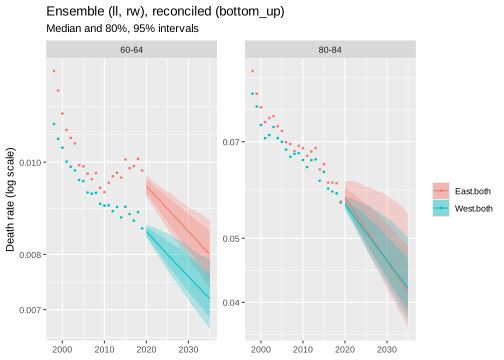
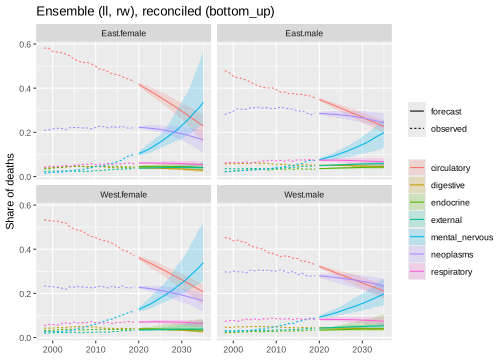

*This vignette is precomputed (`dev/precompute-vignettes.R`) because its
backtests take several minutes.*

Regional mortality forecasts are usually needed at several levels at once:
for each region and sex, for groups of regions, for the country, and often
by cause of death. Forecasts made separately for each of these strata do not
add up, and many cells of small regions hold few deaths. This vignette works
through both problems with deaths in the 16 German Laender, 1998-2019 (the
years before the COVID-19 pandemic):

1. preparation: reading the published tables, estimating cells that the
   source suppresses, and choosing age groups, regions and cause groups;
2. coherent all-cause forecasts for Laender, East and West Germany and
   Germany, by sex;
3. cause-specific forecasts at ages 50 and over, where sparse cells need
   pooling or smoothing.

Every step uses general functions; nothing is specific to Germany or to
regions. The same steps apply to districts, deprivation quintiles or ethnic
groups: a region is one *aggregation layer* among others.


```r
library(mortensor)
library(data.table)
```

## Data

`de_deaths` holds deaths by year, Land, sex, age group and ICD-10 chapter
from the cause-of-death statistics of the Federal Statistical Office
(Destatis), published by the Federal Health Monitoring (GBE-Bund), with the
national total as `region = "Deutschland"`. `de_population` holds the
populations on 31 December by single year of age (GENESIS-Online, table
12411-0013). Both are licensed under the Datenlizenz Deutschland -
Namensnennung - Version 2.0.


```r
head(de_deaths)
#>   year                   region    sex          age   cause deaths
#> 1 1998 Baden-W<U+00FC>rttemberg female Unter 1 Jahr A00-B99     NA
#> 2 1998 Baden-W<U+00FC>rttemberg female Unter 1 Jahr C00-D48      0
#> 3 1998 Baden-W<U+00FC>rttemberg female Unter 1 Jahr D50-D90      0
#> 4 1998 Baden-W<U+00FC>rttemberg female Unter 1 Jahr E00-E90      4
#> 5 1998 Baden-W<U+00FC>rttemberg female Unter 1 Jahr F00-F99      0
#> 6 1998 Baden-W<U+00FC>rttemberg female Unter 1 Jahr G00-H95     NA
head(de_population)
#>   year                   region    sex              age population
#> 1 1997 Baden-W<U+00FC>rttemberg female     unter 1 Jahr      56778
#> 2 1997 Baden-W<U+00FC>rttemberg female 1-J<U+00E4>hrige      55821
#> 3 1997 Baden-W<U+00FC>rttemberg female 2-J<U+00E4>hrige      54814
#> 4 1997 Baden-W<U+00FC>rttemberg female 3-J<U+00E4>hrige      55363
#> 5 1997 Baden-W<U+00FC>rttemberg female 4-J<U+00E4>hrige      57672
#> 6 1997 Baden-W<U+00FC>rttemberg female 5-J<U+00E4>hrige      57879
```

The source suppresses small counts for confidentiality (symbol `"."`, here
`NA`). Suppression concerns 13% of the cells, mostly rare chapters in small
Laender:


```r
d <- as.data.table(de_deaths)[year <= 2019]
d[, .(suppressed = round(mean(is.na(deaths)), 3)), by = .(all_causes = cause == "all")]
#>    all_causes suppressed
#> 1:      FALSE      0.137
#> 2:       TRUE      0.002
d[cause != "all", .(suppressed = round(mean(is.na(deaths)), 3)), by = region][order(-suppressed)][1:5]
#>                    region suppressed
#> 1: Mecklenburg-Vorpommern      0.167
#> 2:     Schleswig-Holstein      0.160
#> 3:       Th<U+00FC>ringen      0.158
#> 4:         Sachsen-Anhalt      0.154
#> 5:                Hamburg      0.153
```

## Preparation

Each step below is a decision of the analyst; the functions make it explicit
and reproducible.

**Reading.** `mt_data()` reads both tables. Stratum variables are region,
sex and cause; the populations have no cause and are shared by all causes.
Suppressed cells are left out with a warning.


```r
x <- mt_data(deaths = de_deaths, population = de_population, by = c("region", "sex", "cause"))
#> Warning in ingest_obs(x, by, age, period, value, measure, age_open, missing =
#> missing, : 41396 missing deaths value(s) left out; suppressed counts can be
#> estimated with mt_fill_suppressed().
x
#> <mt_data> 646 strata by region, sex, cause, omega = 110
#>   deaths     mixed widths (1,5,14) 0-89, 90+; periods 1998-2024 (width 1); 272560 cells
#>   population single years 0-89, 90+; periods 1997-2024 (width 1); 1549184 cells
#>   grid       <mt_axis: age, 91 intervals> 0 1 2 3 ... 88 89 90+
#>              <mt_axis: period, 28 intervals> 1997 1998 1999 2000 ... 2022 2023 2024
```

**Exposures.** The person-years at risk in year *t* are approximated by the
mean of the populations on 31 December of years *t* - 1 and *t*. Then the
years before the pandemic are kept, and the single-year exposures are summed
to the age groups of the deaths (0, 1-14, 15-19, ..., 85-89, 90+):


```r
x <- mt_as_exposure(x, type = "dec31")
x <- mt_subset(x, periods = c(1998, 2019))
x <- mt_regroup(x, age = "deaths")
```

**Suppressed cells.** The published totals constrain the suppressed cells:
the Laender add up to Germany and the chapters to all causes, in every age
group, sex and year. `mt_fill_suppressed()` estimates the suppressed counts
by iterative proportional fitting (raking): starting values proportional to
the exposures are scaled until every published total is matched. The
estimates are marked with provenance `"estimated"`.


```r
h_fill <- mt_hierarchy(region = "Deutschland", cause = list(total = "all", additive = "rates"))
x <- mt_fill_suppressed(x, h_fill)
attr(x, "fill")
#>    filled missing inconsistent iterations      max_gap
#> 1:  33225       0            0       1787 7.721494e-07
mt_validate(x, hierarchy = h_fill)
#> <mt_validation> 3 finding(s): 0 error, 1 warning, 2 info
#>   [warning] no exposure (exposure, Deutschland.female.A00-B99, Deutschland.female.C00-D48, Deutschland.female.E00-E90, Deutschland.female.F00-F99, n = 38): 38 stratum/strata without any exposure; remove them with mt_subset() or add the table
#>   [info] grid coverage (exposure, all, n = 15048): grid cells not covered by observations
#>   [info] hierarchy (deaths,exposure, 67 aggregate strata, n = 0): sums of parts agree with the totals within tolerance
```

The hierarchy states how the totals arise: deaths add up over Laender and
over causes; exposures add up over Laender and are shared by the causes of
a Land (`additive = "rates"`). `mt_validate()` confirms that the published
totals and the filled cells agree, and reports that the national
population is not in the population table (it is not needed, the national
total is rebuilt from the Laender below).

All totals are matched (largest relative gap `max_gap`). The raking
estimates are plausible values constrained to the totals, not observations:
they add no information about the suppressed cells beyond the margins, and
cells of small Laender with rare causes stay uncertain. This matters little
for all causes (33 suppressed cells, all at ages 1-34) and more for
cause-specific forecasts in small Laender.

## All causes: coherent forecasts by Land, East-West and sex

All-cause deaths of the 16 Laender are the bottom series. The national
total is dropped and rebuilt as a sum, together with East and West Germany
(Berlin is counted with the East) and both sexes:


```r
xa <- mt_subset(x, cause == "all", region != "Deutschland", drop = TRUE)
laender <- unique(mt_strata(xa)$region)
east <- c("Berlin", "Brandenburg", "Mecklenburg-Vorpommern", "Sachsen", "Sachsen-Anhalt",
          grep("^Th", laender, value = TRUE))
h <- mt_hierarchy(region = list(total = "Deutschland", groups = list(West = setdiff(laender, east), East = east)),
                  sex = "both")
xh <- mt_aggregate_strata(xa, h)
xh
#> <mt_data> 57 strata by region, sex, omega = 110
#>   deaths     mixed widths (1,5,14) 0-89, 90+; periods 1998-2019 (width 1); 22572 cells
#>   exposure   mixed widths (1,5,14) 0-89, 90+; periods 1998-2019 (width 1); 22572 cells
#>   population mixed widths (1,5,14) 0-89, 90+; periods 1998-2019 (width 1); 22572 cells
#>   grid       <mt_axis: age, 18 intervals> 0 1-14 15-19 20-24 ... 80-84 85-89 90+
#>              <mt_axis: period, 22 intervals> 1998 1999 2000 2001 ... 2017 2018 2019
```

The hierarchy has 57 strata: 32 bottom series (Land by
sex) and their sums. Three ways to coherent forecasts are compared with a
rolling-origin backtest (origins 2008, 2011 and 2014, five years ahead):

* separate Lee-Carter models per stratum, without reconciliation (not
  coherent, for reference);
* separate Lee-Carter models, reconciled by weighted least squares
  (`reconciled(..., method = "wls")`);
* a joint Li-Lee model with a common trend per sex, aggregated bottom-up;
* an equal-weight ensemble of that Li-Lee model and random walks with drift
  observed with noise (`rwd(observation_noise = TRUE)`), aggregated
  bottom-up. The plain random walk is not used here: in small Laender its
  year-to-year changes are mostly Poisson noise, and over 15 years its
  paths reach impossible rates (`mt_forecast()` warns about that).


```r
lev <- mt_strata(xh, h)[, .(label, level)]
specs <- list(
  "Lee-Carter, separate" = lee_carter(),
  "Lee-Carter, WLS" = reconciled(lee_carter(), h, method = "wls"),
  "Li-Lee, bottom-up" = reconciled(li_lee(common_by = "sex"), h, method = "bottom_up"),
  "Ensemble, bottom-up" = reconciled(ensemble(ll = li_lee(common_by = "sex"), rw = rwd(observation_noise = TRUE)),
                                     h, method = "bottom_up"))
bt <- rbindlist(lapply(names(specs), function(n) {
  b <- mt_backtest(specs[[n]], xh, origins = c(2008, 2011, 2014), h = 5, n_draws = 300)
  merge(b, lev, by = "label")[, spec := n]
}))
bt[, .(crps_bottom = mean(crps[level == "bottom"]), crps_aggregate = mean(crps[level != "bottom"]),
       crps_bremen_saarland = mean(crps[level == "bottom" & region %in% c("Bremen", "Saarland")]),
       cov95_bottom = mean(cov95[level == "bottom"]), cov95_aggregate = mean(cov95[level != "bottom"])),
   by = spec][, lapply(.SD, function(v) if (is.numeric(v)) round(v, 3) else v)]
#>                    spec crps_bottom crps_aggregate crps_bremen_saarland
#> 1: Lee-Carter, separate       0.091          0.065                0.133
#> 2:      Lee-Carter, WLS       0.092          0.066                0.133
#> 3:    Li-Lee, bottom-up       0.089          0.064                0.137
#> 4:  Ensemble, bottom-up       0.088          0.061                0.134
#>    cov95_bottom cov95_aggregate
#> 1:        0.820           0.782
#> 2:        0.818           0.716
#> 3:        0.855           0.760
#> 4:        0.903           0.803
```

CRPS is the continuous ranked probability score of the log death rate per
age group and year (lower is better); `cov95` is the share of observed
rates inside the 95% intervals (target 0.95). Pooling the Laender of one
sex into a common trend (Li-Lee) is more accurate than separate models,
and the ensemble with random walks is the most accurate and the best
calibrated. All models are too narrow for the aggregates, as single models
usually are on real data, where trends change; the ensemble comes
closest to nominal coverage.

### Forecasts

The ensemble is fitted to all years and forecast to 2035:


```r
fit <- mt_fit(specs[["Ensemble, bottom-up"]], xh)
fc <- mt_forecast(fit, to = 2035, n_draws = 1000, seed = 1)
```

Life expectancy at birth is computed path by path. The smallest Laender
have the widest intervals:


```r
e0 <- life_expectancy(fc, at = 0)
e0[region %in% c("Deutschland", "West", "East", "Bremen", "Saarland") & sex == "both" & period %in% c(2020, 2035),
   .(region, period, q0.025 = round(q0.025, 1), q0.5 = round(q0.5, 1), q0.975 = round(q0.975, 1))]
#>          region period q0.025 q0.5 q0.975
#>  1:      Bremen   2020   80.3 80.7   81.2
#>  2:      Bremen   2035   81.3 82.7   84.6
#>  3:    Saarland   2020   80.0 80.4   80.8
#>  4:    Saarland   2035   81.1 82.5   84.1
#>  5:        West   2020   81.4 81.5   81.7
#>  6:        West   2035   82.5 83.7   84.8
#>  7:        East   2020   80.7 80.9   81.1
#>  8:        East   2035   81.8 83.5   84.2
#>  9: Deutschland   2020   81.2 81.4   81.6
#> 10: Deutschland   2035   82.4 83.6   84.6
```

`mt_contrast()` computes the East-West gap path by path, so its interval
includes the joint uncertainty of both regions:


```r
gap <- mt_contrast(fc, var = "region", ref = "West", at = 0)
gap[level == "East" & period %in% c(2020, 2035),
    .(sex, period, q0.025 = round(q0.025, 2), q0.5 = round(q0.5, 2), q0.975 = round(q0.975, 2), p_positive)]
#>       sex period q0.025  q0.5 q0.975 p_positive
#> 1: female   2020  -0.31  0.00   0.29      0.498
#> 2: female   2035  -0.70  0.20   1.38      0.637
#> 3:   male   2020  -1.41 -1.16  -0.91      0.000
#> 4:   male   2035  -1.86 -0.91   0.12      0.040
#> 5:   both   2020  -0.83 -0.61  -0.41      0.000
#> 6:   both   2035  -1.06 -0.40   0.57      0.233
```


```r
mt_plot_forecast(fc, ages = c("60-64", "80-84"), strata = c("East.both", "West.both"))
```



## Causes of death at ages 50 and over

**Cause groups.** Deaths by ICD-10 chapter are sparse in small Laender.
`de_cause_groups` keeps the large chapters (neoplasms, circulatory,
respiratory, digestive diseases, endocrine diseases, external causes) and
combines mental and nervous system disorders, because dementia is coded in
both chapters and the coding shifted between them over time. All other
chapters form the rest, the total minus the groups. The analysis starts at
age 50, where most groups have enough deaths.


```r
de_cause_groups
#> $neoplasms
#> [1] "C00-D48"
#> 
#> $circulatory
#> [1] "I00-I99"
#> 
#> $respiratory
#> [1] "J00-J99"
#> 
#> $digestive
#> [1] "K00-K93"
#> 
#> $mental_nervous
#> [1] "F00-F99" "G00-H95"
#> 
#> $endocrine
#> [1] "E00-E90"
#> 
#> $external
#> [1] "S00-T98"
xc <- mt_subset(x, region != "Deutschland", ages = c(50, Inf))
xc <- mt_group_levels(xc, "cause", de_cause_groups, other = "rest", total = "all", additive = "rates")
xc
#> <mt_data> 288 strata by region, sex, cause, omega = 110
#>   deaths     5-year groups 50-89, 90+; periods 1998-2019 (width 1); 57024 cells
#>   exposure   5-year groups 50-89, 90+; periods 1998-2019 (width 1); 57024 cells
#>   population 5-year groups 50-89, 90+; periods 1998-2019 (width 1); 57024 cells
#>   grid       <mt_axis: age, 9 intervals> 50-54 55-59 60-64 65-69 ... 80-84 85-89 90+
#>              <mt_axis: period, 22 intervals> 1998 1999 2000 2001 ... 2017 2018 2019
```

The cause-specific forecasts are wanted for the Laender, for East and
West Germany and for Germany. One hierarchy crosses both aggregation
layers: deaths add up over Laender and over causes, exposures over Laender
only.


```r
hc <- mt_hierarchy(region = list(total = "Deutschland", groups = list(West = setdiff(laender, east), East = east)),
                   cause = list(total = "all", additive = "rates"))
xcc <- mt_aggregate_strata(xc, hc)
xcc
#> <mt_data> 342 strata by region, sex, cause, omega = 110
#>   deaths     5-year groups 50-89, 90+; periods 1998-2019 (width 1); 67716 cells
#>   exposure   5-year groups 50-89, 90+; periods 1998-2019 (width 1); 67716 cells
#>   population 5-year groups 50-89, 90+; periods 1998-2019 (width 1); 67716 cells
#>   grid       <mt_axis: age, 9 intervals> 50-54 55-59 60-64 65-69 ... 80-84 85-89 90+
#>              <mt_axis: period, 22 intervals> 1998 1999 2000 2001 ... 2017 2018 2019
mt_validate(xcc, hierarchy = hc)
#> <mt_validation> 1 finding(s): 0 error, 0 warning, 1 info
#>   [info] hierarchy (deaths,exposure, 86 aggregate strata, n = 0): sums of parts agree with the totals within tolerance
```

Causes share the population of their stratum, so their rates add up to
the all-cause rate.

**Sparse cells.** The share of cells with fewer than 5 deaths, by cause
group, in the two smallest Laender and in all others:


```r
o <- mt_obs(xc)
o[, .(cells_below_5 = round(mean(value < 5), 3)), by = .(cause, bremen_saarland = region %in% c("Bremen", "Saarland"))][
  , dcast(.SD, cause ~ bremen_saarland, value.var = "cells_below_5")]
#>             cause FALSE  TRUE
#> 1:            all 0.000 0.000
#> 2:    circulatory 0.000 0.000
#> 3:      digestive 0.000 0.020
#> 4:      endocrine 0.021 0.199
#> 5:       external 0.001 0.144
#> 6: mental_nervous 0.004 0.106
#> 7:      neoplasms 0.000 0.000
#> 8:    respiratory 0.008 0.057
#> 9:           rest 0.001 0.027
```

Two remedies are compared: **pooling**, by a joint Li-Lee model with a
common trend per sex and cause (the Laender deviate from it with stationary
factors), and **smoothing**, by Whittaker smoothing of the log rates over
age before fitting (a preprocessing step, so in the backtest it sees only
the training years). Forecasts of the causes are summed bottom-up to all
causes, which keeps them coherent.


```r
smooth <- mt_prep(step_smooth(method = "whittaker"))
levc <- mt_strata(xcc, hc)[, .(label, level)]
specs_c <- list(
  "Lee-Carter" = list(reconciled(lee_carter(), hc, method = "bottom_up"), NULL),
  "Li-Lee" = list(reconciled(li_lee(common_by = c("sex", "cause")), hc, method = "bottom_up"), NULL),
  "Li-Lee, smoothed" = list(reconciled(li_lee(common_by = c("sex", "cause")), hc, method = "bottom_up"), smooth),
  "Ensemble, smoothed" = list(reconciled(ensemble(ll = li_lee(common_by = c("sex", "cause")),
                                                  rw = rwd(observation_noise = TRUE)), hc, method = "bottom_up"),
                              smooth))
btc <- rbindlist(lapply(names(specs_c), function(n) {
  b <- mt_backtest(specs_c[[n]][[1]], xcc, origins = c(2008, 2011, 2014), h = 5, n_draws = 300,
                   prep = specs_c[[n]][[2]])
  merge(b, levc, by = "label")[, spec := n]
}))
#> Warning in check_draws_plausible(arr, fit$age, fit$strata, spec$label):
#> Lee-Carter: forecast death rates above 1 in 19.3% of the draws (strata
#> Bremen.female.respiratory, Bremen.female.mental_nervous,
#> Bremen.male.mental_nervous; ages 50-54, 85-89). The model is unstable here,
#> often because of sparse counts; consider wider age groups (mt_regroup()),
#> pooling (li_lee(common_by = )), smoothing (step_smooth()) or an ensemble.
#> Warning in check_draws_plausible(arr, fit$age, fit$strata, spec$label):
#> Lee-Carter: forecast death rates above 1 in 7.0% of the draws (strata
#> Bremen.male.mental_nervous, Bremen.male.external; ages 80-84, 85-89). The model
#> is unstable here, often because of sparse counts; consider wider age groups
#> (mt_regroup()), pooling (li_lee(common_by = )), smoothing (step_smooth()) or an
#> ensemble.
#> Warning in check_draws_plausible(arr, fit$age, fit$strata, spec$label):
#> Lee-Carter: forecast death rates above 1 in 4.3% of the draws (strata
#> Bremen.male.mental_nervous, Bremen.male.external; ages 85-89). The model is
#> unstable here, often because of sparse counts; consider wider age groups
#> (mt_regroup()), pooling (li_lee(common_by = )), smoothing (step_smooth()) or an
#> ensemble.
btc[, .(crps_causes_laender = mean(crps[level == "bottom"]),
        crps_causes_bremen_saarland = mean(crps[level == "bottom" & region %in% c("Bremen", "Saarland")]),
        crps_germany = mean(crps[region == "Deutschland"]),
        cov95_laender = mean(cov95[level == "bottom"]), cov95_germany = mean(cov95[region == "Deutschland"])),
    by = spec][, lapply(.SD, function(v) if (is.numeric(v)) round(v, 3) else v)]
#>                  spec crps_causes_laender crps_causes_bremen_saarland
#> 1:         Lee-Carter               0.133                       0.198
#> 2:             Li-Lee               0.125                       0.184
#> 3:   Li-Lee, smoothed               0.121                       0.171
#> 4: Ensemble, smoothed               0.115                       0.167
#>    crps_germany cov95_laender cov95_germany
#> 1:        0.061         0.884         0.753
#> 2:        0.068         0.870         0.721
#> 3:        0.066         0.864         0.722
#> 4:        0.058         0.911         0.737
```

Pooling (Li-Lee) and smoothing both improve the cause-specific forecasts
of the Laender, most in the small Laender, and the ensemble with
noise-robust random walks is the most accurate and the best calibrated.
Separate Lee-Carter models produce implausible paths for sparse causes in
Bremen (see the warnings). The national cause-specific intervals stay too
narrow (95% coverage about 0.74), as for all causes. All forecasts add up:
the national cause-specific forecasts are sums of the Laender, and the
causes add up to all causes.

### Forecasts by cause


```r
spc <- specs_c[["Ensemble, smoothed"]][[1]]
fcc <- mt_forecast(mt_fit(spc, xcc, prep = smooth), to = 2035, n_draws = 500, seed = 2)
#> Warning in check_draws_plausible(arr, fit$age, fit$strata, spec$label): Random
#> walk with drift plus noise: forecast death rates above 1 in 0.6% of the draws
#> (strata Berlin.female.mental_nervous; ages 85-89). The model is unstable here,
#> often because of sparse counts; consider wider age groups (mt_regroup()),
#> pooling (li_lee(common_by = )), smoothing (step_smooth()) or an ensemble.
```

Age-standardised death rates at ages 50 and over (per 100,000 of the
European Standard Population 2013 aged 50 and over) in 2035, and the
difference between East and West Germany by cause:


```r
a <- asr(fcc)
a[region %in% c("Deutschland", "Bremen") & sex == "female" & period == 2035,
  .(region, cause, q0.025 = round(q0.025), q0.5 = round(q0.5), q0.975 = round(q0.975))]
#>          region          cause q0.025 q0.5 q0.975
#>  1:      Bremen      neoplasms    404  466    534
#>  2:      Bremen    circulatory    346  463    570
#>  3:      Bremen    respiratory    122  194    677
#>  4:      Bremen      digestive     43   73    129
#>  5:      Bremen mental_nervous    107  638   4811
#>  6:      Bremen      endocrine     35   67    200
#>  7:      Bremen       external     36   60    222
#>  8:      Bremen            all   1691 2451   6434
#>  9:      Bremen           rest    172  332    671
#> 10: Deutschland      neoplasms    417  434    460
#> 11: Deutschland    circulatory    419  493    574
#> 12: Deutschland    respiratory    128  156    207
#> 13: Deutschland      digestive     61   72     79
#> 14: Deutschland mental_nervous    534  795   1719
#> 15: Deutschland      endocrine     66   86    167
#> 16: Deutschland       external     73   93    154
#> 17: Deutschland           rest    211  256    343
#> 18: Deutschland            all   2038 2422   3491
d <- mt_contrast(fcc, var = "region", ref = "West", quantity = "asr")
d[level == "East" & period == 2035,
  .(sex, cause, q0.025 = round(q0.025), q0.5 = round(q0.5), q0.975 = round(q0.975), p_positive)]
#>        sex          cause q0.025 q0.5 q0.975 p_positive
#>  1: female      neoplasms    -35  -11     13      0.206
#>  2:   male      neoplasms      8   64    117      0.992
#>  3: female    circulatory    -38   54    154      0.896
#>  4:   male    circulatory    -17   88    190      0.948
#>  5: female    respiratory    -67  -28     -2      0.020
#>  6:   male    respiratory    -62  -13     33      0.272
#>  7: female      digestive    -13   -1      9      0.422
#>  8:   male      digestive      9   22     34      1.000
#>  9: female mental_nervous   -773   -2   1218      0.496
#> 10:   male mental_nervous   -402   46    425      0.570
#> 11: female      endocrine   -105   14     71      0.744
#> 12:   male      endocrine   -218   10     50      0.640
#> 13: female       external    -73    4     47      0.590
#> 14:   male       external    -27   30     73      0.918
#> 15: female           rest   -174  -43     82      0.246
#> 16:   male           rest   -238  -50    145      0.236
#> 17: female            all   -795  -13   1153      0.480
#> 18:   male            all   -482  176    583      0.786
```


```r
mt_plot_shares(fcc, groups = c("West.female", "East.female", "West.male", "East.male"),
               causes = names(de_cause_groups))
```



The intervals of Bremen are wider than those of Germany, as they should
be: pooling borrows strength for the trend, but the variation of deaths in
a small population remains.

The group of mental and nervous system disorders stands out: its intervals
for 2035 are very wide, and they widen the all-cause intervals of the
bottom-up sums. Deaths in this group rose steeply between 1998 and 2019,
partly because dementia was increasingly coded as the underlying cause.
Extrapolating that trend over 16 years is uncertain, and the forecast says
so. For such causes, a shorter horizon or a fitting period that starts
after the coding changes (`step_window()`, compared in a backtest) is more
defensible than a long extrapolation; the gaps between East and West
Germany by cause are better determined than the levels.

## Summary of the decisions

| Step | Decision here | Function |
|---|---|---|
| Exposure | mean of 31 December populations | `mt_as_exposure(type = "dec31")` |
| Period | 1998-2019, before the pandemic | `mt_subset(periods = )` |
| Age groups | age groups of the deaths; causes from 50 | `mt_regroup(age = "deaths")`, `mt_subset(ages = )` |
| Suppressed cells | raking to Land and national totals | `mt_fill_suppressed()` |
| Aggregation layers | East and West; cause groups and rest | `mt_hierarchy(groups = )`, `mt_group_levels()` |
| Shared exposures | causes share the population of their Land | `mt_hierarchy(cause = list(additive = "rates"))` |
| Sparse cells | pooling and Whittaker smoothing | `li_lee(common_by = )`, `step_smooth()` |
| Coherence | bottom-up sums of a joint model | `reconciled()` |
| Calibration | ensemble with noise-robust random walks | `ensemble()`, `rwd(observation_noise = TRUE)` |
